<p align="center">
  
</p>

<p align="center">
  <a href="https://pokeverse.pages.dev/"><strong>Abrir a plataforma ao vivo</strong></a>
  &nbsp;·&nbsp;
  <a href="docs/capitulo-zero-como-tudo-comecou.md">Capítulo Zero: como tudo começou</a>
  &nbsp;·&nbsp;
  <a href="docs/00-visao-geral-e-roadmap.md">Roadmap</a>
  &nbsp;·&nbsp;
  <a href="docs/ARCHITECTURE.md">Contrato de Qualidade</a>
  &nbsp;·&nbsp;
  <a href="#documentação">Documentação</a>
</p>

<p align="center">
  
  
  
  
  
  
  
  
  
  
</p>

# PokéVerse OS

**Uma Pokédex 3D skeuomórfica, com tampa que gira, LEDs, metal e vidro, construída sobre uma plataforma full-stack real.** Ela tem autenticação segura, cache distribuído, mensageria, deploy em nuvem e uma auditoria visual automatizada que reprova regressões de contraste e layout.

O projeto começou como a **atividade final de Front-end no Senac**: uma Pokédex em HTML, CSS e JavaScript puro. Eu gostei do tema e decidi continuar por conta própria. O resultado é este monorepo. A história completa está no **[Capítulo Zero](docs/capitulo-zero-como-tudo-comecou.md)**, junto com o README original, preservado como recordação.

<p align="center">
  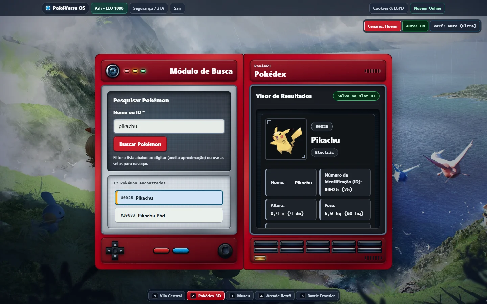
</p>

---

## Sumário

1. [Estado atual em um olhar](#estado-atual-em-um-olhar)
2. [Galeria](#galeria)
3. [Arquitetura](#arquitetura)
4. [Fluxos principais](#fluxos-principais)
5. [Modelo de dados](#modelo-de-dados)
6. [API](#api)
7. [Qualidade, testes e CI/CD](#qualidade-testes-e-cicd)
8. [Segurança e privacidade](#segurança-e-privacidade)
9. [Performance](#performance)
10. [Roadmap: o que vem a seguir](#roadmap-o-que-vem-a-seguir)
11. [Como executar](#como-executar)
12. [Estrutura do repositório](#estrutura-do-repositório)
13. [Documentação](#documentação)
14. [Princípios de engenharia](#princípios-de-engenharia)
15. [Créditos e avisos](#créditos-e-avisos)

---

## Estado atual em um olhar

A plataforma tem **cinco módulos**, acessíveis pelo dock inferior (atalhos `1` a `5`). Hoje a prioridade é o módulo 2, a Pokédex, que vai virar a enciclopédia Pokémon mais completa possível. Os outros módulos usarão os dados dela.

| # | Módulo | Rota | Acesso | Estado | Progresso |
| :-: | :--- | :--- | :---: | :--- | :--- |
| 1 | **Vila Central** (overworld 2D/HD-2D) | `/mundo` | Treinador | 🚧 Tela de status | `█░░░░░░░░░` 18% |
| 2 | **Pokédex 3D** | `/` e `/pokedex` | Público | ✅ **Em produção** | `██████████` Fase 4A |
| 3 | **Museu das Regiões** | `/museu` | Público | 🟡 Base com 6 gerações | `███░░░░░░░` 36% |
| 4 | **Arcade Retrô** (WASM + cloud saves) | `/arcade` | Treinador | 🚧 Tela de status | `█░░░░░░░░░` 14% |
| 5 | **Battle Frontier** (PvE/PvP e mini-games) | `/arena` | Treinador | 🚧 Tela de status | `██░░░░░░░░` 28% |

> Os percentuais são os exibidos nas telas de módulo em construção ([`under-construction.data.ts`](apps/web/src/app/features/under-construction/under-construction.data.ts)). Eles medem preparação (modelagem, contratos, schema), não entrega do módulo.

### O que já funciona

<table>
<tr>
<td width="50%" valign="top">

**Pokédex 3D e experiência**

- Chassi skeuomórfico fiel, com luz que segue o ponteiro, microtexturas WebP, dobradiça, lente de safira e LEDs reativos
- Abertura e fechamento 3D **reversíveis em voo**
- Catálogo completo da PokéAPI (1351 entradas) com busca por ID ou nome, chave fonética PT/EN e aproximação Damerau-Levenshtein
- Seleção em 2 passos: o 1º clique destaca, o 2º (ou `A` / `Enter`) abre no visor
- Botão vermelho com **histórico progressivo** de navegação
- **10 slots azuis** de gravação, com luz azul (livre) ou verde (ocupado), 1 Pokémon por botão e apelidos
- 4 cenários (**Hoenn, Cidade, Vila, Floresta**), modo Auto e detector de hardware
- Dock inferior em vidro translúcido e HUD compacta com ticker ao vivo

</td>
<td width="50%" valign="top">

**Plataforma e back-end**

- Proxy e cache da PokéAPI no Redis: 24 h de TTL e `stale-fallback` de 7 dias
- Sessões **BFF opacas** no Redis, cookie `HttpOnly` e zero JWT no JavaScript do navegador
- MFA: **TOTP** com QR Code e 8 códigos de backup, **Passkeys WebAuthn** e **Google OAuth PKCE**
- Verificação de e-mail e recuperação de senha por **OTP**
- **Transactional Outbox**, Redpanda/Kafka, consumidores idempotentes e DLQ
- Gateway WebSocket `/ws/world` com ticker global
- Banner de cookies e **LGPD** (consentimento versionado, exportação JSON e eliminação em cascata `DELETE /auth/me`)
- Deploy contínuo em **Cloudflare Pages + Azure Container Apps**

</td>
</tr>
</table>

### Domínio futuro já modelado

Estes módulos estão em [`@pokeverse/shared`](packages/shared/src) com testes, mas ainda **sem tela nem endpoint**:

- **Catálogo dos 51 endpoints da PokéAPI v2** com modelo de filtros avançados: [`pokeapi-endpoints.ts`](packages/shared/src/domain/pokeapi-endpoints.ts)
- **Laboratório Genético**: atributos e XP por nível, chance de evolução, clonagem e replicação, e conversão em **Bio-Essência** (ranks `E`, `D`, `C`, `B`, `A`, `S` e `APEX`): [`pokemon-lab.ts`](packages/shared/src/domain/pokemon-lab.ts)

---

## Galeria

### Pokédex 3D

<table>
<tr>
<td width="50%"><br><sub><b>Fechada:</b> tampa, dobradiça lateral, lente de safira e LEDs.</sub></td>
<td width="50%"><br><sub><b>Aberta:</b> módulo de busca, D-pad, botões e visor de resultados.</sub></td>
</tr>
</table>

### Módulos e responsividade

<table>
<tr>
<td width="50%"><br><sub><b>Museu:</b> 6 gerações, cada uma com um inicial para inspecionar na Pokédex.</sub></td>
<td width="50%">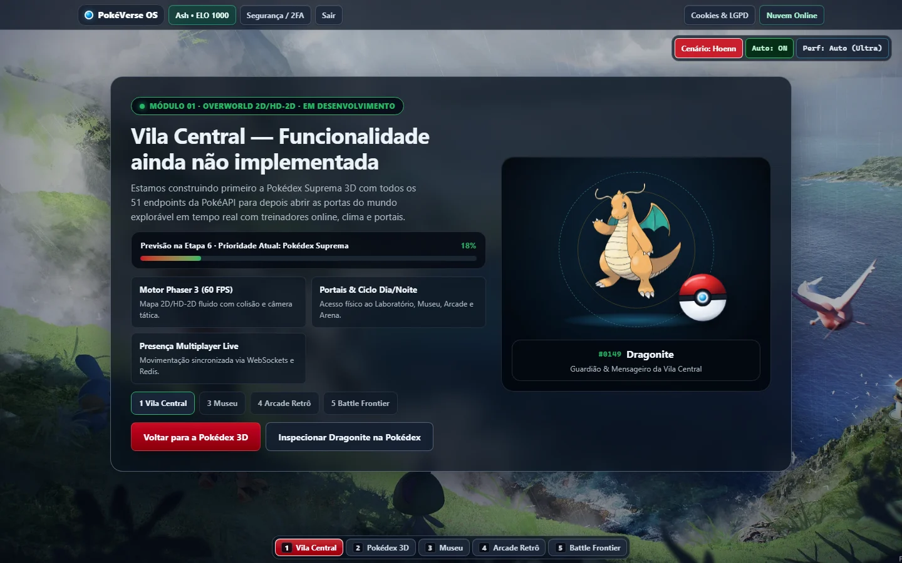<br><sub><b>Em construção:</b> telas dedicadas, com especificação e progresso por módulo.</sub></td>
</tr>
</table>

<table>
<tr>
<td align="center" width="50%">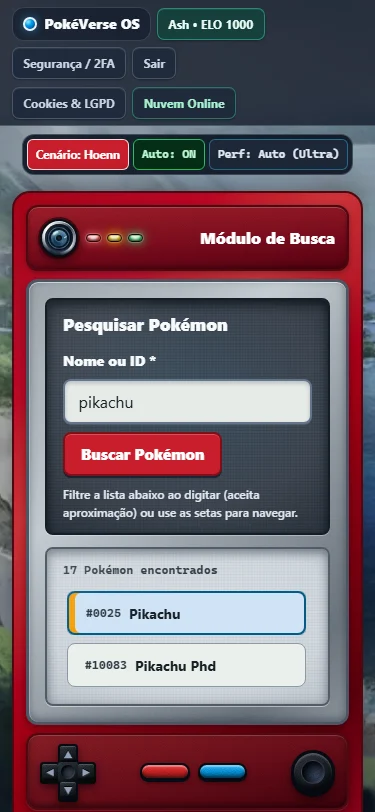<br><sub><b>Mobile (375×812):</b> a tampa gira no eixo X.</sub></td>
<td align="center" width="50%"><br><sub><b>Museu no mobile</b></sub></td>
</tr>
</table>

### Cenários

<table>
<tr>
<td width="50%"><br><sub><b>Hoenn</b></sub></td>
<td width="50%">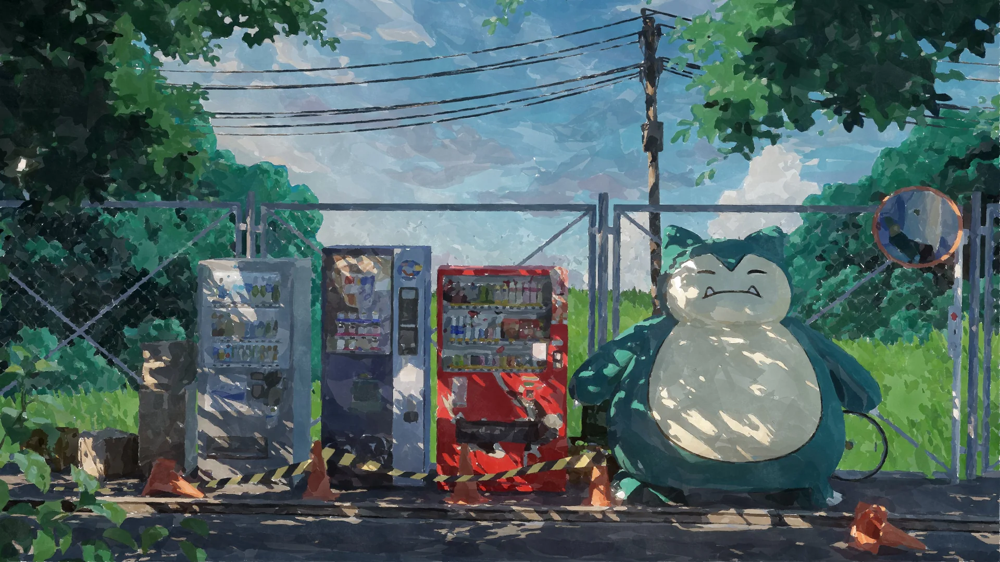<br><sub><b>Cidade</b></sub></td>
</tr>
<tr>
<td width="50%"><br><sub><b>Vila</b></sub></td>
<td width="50%"><br><sub><b>Floresta</b></sub></td>
</tr>
</table>

> As capturas foram geradas automaticamente com Chrome headless sobre o build de produção, em `1440×900` e `375×812`. Para refazê-las, consulte [`docs/assets/README.md`](docs/assets/README.md).

---

## Arquitetura

### Visão de contexto


O proxy **same-origin** é essencial: os cookies `HttpOnly` de sessão ficam no domínio do front-end, o CSP pode ser estrito e o CSRF fica mais simples de defender.

### Monorepo e dependências

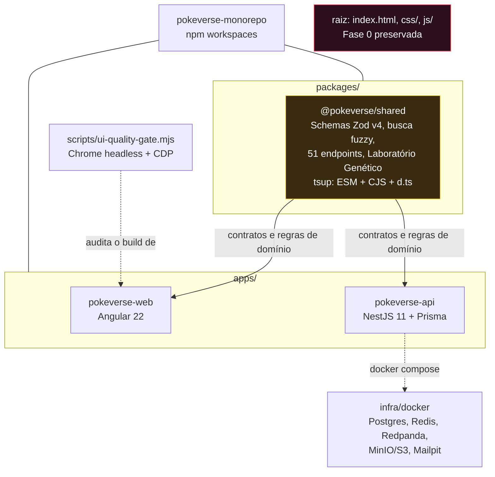

**Regra de ouro:** contratos Zod, schemas de eventos e regras de domínio vivem **somente** em `@pokeverse/shared`. Front-end e back-end importam de lá e nunca duplicam.

### Stack em detalhe

| Camada | Tecnologias |
| :--- | :--- |
| **Front-end** | Angular 22 (Standalone, Signals, Zoneless, `@defer`), SCSS com tokens `oklch`, `socket.io-client` e `@simplewebauthn/browser` carregados sob demanda |
| **Back-end** | NestJS 11, Express, Socket.IO, Helmet, Throttler com storage em Redis, `argon2` (Argon2id), `qrcode`, `nodemailer` |
| **Dados** | PostgreSQL com Prisma 6.19 (13 modelos), Redis 7 via `ioredis`, Kafka via `kafkajs` (Redpanda no local, Aiven na nuvem) |
| **Contratos** | Zod v4 em `@pokeverse/shared`, compilado com `tsup` |
| **Qualidade** | Vitest 5, Jest 30, ESLint 9, Prettier, SonarCloud, UI Quality Gate próprio |
| **Infra** | Docker multi-stage não-root, GitHub Actions, Cloudflare Pages, Azure Container Apps, Neon, Upstash, Aiven, Resend |

---

## Fluxos principais

### Busca de Pokémon com cache e degradação graciosa

A Pokédex **nunca fica inutilizável**. Se a API estiver fora do ar, o front-end consulta a PokéAPI direto e o visitante continua navegando.

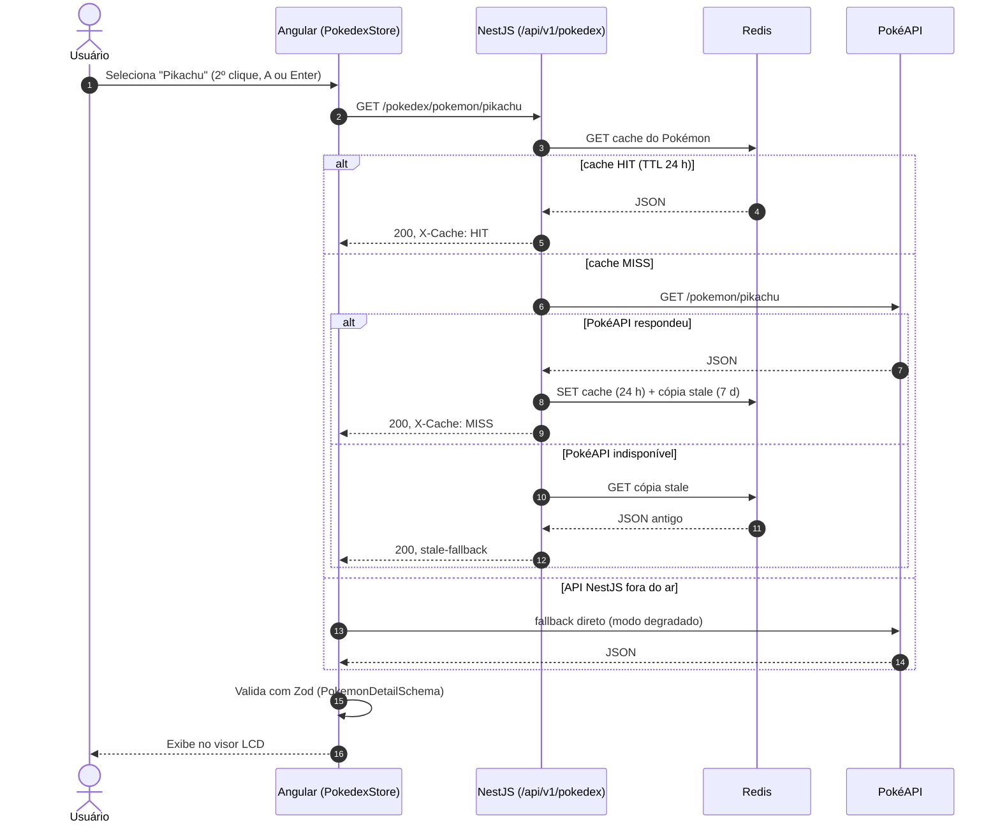

### Controles da Pokédex: a máquina de estados do botão vermelho

O botão vermelho volta **um passo por clique**, para o usuário nunca se perder em uma lista de 1351 itens.

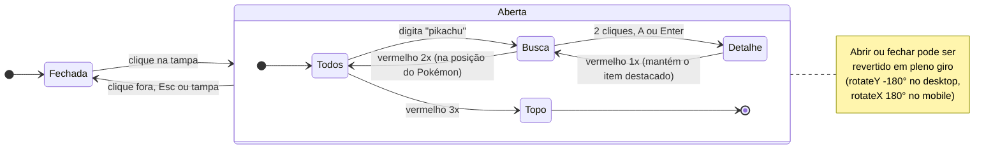

### Autenticação BFF com MFA

Nenhum token de acesso chega ao JavaScript. A sessão é um identificador **opaco** guardado em cookie `HttpOnly`, e o estado vive no Redis, o que permite revogação instantânea.

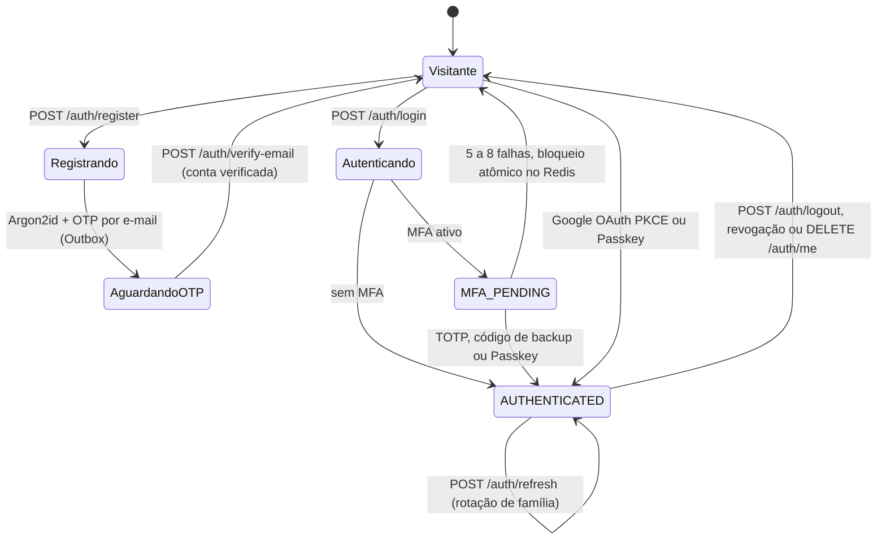

### Eventos confiáveis: Transactional Outbox

O envio de e-mail e a atualização do ticker **nunca** acontecem no meio de uma transação de banco. O evento é gravado junto com o dado e publicado depois, de forma atômica e idempotente.

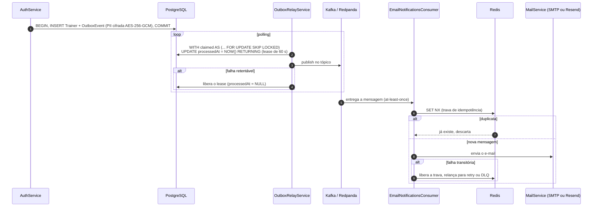

**Tópicos Kafka** (definidos em [`events.schemas.ts`](packages/shared/src/schemas/events.schemas.ts)):

| Tópico | Uso |
| :--- | :--- |
| `pokeverse.world.events.v1` | Eventos do mundo e ticker global (`/ws/world`) |
| `pokeverse.notifications.email.v1` | E-mails transacionais (OTP, recuperação) |
| `pokeverse.arcade.savestate.v1` | Cloud saves do Arcade (reservado) |
| `pokeverse.battle.matchmaking.v1` | Matchmaking da Arena (reservado) |
| `pokeverse.battle.results.v1` | Resultados de batalhas (reservado) |
| `pokeverse.dlq.v1` | Dead Letter Queue, com payload e metadados de erro |

---

## Modelo de dados

O schema Prisma tem **13 modelos** e 2 migrações. Os módulos futuros (Arcade, Arena, times) já têm tabelas para não exigir reestruturação depois.

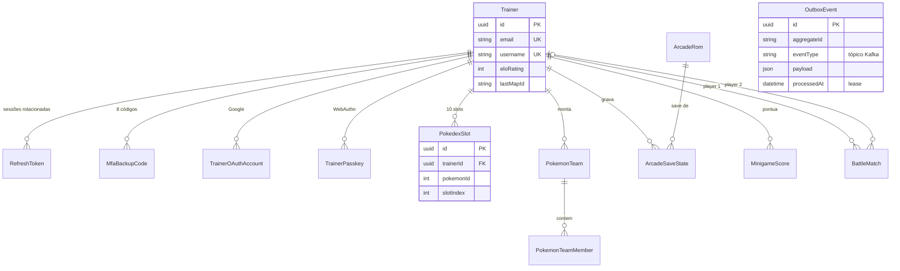

`OutboxEvent` não tem relação com `Trainer` de propósito: ele é infraestrutura de mensageria. Há um índice parcial `idx_outbox_pending` para o polling.

---

## API

Prefixo global `/api/v1` (exceto `/health`). Validação de entrada com Zod na fronteira, `CsrfOriginGuard` e throttling em Redis.

| Domínio | Método e rota | Descrição |
| :--- | :--- | :--- |
| **Saúde** | `GET /health/live` · `GET /health/ready` | Liveness e readiness (Postgres, Redis, Kafka e S3) |
| **Sistema** | `GET /system/bootstrap` | Fase atual e módulos da plataforma |
| **Pokédex** | `GET /pokedex/catalog` | Catálogo completo (cache Redis) |
| | `GET /pokedex/pokemon/:idOrName` | Detalhe de um Pokémon (cache Redis) |
| | `GET /pokedex/slots` | Lista os slots do treinador |
| | `PUT /pokedex/slots/:index` | Grava um slot (`409` se o Pokémon já estiver em outro) |
| | `DELETE /pokedex/slots/:index` · `DELETE /pokedex/slots` | Remove um slot ou todos (atômico) |
| **Auth** | `GET /auth/providers` · `GET /auth/session` | Provedores ativos e estado da sessão |
| | `POST /auth/register` · `login` · `refresh` · `logout` | Ciclo de vida da conta e da sessão |
| | `POST /auth/verify-email` · `resend-verification` | Verificação por OTP |
| | `POST /auth/forgot-password` · `reset-password` | Recuperação por OTP |
| | `GET /auth/me` · `me/export` · `DELETE /auth/me` | Perfil, portabilidade e eliminação em cascata (LGPD) |
| | `GET /auth/sessions` · `POST /auth/sessions/revoke-others` | Gestão de dispositivos |
| **Google** | `GET /auth/google/start` · `callback` · `DELETE /auth/google` | OAuth com PKCE e vínculo de conta |
| **MFA** | `GET /auth/security/overview` | Painel de segurança |
| | `POST /auth/mfa/totp/setup` · `enable` · `disable` · `POST /auth/mfa/verify` | TOTP e códigos de backup |
| | `GET /auth/passkeys` · `DELETE /auth/passkeys/:id` | Gestão de Passkeys |
| | `POST /auth/passkeys/register/{options,verify}` · `login/{options,verify}` | Fluxos WebAuthn |
| **Tempo real** | `WS /ws/world` | Ticker global (Socket.IO) |

---

## Qualidade, testes e CI/CD

### Pipeline

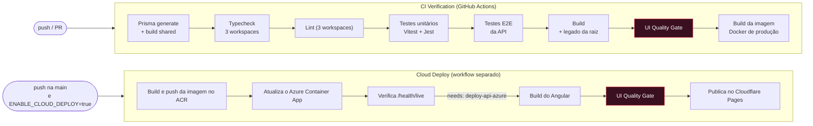

### UI Quality Gate

`npm run audit:ui` ([`scripts/ui-quality-gate.mjs`](scripts/ui-quality-gate.mjs)) abre o **bundle compilado** em Chrome headless via CDP, em Desktop (`1440×900`) e Mobile (`375×812`). Ele percorre `/`, `/pokedex?q=pikachu`, `/museu` e `/mundo`, e **reprova o build** quando encontra:

| Verificação | Critério de reprovação |
| :--- | :--- |
| Texto sobre cenário sem fundo adequado | `effectiveSurfaceAlpha < 0.55` |
| Contraste WCAG AA | `< 4.5:1` (texto normal) ou `< 3.0:1` (texto grande), também simulado sobre fundo diurno claro |
| Layout | Overflow horizontal, clipping lateral ou texto vazando de botões e caixas |
| Tipografia e console | Fonte menor que `10.5px` ou erros no console |

### Testes

| Workspace | Runner | Testes |
| :--- | :--- | :-: |
| `@pokeverse/shared` | Vitest 5 | 15 (3 arquivos) |
| `pokeverse-api` (unit) | Jest 30 | 32 (12 suítes) |
| `pokeverse-api` (E2E) | Jest + Supertest | 8 (1 suíte) |
| `pokeverse-web` | Vitest 5 + TestBed | 18 (1 arquivo) |
| **Total** | | **65 unitários + 8 E2E (73 verificações)** |

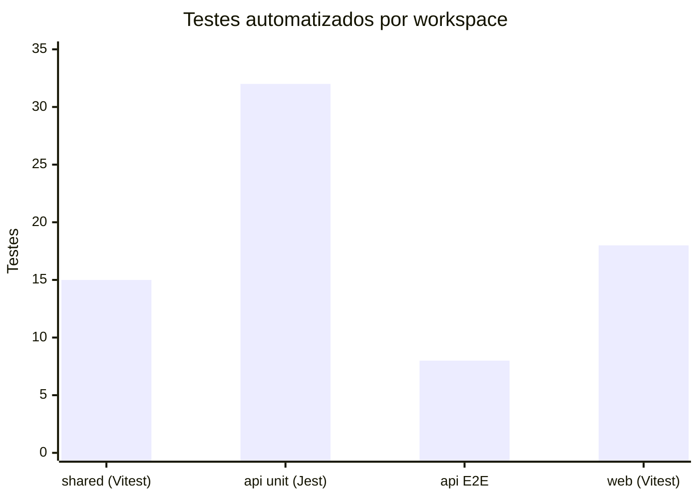

Os testes cobrem busca fuzzy, regras do Laboratório, schemas, `PokeApiCacheService`, `PokedexSlotsService`, TOTP, Passkeys WebAuthn, OAuth PKCE, consumidores Kafka, Outbox, deleção LGPD, expurgo temporal, health, bootstrap e a Pokédex (incluindo slots azuis e `PrivacyConsentStore`).

### Bundle do front-end

`495.13 kB` raw e `127.35 kB` de transferência estimada no bundle inicial. O CSS global tem `67.44 kB` (`11.51 kB` transferido) e o `main` tem `36.61 kB` (`10.06 kB` transferido). O resto é carregado sob demanda: Pokédex (`83.51 kB`), `socket.io-client` (`42.17 kB`), telas em construção (`23.16 kB`), configurações de segurança (`18.18 kB`), diálogo de visitante (`18.02 kB`), diálogo de privacidade/LGPD (`10.70 kB`) e Museu (`4.49 kB`).

---

## Segurança e privacidade

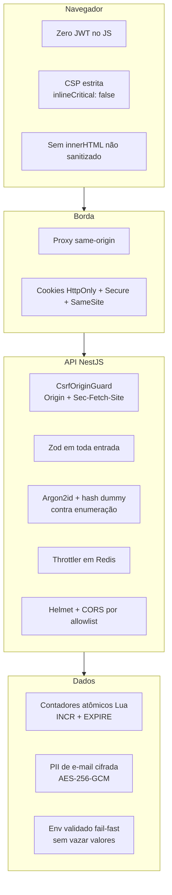

| Tema | Como está resolvido |
| :--- | :--- |
| **Sessão** | Opaca, no Redis, com `MFA_PENDING` → `AUTHENTICATED`, rotação de refresh por família e revogação instantânea |
| **MFA** | TOTP (QR Code + 8 backup codes), Passkeys WebAuthn e proteção contra *account takeover* no Google PKCE |
| **Concorrência** | Zero TOCTOU em contadores (Lua), zero efeito externo antes da constraint `UNIQUE`, lease atômico no Outbox e rollback de idempotência no `catch` |
| **LGPD** | Cookie de consentimento versionado (`pokeverse_consent`, 180 dias), chaves não essenciais registradas declarativamente, portabilidade em `GET /auth/me/export`, eliminação definitiva em cascata via `DELETE /auth/me` (confirmação em 2 etapas na UI), expurgo temporal de tokens/eventos expirados e zero rastreadores de terceiros |
| **Infra** | Imagem Docker multi-stage não-root, secrets só em variáveis de ambiente, TLS e mTLS nos serviços gerenciados |
| **Observabilidade** | Logs JSON estruturados, `x-correlation-id` e `traceparent` W3C, health checks separados de liveness e readiness |

Os detalhes estão no [Dossiê 13](docs/13-dossie-de-seguranca-e-blindagem.md) e no [documento de cookies e LGPD](docs/16-cookies-lgpd-e-requisitos.md).

---

## Performance

O projeto detecta o hardware e escolhe um perfil. Isso mantém a fidelidade visual em desktops e a fluidez em celulares fracos. O seletor `Perf: Auto` fica visível na HUD.

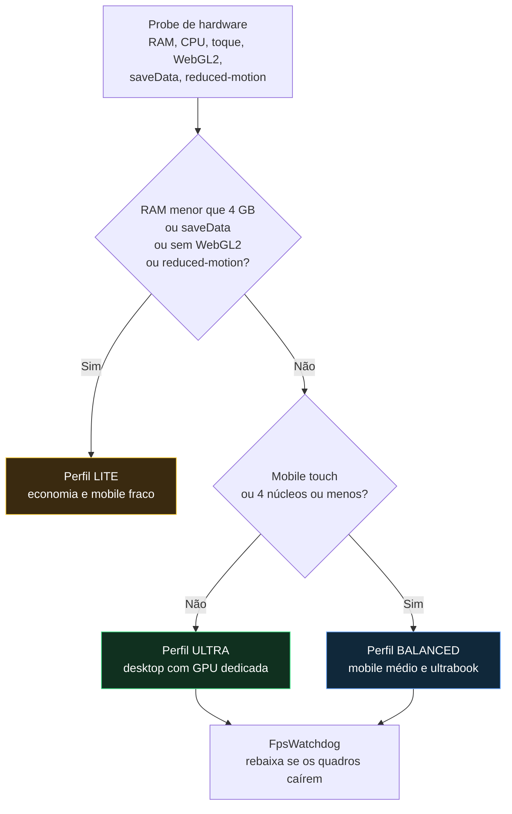

As animações dos LEDs usam apenas `opacity` e `transform` (sem `filter` nem `box-shadow` por quadro), e os cenários têm variantes `-desktop` e `-mobile` em WebP. Veja o [documento 11](docs/11-performance-hardware-gates-e-mobile.md).

---

## Roadmap: o que vem a seguir

```mermaid
flowchart LR
  f0["Fase 0<br/>Pokédex estática<br/>(atividade do Senac)"]:::done
  f1["Fase 1<br/>Monorepo + shell Angular"]:::done
  f2["Fase 2<br/>API, Prisma, Redis,<br/>Outbox e WebSocket"]:::done
  f2b["Etapas 2A e 2B<br/>IAM BFF, MFA<br/>e hardening"]:::done
  f3["Fase 3<br/>Deploy em nuvem"]:::done
  f4a["Fase 4A<br/>Restauração fiel 3D,<br/>CSP e bundle"]:::done
  f4b["Fase 4B<br/>Pokédex Suprema"]:::next
  f5["Fase 5<br/>Back-end do Laboratório<br/>e mecânicas de jogo"]:::plan
  f6["Fase 6<br/>Overworld, Museu 3D,<br/>Arcade e Battle Frontier"]:::plan

  f0 --> f1 --> f2 --> f2b --> f3 --> f4a --> f4b --> f5 --> f6

  classDef done fill:#10301f,stroke:#3ddc84,color:#fff
  classDef next fill:#3a2a10,stroke:#ffd23f,color:#fff
  classDef plan fill:#1b2a4a,stroke:#6aa7ff,color:#fff
```

| Etapa | Nome | Estado | Entregas |
| :--- | :--- | :---: | :--- |
| Fase 0 | Pokédex 3D estática (vanilla) | ✅ | [`index.html`](index.html), [`css/`](css), [`js/`](js) preservados |
| Fase 1 | Fundação do monorepo e shell Angular | ✅ | Workspaces, `docker-compose` saudável |
| Fase 2 | API, Prisma, Redis, Outbox e WebSocket | ✅ | Cache PokéAPI, 10 slots em ACID, ticker ao vivo |
| 2A e 2B | IAM Enterprise BFF e hardening | ✅ | MFA, Passkeys, OAuth PKCE, OTP, SonarCloud |
| Fase 3 | Deploy em nuvem | ✅ | Cloudflare Pages, Azure, Neon, Upstash, Aiven, Resend, CI/CD |
| Fase 4A | Restauração fiel 3D, CSP e bundle | ✅ | Giro reversível, unicidade de slots, `stale-fallback`, 51 endpoints e Lab modelados |
| **Fase 4B** | **Pokédex Suprema** | 🔜 **Próxima** | Veja abaixo |
| Fase 5 | Back-end do Laboratório e mecânicas | 📐 Modelada | Atributos por nível, evolução, clonagem, Bio-Essência, encontros e combate |
| Fase 6 | Expansões do mundo | 🗺️ Futura | Overworld Phaser 3, Museu em globo 3D, Arcade WASM e Battle Frontier |

### Próxima entrega: Fase 4B, Pokédex Suprema

- **Consultas avançadas e 5 abas LCD no visor**, com endpoints agregados no NestJS para espécie, evolução, golpes, habilidades, formas, encontros e gerações, além de um índice compacto multi-filtro sobre os 51 recursos da PokéAPI
- **Motor audiovisual**: espectrograma Web Audio nos *Cries*, sons táteis da dobradiça e dos botões, e projetor **Holocron** em Three.js (`@defer`), respeitando `ULTRA`, `BALANCED` e `LITE`
- **`TrainerPokemonSnapshot` no PostgreSQL**: snapshot dos favoritos para continuar disponível mesmo com as APIs externas fora do ar
- Fontes complementares: **Pokémon TCG API** e histórico de anime e filmes

### Dívidas técnicas conhecidas

Aqui está o estado atualizado das dívidas mapeadas após a execução do [doc 17](docs/17-plano-solid-clean-code-e-engenharia-big-tech.md):

| Item | Situação |
| :--- | :--- |
| Lint e formatação no CI | ✅ **`npm run lint` unificado** nos 3 workspaces (`@pokeverse/shared`, `apps/api`, `apps/web`) com `@typescript-eslint/no-explicit-any: error`; próximo passo: `prettier --check` e limites graduais de complexidade (`max-lines`) |
| Decomposição SOLID do IAM e `AuthStore` | ✅ **Concluída:** `AuthService` fatiado em 5 serviços especializados + `TrainerSessionIssuer` + `AuthOutboxPublisher`; `GoogleOAuthService` em 3 serviços; e `AuthStore` com `AuthRecoveryService` + `AuthCrossTabSyncService` |
| `PokedexRpgNavService` e CSS 3D | ✅ **Refatorados:** extraídos `PokedexLidPhysicsService` + diretiva declarativa `[pvRpgFocusable]` / `[pvRpgContainer]` (DIP) e `_pokedex-classic.scss` dividido em 5 parciais em `styles/pokedex/`; resta apenas consolidar o segundo vocabulário legado de tokens em `_tokens.scss` |
| Cobertura e integração reais | ✅ **65 unitários + 8 E2E** (adicionados testes em `PokeApiCacheService`, `PokedexSlotsService`, `PasskeyService`, deleção LGPD e `PrivacyConsentStore`); pendente fatiar `app.spec.ts` por feature e rodar **Testcontainers** (Postgres + Redis + Redpanda reais) no CI |
| Observabilidade & Segurança (ondas 2 e 3) | OpenTelemetry SDK completo (OTel + métricas RED/USE), `gitleaks` / `npm audit --audit-level=high` bloqueantes e demais itens do [Dossiê 13](docs/13-dossie-de-seguranca-e-blindagem.md) |
| Domínio próprio | Opcional: conectar `pokedex.<domínio>` no Cloudflare e atualizar `CORS_ORIGINS`, `WEBAUTHN_*` e `GOOGLE_REDIRECT_URI` |
| `WsAuthGuard` | O `/ws/world` aceita visitantes para o ticker. Ações do Overworld exigirão sessão autenticada |

---

## Como executar

### Pré-requisitos

- **Node.js 22+** e **npm 11+**
- **Docker** (opcional, para PostgreSQL, Redis, Redpanda, MinIO/S3 e Mailpit locais)
- **Chrome, Chromium ou Edge** (só para `npm run audit:ui`; defina `CHROME_BIN` se necessário)

### Modo rápido: só o front-end

Sem Docker e sem API, a Pokédex funciona em **modo degradado**, direto contra a PokéAPI.

```bash
npm install
npm run build:shared
npm run dev:web
```

Abra `http://localhost:4200`.

### Modo completo: com API, banco, cache e mensageria

```bash
npm install
npm run build:shared

cp .env.example .env          # ajuste os segredos locais
npm run infra:up              # Postgres, Redis, Redpanda, MinIO e Mailpit

npx --workspace=pokeverse-api prisma generate
npx --workspace=pokeverse-api prisma migrate deploy

npm run dev:api               # API em http://localhost:3000
npm run dev:web               # Web em http://localhost:4200 (proxy para /api, /health, /socket.io)
```

| Serviço local | Porta | Observação |
| :--- | :---: | :--- |
| Web (Angular) | `4200` | Proxy automático para a API |
| API (NestJS) | `3000` | Prefixo `/api/v1` |
| PostgreSQL | `5433` | Porta alterada para não colidir com um Postgres local |
| Redis | `6379` | AOF habilitado |
| Redpanda (Kafka) / Console | `19092` / `8085` | Console web para inspecionar tópicos |
| MinIO (S3) / Console | `9000` / `9001` | Buckets privados `pokeverse-roms` e `pokeverse-saves` |
| Mailpit | `1025` / `8025` | Captura os e-mails de OTP em desenvolvimento |

### Scripts do monorepo

| Comando | O que faz |
| :--- | :--- |
| `npm run build` | Build de `shared`, `api` e `web` |
| `npm run typecheck` | `tsc --noEmit` nos 3 workspaces |
| `npm run lint` | ESLint nos 3 workspaces (`lint:shared`, `lint:api`, `lint:web`) |
| `npm run test` | Vitest (`shared`, `web`) e Jest (`api`) |
| `npm run audit:ui` | UI Quality Gate sobre o build do front-end |
| `npm run infra:up` / `infra:down` | Sobe e derruba a infraestrutura Docker |

> **Antes de abrir um PR**, rode a sequência: `typecheck`, `lint`, `test`, `build` e `audit:ui`. O CI executa exatamente esses passos.

### Variáveis de ambiente

Todas as chaves estão em [`.env.example`](.env.example) e são validadas **na inicialização** da API ([`env.schema.ts`](apps/api/src/config/env.schema.ts)). Se algo estiver errado, ela falha sem imprimir os valores. Os grupos principais são:

`NODE_ENV`, `API_PORT` · `CORS_ORIGINS`, `COOKIE_*` · `APP_ENCRYPTION_KEY` · `DATABASE_URL`, `DATABASE_URL_UNPOOLED` · `REDIS_URL` · `KAFKA_*` · `MAIL_*`, `SMTP_*`, `RESEND_API_KEY` · `GOOGLE_*` · `WEBAUTHN_*` · `S3_*`

> Nunca faça commit de `.env` ou `.env.cloud`. Eles estão no `.gitignore`.

### Versão estática (Fase 0)

Para ver o projeto original, **sem build e sem dependências**, abra [`index.html`](index.html) em um servidor estático (por exemplo, a extensão Live Server).

---

## Estrutura do repositório

```text
pokedex-frontend/
├── apps/
│   ├── api/                       # NestJS 11 + Prisma 6 + Redis + Kafka + Socket.IO
│   │   ├── prisma/                #   schema.prisma (13 modelos) e migrações
│   │   └── src/
│   │       ├── common/            #   guards, filtros, pipes, middleware, telemetria, crypto
│   │       ├── config/            #   env.schema.ts (validação fail-fast com Zod)
│   │       ├── infra/             #   Prisma, Redis, Kafka e probes de saúde
│   │       └── modules/           #   auth (SOLID IAM: AuthService fachada, CredentialsAuth, TokenRefresh, Recovery, SessionMgmt, TrainerGdpr, SessionIssuer, OutboxPublisher, GoogleOAuth*), pokedex · events · notifications · world · health · system
│   └── web/                       # Angular 22 Standalone + Zoneless
│       ├── functions/             #   Cloudflare Pages Functions (proxy same-origin)
│       └── src/
│           ├── app/core/          #   guards · interceptors · http (api-error.util) · stores (Auth, AuthCrossTabSync, AuthRecovery, SecurityIam, PrivacyConsent, Quality, Scenario, SystemStatus, WorldTicker)
│           ├── app/features/      #   pokedex-device (services/ + directives/ [pvRpgFocusable]) · regions-museum · title-screen · under-construction
│           ├── app/shared/        #   HUD, dock, diálogos (VisitorLock, SecuritySettings, PrivacyConsent) e diretivas
│           └── styles/            #   _tokens.scss · _pokedex-classic.scss + parciais styles/pokedex/ (_chassis-3d, _search-scanner, _controls-dpad, _slots-grid, _visor-lcd)
├── packages/
│   └── shared/                    # @pokeverse/shared: schemas Zod, busca fuzzy, 51 endpoints, Laboratório
├── infra/docker/                  # api.Dockerfile e docker-compose.yml
├── scripts/ui-quality-gate.mjs    # Auditoria de contraste, overflow e tipografia
├── .github/workflows/             # ci.yml e deploy.yml
├── assets/                        # Cenários WebP (-desktop e -mobile) e texturas
├── docs/                          # Documentação (00 a 17), Capítulo Zero e Guias de Estudos
├── index.html · css/ · js/        # Fase 0 preservada intacta (referência visual canônica)
└── AGENTS.md                      # Regras inegociáveis de fidelidade visual e engenharia
```

---

## Documentação

| Doc | Assunto |
| :-: | :--- |
| **Arch** | **[Contrato de Qualidade: Diretrizes de Arquitetura e Padrões de Código (Anti-AI Slop)](docs/ARCHITECTURE.md)** |
| **Zero** | **[Capítulo Zero: como tudo começou](docs/capitulo-zero-como-tudo-comecou.md)**, com o README original e a história da atividade do Senac |
| 00 | [Visão geral, regras de acesso e roadmap](docs/00-visao-geral-e-roadmap.md) |
| 01 | [Arquitetura do monorepo e padrões de engenharia](docs/01-arquitetura-monorepo-e-padroes.md) |
| 02 | [Front-end Angular, HUD de jogo e gerenciamento de estado](docs/02-frontend-angular-hud-e-estado.md) |
| 03 | [Motores gráficos: Phaser 3 e Three.js (WebGL2/GLSL)](docs/03-motores-graficos-phaser-e-threejs.md) |
| 04 | [Back-end NestJS, autenticação e segurança](docs/04-backend-nestjs-auth-e-seguranca.md) |
| 05 | [PostgreSQL e Prisma ORM](docs/05-banco-de-dados-postgresql-e-prisma.md) |
| 06 | [Cache Redis e mensageria Kafka / Redpanda](docs/06-cache-redis-e-eventos-kafka.md) |
| 07 | [Arcade Retrô 3D (WebAssembly) e cloud save states](docs/07-arcade-retro-wasm-e-cloud-saves.md) |
| 08 | [Museu das Regiões, lore e Pokédex Holocron 3D](docs/08-museu-lore-e-holocron-pokedex.md) |
| 09 | [Arena de batalha (PvE/PvP), Team Builder e mini-games](docs/09-arena-batalha-teambuilder-e-minigames.md) |
| 10 | [Infraestrutura Docker, observabilidade e CI/CD](docs/10-infraestrutura-docker-ci-cd-e-deploy.md) |
| 11 | [Desempenho, detecção de hardware, mobile e release gates](docs/11-performance-hardware-gates-e-mobile.md) |
| 12 | [Pokédex 2.0: catálogo completo da PokéAPI v2 e controles](docs/12-pokedex-2-0-pokeapi-e-controles.md) |
| 13 | [Dossiê de segurança e blindagem (AppSec, Auth e Infra)](docs/13-dossie-de-seguranca-e-blindagem.md) |
| 14 | [**Status real da implementação**, mudanças vs. plano original e backlog](docs/14-status-e-changelog-implementacao.md) |
| 15 | [Pokédex Suprema: auditoria, 51 endpoints e Laboratório Genético](docs/15-pokedex-suprema-51-endpoints-e-laboratorio-genetico.md) |
| 16 | [Cookies, LGPD e levantamento de requisitos](docs/16-cookies-lgpd-e-requisitos.md) |
| 17 | [Plano SOLID, Clean Code e engenharia Big Tech](docs/17-plano-solid-clean-code-e-engenharia-big-tech.md) |
| Guia 0 | **[Capítulo Zero — Guia de estudos da Pokédex (Fase 0)](docs/capitulo-zero-guia-de-estudos-pokedex.md)**, a "colinha" e manual técnico para a apresentação no Senac |
| Guia 1 | **[Capítulo 1 — Guia de estudos full-stack do PokéVerse OS](docs/capitulo-um-guia-de-estudos-pokedex.md)**, escopo completo de tecnologias, arquitetura e boas práticas do projeto atual |

> **Por onde começar?** Para entender o que existe hoje, leia o [doc 14](docs/14-status-e-changelog-implementacao.md). Para entender o rumo, leia o [doc 00](docs/00-visao-geral-e-roadmap.md) e o [doc 15](docs/15-pokedex-suprema-51-endpoints-e-laboratorio-genetico.md).

---

## Princípios de engenharia

As regras completas e o Contrato de Qualidade estão em [`AGENTS.md`](AGENTS.md) e [`docs/ARCHITECTURE.md`](docs/ARCHITECTURE.md), valendo para qualquer pessoa ou agente que contribua.

1. **Regra Zero de UI.** Nenhum componente, animação 3D, textura ou fluxo visual é substituído ou simplificado sem validação explícita. A referência canônica é a Fase 0.
2. **Conferência visual real.** Nenhuma mudança de interface é "pronta" antes de ser comparada no navegador, em Desktop `1440×900` e Mobile `375×812`, com zero erros no console, zero falhas de rede inesperadas e zero overflow horizontal.
3. **Preservar o que já funciona.** Os arquivos estáticos da raiz não são alterados sem pedido explícito. Nada testado é degradado.
4. **Shift-Left, SoC e Repositórios isolados.** A infraestrutura obedece ao domínio; contratos Zod vivem em `@pokeverse/shared` (DRY real); Controllers apenas recebem payloads validados e retornam HTTP status codes; consultas Prisma ficam isoladas em Repositórios sem poluir Services.
5. **Estado Stateless, MinIO/S3 e Kafka idempotente.** Sessões e dados transitórios vivem no Redis (Lua atômico anti-TOCTOU, zero efeito externo antes da constraint); arquivos pesados vão para MinIO/S3 via URLs geradas (nunca no PostgreSQL); Outbox usa *atomic lease* e consumidores liberam idempotência no `catch`.
6. **Zero N+1 e paginação desde a v1.** Buscas relacionais usam joins nativos do Prisma em uma única ida ao banco com projeção estrita (`select`), índices definidos e paginação obrigatória (`limit`/`offset` ou cursor) em todo endpoint de lista.
7. **SOLID & Clean Code Anti-AI Slop.** Services/stores até ~300 linhas e UI até ~150–200 linhas; nomenclatura ubíqua (proibido `dataHandler`/`processor`), zero valores mágicos, **Early Returns** sem código em flecha e alterações atômicas sem boilerplate para ciclos curtos de até 5 prompts seguidos de `git commit`.
8. **Documentação e README sempre sincronizados.** Toda implementação, alteração estrutural ou remoção no projeto atualiza também [`README.md`](README.md) e os documentos em [`docs/`](docs/) na mesma entrega.

Os commits seguem [Conventional Commits](https://www.conventionalcommits.org/pt-br/) (`feat:`, `fix:`, `docs:`, `chore:`).

---

## Créditos e avisos

- **Dados:** [PokéAPI](https://pokeapi.co/). Sprites e artworks vêm de [PokeAPI/sprites](https://github.com/PokeAPI/sprites).
- **Origem:** atividade final da matéria de Front-end no **Senac**, expandida por iniciativa própria. Veja o [Capítulo Zero](docs/capitulo-zero-como-tudo-comecou.md).
- **Aviso legal:** este é um **projeto de fã, educacional e sem fins lucrativos**. Pokémon e todos os nomes, personagens e marcas relacionados pertencem a **Nintendo, Game Freak e The Pokémon Company**. Este projeto não é afiliado, patrocinado nem endossado por eles. Se você é titular de algum direito e quer a remoção de algum asset, abra uma issue.
- **Licença:** não há licença de código aberto declarada. Por padrão, todos os direitos sobre o código original são reservados ao autor.

<p align="center">
  <sub>Feito com carinho por <a href="https://github.com/digooow">@digooow</a>, de uma atividade de faculdade a uma plataforma inteira.</sub>
</p>
