<!-- markdownlint-disable MD033 MD041 -->
<p align="center">
  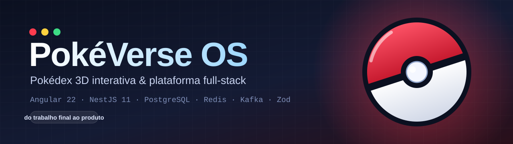
</p>

<p align="center">
  <a href="https://pokeverse.pages.dev/"><strong>Abrir a plataforma ao vivo</strong></a>
  &nbsp;·&nbsp;
  <a href="docs/capitulo-00-como-tudo-comecou.md">Capítulo 00: como tudo começou</a>
  &nbsp;·&nbsp;
  <a href="docs/00-fila-prioritaria-melhorias.md">Fila Prioritária</a>
  &nbsp;·&nbsp;
  <a href="docs/00-visao-geral-e-roadmap.md">Roadmap</a>
  &nbsp;·&nbsp;
  <a href="docs/ARCHITECTURE.md">Contrato de Qualidade</a>
  &nbsp;·&nbsp;
  <a href="#documentação">Documentação</a>
</p>

<p align="center">
  
  
  
  
  
  
  
  
  
  
</p>

# PokéVerse OS

**Uma Pokédex 3D skeuomórfica, com tampa que gira, LEDs, metal e vidro, construída sobre uma plataforma full-stack real.** Ela tem autenticação segura, cache distribuído, mensageria, deploy em nuvem e uma auditoria visual automatizada que reprova regressões de contraste e layout.

O projeto começou como a **atividade final de Front-end no Senac**: uma Pokédex em HTML, CSS e JavaScript puro. Eu gostei do tema e decidi continuar por conta própria. O resultado é este monorepo. A história completa está no **[Capítulo 00](docs/capitulo-00-como-tudo-comecou.md)**, junto com o README original, preservado como recordação.

<p align="center">
  
</p>

---

## Sumário

1. [Estado atual em um olhar](#estado-atual-em-um-olhar)
2. [Galeria](#galeria)
3. [Arquitetura](#arquitetura)
4. [Fluxos principais](#fluxos-principais)
5. [Modelo de dados](#modelo-de-dados)
6. [API](#api)
7. [Qualidade, testes e CI/CD](#qualidade-testes-e-cicd)
8. [Segurança e privacidade](#segurança-e-privacidade)
9. [Performance](#performance)
10. [Roadmap: o que vem a seguir](#roadmap-o-que-vem-a-seguir)
11. [Como executar](#como-executar)
12. [Estrutura do repositório](#estrutura-do-repositório)
13. [Documentação](#documentação)
14. [Princípios de engenharia](#princípios-de-engenharia)
15. [Créditos e avisos](#créditos-e-avisos)

---

## Estado atual em um olhar

A entrada da plataforma abre na **Tela Inicial retrô (`/`)** com o botão **Iniciar Jogo** (sem barra superior) e leva ao **Hub Inicial (`/inicio`)**. A partir dele e do seletor de módulos na barra superior ao lado de **PokéVerse OS** (ou pelos atalhos `1` a `5`), você acessa os **cinco módulos**. Hoje a prioridade é a **Pokédex 3D** (módulo 2, que centraliza fichas, Holocron 3D, comparador 1v1, calculadora de atributos, Enciclopédia Global e Atlas das Regiões em `/pokedex`) e o módulo **Personagem** (módulo 5 em `/personagem`, com **Holograma 3D** em **Babylon.js 9 + Havok WASM** usando 2 modelos CC0 — *Aventureiro* e *Aventureira* —, radar heptagonal, progressão **sem nível** por treino de skills em cascata, classes livres emergentes, 15 profissões e **Bazar de Personagens**).

| # | Módulo | Rota | Acesso | Estado | Progresso |
| :-: | :--- | :--- | :---: | :--- | :--- |
| 0 | **Tela Inicial & Hub** (Start Retrô + Central) | `/` e `/inicio` | Público | **Em produção** (`StartScreen` + `HomeHub`) | `████████░░` Hub v1 |
| 1 | **Vila Central** (overworld 2D/HD-2D) | `/mundo` | Treinador | Em construção (tela de status) | `█░░░░░░░░░` 18% |
| 2 | **Pokédex 3D** | `/pokedex` (`/enciclopedia` e `/museu` redirecionam) | Público | **Em produção** (Ficha, 3D, 1v1, Calc, Enciclo + Atlas das Regiões) | `██████████` Fase 4B |
| 3 | **Arcade Retrô** (WASM + cloud saves) | `/arcade` | Treinador | Em construção (tela de status) | `█░░░░░░░░░` 14% |
| 4 | **Battle Frontier** (PvE/PvP e mini-games) | `/arena` | Treinador | Em construção (tela de status) | `██░░░░░░░░` 28% |
| 5 | **Personagem** (Holograma 3D, Treino & Bazar) | `/personagem` | Público (prévia) / Treinador (salvar) | **Em produção** (Holograma 3D Babylon.js 2 modelos, evolução sem nível, skills em cascata e Bazar) | `██████████` Passo 1B |

> Os percentuais são os exibidos nas telas de módulo em construção ([`under-construction.data.ts`](apps/web/src/app/features/under-construction/under-construction.data.ts)). Eles medem preparação (modelagem, contratos, schema), não entrega do módulo.

### O que já funciona

<table>
<tr>
<td width="50%" valign="top">

#### Pokédex 3D e experiência

- Chassi skeuomórfico fiel, com luz que segue o ponteiro, microtexturas WebP, dobradiça, lente de safira e LEDs reativos
- Abertura e fechamento 3D **reversíveis em voo**
- Catálogo completo da PokéAPI (1351 entradas) com busca por ID ou nome, chave fonética PT/EN e aproximação Damerau-Levenshtein
- Seleção em 2 passos: o 1º clique destaca, o 2º (ou `A` / `Enter`) abre no visor
- Botão vermelho com **histórico progressivo** de navegação
- **Tela Inicial Retrô (`/`) & Hub Inicial (`/inicio`):** tela de entrada dedicada com botão **Iniciar Jogo** (atalho `Enter`/`Space`, sem topbar) que conduz ao Hub (`/inicio`); clicar em **PokéVerse OS** na topbar sempre retorna ao Hub sem forçar saída da plataforma
- **10 slots azuis** de gravação, com luz azul (livre) ou verde (ocupado), 1 Pokémon por botão, abertura instantânea ao clicar em slot ocupado (sem modal desnecessário de confirmação), reordenação por **arrastar e soltar (Drag & Drop)** ou botões `↑`/`↓` na tela de configuração (persistida localmente e via `PATCH /api/v1/pokedex/slots/swap`), badge animada de salvamento e apelidos
- **Visor LCD Compacto + Projeção Holográfica (`MEL-03`):** o visor interno da Pokédex exibe o **Resumo completo** do Pokémon selecionado em destaque, com botões exclusivos para projetar no **Holograma expandido** (`#btn-visor-expand`, `Comparar 1v1`, `Ficha Completa`, `Holocron 3D`, `Calculadora` e `Enciclopédia`) — sem duplicar controles na busca nem espremer módulos complexos na tela pequena (`Esc` ou clique externo recolhem restaurando a carcaça 3D intacta):
  - **Ficha (`Resumo` no visor; `Stats`, `Evolução`, `Golpes` e `Mapa` no Holograma):** `Resumo & Lore` (Arte/Home/Animado respeitando perfil `LITE`, Normal/Shiny, *Cry* `latest`/`Retrô` com espectrograma Web Audio em Canvas 2D), `Atributos & Tipos` (6 Base Stats, `BST`, *EV Yield*, matriz defensiva explícita `Fraco contra (4x/2x)` / `Forte contra (0.5x/0.25x)` / `Imune a (0x)`, biologia e habilidades expansíveis lazy via `/abilities/:name`), `Evolução & Formas` (árvore clicável + `/forms` lazy), `Golpes & Itens` (filtros `Nível`/`TM/HM`/`Ovo`/`Tutor`, paginação, ficha lazy via `/moves/:name` e *held items*) e `Mapa & Sprites` (`/encounters` lazy + galeria histórica Gen I–IX), navegáveis por clique, `ArrowLeft`/`ArrowRight` ou D-Pad `◀`/`▶`
  - **Holocron 3D (`mode=holocron` — `MEL-01`):** projetor holográfico embutido no visor (`@babylonjs/core` + `@babylonjs/loaders` em chunk lazy sob demanda, com fundação Havok WASM em `@babylonjs/havok`) com modelos **3D `.glb` reais** (`Pokemon-3D-api/assets`, regular e shiny `1..1025`) decodificados via Draco auto-hospedado (`/assets/draco/`), animações esqueléticas via `AnimationGroup` com seletor de clipes, movimento procedural *idle* para modelos sem trilhas esqueléticas, sincronização automática ao trocar de Pokémon na busca, inclinação/zoom 360°, pedestal elemental hexagonal e fallback ao prisma 3D / modo 2D em `LITE`/`webglcontextlost`
  - **Comparador 1v1 (`mode=comparar`):** abre diretamente no **Holograma expandido** com os 2 Pokémon lado a lado em alta leitura (avatar amplo, genus, tipos, habilidades, placar `VS`, delta de `BST`, barras espelhadas e perfil defensivo `Fraco contra (4x/2x)` / `Forte contra (0.5x/0.25x)` / `Imune a (0x)`)
  - **Calculadora Competitiva (`mode=calculadora` — Fase 2 `MEL-04`):** cálculo em tempo real no Holograma (`calculateStatsAtLevel`, `calculateXpForLevel`, `calculatePokemonDamage` e `formatShowdownSpread`/`parseShowdownSpread` em `@pokeverse/shared`) com nível `1–100`, IVs (`0–31`), EVs (`0–252`, teto `510`), **25 naturezas oficiais**, **8 presets Smogon OU / VGC**, **Simulador de Dano 1v1** (STAB, eficácia 18 tipos, clima, crítico, queimado, VGC spread, itens, golpes aprendidos e 16 rolls + KO verdict) e **Import/Export Pokémon Showdown**
  - **Enciclopédia Global & Atlas das Regiões (`mode=enciclopedia`):** os 11 recursos do BFF integrados dentro do Holograma da Pokédex (`/enciclopedia` e `/museu` redirecionam automaticamente para `/pokedex?mode=enciclopedia`), unificando na categoria **Regiões & História** a linha do tempo única das **9 regiões canônicas (Kanto–Paldea, `1996–2022`)**, iniciais, guardiões lendários, *version groups*, Pokédexes regionais e localidades clicáveis — com navegação direta para Ficha, **Holocron 3D** e busca reversa sem sair da Pokédex
- **Lista sempre preenchida & Pesquisa Multi-Atributos:** buscas que resultam em 1 único Pokémon exibem automaticamente evoluções, mesmo tipo e vizinhos de ID na seção `Relacionados & Próximos`; painel de filtros em 3 abas (`Tipos & Mundo`, `Raça & Golpe`, `Taxonomia`) e atalho 1-clique na busca para **Elemento**, **Raça (Grupo de Ovo)**, **Mapa/Região/Habitat**, **Jogo/Versão**, **Golpe**, **Habilidade**, geração, cor, formato, BST mínimo, raridade e ordenação
- **Espectrograma Web Audio & Feedback Tátil:** motor acústico Web Audio (`AudioStore` + `AudioEngineService` + `CrySpectrogramComponent`) nos gritos *latest*/*Retrô* e nos cliques táteis do dispositivo
- 4 cenários (**Hoenn, Cidade, Vila, Floresta**), modo Auto e detector de hardware
- Topbar tática full-width ancorada nas extremidades (marca `PokéVerse OS` com `<pv-pokeball-mark>` apontando para `/inicio`, seletor de módulos `1`–`4`, painel do jogador, configurações e status da nuvem), menus em dobra suave estilo Pokédex, botões com feedback tátil, ticker temporário animado ao vivo (`6s`) e rodapé discreto com créditos & cookies/LGPD

</td>
<td width="50%" valign="top">

#### Plataforma e back-end

- Proxy e cache da PokéAPI no Redis: `24h` de TTL + `stale-fallback` de `7d` (incluindo `/catalog/enriched` via GraphQL v1beta2 com fallback REST, `/bundle` com matriz defensiva `0x..4x`, `/encounters`, `/forms` e rotas enciclopédicas paginadas + busca reversa em `/moves`, `/abilities`, `/items`, `/berries` e `/locations`, além de `/meta/filters`, `/regions`, `/pokedexes`, `/egg-groups`, `/growth-rates`, `/natures` e `/types` em `7d` + `14d` stale)
- Sessões **BFF opacas** no Redis, cookie `HttpOnly` e zero JWT no JavaScript do navegador
- MFA: **TOTP** com QR Code e 8 códigos de backup, **Passkeys WebAuthn** e **Google OAuth PKCE**
- Verificação de e-mail e recuperação de senha por **OTP**
- **Transactional Outbox**, Redpanda/Kafka, consumidores idempotentes e DLQ
- Gateway WebSocket `/ws/world` com ticker global
- Banner de cookies e **LGPD** (consentimento versionado, exportação JSON e eliminação em cascata `DELETE /auth/me`)
- Deploy contínuo em **Cloudflare Pages + Azure Container Apps**

</td>
</tr>
</table>

### Domínio futuro já modelado

Estes módulos estão em [`@pokeverse/shared`](packages/shared/src) com testes, mas ainda **sem tela nem endpoint**:

- **Catálogo dos 51 endpoints da PokéAPI v2** com modelo de filtros avançados: [`pokeapi-endpoints.ts`](packages/shared/src/domain/pokeapi-endpoints.ts)
- **Laboratório Genético**: atributos e XP por nível, chance de evolução, clonagem e replicação, e conversão em **Bio-Essência** (ranks `E`, `D`, `C`, `B`, `A`, `S` e `APEX`): [`pokemon-lab.ts`](packages/shared/src/domain/pokemon-lab.ts)

---

## Galeria

### Pokédex 3D

<table>
<tr>
<td width="50%">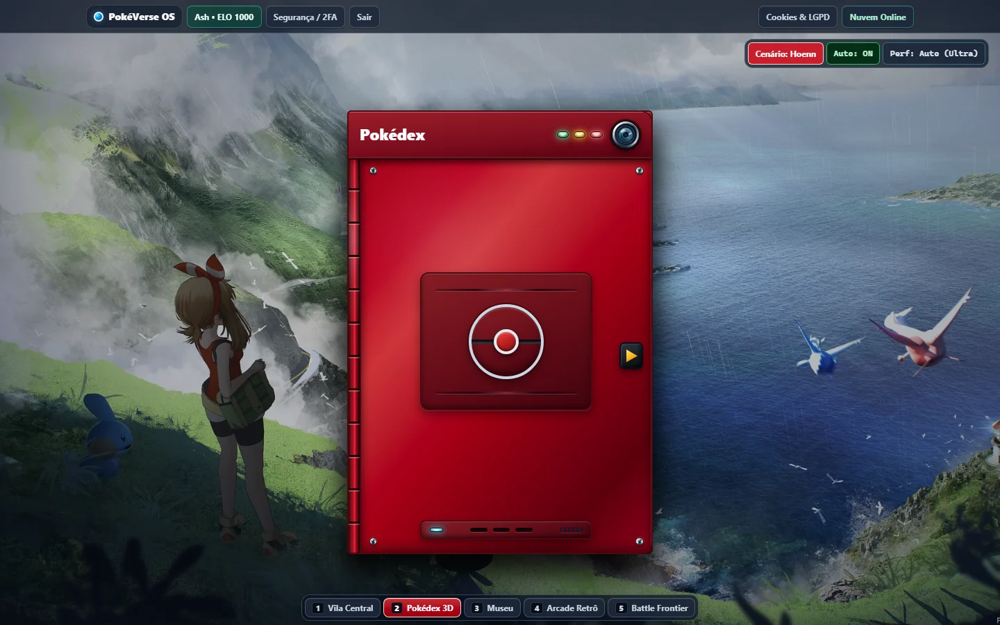<br><sub><b>Fechada:</b> tampa, dobradiça lateral, lente de safira e LEDs.</sub></td>
<td width="50%">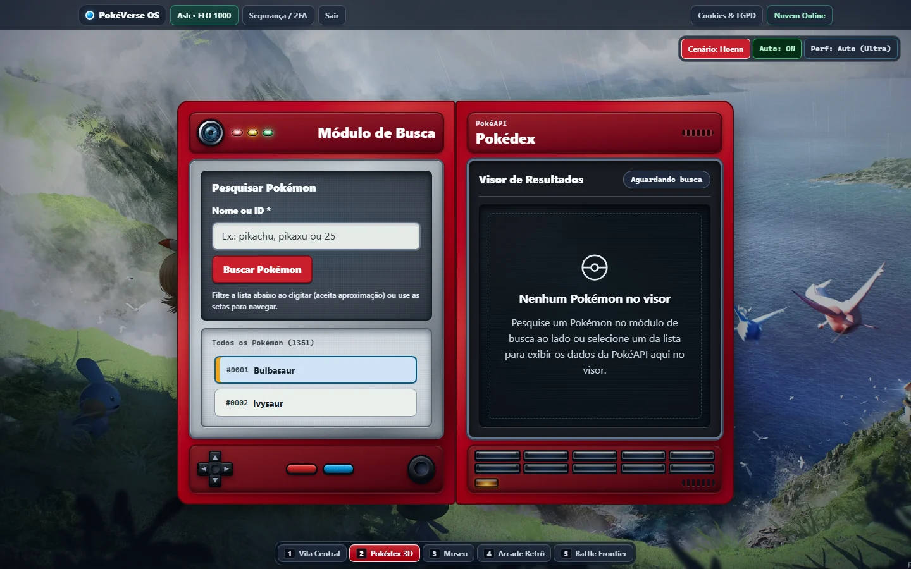<br><sub><b>Aberta:</b> módulo de busca, D-pad, botões e visor de resultados.</sub></td>
</tr>
</table>

### Módulos e responsividade

<table>
<tr>
<td width="50%">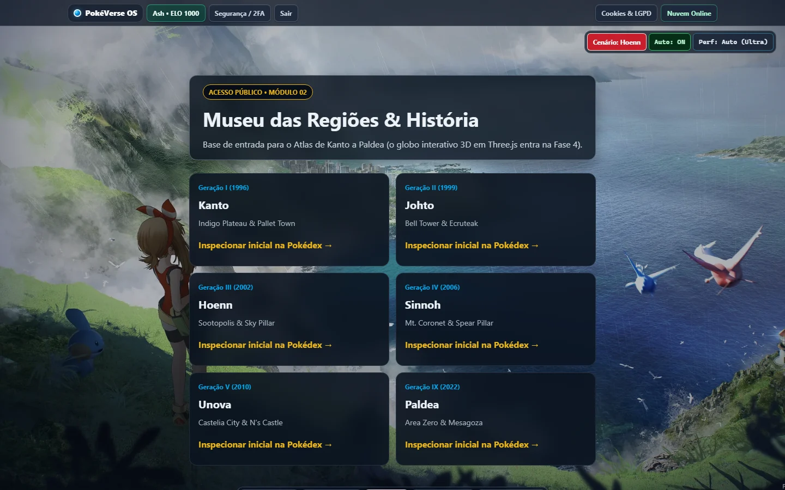<br><sub><b>Museu:</b> 6 gerações, cada uma com um inicial para inspecionar na Pokédex.</sub></td>
<td width="50%"><br><sub><b>Em construção:</b> telas dedicadas, com especificação e progresso por módulo.</sub></td>
</tr>
</table>

<table>
<tr>
<td align="center" width="50%"><br><sub><b>Mobile (375×812):</b> a tampa gira no eixo X.</sub></td>
<td align="center" width="50%">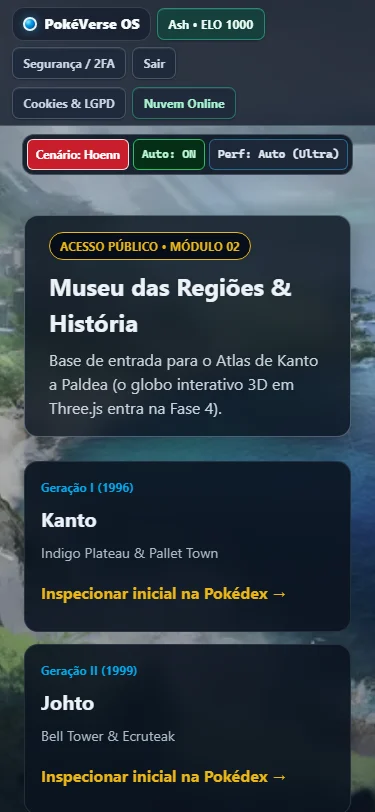<br><sub><b>Museu no mobile</b></sub></td>
</tr>
</table>

### Cenários

<table>
<tr>
<td width="50%"><br><sub><b>Hoenn</b></sub></td>
<td width="50%"><br><sub><b>Cidade</b></sub></td>
</tr>
<tr>
<td width="50%">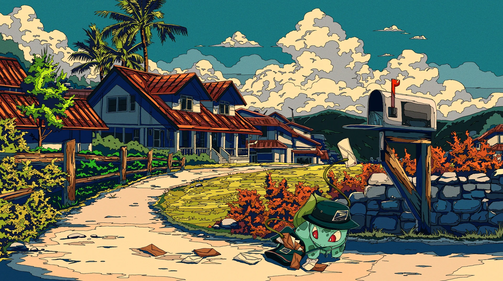<br><sub><b>Vila</b></sub></td>
<td width="50%">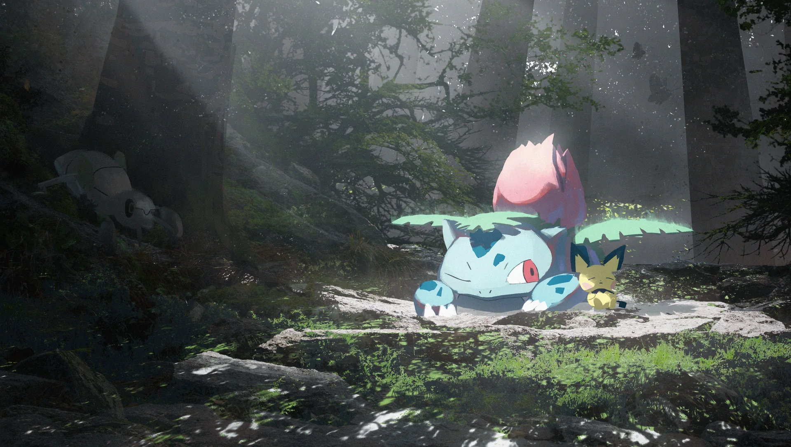<br><sub><b>Floresta</b></sub></td>
</tr>
</table>

> As capturas foram geradas automaticamente com Chrome headless sobre o build de produção, em `1440×900` e `375×812`. Para refazê-las, consulte [`docs/assets/README.md`](docs/assets/README.md).

---

## Arquitetura

### Visão de contexto

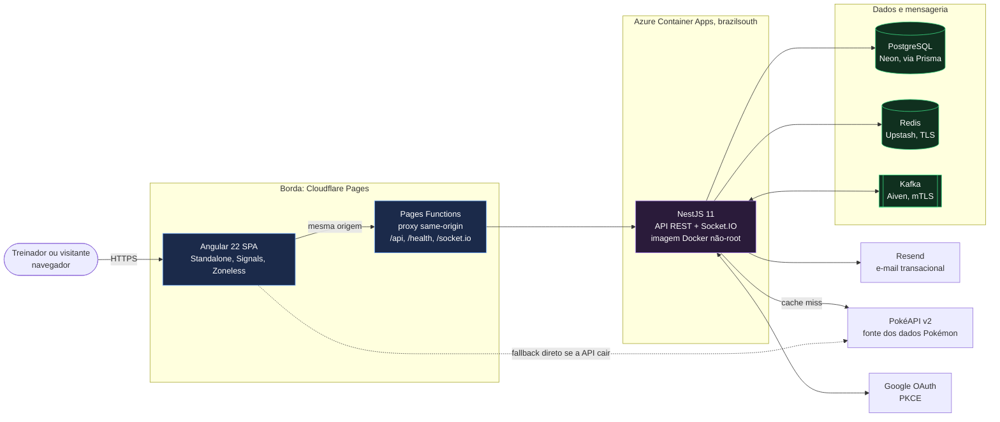

O proxy **same-origin** é essencial: os cookies `HttpOnly` de sessão ficam no domínio do front-end, o CSP pode ser estrito e o CSRF fica mais simples de defender.

### Monorepo e dependências

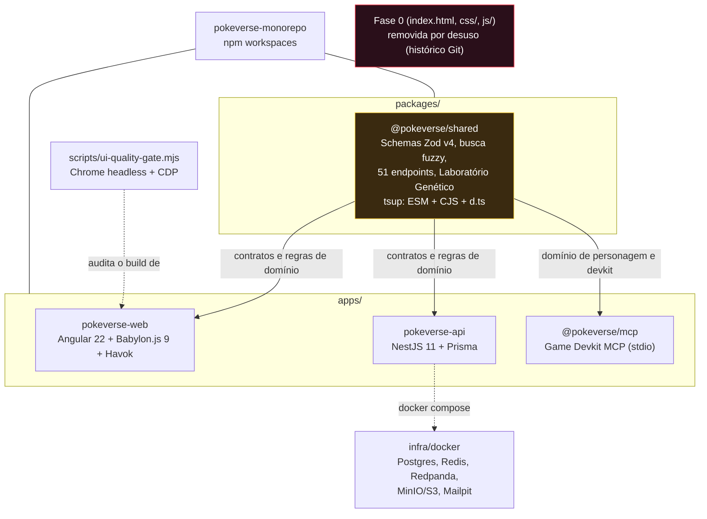

**Regra de ouro:** contratos Zod, schemas de eventos e regras de domínio vivem **somente** em `@pokeverse/shared`. Front-end e back-end importam de lá e nunca duplicam.

### Stack em detalhe

| Camada | Tecnologias |
| :--- | :--- |
| **Front-end** | Angular 22 (Standalone, Signals, Zoneless, `@defer`), Babylon.js 9 (`@babylonjs/core`, `@babylonjs/loaders`, `@babylonjs/havok`), SCSS com tokens `oklch`, `socket.io-client` e `@simplewebauthn/browser` carregados sob demanda |
| **Back-end** | NestJS 11, Express, Socket.IO, Helmet, Throttler com storage em Redis, `argon2` (Argon2id), `qrcode`, `nodemailer` |
| **Devkit MCP** | `@pokeverse/mcp` (`@modelcontextprotocol/sdk` sobre `stdio`) + integração Blender (`mcp-for-blender` via `uvx` em `.vscode/mcp.json` e `.mcp.json`) |
| **Dados** | PostgreSQL com Prisma 6.19 (16 modelos, 6 enums, 4 migrações), Redis 7 via `ioredis`, Kafka via `kafkajs` (Redpanda no local, Aiven na nuvem) |
| **Contratos** | Zod v4 em `@pokeverse/shared`, compilado com `tsup` |
| **Qualidade** | Vitest 5, Jest 30, `jest-mock-extended`, Playwright, ESLint 9, Prettier, SonarCloud, UI Quality Gate próprio |
| **Observabilidade** | OpenTelemetry SDK (Traces, Metrics e Logs OTLP), OTel Collector, Prometheus + Postgres/Redis Exporters + alertas, Grafana Loki + Promtail, Grafana Tempo, Grafana, Sentry Envelope v7 e Datadog Agent |
| **Infra** | Docker multi-stage não-root, GitHub Actions, Cloudflare Pages, Azure Container Apps, Neon, Upstash, Aiven, Resend |

---

## Fluxos principais

### Busca de Pokémon com cache e degradação graciosa

A Pokédex **nunca fica inutilizável**. Se a API estiver fora do ar, o front-end consulta a PokéAPI direto e o visitante continua navegando.

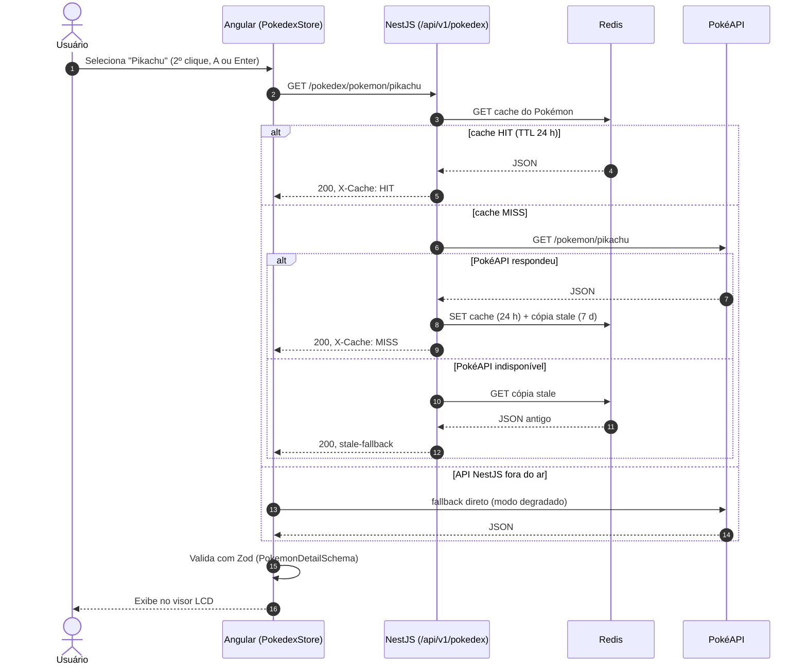

### Controles da Pokédex: a máquina de estados do botão vermelho

O botão vermelho volta **um passo por clique**, para o usuário nunca se perder em uma lista de 1351 itens.

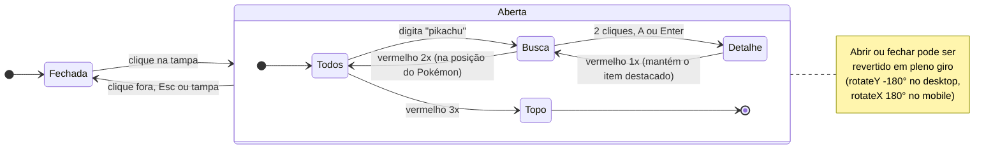

### Autenticação BFF com MFA

Nenhum token de acesso chega ao JavaScript. A sessão é um identificador **opaco** guardado em cookie `HttpOnly`, e o estado vive no Redis, o que permite revogação instantânea.

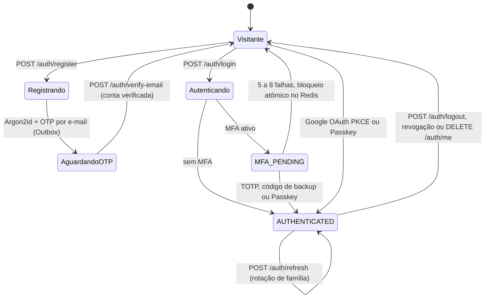

### Eventos confiáveis: Transactional Outbox

O envio de e-mail e a atualização do ticker **nunca** acontecem no meio de uma transação de banco. O evento é gravado junto com o dado e publicado depois, de forma atômica e idempotente.

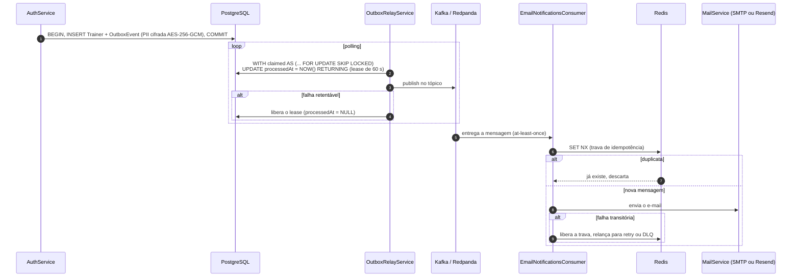

**Tópicos Kafka** (definidos em [`events.schemas.ts`](packages/shared/src/schemas/events.schemas.ts)):

| Tópico | Uso |
| :--- | :--- |
| `pokeverse.world.events.v1` | Eventos do mundo e ticker global (`/ws/world`) |
| `pokeverse.notifications.email.v1` | E-mails transacionais (OTP, recuperação) |
| `pokeverse.arcade.savestate.v1` | Cloud saves do Arcade (reservado) |
| `pokeverse.battle.matchmaking.v1` | Matchmaking da Arena (reservado) |
| `pokeverse.battle.results.v1` | Resultados de batalhas (reservado) |
| `pokeverse.dlq.v1` | Dead Letter Queue, com payload e metadados de erro |

---

## Modelo de dados

O schema Prisma tem **16 modelos**, **6 enums** (`TrainerRole` e `CharacterPresenceMode` incluídos) e **4 migrações** (incluindo `AuditLog` protegido por trigger SQL *append-only* e `Character`/`CharacterAttribute` com `CHECK` constraints de atributos e unicidade global `normalizedName`). Os módulos futuros (Arcade, Arena, times) já têm tabelas para não exigir reestruturação depois.

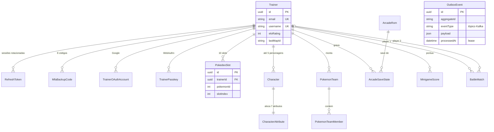

`OutboxEvent` não tem relação com `Trainer` de propósito: ele é infraestrutura de mensageria. Há um índice parcial `idx_outbox_pending` para o polling.

---

## API

Prefixo global `/api/v1` (exceto `/health`). Validação de entrada com Zod na fronteira, `CsrfOriginGuard` e throttling em Redis.

| Domínio | Método e rota | Descrição |
| :--- | :--- | :--- |
| **Saúde** | `GET /health/live` · `GET /health/ready` | Liveness e readiness (Postgres, Redis, Kafka e S3) |
| **Sistema** | `GET /system/bootstrap` | Fase atual e módulos da plataforma |
| **Pokédex** | `GET /pokedex/catalog` | Catálogo completo da PokéAPI v2 (cache Redis `24h` + `stale-fallback` `7d`) |
| | `GET /pokedex/catalog/enriched` | Catálogo enriquecido em 1 query GraphQL v1beta2 (`24h` + `7d` stale + fallback REST degradado) |
| | `GET /pokedex/meta/filters` | Metadados de filtros (`types`, `generations`, `habitats`, `colors`, `shapes`, `eggGroups`, `growthRates`, `regions`) cacheados `7d` + `14d` stale |
| | `GET /pokedex/pokemon/:idOrName` | Detalhe de um Pokémon na PokéAPI v2 (cache Redis `24h` + `stale-fallback` `7d`) |
| | `GET /pokedex/pokemon/:idOrName/bundle` | Bundle agregado (`pokemon` + `species` + `evolution-chain` + matriz defensiva `0x..4x` via `/type` `7d`) |
| | `GET /pokedex/pokemon/:idOrName/encounters` | Locais de encontro por versão, nível, método e condições (`24h` + `stale-fallback` `7d`) |
| | `GET /pokedex/pokemon/:idOrName/forms` | Formas alternativas (`/pokemon-form`) e variedades da espécie (`24h` + `stale-fallback` `7d`) |
| | `GET /pokedex/{moves,abilities,items,berries,locations}` + `/:idOrName` | Listagem paginada (`limit`/`offset`/`q`) com chave de índice única e detalhe com busca reversa (`24h` + `7d` stale) |
| | `GET /pokedex/{regions,pokedexes,egg-groups,growth-rates}` + `/:idOrName` | Listagem paginada (`limit`/`offset`/`q`) e detalhe com entradas/espécies/localizações (`7d` + `14d` stale) |
| | `GET /pokedex/{natures,types}` + `/:idOrName` | Tabelas completas enriquecidas e detalhe com busca reversa de Pokémon e golpes (`7d` + `14d` stale) |
| | `GET /pokedex/slots` | Lista os slots do treinador |
| | `PUT /pokedex/slots/:index` | Grava um slot (`409` se o Pokémon já estiver em outro) |
| | `DELETE /pokedex/slots/:index` · `DELETE /pokedex/slots` | Remove um slot ou todos (atômico) |
| **Auth** | `GET /auth/providers` · `GET /auth/session` | Provedores ativos e estado da sessão |
| | `POST /auth/register` · `login` · `refresh` · `logout` | Ciclo de vida da conta e da sessão |
| | `POST /auth/verify-email` · `resend-verification` | Verificação por OTP |
| | `POST /auth/forgot-password` · `reset-password` | Recuperação por OTP |
| | `GET /auth/me` · `me/export` · `DELETE /auth/me` | Perfil, portabilidade e eliminação em cascata (LGPD) |
| | `GET /auth/sessions` · `POST /auth/sessions/revoke-others` | Gestão de dispositivos |
| **Google** | `GET /auth/google/start` · `callback` · `DELETE /auth/google` | OAuth com PKCE e vínculo de conta |
| **MFA** | `GET /auth/security/overview` | Painel de segurança |
| | `POST /auth/mfa/totp/setup` · `enable` · `disable` · `POST /auth/mfa/verify` | TOTP e códigos de backup |
| | `GET /auth/passkeys` · `DELETE /auth/passkeys/:id` | Gestão de Passkeys |
| | `POST /auth/passkeys/register/{options,verify}` · `login/{options,verify}` | Fluxos WebAuthn |
| **Personagem** | `GET /characters` · `GET /characters/:id` | Lista paginada e Ficha Viva do personagem do usuário |
| | `POST /characters` · `POST /characters/:id/attributes/allocate` | Criação livre (*classless*) e alocação atômica de atributos |
| **Tempo real** | `WS /ws/world` | Ticker global (Socket.IO) |

---

## Qualidade, testes e CI/CD

### Pipeline

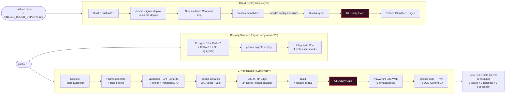

### Qualidade de código e SonarQube Gate

O repositório opera sob **tolerância zero** no SonarQube Cloud (`Quality Gate OK`, **`0` issues** de qualquer tipo ou severidade, **`0` Security Hotspots `TO_REVIEW`** e **`0%` de duplicação CPD**), sem uso de `// NOSONAR` ou `cpd-ignore`.

- **Regras normativas consolidadas:** [`docs/21-qualidade-de-codigo-sonarqube-e-regras.md`](docs/21-qualidade-de-codigo-sonarqube-e-regras.md) define o catálogo obrigatório para TypeScript/JS (`S6582`, `S7747`, `S7758`, `S7763`, `S7765`, `S7766`, `S7727`, `S7770`, `S2933`, `S7503`, `S7649`, `S8786`, `S9382`, `S107`), HTML/Angular (`Web:S6819`, `Web:S1082`, `Web:S6825`, `Web:S6853`, `Web:S7927`), CSS/SCSS (`css:S4656`, `css:S4666`, `css:S9440`) e limites de coesão/duplicação.
- **Portão local pré-push (`npm run audit:sonar:local`):** executa ESLint (`eslint-plugin-sonarjs`, `no-await-in-loop`, `complexity <= 15`, `max-depth <= 3`, `max-params <= 7`, `prefer-includes`, `prefer-optional-chain`, `prefer-readonly`, `max-lines`) + [`scripts/sonar-quality-gate.mjs`](scripts/sonar-quality-gate.mjs) (`jscpd` Type-1 + [`scripts/sonar-cpd-parity.mjs`](scripts/sonar-cpd-parity.mjs) Type-2 literal-normalized a `0%` + paridade estática SonarCloud em `.ts`, `.js`, `.html` e `.scss`).
- **Autoria preventiva para agentes de IA:** as skills **`sonarqube-clean-code`** (aplicada proativamente *durante* escrita/refatoração de código para aprovação de primeira) e **`sonarqube-quality-gate`** (portão obrigatório antes do `git push`) mantêm conformidade contínua com o pipeline.

### UI Quality Gate

`npm run audit:ui` ([`scripts/ui-quality-gate.mjs`](scripts/ui-quality-gate.mjs)) abre o **bundle compilado** em Chrome headless via CDP, em Desktop (`1440×900`) e Mobile (`375×812`). Ele percorre `/`, `/pokedex?q=pikachu`, `/personagem`, `/museu` e `/mundo`, e **reprova o build** quando encontra:

| Verificação | Critério de reprovação |
| :--- | :--- |
| Texto sobre cenário sem fundo adequado | `effectiveSurfaceAlpha < 0.55` |
| Contraste WCAG AA | `< 4.5:1` (texto normal) ou `< 3.0:1` (texto grande), também simulado sobre fundo diurno claro |
| Layout | Overflow horizontal, clipping lateral ou texto vazando de botões e caixas |
| Tipografia e console | Fonte menor que `10.5px` ou erros no console |

### Testes

| Workspace | Runner | Testes |
| :--- | :--- | :-: |
| `@pokeverse/shared` | Vitest 5 | 40 (10 arquivos) |
| `pokeverse-api` (unit) | Jest 30 + `jest-mock-extended` | 124 (42 suítes) |
| `pokeverse-api` (E2E HTTP edge) | Jest + Supertest | 24 (6 suítes) |
| `pokeverse-api` (integração real CI / Testcontainers) | Jest + Postgres/Redis/Kafka/S3 | 4 (1 suíte) |
| `pokeverse-web` (unit) | Vitest 5 + TestBed | 77 (22 arquivos) |
| `@pokeverse/mcp` (unit) | Vitest 5 + `InMemoryTransport` | 5 (1 arquivo) |
| `pokeverse-web` (E2E navegador) | Playwright | 5 (1 arquivo) |
| `scripts` (`test:quality-gates`) | `node --test` | 10 (1 suíte — CI/Sonar/CPD/Docker) |
| **Total** | | **246 unitários + 10 quality gates + 29 E2E + 4 integração real (289 verificações)** |

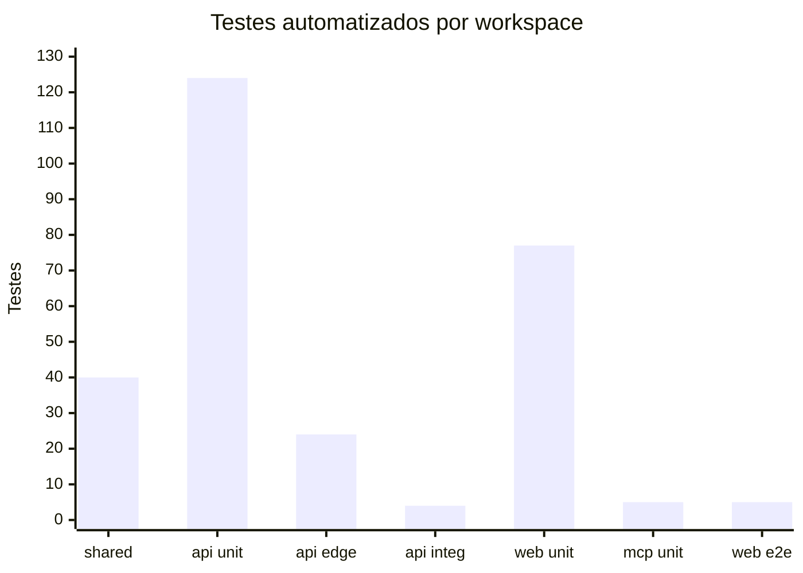

Os testes cobrem busca fuzzy, catálogo dos 51 endpoints e consultas avançadas (`pokeapi-endpoints.spec.ts`), domínio puro e schemas de Personagem Livre (`character-rules.spec.ts`), calculadora competitiva de dano 1v1 e Showdown I/O (`pokemon-battle-calc.spec.ts`), contratos de catálogo enriquecido, filtros e enciclopédia paginada via subpath `@pokeverse/shared/pokedex-encyclopedia` (`pokedex-catalog.schemas.spec.ts`, `pokedex-encyclopedia.schemas.spec.ts`), matriz defensiva `0x..4x` (`type-effectiveness.spec.ts`), schemas de bundle/encontros/formas (`pokedex-bundle.schemas.spec.ts`), regras do Laboratório, schemas (incluindo validação `https:` em URLs, parâmetros de rota da Pokédex, callback Google OAuth, Passkey ID e contratos RUM/Crash Reporting), `ZodValidationPipe`, `SessionAuthGuard`, `CsrfOriginGuard`, `TrainerThrottlerGuard`, `RbacGuard` (*deny-by-default* em rotas privadas), `GlobalExceptionFilter`, `AuditTrailService` + `TrainerGdprService` (`export`/`delete` pseudonimizado), `assertSafeOutboundUrl` (anti-SSRF pós-DNS), `StructuredLoggerService` (redator DLP de segredos/PII + OTel Logs), `SentryErrorReporterService` (Envelope HTTP v7 + anti-SSRF), `TelemetryIngestionService` (`/api/v1/telemetry/{rum,errors}`), `WorldGateway` (origem em produção, cota/IP e anti-spoofing de `x-forwarded-for`), `UpstreamCircuitBreaker` + `PokeApiHttpCacheClient`, `PokeApiCacheService`, `PokedexCatalogService`, `PokedexEncyclopediaService`, `PokedexEnrichmentService`, `PokedexSlotRepository`, `PokedexSlotsService`, `CharacterRepository`, `CharactersService`, `totp-crypto.util`, `TrainerAccountRepository`, `AuthTokenRepository`, `MfaTotpRepository`, `TrainerOAuthRepository`, `PasskeyRepository`, `MailService`, `S3ObjectStorageAdapter` (`assertSafeStorageKey` anti-traversal + SHA-256), `InfraProbesService`, TOTP, Passkeys WebAuthn, OAuth PKCE (`GETDEL` atômico), OTP concorrente, `OutboxEventRepository`, `OutboxRelayService`, consumidores Kafka, deleção LGPD, expurgo temporal, limites `413`/`400` de body parser, E2E HTTP simulado de criação e alocação de personagem ([`characters.e2e-spec.ts`](apps/api/test/characters.e2e-spec.ts)), Google OAuth PKCE + cache `MISS -> HIT -> STALE-FALLBACK` ([`oauth-cache-storage.e2e-spec.ts`](apps/api/test/oauth-cache-storage.e2e-spec.ts)), enriquecimento `/bundle`, `/encounters` e `/forms` ([`pokedex-enrichment.e2e-spec.ts`](apps/api/test/pokedex-enrichment.e2e-spec.ts)), catálogo enriquecido + metadados de filtros ([`pokedex-catalog.e2e-spec.ts`](apps/api/test/pokedex-catalog.e2e-spec.ts)) e enciclopédia paginada + busca reversa ([`pokedex-encyclopedia.e2e-spec.ts`](apps/api/test/pokedex-encyclopedia.e2e-spec.ts)), integração real com PostgreSQL/Redis/Kafka/S3 (`pgsty/silo`), testes unitários Angular (`app-shell.spec.ts`, `auth-guard-interceptor.spec.ts`, `character-studio.spec.ts`, `pokedex-device.spec.ts`, `pokedex-ui-states.spec.ts`, `pokedex-visor-tabs.spec.ts`, `pokedex-filters-compare.spec.ts`, `encyclopedia-page.spec.ts`, `regions-atlas-panel.spec.ts`, `holocron-audio.spec.ts`, `pokemon-type-style.util.spec.ts`, `privacy-consent.store.spec.ts`, `auth-iam.spec.ts`, `world-ticker.store.spec.ts`, `web-telemetry.spec.ts`, `pokedex-view-mapper.util`, `PokedexLocalSlotsStorage`, `auth-dialog-validator.util`, `test-fixtures.spec-helper.ts`, `pokemon-bundle-fixture.spec-helper.ts` e `visor-fixtures.spec-helper.ts`) e jornadas reais no navegador com **Playwright** ([`pokeverse-journey.e2e.ts`](apps/web/e2e/pokeverse-journey.e2e.ts)).

### Bundle do front-end

`633.50 kB` raw e `155.09 kB` de transferência estimada no bundle inicial (`0` warnings de budget). O CSS global tem `118.91 kB` (`18.55 kB` transferido) e o `main` tem `86.48 kB` (`17.98 kB` transferido). O motor **Babylon.js 9 + Havok WASM** (`character-hologram-babylon-renderer` em `57.40 kB` / `12.56 kB` transferido e chunks lazy do Holocron/GLTF/PBR + `/assets/draco/` e `/assets/havok/` auto-hospedados) é carregado apenas sob demanda ao abrir as cenas 3D em `ULTRA`/`BALANCED`, junto com `pokedex-device-component` (`345.31 kB`), `character-studio-page-component` (`84.99 kB`), `socket.io-client` e diálogos sob `@defer`.

---

## Segurança e privacidade

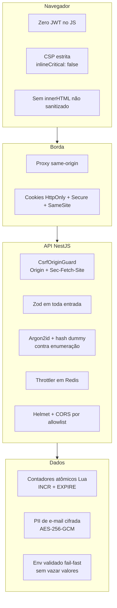

| Tema | Como está resolvido |
| :--- | :--- |
| **Sessão** | Opaca, no Redis, com `MFA_PENDING` → `AUTHENTICATED`, rotação de refresh por família e revogação instantânea |
| **MFA** | TOTP (QR Code + 8 backup codes), Passkeys WebAuthn e proteção contra *account takeover* no Google PKCE |
| **Concorrência** | Zero TOCTOU em contadores (Lua), consumo one-time atômico via `GETDEL` (OAuth/Passkey) e `DEL` (OTP), zero efeito externo antes da constraint `UNIQUE`, lease atômico no Outbox e rollback de idempotência no `catch` |
| **WebSockets & Logs** | `/ws/world` rejeita `!origin` em produção e aplica cota (`10`/IP, `1000` globais); `StructuredLoggerService` mascara segredos/tokens e logs HTTP gravam só `req.path`; `bodyParser: false` com `64kb` (`413`/`400`) |
| **LGPD** | Cookie de consentimento versionado (`pokeverse_consent`, 180 dias), chaves não essenciais registradas declarativamente, portabilidade em `GET /auth/me/export`, eliminação definitiva em cascata via `DELETE /auth/me` (confirmação em 2 etapas na UI), expurgo automático a cada `6h` de tokens/eventos expirados e zero rastreadores de terceiros |
| **Infra & CI/CD** | Container multi-stage não-root stateless (migrations pré-deploy separadas em `deploy.yml` via `DATABASE_URL_UNPOOLED` e step `db-secret`), backing services reais no `ci.yml` (`postgres`, `redis`, `apache/kafka`), **Testcontainers** local (`test:integration:tc`), **Gitleaks** (pré-`npm ci` + `.gitleaks.toml`), **Trivy** (`CRITICAL`, pinado por SHA + SBOM CycloneDX), **CodeQL** SAST, `npm audit --omit=dev --audit-level=high` (`0` vulnerabilidades), `.github/CODEOWNERS` + template de PR, TLS e mTLS em nuvem |
| **Qualidade Estática & SAST (`SonarQube`)** | `SonarQube Cloud` bloqueante com `0` vulnerabilidades, `0` Security Hotspots `TO_REVIEW`, prevenção de ReDoS (`S8786`) e `0%` CPD; paridade estática local pré-push via `npm run audit:sonar:local` + skills preventivas `sonarqube-clean-code` e `sonarqube-quality-gate` ([doc 21](docs/21-qualidade-de-codigo-sonarqube-e-regras.md)) |
| **Observabilidade** | **OpenTelemetry SDK (3 sinais OTLP)** ponta a ponta (HTTP, Prisma, Redis, KafkaJS + *Child Spans*, WebSocket e RUM Angular via `/api/v1/telemetry/rum` sob gate LGPD) -> **OTel Collector** -> **Prometheus** (+ Postgres/Redis Exporters e `alerts.yml`), **Grafana Loki** (`30d`) + Promtail, **Grafana Tempo** e **Grafana** (`:3005` autenticado em `127.0.0.1`), além de **`SentryErrorReporterService`** (Envelope v7 + anti-SSRF pós-DNS via `/api/v1/telemetry/errors`) e perfil paralelo `datadog` (`Datadog Agent`) ([doc 19](docs/19-observabilidade-telemetria-e-monitoramento.md)) |
| **Governança & Gate Pré-IA (35 controles)** | Matriz completa `REQ-SEC-01..35` documentada: RBAC granular/escopos, WAF/DDoS, CORS/CSP estritos, anti-SSRF, rate limit por usuário/chave, proteção EDoS, cofre centralizado de segredos, KMS em repouso, DLP runtime, TTLs automatizados, trilha de auditoria imutável, SCA/SBOM + SAST/DAST, revisão de terceiros, controle estrito de logs/métricas, alertas + playbooks IRP, limitações/AUP, SLAs de responsabilidade compartilhada e portões obrigatórios antes de qualquer uso de IA/modelos (tokenização PII, filtro de *prompt injection*, moderação, Red Teaming, vieses, sandboxing sem rede, HITL, privacidade diferencial e assinatura de respostas) |

Os detalhes estão no [Dossiê 13](docs/13-dossie-de-seguranca-e-blindagem.md), nos [requisitos de privacidade, LGPD e segurança (`REQ-SEC-01..35`)](docs/16-cookies-lgpd-e-requisitos.md) e no [guia de qualidade de código e SonarQube](docs/21-qualidade-de-codigo-sonarqube-e-regras.md).

---

## Performance

O projeto detecta o hardware e escolhe um perfil. Isso mantém a fidelidade visual em desktops e a fluidez em celulares fracos. O seletor `Perf: Auto` fica visível na HUD.

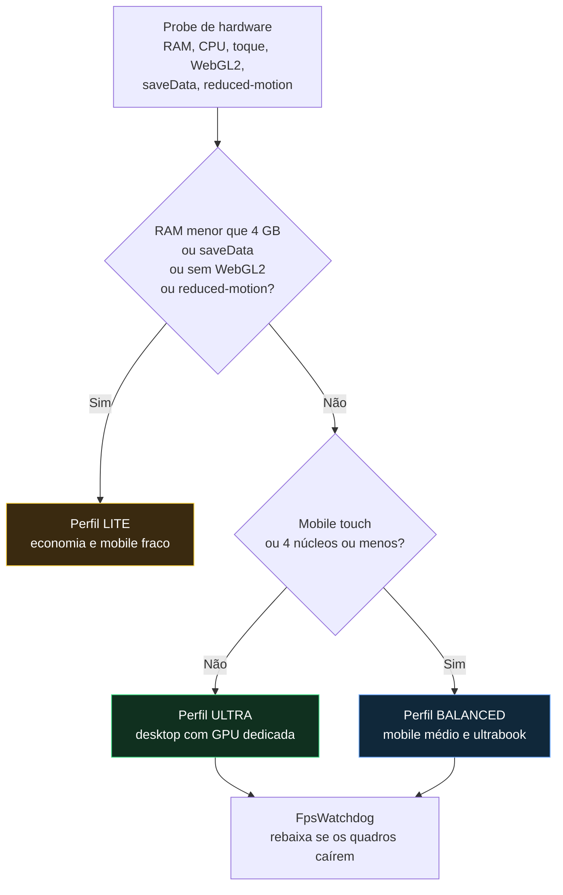

As animações dos LEDs usam apenas `opacity` e `transform` (sem `filter` nem `box-shadow` por quadro), e os cenários têm variantes `-desktop` e `-mobile` em WebP. Veja o [documento 11](docs/11-performance-hardware-gates-e-mobile.md).

---

## Roadmap: o que vem a seguir

```mermaid
flowchart LR
  f0["Fase 0<br/>Pokédex estática<br/>(atividade do Senac)"]:::done
  f1["Fase 1<br/>Monorepo + shell Angular"]:::done
  f2["Fase 2<br/>API, Prisma, Redis,<br/>Outbox e WebSocket"]:::done
  f2b["Etapas 2A e 2B<br/>IAM BFF, MFA<br/>e hardening"]:::done
  f3["Fase 3<br/>Deploy em nuvem"]:::done
  f4a["Fase 4A<br/>Restauração fiel 3D,<br/>CSP e bundle"]:::done
  f4b["Fase 4B<br/>Pokédex Suprema"]:::next
  f5["Fase 5<br/>Back-end do Laboratório<br/>e mecânicas de jogo"]:::plan
  f6["Fase 6<br/>Overworld, Museu 3D,<br/>Arcade e Battle Frontier"]:::plan

  f0 --> f1 --> f2 --> f2b --> f3 --> f4a --> f4b --> f5 --> f6

  classDef done fill:#10301f,stroke:#3ddc84,color:#fff
  classDef next fill:#3a2a10,stroke:#ffd23f,color:#fff
  classDef plan fill:#1b2a4a,stroke:#6aa7ff,color:#fff
```

| Etapa | Nome | Estado | Entregas |
| :--- | :--- | :---: | :--- |
| Fase 0 | Pokédex 3D estática (vanilla) | Concluída *(legado removido por desuso)* | `index.html`, `css/style.css` e `js/app.js` portados integralmente para `apps/web`/`@pokeverse/shared` e **apagados da raiz** (referências preservadas em [`docs/`](docs/capitulo-00-como-tudo-comecou.md) e no histórico Git) |
| Fase 1 | Fundação do monorepo e shell Angular | Concluída | Workspaces, `docker-compose` saudável |
| Fase 2 | API, Prisma, Redis, Outbox e WebSocket | Concluída | Cache PokéAPI, 10 slots em ACID, ticker ao vivo |
| 2A e 2B | IAM Enterprise BFF e hardening | Concluída | MFA, Passkeys, OAuth PKCE, OTP, SonarCloud |
| Fase 3 | Deploy em nuvem | Concluída | Cloudflare Pages, Azure, Neon, Upstash, Aiven, Resend, CI/CD |
| Fase 4A | Restauração fiel 3D, CSP e bundle | Concluída | Giro reversível, unicidade de slots, `stale-fallback`, 51 endpoints e Lab modelados |
| **Fase 4B** | **Pokédex Suprema** | **Concluída (Passos 2A.1–2A.3 + 2B.1–2B.3)** | `22/51` endpoints ativos no BFF (`/catalog/enriched` + `/meta/filters`, `/bundle`, `/encounters`, `/forms` e enciclopédia paginada + busca reversa), **Visor LCD 2.0 (5 abas paginadas)**, **filtros combinados**, **Comparador 1v1** (`@defer`), rota **`/enciclopedia`**, **Museu das 9 Regiões com dados vivos**, **Espectrograma Web Audio** e **Projetor Holocron 3D** *(entregue em `three` no `@defer`; migrado para Babylon.js 9 + Havok WASM)* |
| **UI Polish (Ondas 1–2)** | **Design System & Ergonomia da Pokédex 3D** | **Concluídas (Ondas 1–2 / Doc 20)** | Tokens `--pv-*` unificados (`0` legados em `apps/web/src/app/**`), paleta WCAG AA+ dos **18 tipos Pokémon**, primitivos compartilhados (`_primitives.scss`), *segmented controls* no Visor LCD 2.0 + destaque do sprite por tipo e filtros em 2 abas rápidas (`Tipos & Gen` / `Taxonomia & Ordem`) preservando 100% da carcaça 3D — próxima onda: Onda 3 ([doc 20](docs/20-polimento-visual-e-design-system-frontend.md)) |
| **Passo 1B + MCP & Motor 3D** | **Personagem 3D, `@pokeverse/mcp`, Blender MCP & Babylon.js 9 + Havok** | **Concluída** | Módulo `/personagem` (evolução sem nível, skills em cascata e Bazar), workspace **`apps/mcp` (`@pokeverse/mcp` `stdio` com 12 tools / 5 resources / 3 prompts)**, [`.vscode/mcp.json`](.vscode/mcp.json) + [`.mcp.json`](.mcp.json) (`pokeverse-devkit` + `blender` via `uvx mcp-for-blender`) e migração total de `three` para **`@babylonjs/core@^9.38.0` + `@babylonjs/loaders` + `@babylonjs/havok@^1.3.14`** com Draco/Havok auto-hospedados |
| Fase 5 | Back-end do Laboratório e mecânicas | Modelada | Atributos por nível, evolução, clonagem, Bio-Essência, encontros e combate |
| Fase 6 | Expansões do mundo | Futura | Overworld Phaser 3, Museu em globo 3D, Arcade WASM e Battle Frontier |

### Em andamento: Fase 4B, Pokédex Suprema

- **Passo 2A.1 (Concluído):** refatoração SOLID do cliente HTTP/Redis (`PokeApiHttpCacheClient` + `PokeApiResourceFetcher` + mappers dedicados), cálculo defensivo `0x..4x` em `@pokeverse/shared` (`computeDefensiveTypeEffectiveness`) e rotas `GET /pokedex/pokemon/:idOrName/{bundle,encounters,forms}` com cache `24h` + `7d` stale (`/type` em `7d` + `14d` stale).
- **Passo 2A.2 (Concluído):** subpath export `@pokeverse/shared/pokedex-encyclopedia`, `UpstreamCircuitBreaker` por host (`pokeapi.co` e `graphql.pokeapi.co`), `GET /pokedex/catalog/enriched` em 1 query via **PokéAPI GraphQL v1beta2** (`24h` + `7d` stale + fallback degradado REST sem envenenar o cache enriquecido) e `GET /pokedex/meta/filters` (`7d` + `14d` stale + fallback paralelo REST).
- **Passo 2A.3 (Concluído):** rotas enciclopédicas (`/moves`, `/abilities`, `/items`, `/berries`, `/regions`, `/pokedexes`, `/locations`, `/egg-groups`, `/growth-rates`) com **listagem paginada (`limit`/`offset`/`q` sobre chave única Redis) + detalhe `/:idOrName`** (busca reversa) e `/natures`/`/types` cacheados `7d` + `14d` stale via `PokedexEncyclopediaController`, `PokedexEncyclopediaService` e mappers dedicados (`22/51` ativos no BFF).
- **Passo 2B.1 (Concluído — Visor LCD 2.0):** consumo de `/bundle` (com fallback transparente para `/pokemon/:idOrName` e PokéAPI direta) e cargas lazy por aba (`/forms`, `/encounters`, `/moves/:idOrName`, `/abilities/:idOrName`) nas **5 abas internas do Visor LCD** (`Resumo & Lore`, `Atributos & Tipos`, `Evolução & Formas`, `Golpes & Itens`, `Mapa & Sprites`) via `PokedexVisorDetailStore` e `components/visor-tabs/*`, com navegação por clique, teclado e D-Pad `◀`/`▶` sem alterar a carcaça física 3D.
- **Passo 2B.2 (Concluído — Filtros Combinados, Comparador 1v1 & Enciclopédia):** painel colapsável de filtros combinados na ala esquerda (`/catalog/enriched` + `/meta/filters`), **Comparador 1v1** (`<dialog>` em `@defer`), rota pública lazy **`/enciclopedia`** com 11 recursos do BFF + busca reversa para `/pokedex?q=<nome>` e dossiê de dívida visual no [doc 20](docs/20-polimento-visual-e-design-system-frontend.md).
| **Passo 2B.3 (Concluído — Atlas das Regiões, Motor Web Audio & Projetor Holocron 3D):** linha do tempo das **9 regiões canônicas (`1996–2022`)** + dossiê vivo (`/regions/:id` e `/pokedexes/:id`), posteriormente unificados dentro da **Enciclopédia da Pokédex** (`ENT-19`, com `/museu` redirecionando para `/pokedex?mode=enciclopedia&cat=region`), espectrograma Web Audio (`AudioStore` + `AudioEngineService` + `CrySpectrogramComponent`) nos *Cries* e **Projetor Holocron 3D** *(originalmente `three` em chunk lazy `@defer`; migrado para **Babylon.js 9 + Havok WASM** com shader GLSL, pedestal elemental e fallback 2D em `LITE`/`webglcontextlost`)*.
- **UI Polish — Ondas Visuais 1 e 2 (Concluídas — Design System & Ergonomia da Pokédex 3D):** unificação dos tokens `--pv-*` em [`_tokens.scss`](apps/web/src/styles/_tokens.scss) (`0` legados em `apps/web/src/app/**`, `0` hex literais em `_search-scanner.scss`, `_visor-lcd.scss`, `_visor-tabs.scss` e `_filters-panel.scss`), paleta WCAG AA+ dos **18 tipos Pokémon** ([`_pokemon-types.scss`](apps/web/src/styles/_pokemon-types.scss) + [`pokemon-type-style.util.ts`](apps/web/src/app/shared/utils/pokemon-type-style.util.ts)), primitivos visuais compartilhados ([`_primitives.scss`](apps/web/src/styles/_primitives.scss)), *segmented controls* no Visor LCD 2.0 + destaque do sprite por tipo e painel de filtros em 2 abas rápidas (`Tipos & Gen` / `Taxonomia & Ordem`) preservando 100% da carcaça 3D — próxima onda: 3 em [doc 20](docs/20-polimento-visual-e-design-system-frontend.md).
- **UX Unificada & Fila Prioritária (Concluída — Consolidação na Pokédex, Holocron 3D real, Slots & Atlas das Regiões):** tela inicial retrô em `/` (`TitleScreenComponent`), Hub `/inicio` (`HomeHubComponent`), consolidação de **Holocron 3D**, **Comparador 1v1**, **Enciclopédia Global** (com **Regiões & História** embutido; `/enciclopedia` e `/museu` redirecionam para `/pokedex?mode=enciclopedia`) e **Calculadora de Atributos** (`calculateStatsAtLevel` / `calculateXpForLevel`) dentro do Visor da Pokédex (`visor-modes/`), correção do giro 360° real no Holocron 3D + hook `GLTFLoader` para `.glb` leves, abertura direta de slots azuis ocupados sem modal de confirmação, reordenação Drag & Drop + `↑`/`↓` nos slots (`PATCH /api/v1/pokedex/slots/swap`) e criação da fila prioritária permanente em [doc 00-fila](docs/00-fila-prioritaria-melhorias.md).
- **`TrainerPokemonSnapshot` no PostgreSQL**: snapshot dos favoritos para continuar disponível mesmo com as APIs externas fora do ar
- Fontes complementares: **Pokémon TCG API** e histórico de anime e filmes

### Dívidas técnicas conhecidas

Aqui está o estado atualizado das dívidas mapeadas após a execução do [doc 17](docs/17-plano-solid-clean-code-e-engenharia-big-tech.md) e a auditoria frente ao Contrato de Qualidade no [doc 18](docs/18-auditoria-e-plano-divida-tecnica-arquitetura.md):

| Item | Situação |
| :--- | :--- |
| Adequação ao Contrato de Qualidade (`ARCHITECTURE.md` — Ondas 1–4) | **Concluída no [doc 18](docs/18-auditoria-e-plano-divida-tecnica-arquitetura.md) (Nota `10,0 / 10` — Ondas 1, 2, 3 e 4 concluídas):** 100% de `@pokeverse/shared`, `apps/api` e `apps/web` atendem ao contrato (`DT-01..DT-06` resolvidos, guardrails automáticos de `max-lines`/`complexity`/Prettier e `app.spec.ts` fatiado por domínio) |
| Lint, formatação, Zero Duplicação e SonarCloud no CI | **Concluída (Onda 4 + Remediação SonarCloud + Fechamento Doc 17 + Sonar Gate Bloqueante + Protocolo Nunca Falhar Duas Vezes + CPD Type-2):** `npm run lint` (`--max-warnings=0`, `eslint-plugin-sonarjs`, `no-await-in-loop`, `eslint-plugin-prettier/recommended`, `@typescript-eslint/no-explicit-any: error`, `complexity: ['error', 15]`, `max-depth: ['error', 3]`, `max-lines` `300`/`200` no web, `max-lines-per-function: 65`, além de `@typescript-eslint/require-await`, `prefer-includes`, `prefer-optional-chain` e `prefer-readonly` nos 3 workspaces *type-checked*) via base compartilhada [`eslint.base.mjs`](eslint.base.mjs), `npm run format:check`, **`npm run audit:duplication`** (`jscpd` Type-1 a `0%` + [`scripts/sonar-cpd-parity.mjs`](scripts/sonar-cpd-parity.mjs) Type-2 literal-normalized a `0%` respeitando `.sonarcloud.properties` + paridade em [`scripts/sonar-parity-rules.mjs`](scripts/sonar-parity-rules.mjs)), paridade local de todas as etapas não-Sonar em [`scripts/ci-parity-checks.mjs`](scripts/ci-parity-checks.mjs) + [`scripts/verify-docker-build.mjs`](scripts/verify-docker-build.mjs) (`audit:secrets`, `audit:prisma`, `audit:docker`), suíte de regressão [`scripts/quality-gate.spec.mjs`](scripts/quality-gate.spec.mjs) (`npm run test:quality-gates`), runner paralelo [`scripts/run-verify-suite.mjs`](scripts/run-verify-suite.mjs) + pré-commit rápido [`scripts/verify-commit-fast.mjs`](scripts/verify-commit-fast.mjs) nos hooks [`.githooks/`](.githooks/pre-commit) (`npm run verify:commit` / `npm run verify:push` / `npm test`) e **`npm run audit:sonar`** + job bloqueante `sonarqube` no [`ci.yml`](.github/workflows/ci.yml) (`Quality Gate OK`, `0` issues de qualquer severidade, `0` hotspots `TO_REVIEW` e `0` duplicação CPD), `0` cores literais em `apps/web/src/app/**/*.scss` (tokens `--pv-*`) e governança `.github/CODEOWNERS` + template de PR |
| Decomposição SOLID, Portas DIP/LSP e IAM | **Concluída:** `AuthService` fatiado em 5 serviços especializados + 5 repositórios isolados (`TrainerAccount`, `AuthToken`, `MfaTotp`, `Passkey`, `TrainerOAuth`) + portas DIP/LSP (`EmailTransport`, `SessionRepository`, `OtpStore`, `ObjectStoragePort`, `TelemetryMetricsPort`) + `totp-crypto.util` + `TrainerSessionIssuer` + `AuthOutboxPublisher`; `GoogleOAuthService` em 3 serviços; `AuthStore` (`<= 291` linhas) com `AuthRecoveryService` + `AuthCrossTabSyncService` e validação do diálogo em `auth-dialog-validator.util.ts` (`DIALOG_VALIDATORS`) |
| Pokédex 3D, DIP, Hub e Tokens HUD (`apps/web`) | **Concluída (Ondas 3–4 + Doc 17 + Refino HUD + Passos 2B.1–2B.3 + UI Polish Ondas 1–2 + UX Unificada + `MEL-01`):** stores e serviços (`PokedexStore` + `PokedexApiClient`, `PokedexFiltersStore`, `PokedexCompareStore`, `PokedexVisorDetailStore`, `PokedexSlotsStore` + `PokedexLocalSlotsStorage`, `PokedexRpgNavService`, `PokedexInputShortcutsService`, `PokedexLidPhysicsService`) e componentes UI (`TitleScreen`, `HomeHub`, `PokedexDevicePage`, `PokedexCover`, `PokedexSearchPanel`, `PokedexFiltersPanel`, `PokedexPhysicalControls`, `PokedexVisor` + 5 abas em `visor-tabs/` + 4 modos integrados em `visor-modes/` [Holocron 3D com `.glb` Draco animado, Comparador 1v1 Arena, Calculadora de Atributos, Enciclopédia], `PokedexSlotsConfig` com Drag & Drop/`↑`/`↓`, `PokedexSlotsGrid`, `SlotConfirmDialog`, `HudTopbar`, `HudModulesMenu`, `HudUserMenu`, `HudSettingsMenu`, `PokeballMarkComponent`) fatiados com `.html`/`.scss` dedicados, diretivas `[pvRpgFocusable]`, `[pvRpgAction]`, `[pvRpgEditForm]` e `[pvMainHeading]`, utilitários `pokemon-type-style.util.ts`, `pokedex-stat-calc.util.ts`, `holocron-animation.util.ts` e `holocron-media-loader.util.ts`, tokens `--pv-*`/`--pv-hud-*`/`--pv-type-*` em `_tokens.scss`, `_pokemon-types.scss`, `_primitives.scss` e 7 parciais `styles/pokedex/` (Onda Visual 3 planejada no [doc 20](docs/20-polimento-visual-e-design-system-frontend.md) e backlog em [doc 00-fila](docs/00-fila-prioritaria-melhorias.md)) |
| Cobertura e integração reais | **246 unitários + 10 suítes de regressão CI/Sonar (`test:quality-gates`) + 29 E2E + 4 integração real (`289` verificações):** `10` blocos em [`scripts/quality-gate.spec.mjs`](scripts/quality-gate.spec.mjs) (32 regras SonarCloud, CPD Type-2 literal-normalized, paridade Gitleaks, simulação Docker/lifecycle com `apps/mcp/package.json`, `prisma validate`, `deploy.yml` e falhas históricas do CI), `40` shared (`10` arquivos, incluindo `character-rules.spec.ts`), `124` api unit (`42` suítes com `jest-mock-extended`, incluindo `CharacterRepository`/`CharactersService` e `swapSlots`/`swapSlotsWithOutbox`), `24` api E2E HTTP edge (`app.e2e-spec.ts` + `characters.e2e-spec.ts` + `oauth-cache-storage.e2e-spec.ts` + `pokedex-enrichment.e2e-spec.ts` + `pokedex-catalog.e2e-spec.ts` + `pokedex-encyclopedia.e2e-spec.ts`), `4` integração real (`app.integration-spec.ts` com Postgres 16 + Redis 7 + Apache Kafka 3.9 + `pgsty/silo` S3 no job `integration-e2e` do CI e Testcontainers local via `test:integration:tc`), `5` MCP Game Devkit (`apps/mcp/src/mcp-server.spec.ts` com `InMemoryTransport`), `77` web Vitest em `22` arquivos (`character-studio.spec.ts`, `pokedex-attribute-lookup.service.spec.ts`, `pokedex-attribute-search.util.spec.ts`, `pokedex-catalog-companions.util.spec.ts`, `pokedex-visor-expand-calc.spec.ts`, `regions-atlas-panel.spec.ts`, `holocron-audio.spec.ts`, `app-shell.spec.ts`, `pokedex-device.spec.ts` e `pokemon-type-style.util.spec.ts` incluídos) e `5` jornadas Playwright E2E em `pokeverse-journey.e2e.ts` |
| Observabilidade & Segurança (Ondas 2–5) | **Onda 1 + Onda 4 (Código + CI/CD) + Fechamento Doc 17 concluídos** (`gitleaks`, `Trivy` + **SBOM CycloneDX**, **SAST CodeQL**, `npm audit --omit=dev --audit-level=high` zerado, **OpenTelemetry SDK + métricas RED** em `/api/v1/system/telemetry`, migrations pré-deploy fora do container, `RbacGuard` *deny-by-default* em todas as rotas privadas com preservação de `TrainerRole` e rotação de `sid` no MFA, `TrainerThrottlerGuard`, `assertSafeOutboundUrl` anti-SSRF pós-DNS, `AuditLog` append-only por trigger SQL + `AuditTrailService`, DLP ampliado e `WorldGateway` com resolução direita-esquerda); pendente `WsAuthGuard` + `ngCspNonce` + regras R2/WASM (**Ondas 2–3 / Fase 6**), WAF/cofre centralizado/DAST/playbooks IRP/revisão de terceiros (**Onda 4 Cloud/Ops**) e gate pré-IA + EDoS (**Onda 5**) conforme [Dossiê 13](docs/13-dossie-de-seguranca-e-blindagem.md) e [doc 16](docs/16-cookies-lgpd-e-requisitos.md) |
| Domínio próprio | Opcional: conectar `pokedex.<domínio>` no Cloudflare e atualizar `CORS_ORIGINS`, `WEBAUTHN_*` e `GOOGLE_REDIRECT_URI` |
| `WsAuthGuard` | O `/ws/world` aceita visitantes para o ticker. Ações do Overworld exigirão sessão autenticada |

---

## Como executar

### Pré-requisitos

- **Node.js 22+** e **npm 11+**
- **Docker** (opcional, para PostgreSQL, Redis, Redpanda, MinIO/S3 e Mailpit locais)
- **Chrome, Chromium ou Edge** (só para `npm run audit:ui`; defina `CHROME_BIN` se necessário)
- **Blender + `uv` (`uvx`)** (opcional, para ativar o servidor MCP `blender` via `mcp-for-blender` junto com o `pokeverse-devkit` em [`.vscode/mcp.json`](.vscode/mcp.json) / [`.mcp.json`](.mcp.json))

### Servidor MCP Game Devkit (`apps/mcp`) & Blender MCP

Para expor ferramentas de inspeção `.glb`, auditoria/geração de texturas, simulação **Babylon.js + Havok**, blueprints de personagem e verificação WCAG/HUD no editor:

```bash
npm run build:shared
npm run build:mcp
```

Os arquivos [`.vscode/mcp.json`](.vscode/mcp.json) (`servers`) e [`.mcp.json`](.mcp.json) (`mcpServers`) já registram **`pokeverse-devkit`** (`node apps/mcp/dist/index.js`) e **`blender`** (`uvx mcp-for-blender`, exigindo [`uv`](https://docs.astral.sh/uv/) no `PATH` e o add-on ativo no Blender). Consulte [`apps/mcp/README.md`](apps/mcp/README.md).

### Modo rápido: só o front-end

Sem Docker e sem API, a Pokédex funciona em **modo degradado**, direto contra a PokéAPI.

```bash
npm install
npm run build:shared
npm run dev:web
```

Abra `http://localhost:4200`.

### Modo completo: com API, banco, cache e mensageria

```bash
npm install
npm run build:shared

cp .env.example .env          # ajuste os segredos locais
npm run infra:up              # Postgres, Redis, Redpanda, MinIO e Mailpit

npx --workspace=pokeverse-api prisma generate
npx --workspace=pokeverse-api prisma migrate deploy

npm run dev:api               # API em http://localhost:3000
npm run dev:web               # Web em http://localhost:4200 (proxy para /api, /health, /socket.io)
```

| Serviço local | Porta | Observação |
| :--- | :---: | :--- |
| Web (Angular) | `4200` | Proxy automático para a API |
| API (NestJS) | `3000` | Prefixo `/api/v1` |
| PostgreSQL | `5433` | Porta alterada para não colidir com um Postgres local |
| Redis | `6379` | AOF habilitado |
| Redpanda (Kafka) / Console | `19092` / `8085` | Console web para inspecionar tópicos |
| MinIO (S3) / Console | `9000` / `9001` | Buckets privados `pokeverse-roms` e `pokeverse-saves` |
| Mailpit | `1025` / `8025` | Captura os e-mails de OTP em desenvolvimento |
| Grafana | `3005` | Dashboards correlacionados em `127.0.0.1:3005` (login via `.env`) |
| Prometheus | `9090` | Séries temporais, Exporters (`9187` / `9121`) e `alerts.yml` |
| Loki / Tempo | `3100` / `3200` | Logs centralizados (`30d`) e Traces distribuídos |
| OTel Collector | `4317` / `4318` | Ingestão OTLP gRPC / HTTP (métricas Prometheus em `8889`) |

### Scripts do monorepo

| Comando | O que faz |
| :--- | :--- |
| `npm run build` | Build de `shared`, `api`, `web` e `mcp` (`build:mcp`) |
| `npm run typecheck` | `tsc --noEmit` nos 4 workspaces (`shared`, `api`, `web`, `mcp`) |
| `npm run lint` | ESLint (`--max-warnings=0`, `eslint-plugin-sonarjs`, `no-await-in-loop`, `complexity`, `max-depth`, `max-params`, `max-lines`, `max-lines-per-function`, `prefer-optional-chain` e `prefer-readonly` nos type-checked) nos 4 workspaces |
| `npm run format:check` | Valida formatação Prettier nos 4 workspaces (`shared`, `api`, `web`, `mcp`) |
| `npm run audit:secrets` | Varredura local estilo Gitleaks sobre arquivos rastreados/não ignorados (`.gitleaks.toml`) |
| `npm run audit:prisma` | Valida `schema.prisma` (`DATABASE_URL_UNPOOLED`) e ordem das migrations (`prisma validate`) |
| `npm run audit:deps` | Audita dependências de produção contra vulnerabilidades `high` e `critical` (`npm audit --omit=dev`) |
| `npm run audit:duplication` | Detector CPD local Type-1 (`jscpd` a `0%`) + Type-2 (`sonar-cpd-parity.mjs`) + paridade estática SonarCloud em `.ts`, `.js`, `.html` e `.scss` (`apps` e `packages`) |
| `npm run audit:sonar:local` | Executa `lint` (SonarJS) + `audit:duplication` (CPD + paridade SonarCloud) antes do `git push` |
| `npm run audit:sonar` | Consulta a API do SonarQube Cloud e reprova se houver qualquer issue, hotspot ou duplicação |
| `npm run audit:docker` | Simula contexto e lifecycle hooks de `infra/docker/api.Dockerfile` (e executa `docker build` quando o daemon estiver ativo) |
| `npm run test:quality-gates` | Suíte de regressão (`10` blocos: paridade SonarCloud, ESLint/SonarJS AST, CPD Type-2, Gitleaks, Docker lifecycle, Prisma e invariantes históricos do CI/Deploy) |
| `npm run verify:commit` | Portão pré-commit rápido (`scripts/verify-commit-fast.mjs`: `audit:secrets`, paridade Sonar/Prettier e CPD Type-2 nos arquivos *staged* + `audit:prisma` condicional) acionado por `.githooks/pre-commit` |
| `npm run verify:push` | Portão pré-push paralelo por ondas (`scripts/run-verify-suite.mjs --mode=push`, com cache por *tree SHA* limpo e `--no-cache`) cobrindo 100% do CI (`audit:secrets`, `audit:prisma`, `format:check`, `audit:deps`, `build:shared`, `typecheck:*`, `lint:*`, `audit:duplication`, `test:quality-gates`, `test:unit:*`, `test:e2e:api`, `build:*`, `audit:ui`, `test:e2e:web`, `audit:docker`) acionado por `.githooks/pre-push` |
| `npm run test:unit` | Vitest (`shared`, `web`) + Jest (`api` unitários) |
| `npm run test` | Runner paralelo (`scripts/run-verify-suite.mjs --mode=test`): localmente executa todos os portões estáticos + `test:quality-gates` + `test:unit:*`; no CI (`CI=true`) foca em `test:quality-gates` + `test:unit:*` sem duplicar etapas |
| `npm run test:e2e` | Suítes E2E completas (`test:e2e:api` + `test:e2e:web`) |
| `npm run test:e2e:api` | Suítes E2E da borda HTTP (`app.e2e-spec.ts`, `oauth-cache-storage.e2e-spec.ts`, `pokedex-enrichment.e2e-spec.ts`, `pokedex-catalog.e2e-spec.ts` e `pokedex-encyclopedia.e2e-spec.ts`) |
| `npm run test:e2e:web` | Jornadas visuais E2E com Playwright no navegador (`pokeverse-journey.e2e.ts`) |
| `npm run test:integration --workspace=pokeverse-api` | Integração real sem mocks contra Postgres, Redis, Kafka e S3 (`app.integration-spec.ts`) |
| `npm run test:integration:tc --workspace=pokeverse-api` | Integração real autocontida via Testcontainers (Postgres, Redis, Redpanda e `pgsty/silo` S3 locais) |
| `npm run audit:ui` | UI Quality Gate sobre o build do front-end |
| `npm run infra:up` / `infra:down` | Sobe e derruba a infraestrutura Docker (incluindo stack de observabilidade) |
| `npm run infra:datadog:up` / `infra:datadog:down` | Sobe e derruba a stack incluindo o perfil paralelo `datadog` (`DD_API_KEY`) |

> **Antes de abrir um PR ou fazer `git push`**, rode `npm run verify:push` (executado automaticamente pelo `.githooks/pre-push`) e `npm run audit:sonar`. Qualquer falha de segredo, Prisma, formatação, tipagem, lint, duplicação, teste, build, UI Gate, Playwright ou Docker bloqueia o push e o CI.

### Variáveis de ambiente

Todas as chaves estão em [`.env.example`](.env.example) e são validadas **na inicialização** da API ([`env.schema.ts`](apps/api/src/config/env.schema.ts)). Se algo estiver errado, ela falha sem imprimir os valores. Os grupos principais são:

`NODE_ENV`, `API_PORT` · `CORS_ORIGINS`, `COOKIE_*` · `APP_ENCRYPTION_KEY` · `DATABASE_URL`, `DATABASE_URL_UNPOOLED` · `REDIS_URL` · `KAFKA_*` · `MAIL_*`, `SMTP_*`, `RESEND_API_KEY` · `GOOGLE_*` · `WEBAUTHN_*` · `S3_*`

> Nunca faça commit de `.env` ou `.env.cloud`. Eles estão no `.gitignore`.

### Versão estática anterior (Fase 0 — removida por desuso)

Os arquivos estáticos da Fase 0 (`index.html`, `css/style.css` e `js/app.js`, que iniciaram o projeto em HTML, CSS e JavaScript puro) foram integralmente portados para o motor **Angular 22 + `@pokeverse/shared` + NestJS** e **removidos da raiz por não serem mais utilizados**. O histórico completo e as referências técnicas continuam preservados no Git e nos documentos [`Capítulo 00`](docs/capitulo-00-como-tudo-comecou.md) e [`Guia 00`](docs/capitulo-00-guia-de-estudos-pokedex.md).

---

## Estrutura do repositório

```text
pokedex-frontend/
├── apps/
│   ├── api/                       # NestJS 11 + Prisma 6 + Redis + Kafka + Socket.IO
│   │   ├── prisma/                #   schema.prisma (16 modelos, 6 enums) e 4 migrações
│   │   └── src/
│   │       ├── common/            #   guards, filtros, pipes, middleware, telemetria (OTel 3 sinais + Sentry Envelope v7 + AuditTrail), crypto
│   │       ├── config/            #   env.schema.ts (validação fail-fast com Zod)
│   │       ├── infra/             #   Prisma, Redis, Kafka e probes de saúde
│   │       └── modules/           #   auth (SOLID IAM: AuthService fachada, 5 services, 5 repositórios [TrainerAccount, AuthToken, MfaTotp, Passkey, TrainerOAuth], totp-crypto.util, SessionIssuer, OutboxPublisher, GoogleOAuth*), characters (CharacterRepository, CharactersService, CharactersController + criação livre e alocação atômica), pokedex (UpstreamCircuitBreaker, PokeApiHttpCacheClient, PokeApiResourceFetcher, PokeApiCacheService, PokedexCatalogService, PokedexEnrichmentService, PokedexEncyclopediaController, PokedexEncyclopediaService, PokedexSlotsService com swapSlots, specs, mappers e PokedexSlotRepository com swapSlotsWithOutbox) · events (OutboxEventRepository, BaseIdempotentKafkaConsumer) · notifications · world · health · system (System, Telemetry, ClientTelemetry)
│   ├── mcp/                       # @pokeverse/mcp — Servidor MCP Game Devkit (stdio: GLB, texturas, Havok, Babylon, HUD, checks)
│   └── web/                       # Angular 22 Standalone + Zoneless + Babylon.js 9 + Havok
│       ├── functions/             #   Cloudflare Pages Functions (proxy same-origin)
│       └── src/
│           ├── app/core/          #   guards · interceptors (auth + telemetryTrace) · http (api-error.util) · audio (AudioEngineService) · engine-ports (avatar-stage.port.ts, babylon-stage.util.ts, babylon-physics.util.ts) · telemetry (WebTelemetryService RUM + GlobalErrorHandler + traceparent) · stores (ApiCredits, Audio, Auth, AuthCrossTabSync, AuthRecovery, SecurityIam, PrivacyConsent, Quality, Scenario, SystemStatus, WorldTicker) · suítes auth-iam, privacy-consent e web-telemetry
│           ├── app/features/      #   title-screen (/) · home-hub (/inicio) · character-studio (/personagem: Holograma 3D Babylon.js com 2 modelos CC0, RadarChart, SkillTrainer em cascata, BazaarPanel 8%, CreatorForm, SheetView, Store, ApiClient + character-studio.spec.ts) · pokedex-device (services/ [PokedexApiClient, PokedexAttributeLookupService, PokedexFiltersStore, PokedexCompareStore, PokedexVisorDetailStore, PokedexLocalSlotsStorage, PokedexInputShortcuts, PokedexLidPhysics, PokedexRpgNav, mapper/compare/stat-calc/damage-sim/visor-format/nav/companions/attribute-search utils], directives/ [pvRpgFocusable, pvRpgEditForm], components/ [Cover, SearchPanel, FiltersPanel, PhysicalControls, Visor + visor-tabs/ + visor-modes/ (Holocron 3D, Comparador 1v1, Calculadora Competitiva + DamageSim + SpreadIO, Enciclopédia + Atlas das Regiões), SlotsConfig com Drag & Drop, SlotsGrid, SlotConfirmDialog] e suítes pokedex-device, pokedex-ui-states, pokedex-visor-tabs, pokedex-filters-compare, pokedex-visor-expand-calc, pokedex-attribute-lookup.service, pokedex-catalog-companions.util, pokedex-attribute-search.util) · holocron (HolocronStore, HolocronStage, holocron-babylon.renderer/orbit/media-loader + holocron-audio.spec.ts) · encyclopedia (EncyclopediaStore + EncyclopediaDetailPanel consumidos no visor da Pokédex + encyclopedia-page.spec.ts) · regions-museum (RegionsAtlasPanel, MuseumStore, MuseumRegionInspector embutidos na Enciclopédia da Pokédex + regions-atlas-panel.spec.ts; /museu redireciona) · under-construction
│           ├── app/shared/        #   components (CrySpectrogramComponent, PokeballMarkComponent) · data (regions-atlas.data.ts com 9 regiões) · utils (pokemon-type-style.util.ts) · HUD (_hud-controls.scss, Topbar, ModulesMenu, UserMenu, SettingsMenu, CenariosBackdrop) · diálogos (ApiCredits, VisitorLock + auth-dialog-validator.util, SecuritySettings, PrivacyConsent) e diretivas (RequiresTrainer, MainHeading, DialogLightDismiss)
│           ├── app/testing/       #   test-fixtures.spec-helper.ts, pokemon-bundle-fixture.spec-helper.ts e visor-fixtures.spec-helper.ts (fixtures compartilhados Vitest/E2E) + app-shell.spec.ts na raiz de app/
│           └── styles/            #   _tokens.scss (--pv-*, --pv-hud-*, --pv-rpg-*) · _pokemon-types.scss (paleta 18 tipos) · _primitives.scss (.pv-glass-card, .pv-btn*, .pv-chip, .pv-badge, .pv-dialog*) · _pokedex-classic.scss + parciais styles/pokedex/ (_chassis-3d, _search-scanner, _controls-dpad, _slots-grid, _visor-lcd, _visor-tabs, _filters-panel)
├── packages/
│   └── shared/                    # @pokeverse/shared (+ subpath @pokeverse/shared/pokedex-encyclopedia): schemas Zod, Personagem Livre (character-presets.ts, character-rules.ts, character-skill-catalog.ts, character-progression.ts, character-bazaar.ts, character.schemas.ts), busca fuzzy, matriz 0x..4x, 51 endpoints, Laboratório, motor de dano 1v1 e Showdown I/O
├── infra/
│   ├── docker/                    # api.Dockerfile e docker-compose.yml (dados + observabilidade + perfil datadog)
│   └── observability/             # otel-collector, prometheus (+ alerts.yml), loki, promtail, tempo e grafana
├── scripts/                       # ui-quality-gate.mjs (CDP), sonar-quality-gate.mjs, sonar-cpd-parity.mjs, sonar-parity-rules.mjs, ci-parity-checks.mjs, verify-docker-build.mjs, verify-commit-fast.mjs, run-verify-suite.mjs, quality-gate.spec.mjs e setup-git-hooks.mjs
├── .githooks/                     # Hooks Git versionados (pre-commit -> verify:commit, pre-push -> verify:push)
├── .github/                       # CODEOWNERS, pull_request_template.md e workflows (ci.yml, deploy.yml)
├── assets/                        # Cenários WebP (-desktop e -mobile) e texturas da galeria
├── docs/                          # Documentação (00 a 22), Growth/SEO (`growth-e-marketing/`), Capítulo 00 e Manual Capítulo 01 (`capitulo-01-guia-de-estudos/`)
├── eslint.base.mjs                # Base compartilhada do ESLint v9 para os 3 workspaces
└── AGENTS.md                      # Regras inegociáveis de fidelidade visual e engenharia
```

---

## Documentação

| Doc | Assunto |
| :-: | :--- |
| **P0-CI / 21** | **[Prioridade Máxima Absoluta: Qualidade de Código, SonarQube e Regras de CI/CD](docs/21-qualidade-de-codigo-sonarqube-e-regras.md)** |
| **00-Fila** | **[Fila Prioritária de Melhorias, Bugs e Pendências de UI (Produto/UI)](docs/00-fila-prioritaria-melhorias.md)** |
| **Arch** | **[Contrato de Qualidade: Diretrizes de Arquitetura e Padrões de Código (Anti-AI Slop)](docs/ARCHITECTURE.md)** |
| **Cap. 00** | **[Capítulo 00: como tudo começou](docs/capitulo-00-como-tudo-comecou.md)**, com o README original e a história da atividade do Senac |
| 00 | [Visão geral, regras de acesso e roadmap](docs/00-visao-geral-e-roadmap.md) |
| 01 | [Arquitetura do monorepo e padrões de engenharia](docs/01-arquitetura-monorepo-e-padroes.md) |
| 02 | [Front-end Angular, HUD de jogo e gerenciamento de estado](docs/02-frontend-angular-hud-e-estado.md) |
| 03 | [Motores gráficos: Phaser 3 e Babylon.js 9 + Havok (WebGL2/GLSL)](docs/03-motores-graficos-phaser-e-threejs.md) |
| 04 | [Back-end NestJS, autenticação e segurança](docs/04-backend-nestjs-auth-e-seguranca.md) |
| 05 | [PostgreSQL e Prisma ORM](docs/05-banco-de-dados-postgresql-e-prisma.md) |
| 06 | [Cache Redis e mensageria Kafka / Redpanda](docs/06-cache-redis-e-eventos-kafka.md) |
| 07 | [Arcade Retrô 3D (WebAssembly) e cloud save states](docs/07-arcade-retro-wasm-e-cloud-saves.md) |
| 08 | [Museu das Regiões, lore e Pokédex Holocron 3D](docs/08-museu-lore-e-holocron-pokedex.md) |
| 09 | [Arena de batalha (PvE/PvP), Team Builder e mini-games](docs/09-arena-batalha-teambuilder-e-minigames.md) |
| 10 | [Infraestrutura Docker, observabilidade e CI/CD](docs/10-infraestrutura-docker-ci-cd-e-deploy.md) |
| 11 | [Desempenho, detecção de hardware, mobile e release gates](docs/11-performance-hardware-gates-e-mobile.md) |
| 12 | [Pokédex 2.0: catálogo completo da PokéAPI v2 e controles](docs/12-pokedex-2-0-pokeapi-e-controles.md) |
| 13 | [Dossiê de segurança e blindagem (AppSec, Auth e Infra)](docs/13-dossie-de-seguranca-e-blindagem.md) |
| 14 | [**Status real da implementação**, mudanças vs. plano original e backlog](docs/14-status-e-changelog-implementacao.md) |
| 15 | [Pokédex Suprema: auditoria, 51 endpoints e Laboratório Genético](docs/15-pokedex-suprema-51-endpoints-e-laboratorio-genetico.md) |
| 16 | [Cookies, LGPD e requisitos (RF, RNF e `REQ-SEC-01..35`)](docs/16-cookies-lgpd-e-requisitos.md) |
| 17 | [Plano SOLID, Clean Code e engenharia Big Tech](docs/17-plano-solid-clean-code-e-engenharia-big-tech.md) |
| 18 | [Auditoria técnica e plano de dívida técnica (`ARCHITECTURE.md`)](docs/18-auditoria-e-plano-divida-tecnica-arquitetura.md) |
| 19 | [Observabilidade híbrida: OpenTelemetry, Prometheus, Loki, Tempo, Grafana, Sentry e Datadog](docs/19-observabilidade-telemetria-e-monitoramento.md) |
| 20 | [Polimento visual, Design System e dívida estética do front-end](docs/20-polimento-visual-e-design-system-frontend.md) |
| 22 | [Observabilidade em produção, guia operacional e especificação do Painel Admin (`/admin`)](docs/22-observabilidade-em-producao-uso-e-painel-admin.md) |
| **Growth** | **[SEO Técnico, Divulgação, Comunidades e Métricas de Produto](docs/growth-e-marketing/README.md)** |
| Guia 00 | **[Capítulo 00 — Guia de estudos da Pokédex (Fase 0)](docs/capitulo-00-guia-de-estudos-pokedex.md)**, a "colinha" e manual técnico para a apresentação no Senac |
| Guia 01 | **[Capítulo 01 — Manual Técnico e Guia de Estudos Full-Stack](docs/capitulo-01-guia-de-estudos-pokedex.md)** (`docs/capitulo-01-guia-de-estudos/`: Vols. 01–03 concluídos — Anatomia de Pastas/Arquivos, Linguagens/Frameworks/Estruturas de Dados com exemplos reais + `@pokeverse/shared` e Glossário Técnico; Vols. 04–10 planejados) |

> **Por onde começar?** Para entender o que existe hoje, leia o [doc 14](docs/14-status-e-changelog-implementacao.md). Para entender o rumo, leia o [doc 00](docs/00-visao-geral-e-roadmap.md) e o [doc 15](docs/15-pokedex-suprema-51-endpoints-e-laboratorio-genetico.md).

---

## Princípios de engenharia

As regras completas e o Contrato de Qualidade estão em [`AGENTS.md`](AGENTS.md) e [`docs/ARCHITECTURE.md`](docs/ARCHITECTURE.md), valendo para qualquer pessoa ou agente que contribua.

0. **Prioridade Máxima de CI/CD & SonarQube (Tolerância Zero).** Conforme [`AGENTS.md §0`](AGENTS.md#0-prioridade-máxima-absoluta-regras-de-cicd--portão-sonarqube-sempre-à-frente-do-resto) e [`docs/21`](docs/21-qualidade-de-codigo-sonarqube-e-regras.md), conformidade com o pipeline CI/CD e SonarCloud (`0` issues de qualquer severidade, `0` hotspots `TO_REVIEW` e `0%` duplicação CPD) vem sempre à frente de qualquer outra demanda, feature ou polimento.
1. **Regra Zero de UI.** Nenhum componente, animação 3D, textura ou fluxo visual é substituído ou simplificado sem validação explícita. A referência canônica originada na Fase 0 foi portada integralmente para `apps/web`.
2. **Conferência visual real.** Nenhuma mudança de interface é "pronta" antes de ser comparada no navegador, em Desktop `1440×900` e Mobile `375×812`, com zero erros no console, zero falhas de rede inesperadas e zero overflow horizontal.
3. **Preservar o que já funciona.** `assets/` e o código ativo em `apps/web`, `apps/api` e `@pokeverse/shared` não têm funcionalidades degradadas; os arquivos legados da Fase 0 (`index.html`, `css/style.css` e `js/app.js`) foram removidos da raiz por desuso. Nada testado é degradado.
4. **Shift-Left, SoC e Repositórios isolados.** A infraestrutura obedece ao domínio; contratos Zod vivem em `@pokeverse/shared` (DRY real); Controllers apenas recebem payloads validados e retornam HTTP status codes; consultas Prisma ficam isoladas em Repositórios sem poluir Services.
5. **Estado Stateless, MinIO/S3 e Kafka idempotente.** Sessões e dados transitórios vivem no Redis (Lua atômico anti-TOCTOU, zero efeito externo antes da constraint); arquivos pesados vão para MinIO/S3 via URLs geradas (nunca no PostgreSQL); Outbox usa *atomic lease* e consumidores liberam idempotência no `catch`.
6. **Zero N+1 e paginação desde a v1.** Buscas relacionais usam joins nativos do Prisma em uma única ida ao banco com projeção estrita (`select`), índices definidos e paginação obrigatória (`limit`/`offset` ou cursor) em todo endpoint de lista.
7. **SOLID & Clean Code Anti-AI Slop.** Services/stores até ~300 linhas e UI até ~150–200 linhas; nomenclatura ubíqua (proibido `dataHandler`/`processor`), zero valores mágicos, **Early Returns** sem código em flecha e alterações atômicas sem boilerplate para ciclos curtos de até 5 prompts seguidos de `git commit`.
8. **Documentação e README sempre sincronizados.** Toda implementação, alteração estrutural ou remoção no projeto atualiza também [`README.md`](README.md) e os documentos em [`docs/`](docs/) na mesma entrega.

Os commits seguem [Conventional Commits](https://www.conventionalcommits.org/pt-br/) (`feat:`, `fix:`, `docs:`, `chore:`).

---

## Créditos e avisos

- **API de Terceiros Ativa (Dados, Sprites e Áudios):**
  - **[PokéAPI v2](https://pokeapi.co/)** — API RESTful pública e open-source (`BSD-3-Clause`), criada por **Paul Hallett** e mantida pelos contribuidores da comunidade PokéAPI, fornecendo dados de espécies, tipos, habilidades, atributos base e catálogo completo das gerações I–IX.
  - **[PokeAPI/sprites](https://github.com/PokeAPI/sprites)** — Sprites oficiais, *official-artwork*, renders *HOME*, *Dream World* e animações *Showdown*.
  - **[PokeAPI/cries](https://github.com/PokeAPI/cries)** — Áudios oficiais de gritos (*cries* `latest` e `legacy`).
  - **Conformidade com a [PokéAPI Fair Use Policy](https://pokeapi.co/docs/v2#fairuse):** o back-end NestJS aplica cache distribuído no Redis (`24h` TTL quente + `7 dias` *stale-fallback*), deduplicação *singleflight* em voo e *Circuit Breaker*, minimizando requisições ao upstream; a interface web exibe créditos discretos no rodapé global (`Créditos & APIs` ao lado de `Cookies & LGPD`) abrindo o diálogo dedicado [`ApiCreditsDialogComponent`](apps/web/src/app/shared/hud/api-credits-dialog.component.ts).
- **Fontes Complementares Planejadas (Roadmap):** **[Pokémon TCG API](https://pokemontcg.io/)** e catálogos públicos de séries/filmes (ainda não integrados ao runtime atual).
- **Origem:** atividade final da matéria de Front-end no **Senac**, expandida por iniciativa própria. Veja o [Capítulo 00](docs/capitulo-00-como-tudo-comecou.md).
- **Aviso legal e propriedade intelectual:** este é um **projeto de fã, educacional e sem fins lucrativos**. **Pokémon** e todos os nomes, personagens, artes, sprites, áudios e marcas relacionados pertencem a **Nintendo, Creatures Inc., Game Freak Inc. e The Pokémon Company International**. Este projeto **não** é afiliado, patrocinado, endossado nem mantido pela Nintendo, The Pokémon Company ou pelos mantenedores da PokéAPI. Se você é titular de algum direito e deseja a remoção de algum asset, abra uma issue.
- **Licença:** não há licença de código aberto declarada. Por padrão, todos os direitos sobre o código original são reservados ao autor.

<p align="center">
  <sub>Feito com carinho por <a href="https://github.com/digooow">@digooow</a>, de uma atividade de faculdade a uma plataforma inteira.</sub>
</p>
