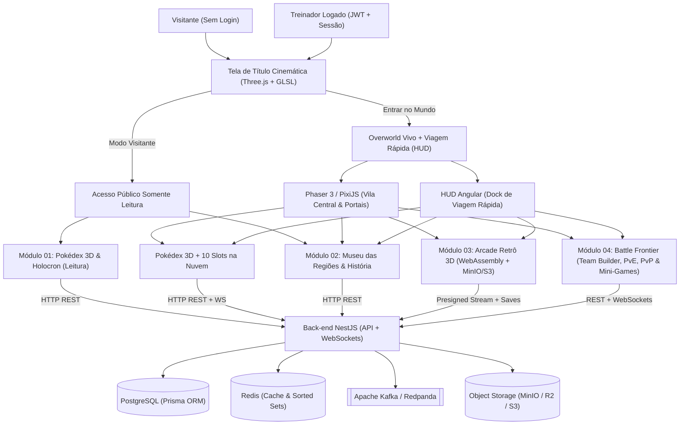

# 00 — Visão Geral e Roadmap do PokéVerse OS

## 1. Visão Executiva do Produto

O **PokéVerse OS** transforma o repositório [pokedex-frontend](../README.md) em uma plataforma web Full-Stack em formato de **mundo interativo de videogame**, unindo interface de alta precisão (**Angular**), exploração em mundo 2D/HD-2D (**Phaser 3 / PixiJS**), inspeção e hardware virtual em tempo real (**Three.js + WebGL2/Shaders GLSL + GSAP**) e back-end distribuído orientado a eventos (**NestJS + PostgreSQL + Redis + Apache Kafka/Redpanda + MinIO/S3**).

A Pokédex 3D skeuomórfica existente ([index.html](../index.html), [css/style.css](../css/style.css) e [js/app.js](../js/app.js)) **não é descartada**: ela é preservada como o **Módulo 01 (Dispositivo de Campo)**, abrindo dentro do ecossistema como um equipamento oficial do treinador e evoluindo de persistência local (`localStorage`) para sincronização em nuvem quando autenticada.

> **Evolução Orientada a Evidências (Desempenho & Mobile-First):** após um *post-mortem* real de travamento em smartphone na versão estática inicial (causado por 4 imagens 4K simultâneas de `9,34 MB`, transição com *reflow* via `padding-top`, filtros SVG `feTurbulence` e `backdrop-filter`), a plataforma nasceu com **Detecção Automática de Hardware (`ULTRA` / `BALANCED` / `LITE`)**, **versão Lite para PCs e celulares modestos**, telemetria registrável e **Release Gates automatizados** cobrindo gráficos, APIs, PostgreSQL, Redis e Kafka (ver [11 — Desempenho Ponta a Ponta](11-performance-hardware-gates-e-mobile.md)).

---

## 2. Diagrama de Contexto da Plataforma

---

## 3. Pilares Funcionais e Motores Gráficos

| Pilar | Tecnologia Principal | Papel no Ecossistema | Experiência Visual |
| :--- | :--- | :--- | :--- |
| **Sistema Operacional & HUD** | Angular (Standalone + Signals + Zoneless) | Roteamento, autenticação, barra de viagem rápida, inventário, feed global e formulários | HUD tático de jogo sobreposto ao canvas em 60–120 FPS |
| **Tela de Título & Hardware 3D** | Three.js + WebGL2 + GLSL + GSAP | Tela *"Press Start"*, Console Portátil 3D, Pedestal Holocron 3D e Globo das Regiões | Iluminação dinâmica, Bloom, reflexos em vidro/safira e partículas |
| **Overworld Explorável** | Phaser 3 / PixiJS | Vila Central com prédios interativos, ciclo dia/noite, clima e presença multiplayer | Caminhada 2D/HD-2D com portais físicos para cada módulo |
| **Dispositivo de Campo (Pokédex)** | Pokédex 3D Atual + Holocron 3D | Busca fonética/Damerau-Levenshtein, slots salvos, *cries* (Web Audio), evoluções e tipos | Carcaça metálica realista já implementada + projeção holográfica |
| **Arcade Retrô** | WebAssembly + Three.js + MinIO/S3 | Catálogo fixo no servidor em 1 clique para GB/GBC/GBA/NDS + *Cloud Save States* | Jogo rodando ao vivo dentro da tela do console portátil 3D |
| **Museu das Regiões & Lore** | Angular + Three.js / Canvas | Atlas interativo de Kanto a Paldea, Líderes, Elite Four e linha do tempo (1996–presente) | Enciclopédia viva navegável sem necessidade de conta |
| **Battle Frontier** | Angular + WebSockets + Kafka + Redis | Team Builder (IVs/EVs/Natures), Mini-Games competitivos e Batalhas Turn-Based (PvE/PvP) | Arena tática em tempo real com placares globais ao vivo |

---

## 4. Matriz de Permissões: Visitante vs. Treinador Autenticado

O controle de acesso segue política estrita de **Login Obrigatório para recursos persistentes, jogos e tempo real**, tanto no Front-end (`AuthGuard` e cadeados visuais no HUD) quanto no Back-end (Guards NestJS validando JWT).

| Módulo / Funcionalidade | Visitante (Sem Login) | Treinador Autenticado (Com Login) | Motivo Arquitetural |
| :--- | :---: | :---: | :--- |
| **Tela de Título Cinemática ("Press Start")** | Permitido | Permitido | Recepção universal e entrada para Login ou Modo Visitante |
| **Pokédex 3D Clássica (Pesquisa + Catálogo)** | Permitido (Leitura) | Permitido | Consulta pública à PokéAPI em cache sem necessidade de gravação |
| **10 Botões de Slot da Pokédex (Gravar/Editar)** | Bloqueado (Cadeado) | Permitido (Sync PostgreSQL) | Persistência nominal de slots na nuvem vinculada ao treinador |
| **Holocron 3D (Modelo, Evoluções, Cries, Tipos)** | Permitido (Leitura) | Permitido | Conteúdo enciclopédico público compartilhado |
| **Museu das Regiões & Linha do Tempo dos Jogos** | Permitido (Leitura) | Permitido | Descoberta pública da história e geografia do universo |
| **Overworld Explorável 2D/HD-2D (Phaser)** | Bloqueado (Cadeado) | Permitido | Sincroniza coordenadas, presença multiplayer e WebSockets |
| **Arcade Retrô (ROMs do Servidor + Save States)** | Bloqueado (Cadeado) | Permitido | Emissão de stream/URLs temporárias autenticadas e *Cloud Saves* |
| **Team Builder Competitivo (Times na Nuvem)** | Bloqueado (Cadeado) | Permitido | Gravação de equipes, IVs/EVs e análise assíncrona via Kafka |
| **Mini-Games & Simulador de Batalha (PvE / PvP)** | Bloqueado (Cadeado) | Permitido | Matchmaking via Kafka, partidas autoritativas e Ranking no Redis |

> **Regra de UX para Visitantes:** quando um visitante clica em qualquer prédio, botão de slot gravável ou atalho bloqueado no HUD, o sistema exibe uma explicação clara do módulo e um modal elegante de **Login / Criar Conta de Treinador** para desbloqueio imediato sem perder o contexto atual.

---

## 5. Experiência de Entrada e Navegação Dupla

1. **Tela de Título Cinemática ("Press Start"):**
   - Ao carregar o site, uma cena em **Three.js + Shaders GLSL** sobreposta ao cenário vivo do Overworld apresenta o logotipo em relevo 3D, partículas atmosféricas e trilha tema opcional (respeitando políticas de autoplay dos navegadores e `prefers-reduced-motion`).
   - Dois botões principais: **Entrar como Treinador (Login / Cadastro)** e **Explorar como Visitante (Pokédex & Museu)**.
2. **Navegação Dupla para Treinadores Autenticados:**
   - **Exploração Física (Phaser Overworld):** caminhar pela Vila Central até o *Laboratório Pokémon* (Pokédex + Holocron), *Museu Nacional* (Regiões & História), *Game Corner* (Arcade Retrô) e *Battle Frontier* (Team Builder, Mini-Games e Arena).
   - **Viagem Rápida (Angular HUD Dock):** barra fixa tática com ícones dos módulos e inventário para saltar diretamente para qualquer sistema em 1 clique sem obrigatoriedade de caminhada longa.

---

## 6. Roadmap Incremental (6 Fases Entregáveis)

Cada fase foi desenhada para resultar em uma aplicação **executável, testável e utilizável** ao seu término, evitando grandes refatorações cegas.

| Fase | Nome da Entrega | Escopo Técnico Principal | Critério de Conclusão (DoD) |
| :--- | :--- | :--- | :--- |
| **Fase 1** | **Fundação Monorepo + Shell Angular + Pokédex Integrada** | Criação de `apps/web`, `apps/api`, `packages/shared`, `docker-compose.yml` base; Tela *"Press Start"* inicial; HUD Angular com cadeia de rotas e Pokédex 3D atual encapsulada como módulo funcional. | Monorepo compila sem erros; visitante abre Pokédex 3D dentro da nova shell; `docker compose up` sobe bancos e mensageria saudáveis. |
| **Fase 2** | **Back-end NestJS + Auth + PostgreSQL + Redis + Kafka** | Prisma Schema inicial; Auth JWT (Access + Refresh HttpOnly) + RBAC Visitante/Logado; cache da PokéAPI no Redis; sincronização em nuvem dos 10 slots da Pokédex; *Transactional Outbox* + Redpanda/Kafka + WebSocket Ticker ao vivo. | Registro/Login funcionando; gravação de slots persistida no Postgres e notificada via Kafka -> WebSocket; visitante bloqueado nos endpoints privados. |
| **Fase 3** | **Overworld Explorável 2D/HD-2D (Phaser 3)** | Tilemap da Vila Central com 4 edifícios-portais, colisão, ciclo dia/noite, partículas climáticas, sincronização de posição de jogadores online via Redis/WS e HUD de Viagem Rápida integrado. | Treinador logado caminha pelo mapa, entra nos prédios abrindo cada módulo e vê presença de outros treinadores conectados. |
| **Fase 4** | **Holocron 3D (Three.js) + Museu das Regiões & Jogos** | Pedestal holográfico 3D com shaders de tipo elemental, player de áudio *cry* (Web Audio API), árvore evolutiva e tabela de tipos; Atlas interativo de Kanto a Paldea e linha do tempo dos jogos (1996–presente). | Visitantes e treinadores navegam pelo Museu e inspecionam qualquer Pokémon no Holocron 3D sem erros de memória GPU. |
| **Fase 5** | **Arcade Retrô 3D (WebAssembly) + MinIO/S3 + Cloud Saves** | Integração MinIO/S3 para catálogo fixo de ROMs; modelo 3D de portátil em Three.js com tela `CanvasTexture` vinculada ao emulador WASM; fluxo completo de *Cloud Save States* assíncronos via Kafka. | Treinador logado dá Play em 1 clique em uma ROM do catálogo, joga no portátil 3D, salva estado na nuvem e retoma do ponto exato após recarregar a página. |
| **Fase 6** | **Battle Frontier: Team Builder + Mini-Games + PvE/PvP** | Construtor competitivo de 6 Pokémon (IVs/EVs/Natures/Moves); mini-games (*Quem é esse Pokémon?*) com ranking em tempo real no Redis; engine de batalha turn-based autoritativa no NestJS para PvE (Líderes/IA) e PvP (Kafka Matchmaking + WebSocket). | Montagem de time validada e salva; placar global Redis atualizado ao vivo; partidas completas PvE e PvP executadas do início ao fim. |

---

## 7. Índice Completo da Documentação Arquitetural

- [01 — Arquitetura do Monorepo e Padrões de Engenharia](01-arquitetura-monorepo-e-padroes.md)
- [02 — Front-end Angular, HUD e Gerenciamento de Estado](02-frontend-angular-hud-e-estado.md)
- [03 — Motores Gráficos: Phaser 3 e Three.js (WebGL2/GLSL)](03-motores-graficos-phaser-e-threejs.md)
- [04 — Back-end NestJS, Autenticação e Segurança](04-backend-nestjs-auth-e-seguranca.md)
- [05 — Banco de Dados PostgreSQL e Prisma ORM](05-banco-de-dados-postgresql-e-prisma.md)
- [06 — Cache com Redis e Mensageria com Apache Kafka / Redpanda](06-cache-redis-e-eventos-kafka.md)
- [07 — Arcade Retrô 3D (WebAssembly) e Cloud Save States](07-arcade-retro-wasm-e-cloud-saves.md)
- [08 — Museu das Regiões, Lore e Pokédex Holocron 3D](08-museu-lore-e-holocron-pokedex.md)
- [09 — Arena de Batalha (PvE/PvP), Team Builder e Mini-Games](09-arena-batalha-teambuilder-e-minigames.md)
- [10 — Infraestrutura Docker, Observabilidade e CI/CD](10-infraestrutura-docker-ci-cd-e-deploy.md)
- [11 — Desempenho Ponta a Ponta, Detecção de Hardware, Mobile e Release Gates](11-performance-hardware-gates-e-mobile.md)
