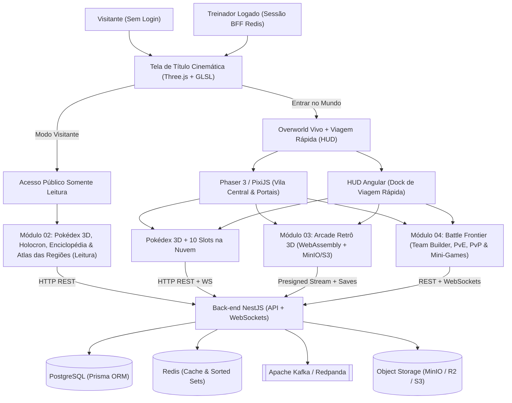

# 00 — Visão Geral e Roadmap do PokéVerse OS

> **Direção Atual (Realinhamento Pós-Fase 2):** Primeiro colocar a infraestrutura oficial no ar saindo do GitHub Pages e transformar a **Pokédex na enciclopédia Pokémon mais completa e bem animada possível** (visual 3D fiel + motor gráfico WebGL2/Three.js/GSAP + PokéAPI completa + Dados de Jogos + Cartas TCG + História de Anime e Filmes, sustentada por arquitetura híbrida API + Redis + Snapshot por usuário no PostgreSQL). Só **depois** que essa base enciclopédica estiver no detalhe é que usaremos esses dados para construir o **Back-end e Motor de Jogo** (chances de encontro, dano de skills, forças e fraquezas, aumento de atributos por nível, Overworld, Arcade e Battle Frontier).

## 1. Visão Executiva do Produto

O **PokéVerse OS** transforma o repositório [pokedex-frontend](../README.md) em uma plataforma web Full-Stack cuja espinha dorsal imediata é a **Pokédex Enciclopédica de Nova Geração**, evoluindo progressivamente para o ecossistema interativo completo em formato de mundo de videogame: interface Angular (**Standalone + Signals + Zoneless**), motor gráfico de alta precisão (**Three.js + WebGL2/Shaders GLSL + GSAP** na Pokédex/Holocron e **Phaser 3** quando iniciar a etapa do Overworld) e back-end distribuído orientado a eventos (**NestJS + PostgreSQL + Redis + Apache Kafka/Redpanda + Object Storage S3**).

A Pokédex 3D skeuomórfica original da **Fase 0** (`index.html`, `css/style.css` e `js/app.js`, já migrada e removida da raiz por desuso após substituição completa pelo monorepo) **não foi descartada nem substituída por um mockup simplificado**: ela foi **portada fielmente** para dentro do Angular (`apps/web`) como ponto de partida visual, recebendo upgrades de motor gráfico, animações e dados ricos sem perder sua identidade (com registro preservado no histórico Git e em `docs/`).

> **Evolução Orientada a Evidências (Desempenho & Mobile-First):** após um *post-mortem* real de travamento em smartphone na versão estática inicial (causado por 4 imagens 4K simultâneas de `9,34 MB`, transição com *reflow* via `padding-top`, filtros SVG `feTurbulence` e `backdrop-filter`), a plataforma nasceu com **Detecção Automática de Hardware (`ULTRA` / `BALANCED` / `LITE`)**, **versão Lite para PCs e celulares modestos**, telemetria registrável e **Release Gates automatizados** cobrindo gráficos, APIs, PostgreSQL, Redis e Kafka (ver [11 — Desempenho Ponta a Ponta](11-performance-hardware-gates-e-mobile.md)).

---

## 2. Diagrama de Contexto da Plataforma

---

## 3. Pilares Funcionais e Motores Gráficos

| Pilar | Tecnologia Principal | Papel no Ecossistema | Experiência Visual |
| :--- | :--- | :--- | :--- |
| **Sistema Operacional & HUD** | Angular (Standalone + Signals + Zoneless) | Roteamento, autenticação, barra de viagem rápida, inventário, feed global e formulários | HUD tático de jogo sobreposto ao canvas em 60–120 FPS |
| **Tela de Título & Hardware 3D** | Three.js + WebGL2 + GLSL + GSAP | Tela *"Press Start"*, Console Portátil 3D, Pedestal Holocron 3D e Globo das Regiões | Iluminação dinâmica, Bloom, reflexos em vidro/safira e partículas |
| **Overworld Explorável** | Phaser 3 / PixiJS | Vila Central com prédios interativos, ciclo dia/noite, clima e presença multiplayer | Caminhada 2D/HD-2D com portais físicos para cada módulo |
| **Dispositivo de Campo (Pokédex)** | Pokédex 3D Atual + Holocron 3D | Busca fonética/Damerau-Levenshtein, slots salvos, *cries* (Web Audio), evoluções e tipos | Carcaça metálica realista já implementada + projeção holográfica |
| **Arcade Retrô** | WebAssembly + Three.js + MinIO/S3 | Catálogo fixo no servidor em 1 clique para GB/GBC/GBA/NDS + *Cloud Save States* | Jogo rodando ao vivo dentro da tela do console portátil 3D |
| **Museu / Atlas das Regiões & Lore (na Pokédex)** | Angular + Three.js / Canvas | Atlas interativo de Kanto a Paldea, Líderes, Elite Four e linha do tempo (1996–presente) dentro da Enciclopédia da Pokédex | Enciclopédia viva navegável sem necessidade de conta |
| **Battle Frontier** | Angular + WebSockets + Kafka + Redis | Team Builder (IVs/EVs/Natures), Mini-Games competitivos e Batalhas Turn-Based (PvE/PvP) | Arena tática em tempo real com placares globais ao vivo |

---

## 4. Matriz de Permissões: Visitante vs. Treinador Autenticado

O controle de acesso segue política estrita de **Login Obrigatório para recursos persistentes, jogos e tempo real**, tanto no Front-end (`authGuard` e cadeados visuais no HUD) quanto no Back-end (`SessionAuthGuard` validando sessão opaca no Redis + cookie `HttpOnly` + `CsrfOriginGuard`).

| Módulo / Funcionalidade | Visitante (Sem Login) | Treinador Autenticado (Com Login) | Motivo Arquitetural |
| :--- | :---: | :---: | :--- |
| **Tela de Título Cinemática ("Press Start")** | Permitido | Permitido | Recepção universal e entrada para Login ou Modo Visitante |
| **Pokédex 3D Clássica (Pesquisa + Catálogo)** | Permitido (Leitura) | Permitido | Consulta pública à PokéAPI em cache sem necessidade de gravação |
| **10 Botões de Slot da Pokédex (Gravar/Editar)** | Bloqueado (Cadeado) | Permitido (Sync PostgreSQL) | Persistência nominal de slots na nuvem vinculada ao treinador |
| **Holocron 3D (Modelo, Evoluções, Cries, Tipos)** | Permitido (Leitura) | Permitido | Conteúdo enciclopédico público compartilhado |
| **Museu das Regiões & Linha do Tempo dos Jogos** | Permitido (Leitura) | Permitido | Descoberta pública da história e geografia do universo |
| **Overworld Explorável 2D/HD-2D (Phaser)** | Bloqueado (Cadeado) | Permitido | Sincroniza coordenadas, presença multiplayer e WebSockets |
| **Arcade Retrô (ROMs do Servidor + Save States)** | Bloqueado (Cadeado) | Permitido | Emissão de stream/URLs temporárias autenticadas e *Cloud Saves* |
| **Team Builder Competitivo (Times na Nuvem)** | Bloqueado (Cadeado) | Permitido | Gravação de equipes, IVs/EVs e análise assíncrona via Kafka |
| **Mini-Games & Simulador de Batalha (PvE / PvP)** | Bloqueado (Cadeado) | Permitido | Matchmaking via Kafka, partidas autoritativas e Ranking no Redis |

> **Regra de UX para Visitantes:** quando um visitante clica em qualquer prédio, botão de slot gravável ou atalho bloqueado no HUD, o sistema exibe uma explicação clara do módulo e um modal elegante de **Login / Criar Conta de Treinador** para desbloqueio imediato sem perder o contexto atual.

---

## 5. Experiência de Entrada e Navegação Dupla

1. **Tela de Título Cinemática ("Press Start"):**
   - Ao carregar o site, uma cena em **Three.js + Shaders GLSL** sobreposta ao cenário vivo do Overworld apresenta o logotipo em relevo 3D, partículas atmosféricas e trilha tema opcional (respeitando políticas de autoplay dos navegadores e `prefers-reduced-motion`).
   - Dois botões principais: **Entrar como Treinador (Login / Cadastro)** e **Explorar como Visitante (Pokédex, Enciclopédia & Atlas das Regiões)**.
2. **Navegação Dupla para Treinadores Autenticados:**
   - **Exploração Física (Phaser Overworld):** caminhar pela Vila Central até o *Laboratório Pokémon* (Pokédex + Holocron), *Museu Nacional* (Regiões & História), *Game Corner* (Arcade Retrô) e *Battle Frontier* (Team Builder, Mini-Games e Arena).
   - **Viagem Rápida (Angular HUD Dock):** barra fixa tática com ícones dos módulos e inventário para saltar diretamente para qualquer sistema em 1 clique sem obrigatoriedade de caminhada longa.

---

## 6. Roadmap Incremental (Reordenado para Pokédex First + Deploy Oficial)

Cada etapa resulta em uma entrega **executável, testável e utilizável**. Após concluir a fundação Auth/Infra (`Fases 1–2B`), o roadmap foi **repriorizado explicitamente** para entregar primeiro a infraestrutura no ar e a **Pokédex Enciclopédica Definitiva**, antes da construção das mecânicas de jogo:

| Etapa | Nome da Entrega | Status | Escopo Técnico Principal | Critério de Conclusão (DoD) |
| :--- | :--- | :---: | :--- | :--- |
| **Fase 0** | **Pokédex 3D Estática (Vanilla)** | **Concluída *(legado removido por desuso)*** | `index.html`, `css/style.css` e `js/app.js` portados integralmente para `apps/web` + `@pokeverse/shared` e **apagados da raiz por não serem mais utilizados** (referências preservadas em [Capítulo 00](capitulo-00-como-tudo-comecou.md) e histórico Git; `assets/` mantido na raiz). | Base visual e funcional portada integralmente para o monorepo. |
| **Fase 1** | **Fundação Monorepo + Shell Angular** | **Concluída** | Workspaces `@pokeverse/shared`, `pokeverse-api`, `pokeverse-web`, `infra/docker/docker-compose.yml` e integração inicial Angular/API. | Monorepo compila sem erros; containers locais saudáveis. |
| **Fase 2** | **Back-end NestJS + PostgreSQL + Redis + Kafka** | **Concluída** | Prisma Schema (`6.19.3`) + `idx_outbox_pending`; cache Redis PokéAPI (`X-Cache`); 10 slots ACID; Transactional Outbox (`SKIP LOCKED`) -> Redpanda -> WebSocket `/ws/world`. | API persistindo slots e emitindo eventos via Kafka -> WS; visitantes restritos a leitura. |
| **Etapa 2A+2B** | **IAM Enterprise BFF (Onda 1)** | **Concluída** | Sessão opaca no Redis (`MFA_PENDING -> AUTHENTICATED`), cookies `HttpOnly`, `CsrfOriginGuard`, Redis Throttler, Argon2id timing shield, OTP assíncrono via Kafka + Mailpit/Resend, TOTP QR + 8 backup codes, Google OAuth PKCE, Passkeys WebAuthn + `.sonarcloud.properties` e `AGENTS.md`. | Fluxos BFF, 2FA, OTP, Passkeys e PKCE validados por testes unitários, E2E e smoke tests; apontamentos SonarQube zerados. |
| **Fase 3** | **Infraestrutura Cloud & Deploy Oficial (Saída do GitHub Pages)** | **Concluída** | `Dockerfile` multi-stage não-root (`apps/api`), CI/CD no GitHub Actions (`ci.yml` + `deploy.yml`), **Cloudflare Pages** (`https://pokeverse.pages.dev` com proxy same-origin), **Azure Container Apps** (`pokeverse-api` em `brazilsouth`), **Neon** (Postgres 18), **Upstash** (Redis TLS), **Aiven Kafka Free** (mTLS, `3` tópicos) e **Resend**. | Plataforma Full-Stack no ar em HTTPS público com `/health/ready` (`200 OK`), cache `X-Cache=HIT` no Upstash, proteção CSRF/Auth e CI/CD automatizado (restam apenas vínculo do domínio customizado `pokedex.digooow.<ext>` + domínio próprio no Resend). |
| **Fase 4 (Em Andamento)** | **Pokédex Suprema: Restauração 3D Fiel, 51 Endpoints & Motor Audiovisual** | **Parcial (4A Entregue)** | **Fase 4A entregue:** restauração fiel da carcaça 3D em `apps/web`, giro bidirecional reversível em movimento, seleção em dois passos + botão redondo `A`, unicidade 1-Pokémon-por-slot + confirmações acessíveis, correção de CSP (`inlineCritical: false`), redução inicial do bundle para `490.00 kB` (`498.50 kB` raw / `128.16 kB` transfer pós-Onda 4) e registro dos `51` endpoints + consultas avançadas em `@pokeverse/shared` ([doc 15](15-pokedex-suprema-51-endpoints-e-laboratorio-genetico.md)). **Fase 4B (próxima):** 5 abas LCD completas, espectrograma Web Audio e Holocron Three.js (`LITE` compatível). | Pokédex suprema nível anime/PS5 com consultas combinadas em ms no Redis (`stale-fallback` 7d) e acesso offline aos favoritos gravados. |
| **Fase 5** | **Back-end do Laboratório Genético & Mecânicas de Jogo** | **Modelagem em `@pokeverse/shared`** | Usar a base validada em [pokemon-lab.ts](../packages/shared/src/domain/pokemon-lab.ts) e a enciclopédia para implementar no NestJS/PostgreSQL: calculadora de atributos e XP por nível (`1..100`), chances de evolução, replicação e clonagem controlada, reciclagem/ascensão de espécimes sem uso (`Rank E..APEX`), além de chances de encontro e dano de skills. | Endpoints `/api/v1/lab/*` e domínio de progressão/combate validados ponta a ponta. |
| **Fase 6** | **Expansões PokéVerse: Overworld, Museu, Arcade & Battle Frontier** | **Futura** | Ativar o ecossistema de mundo interativo descrito nos [docs 03, 07, 08 e 09](03-motores-graficos-phaser-e-threejs.md): Overworld 2D/HD-2D (Phaser 3 + `WsAuthGuard`), Museu Atlas 3D, Arcade Retrô WASM + R2, Team Builder, Mini-Games e Batalhas PvE/PvP. | Módulos jogáveis integrados ao HUD e à Pokédex sobre os portões de performance do [doc 11](11-performance-hardware-gates-e-mobile.md). |

---

## 7. Índice Completo da Documentação Arquitetural

- [01 — Arquitetura do Monorepo e Padrões de Engenharia](01-arquitetura-monorepo-e-padroes.md)
- [02 — Front-end Angular, HUD e Gerenciamento de Estado](02-frontend-angular-hud-e-estado.md)
- [03 — Motores Gráficos: Phaser 3 e Three.js (WebGL2/GLSL)](03-motores-graficos-phaser-e-threejs.md)
- [04 — Back-end NestJS, Autenticação e Segurança](04-backend-nestjs-auth-e-seguranca.md)
- [05 — Banco de Dados PostgreSQL e Prisma ORM](05-banco-de-dados-postgresql-e-prisma.md)
- [06 — Cache com Redis e Mensageria com Apache Kafka / Redpanda](06-cache-redis-e-eventos-kafka.md)
- [07 — Arcade Retrô 3D (WebAssembly) e Cloud Save States](07-arcade-retro-wasm-e-cloud-saves.md)
- [08 — Museu das Regiões, Lore e Pokédex Holocron 3D](08-museu-lore-e-holocron-pokedex.md)
- [09 — Arena de Batalha (PvE/PvP), Team Builder e Mini-Games](09-arena-batalha-teambuilder-e-minigames.md)
- [10 — Infraestrutura Docker, Observabilidade e CI/CD](10-infraestrutura-docker-ci-cd-e-deploy.md)
- [11 — Desempenho Ponta a Ponta, Detecção de Hardware, Mobile e Release Gates](11-performance-hardware-gates-e-mobile.md)
- [12 — Pokédex 2.0: Catálogo Completo da PokéAPI v2 e Controles sem Novos Botões](12-pokedex-2-0-pokeapi-e-controles.md)
- [13 — Dossiê Completo de Segurança e Blindagem (AppSec, Auth & Infra)](13-dossie-de-seguranca-e-blindagem.md)
- [14 — Status Real da Implementação, Mudanças vs. Plano Original e Backlog](14-status-e-changelog-implementacao.md)
- [15 — Pokédex Suprema: Auditoria, 51 Endpoints e Laboratório Genético](15-pokedex-suprema-51-endpoints-e-laboratorio-genetico.md)
- [16 — Cookies, Privacidade (LGPD) e Levantamento de Requisitos](16-cookies-lgpd-e-requisitos.md)
- [17 — Plano SOLID, Clean Code, Post-Mortem e Engenharia Nível Big Tech](17-plano-solid-clean-code-e-engenharia-big-tech.md)
- [18 — Auditoria Técnica e Plano de Dívida Técnica (`ARCHITECTURE.md`)](18-auditoria-e-plano-divida-tecnica-arquitetura.md)
- [19 — Observabilidade Híbrida: OpenTelemetry, Prometheus, Loki, Tempo, Grafana, Sentry e Datadog](19-observabilidade-telemetria-e-monitoramento.md)
- [20 — Polimento Visual, Design System e Dívida Estética do Front-end](20-polimento-visual-e-design-system-frontend.md)
- [21 — Prioridade Máxima: Qualidade de Código, SonarQube e Regras de CI/CD](21-qualidade-de-codigo-sonarqube-e-regras.md)
- [22 — Observabilidade em Produção, Guia de Uso Operacional e Painel Admin (`/admin`)](22-observabilidade-em-producao-uso-e-painel-admin.md)
- [Growth — SEO Técnico, Divulgação, Comunidades e Métricas de Produto](growth-e-marketing/README.md)
