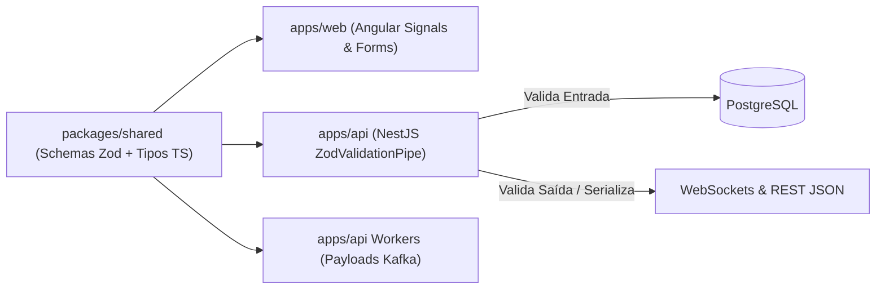

# 01 — Arquitetura do Monorepo e Padrões de Engenharia

## 1. Estrutura de Diretórios Alvo

Para suportar a evolução incremental em fases sem acoplamento destrutivo entre front-end, back-end, workers assíncronos e contratos de tipos compartilhados, o repositório adotará uma arquitetura **Monorepo** baseada em workspaces (`npm`/`pnpm` workspaces) ou orquestração leve com **Turborepo**.

```text
pokedex-frontend/ (Monorepo PokéVerse OS)
├── apps/
│   ├── web/                               # Front-end Angular + Phaser 3 + Three.js
│   │   ├── public/                        # Assets estáticos (tilemaps, fontes, shaders, backgrounds)
│   │   └── src/app/
│   │       ├── core/                      # AuthGuard, HTTP Interceptors, EventBus, Signal Stores
│   │       ├── shared/                    # Design System HUD, botões, modais, pipes e estados UI
│   │       ├── features/
│   │       │   ├── title-screen/          # Cena 3D "Press Start" + escolha Login/Visitante
│   │       │   ├── overworld/             # Hub 2D/HD-2D (Phaser 3) + presença multiplayer
│   │       │   ├── pokedex-device/        # Módulo 01: Pokédex 3D skeuomórfica integrada
│   │       │   ├── holocron-3d/           # Pedestal 3D, árvore evolutiva, áudio e fraquezas
│   │       │   ├── regions-museum/        # Atlas Kanto..Paldea + linha do tempo dos jogos
│   │       │   ├── retro-arcade/          # Console 3D (Three.js) + EmulatorJS/WASM + Save Cloud
│   │       │   └── battle-arena/          # Team Builder, Mini-Games e Simulador PvE/PvP
│   │       └── app.routes.ts
│   │
│   └── api/                               # Back-end NestJS (REST + WebSockets + Workers)
│       ├── prisma/                        # schema.prisma, migrations e seeders (ROMs/Ginásios)
│       └── src/
│           ├── common/                    # Guards RBAC, Zod Pipes, Filters, Telemetry, Outbox
│           ├── infra/                     # PrismaService, RedisService, KafkaService, S3Service
│           └── modules/
│               ├── auth/                  # Login, Registro, JWT, Refresh Rotation
│               ├── trainers/              # Perfil, posição no mapa, conquistas
│               ├── pokedex/               # Cache PokéAPI + CRUD dos 10 slots na nuvem
│               ├── museum/                # Dados curados de regiões, líderes e timeline
│               ├── arcade/                # Catálogo de ROMs S3 + Presigned Stream + Cloud Saves
│               ├── teams/                 # CRUD de times competitivos + Worker de sinergia
│               ├── minigames/             # Sessões anti-cheat + Leaderboard Redis
│               ├── battle/                # Engine PvE/PvP + Matchmaking Kafka + WebSocket Gateway
│               └── world/                 # WorldGateway (presença Overworld + Ticker de eventos)
│
├── packages/
│   └── shared/                            # Contratos únicos compartilhados entre Web e API
│       ├── src/schemas/                   # Schemas Zod (Auth, Slots, Teams, Arcade, Battle, Events)
│       ├── src/constants/                 # Tabela de tipos (18x18), Natures, consoles e regras
│       └── src/types/                     # Tipos TypeScript inferidos diretamente de z.infer<>
│
├── docs/                                  # Documentação arquitetural (00+), Capítulo Zero e Guias de Estudos
├── infra/
│   ├── docker/                            # docker-compose.yml, init buckets MinIO, configs OTel
│   └── dockerfiles/                       # Dockerfiles multi-stage (api.Dockerfile, web.Dockerfile)
├── assets/                                # Assets originais preservados
├── css/                                   # Pokédex Vanilla preservada para referência/legado
├── js/                                    # Lógica Vanilla preservada para referência/legado
├── index.html                             # Ponto de entrada Vanilla preservado no GitHub Pages (Fase 0)
└── README.md
```

---

## 2. Estratégia de Integração da Pokédex 3D Atual

A transição da Pokédex pura atual para dentro de `apps/web/src/app/features/pokedex-device/` seguirá 3 regras para garantir **zero regressão visual e funcional**:

1. **Preservação do Acabamento Skeuomórfico:**
   - Os tokens `oklch` metálicos, microtexturas SVG inline (`--textura-metal-floco`, `--textura-plastico-grao`), câmera de safira, flashes LED, tela LCD em camadas, botões inferiores de plástico transparente iluminados por baixo (`.btn-slot-azul`, `.mini-visor-amarelo`) e a animação de giro 3D sem borrão (`1260ms` alternando para plano 2D) serão encapsulados no componente Angular sem perder fidelidade visual.
2. **Reaproveitamento da Lógica Pura de Domínio:**
   - As funções puras já testadas em [js/app.js](../js/app.js) — como normalização Unicode (`limparTextoComparacao`), chave fonética (`gerarChaveFonetica`), distância de Damerau-Levenshtein (`calcularDistanciaDamerau`) e cálculo de cursor RPG — serão convertidas para TypeScript estrito dentro de `packages/shared` ou `pokedex-device/domain/`, tornando-as unitariamente testáveis com Vitest/Jest.
3. **Abstração de Armazenamento (`SlotStorageAdapter`):**
   - **Modo Visitante:** slots são bloqueados para edição (exibe cadeado visual e convite de login), mantendo apenas pesquisa, catálogo e abertura da ficha no visor.
   - **Modo Treinador Logado:** os 10 botões inferiores leem e gravam diretamente via `PokedexApiService` (`GET/PUT/DELETE /api/v1/pokedex/slots/:index`), sincronizados com PostgreSQL e atualizados reativamente via Signals.

---

## 3. Fluxo de Compartilhamento de Contratos (`packages/shared`)



A fonte única da verdade (**Single Source of Truth**) mora em `packages/shared`. Qualquer alteração em um contrato (por exemplo, adicionar um novo console em `ArcadeConsoleEnum` ou alterar limites de EVs no `TeamMemberSchema`) quebra o *typecheck* em tempo de compilação tanto no Front-end quanto no Back-end caso um dos lados fique desatualizado.

---

## 4. Padrões Inegociáveis de Código e Qualidade

> **Contrato Oficial de Qualidade:** todas as diretrizes detalhadas de engenharia, combate a *AI slop* e exemplos comparativos estão consolidados em **[Contrato de Qualidade — ARCHITECTURE.md](ARCHITECTURE.md)**.

### 4.1. Shift-Left, Engenharia & Arquitetura Limpa
- **Clean Architecture & Inversão de Dependência:** a infraestrutura obedece ao domínio. Regras de negócio (cálculo de dano Pokémon, validação de EVs, ranking Damerau-Levenshtein, máquina de estados de batalha) residem em classes/funções puras de **Domínio**, totalmente desacopladas de Angular, NestJS, Prisma, HTTP ou banco de dados.
- **Separação Rigorosa de Responsabilidades (SoC) & Repositórios Isolados:** Controllers apenas recebem requisições já validadas na borda (`ZodValidationPipe`), delegam ao Service e retornam HTTP status codes (zero regra de negócio no Controller). Consultas diretas via Prisma não devem poluir Services de negócio — ficam encapsuladas em Repositórios dedicados.
- **Backend Stateless, Arquivos em MinIO/S3 & Idempotência:** sessões, tokens e dados transitórios vivem no **Redis**; imagens, ROMs e saves trafegam exclusivamente via **MinIO/S3** por URLs geradas (nunca no PostgreSQL); consumidores Kafka toleram reprocessamento com trava idempotente e rollback em falhas transientes.
- **Performance SQL (Zero N+1 & Paginação desde a v1):** buscas relacionais usam inclusões/joins nativos do Prisma em única ida ao banco (`select` explícito), índices definidos e paginação obrigatória (`limit`/`offset` ou cursor) em todo endpoint REST que retorna listas.
- **TypeScript Estrito (`strict: true`, zero `any`):**
  - Proibido o uso de `any` ou coerções inseguras (`as Tipo` sem *type guard*).
  - Todo payload vindo de rede (`fetch`/`HttpClient`), `localStorage`, URL query params, WebSocket ou mensagem Kafka deve ser validado com `schema.safeParse(input)` (Zod) antes de entrar no domínio.
- **Clean Code Anti-AI Slop:** nomenclatura ubíqua de domínio (proibido `dataHandler`/`processor`), fim das strings e números mágicos (usar Enums/constantes tipadas), **Early Returns** com *Guard Clauses* no topo (zero `if/else` em formato de flecha), zero boilerplate desnecessário e alterações atômicas pensadas para ciclos curtos de até 5 prompts seguidos de `git commit`.
- **Modelagem por Discriminated Unions:** estados assíncronos nunca usam múltiplos booleans soltos (`isLoading`, `hasError`, `isEmpty`). Sempre usam união discriminada explícita:
  ```typescript
  export type AsyncState<T, E = AppError> =
    | { readonly status: 'idle' }
    | { readonly status: 'loading' }
    | { readonly status: 'empty'; readonly reason?: string }
    | { readonly status: 'error'; readonly error: E }
    | { readonly status: 'success'; readonly data: T };
  ```
- **Limite de Coesão:** componentes visuais focam em renderização e delegam regras pesadas e chamadas de rede para *Stores*, *Services* e *Domain Helpers*, mantendo arquivos concisos e fáceis de auditar.

### 4.2. Segurança de Aplicação (AppSec)
- **Zero `innerHTML` ou interpolação de HTML não sanitizado:** todo nó DOM segue criação segura declarativa (templates Angular com sanitização nativa ou `textContent` em adaptadores imperativos).
- **Zero segredos versionados:** todas as credenciais (Postgres, Redis, JWT secrets, chaves MinIO/R2/S3) residem em `.env` ignorados pelo `.gitignore`, documentados apenas via `.env.example` sem valores reais.
- **Tratamento explícito de erros:** proibido `catch` vazio. Toda captura registra erro estruturado (sem vazar stack trace ou segredos para o cliente) e aplica fallback seguro ou retentativa controlada.

### 4.3. Rigor de Testes e Casos de Borda
- Toda regra pura em `packages/shared`, algoritmos de busca, validadores de time, cálculo de dano e casos de uso do NestJS devem incluir testes automatizados cobrindo:
  1. Coleções vazias, unitárias, duplicadas e em larga escala (`1.300+` itens);
  2. Limites numéricos (ID `0`, negativo, `EV > 252`, soma `> 510`, HP `0`);
  3. Strings com acentos, Unicode complexo, múltiplos espaços e payload vazio;
  4. Valores ausentes/nulos, falhas de timeout, respostas HTTP `404`/`429`/`500` e mensagens duplicadas no Kafka.

### 4.4. Sincronização Obrigatória de Documentação e `README.md`
- **Toda** implementação, refatoração estrutural ou remoção de módulos, contratos, endpoints, scripts ou fluxos visuais DEVE atualizar, na mesma entrega, o [`README.md`](../README.md) e os arquivos correspondentes em `docs/`.

---

## 5. Convenções de Versionamento e Branching

- **Conventional Commits:** `feat(arcade): ...`, `fix(pokedex): ...`, `docs(arch): ...`, `refactor(battle): ...`, `test(domain): ...`, `chore(infra): ...`.
- **Branches:** `main` (estável/produção), branches curtas por entrega (`feat/fase-1-monorepo`, `feat/fase-2-auth-slots`, etc.) validadas por CI (`lint`, `typecheck`, `test`, `build`, `audit:ui`) antes do merge.

---

## 6. Estado Real do Monorepo (Fases 1–4A + Hardening SOLID/LGPD Entregues)

O repositório utiliza **npm workspaces** (`package.json` raiz, sem Turborepo neste estágio) e o prefixo Angular **`pv-*`** (`[pvRequiresTrainer]`). Já estão ativos no código-fonte:

- **Qualidade unificada nos 3 workspaces:** `npm run lint` executa ESLint 9 com TypeScript estrito (`no-explicit-any: error`) em `@pokeverse/shared`, `pokeverse-api` e `pokeverse-web`; `npm run typecheck` valida todos os workspaces e `npm run build:shared` compila ESM/CJS/`.d.ts` com `tsup`.
- `packages/shared`: schemas Zod v4 (Auth, Pokédex/Slots, Saúde, Sistema, LGPD/Cookies, Eventos Kafka), busca fonética/Damerau-Levenshtein portada e testada em Vitest, catálogo dos `51` endpoints da PokéAPI v2 ([pokeapi-endpoints.ts](../packages/shared/src/domain/pokeapi-endpoints.ts)) e regras puras do Laboratório Genético ([pokemon-lab.ts](../packages/shared/src/domain/pokemon-lab.ts)).
- `apps/api`: arquitetura **IAM Enterprise BFF** decomposta segundo **SOLID** (`AuthService` como fachada sobre `CredentialsAuthService`, `TokenRefreshService`, `AccountRecoveryService`, `SessionManagementService` + expurgo temporal, `TrainerGdprService` com exportação e `DELETE /api/v1/auth/me`, `TrainerSessionIssuer`, `AuthOutboxPublisher`, `GoogleOAuthService` + `GoogleOidcVerifier` + `GoogleAccountLinker` + `GoogleOAuthHttpClient`, `MfaTotpService`, `PasskeyService`, `OtpService`, `SessionService`), além de `PokedexModule` (`stale-fallback` 7d e slots ACID), `EventsModule` (`OutboxRelayService` com *atomic lease* `UPDATE ... RETURNING` + consumidores idempotentes com rollback no `catch`), `NotificationsModule` (`MailService` com tabela OCP), `WorldModule` (`WorldGateway`), `HealthModule` e `SystemModule` (`POKEVERSE_PHASE` dinâmico) sobre Prisma `6.19.3` (13 modelos), Redis (`ioredis` + Lua atômico) e Kafka (`kafkajs`). Módulos `trainers/`, `museum/`, `arcade/`, `teams/`, `minigames/` e `battle/` pertencem às **Fases 4B–6**.
- `apps/web`: Shell Angular 22 Standalone/Zoneless com `core/http/api-error.util.ts`, `AuthStore` + `AuthCrossTabSyncService` + `AuthRecoveryService`, `SecurityIamStore` (inclusa exclusão LGPD em 2 etapas), `PrivacyConsentStore` (consentimento extensível), `PokedexDevicePageComponent` + `PokedexLidPhysicsService` + diretiva declarativa `[pvRpgFocusable]` / `[pvRpgContainer]` (DIP) + parciais SCSS em [styles/pokedex/](../apps/web/src/styles/pokedex), `TitleScreenComponent` e `MuseumPageComponent`. As features `overworld/`, `holocron-3d/`, `retro-arcade/` e `battle-arena/` pertencem às **Fases 4B–6**.
- `infra/docker/docker-compose.yml`: PostgreSQL 16 (`5433`), Redis 7 (`6379`), Redpanda (`19092`), Redpanda Console (`8085`), Mailpit (`1025/8025`) e S3 compatível (`pgsty/silo` em `9000/9001`).

> Detalhes completos de divergências, módulos entregues e métricas medidas estão em [13 — Dossiê de Segurança e Blindagem](13-dossie-de-seguranca-e-blindagem.md), [14 — Status Real da Implementação](14-status-e-changelog-implementacao.md) e [17 — Plano SOLID e Engenharia Big Tech](17-plano-solid-clean-code-e-engenharia-big-tech.md).
