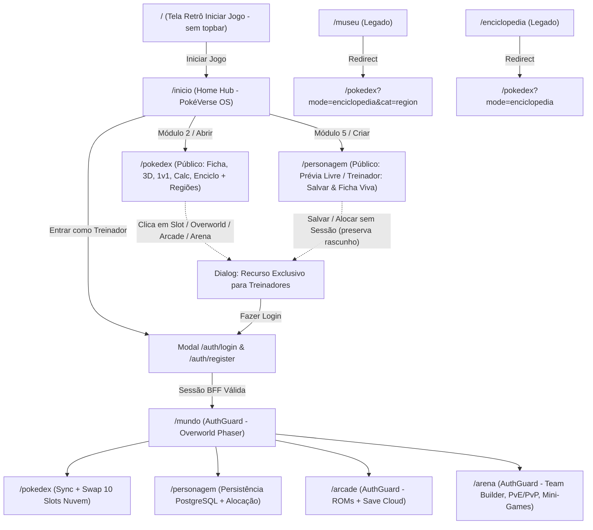

# 02 — Front-end Angular, HUD de Jogo e Gerenciamento de Estado

> **Nota de Estado Real (UX Unificada & Fila Prioritária):** A autenticação evoluiu de JWT em RAM para **sessão BFF opaca no Redis + cookies `HttpOnly`**. `AuthStore` foi decomposta com `AuthRecoveryService` e `AuthCrossTabSyncService`; `VisitorLockDialogComponent` usa `auth-dialog-validator.util.ts`; o painel de segurança ganhou `SecurityIamStore`; `PrivacyConsentStore` gere cookies/opt-in; a entrada da plataforma agora abre em **`TitleScreenComponent` (`/`)** (sem topbar, apenas *Iniciar Jogo*) → **`HomeHubComponent` (`/inicio`)**, com a marca `PokéVerse OS` da topbar apontando para `/inicio`; a Pokédex 3D (`/pokedex`) centraliza no visor os 5 modos internos (**Ficha 5 abas**, **Holocron 3D** sem contra-rotação + hook `GLTFLoader` em `holocron-media-loader.util.ts`, **Comparador 1v1**, **Calculadora de Atributos** com `pokedex-stat-calc.util.ts` e **Enciclopédia Global**, para a qual `/enciclopedia` redireciona automaticamente), os slots azuis abrem instantaneamente sem modal de confirmação e permitem reordenação por Drag & Drop/`↑`/`↓` (`PATCH /api/v1/pokedex/slots/swap`), além de `PokeballMarkComponent` compartilhado. Veja [00 — Fila Prioritária](00-fila-prioritaria-melhorias.md), [14 — Status Real](14-status-e-changelog-implementacao.md), [17 — Plano SOLID](17-plano-solid-clean-code-e-engenharia-big-tech.md), [18 — Auditoria Técnica](18-auditoria-e-plano-divida-tecnica-arquitetura.md) e [20 — Polimento Visual](20-polimento-visual-e-design-system-frontend.md).

## 1. Papel do Angular na Plataforma

Enquanto **Phaser 3 / PixiJS** desenha o mundo explorável 2D/HD-2D e **Babylon.js 9 + Havok WASM** renderiza cenas 3D e hardwares virtuais em WebGL2, o **Angular** atua como o **Sistema Operacional (Shell + HUD)** de toda a aplicação:

- **Standalone Components + Signals + Zoneless Change Detection:** elimina o custo global de `Zone.js` durante loops gráficos de `60–120 FPS` nos canvas do Phaser e Babylon.js. As atualizações da interface reagem apenas aos *Signals* explicitamente alterados.
- **Roteamento Modular com Lazy Loading:** cada grande área (*Title Screen*, *Overworld*, *Pokédex/Holocron*, *Museu*, *Arcade*, *Battle Frontier*) é carregada sob demanda via `loadComponent` / `loadChildren`, mantendo o bundle inicial enxuto para rápido **LCP**.

---

## 2. Mapa de Rotas e Proteção de Acesso



### Implementação dos Guards e Diretivas de Bloqueio

- **`authGuard` (`CanActivateFn` em `apps/web/src/app/core/guards/auth.guard.ts`):** verifica `AuthStore.isAuthenticated()`. Se o usuário for visitante, bloqueia o acesso direto via URL às rotas `/mundo`, `/arcade` e `/arena`, abre o diálogo de autenticação com contexto do módulo (`targetRoute`) e redireciona com segurança para `/inicio`.
- **`RequiresTrainerDirective` (`[pvRequiresTrainer]` em `apps/web/src/app/shared/directives/requires-trainer.directive.ts`):** diretiva de atributo aplicada a controles protegidos dentro de módulos mistos (por exemplo, os botões de slots na Pokédex quando em modo visitante e os atalhos bloqueados do dock). Mantém a focabilidade por teclado usando `aria-disabled="true"` e classe `.is-trainer-locked`, interceptando o clique para abrir o `<dialog>` de Login/Criar Conta (`VisitorLockDialogComponent`).
- **`DialogLightDismissDirective` (`dialog[pvDialogLightDismiss]` em `apps/web/src/app/shared/directives/dialog-light-dismiss.directive.ts`):** diretiva compartilhada por diálogos nativos com `closedby="any"` (`VisitorLockDialogComponent`, `PrivacyConsentDialogComponent`, `ApiCreditsDialogComponent`, `SecuritySettingsDialogComponent`) que garante fallback determinístico de fechamento ao clicar fora do bounding box quando o navegador ainda não suporta `HTMLDialogElement.prototype.closedBy`.

---

## 3. Arquitetura do HUD de Videogame

O HUD envolve o canvas sem bloquear cliques nos momentos de exploração e segue estética tática consistente com a paleta semântica em `oklch` e superfícies translúcidas com alto contraste (`WCAG 2.2 AA`):

1. **Top Bar Tática Unificada (`.hud-topbar`):**
   - Ocupa `100%` da largura da tela (`grade` de 3 colunas no desktop `>= 960px` para ancorar os controles esquerdo e direito nas extremidades e manter o ticker centralizado sem deslocar os botões).
   - À esquerda: emblema **PokéVerse OS** (`<pv-pokeball-mark>`, navegando para `/inicio`) e seletor único de módulos (**`HudModulesMenuComponent`**) agrupando os 5 módulos com atalhos `1` a `5`, rota dedicada `/pokedex`, `/personagem` e rodapé para `/inicio`, além de ícone de cadeado `[pvRequiresTrainer]` quando visitante:
     1. **Overworld (Vila Central)** — *cadeado se visitante*;
     2. **Pokédex 3D** *(inclui Ficha, Holocron 3D, Comparador 1v1, Calculadora, Enciclopédia & Atlas das Regiões)* — *sempre liberado*;
     3. **Arcade Retrô 3D** — *cadeado se visitante*;
     4. **Battle Frontier (Team Builder / Arena / Mini-Games)** — *cadeado se visitante*;
     5. **Personagem (Criação Livre & Ficha Viva)** — *sempre liberado em prévia / salvar requer sessão*.
   - Ao centro: **Ticker de Eventos Globais** alimentado pelo Kafka -> WebSocket (ex.: *"Treinador_Ash venceu Líder Brock na Battle Frontier"*), exibido temporariamente por `6s` (`activeNotification`) com animação suave de entrada e saída (`280ms`, classe `.is-exiting`) sem exibir eventos antigos (`> 30s`) em reconexões, mantendo o histórico recente no `WorldTickerStore`.
   - À direita (ordem fixa):
     - **Painel do Jogador (`HudUserMenuComponent`):** botão de visitante (*Modo Visitante • Entrar*) ou emblema do Treinador (`username • ELO`) que abre o painel da conta (insígnias, status 2FA/e-mail, `Segurança, 2FA & Dados da Conta`, verificação OTP e `Sair da conta`);
     - **Configurações (`HudSettingsMenuComponent`):** menu único com seleção de cenário de fundo (Hoenn, Cidade, Vila, Floresta), rotação automática (`ON`/`OFF`) e perfil de desempenho gráfico do navegador (`Auto`, `Ultra`, `Equil.`, `Lite`);
     - **Status da Nuvem:** pílula no canto direito (`Nuvem Online` / `Modo Offline`) que reconsulta `/health/ready`.
   - **Tato e abertura dos menus:** todos os botões do HUD e da Pokédex compartilham mixins táteis (`_hud-controls.scss`) com resposta física ao pressionar (`:active` afundando suavemente) e os popovers permanecem montados com `[inert]` abrindo em dobra suave estilo Pokédex (com fallback simplificado em `data-perf-tier="lite"` e `prefers-reduced-motion: reduce`), assim como a badge `#status-badge` ao salvar slots.
2. **Rodapé Discreto (`.app-footer`):**
   - Barra compacta centralizada na base da tela exibindo atribuição resumida (`PokéAPI v2 · Pokémon © Nintendo / Game Freak / TPC`) e links diretos para os modais **Créditos & APIs** e **Cookies & LGPD**, sem duplicação no cabeçalho, no visor da Pokédex ou no Museu.
3. **Overlay Dinâmico de Módulos (`.hud-stage-overlay`):**
   - Quando o treinador entra em um prédio no Overworld ou clica na Viagem Rápida, o Phaser pausa seu loop de física/renderização enquanto o módulo Angular/Babylon.js abre suavemente sobre o palco (e retoma instantaneamente ao fechar com `Escape` ou botão *Voltar ao Mapa*).

---

## 4. Gerenciamento de Estado com Signal Stores

Em vez de dependências pesadas como Redux/NgRx completo, cada domínio utiliza um serviço injetável (`providedIn: 'root'`) baseado em **`signal`**, **`computed`** e **`effect`**, expondo apenas leituras imutáveis (`asReadonly()`) e ações explícitas:

```typescript
@Injectable({ providedIn: 'root' })
export class AuthStore {
  private readonly state = signal<AsyncState<TrainerProfile>>({ status: 'idle' });

  readonly profile = computed(() => {
    const current = this.state();
    return current.status === 'success' ? current.data : null;
  });

  readonly isAuthenticated = computed(() => this.profile() !== null);
  readonly isLoading = computed(() => this.state().status === 'loading');
  readonly accessMode = computed<'visitor' | 'trainer'>(() =>
    this.isAuthenticated() ? 'trainer' : 'visitor'
  );
}
```

### Catálogo de Stores do Front-end (Implementados vs. Planejados)

| Store | Status | Responsabilidade Principal | Fonte de Verdade |
| :--- | :---: | :--- | :--- |
| **`AuthStore`** *(e `AuthSessionStore`)* | **Implementada + Refatorada SOLID** | Estado reativo da sessão BFF opaca (zero JWT no JS), login/registro/refresh, delegando OTP/recuperação a `AuthRecoveryService` e multi-aba a `AuthCrossTabSyncService` | NestJS `/api/v1/auth/*` + Cookies `HttpOnly` + `BroadcastChannel` |
| **`SecurityIamStore`** | **Implementada (2B + LGPD)** | Visão geral IAM, setup/ativação/desativação TOTP, registro/exclusão de Passkeys WebAuthn, vínculo Google PKCE, revogação de sessões, exportação JSON e exclusão definitiva (`deleteAccount`) | NestJS `/api/v1/auth/security/*`, `/passkeys/*`, `/me/export`, `DELETE /me` |
| **`PrivacyConsentStore`** | **Implementada (LGPD)** | Cookie versionado `pokeverse_consent`, registro extensível de chaves opcionais (`registerNonEssentialStorageKey`) e limpeza automática sem opt-in explícito | Cookie first-party `pokeverse_consent` + `BroadcastChannel` |
| **`WorldTickerStore`** | **Implementada (Fase 2)** | Ticker global em tempo real no HUD com importação dinâmica lazy de `socket.io-client` e notificação temporária (`6s` via `activeNotification` + histórico recente) | WebSocket `/ws/world` (`world:recent-events` / `world:global-event`) |
| **`PokedexStore`, `PokedexFiltersStore`, `PokedexCompareStore`, `PokedexVisorDetailStore`, `PokedexSlotsStore`, `PokedexApiClient` & `PokedexRpgNavService`** | **Implementadas + UX Unificada** | Catálogo/detalhes via `PokedexApiClient`, filtros combinados (`/catalog/enriched` + `/meta/filters`), 5 modos integrados no visor (**Ficha 5 abas**, **Holocron 3D**, **Comparador 1v1**, **Calculadora de Atributos** via `@pokeverse/shared` e **Enciclopédia Global**), abertura instantânea nos 10 slots + reordenação Drag & Drop/`↑`/`↓` (`PATCH /slots/swap`) e foco declarativo via `[pvRpgFocusable]` | NestJS `/api/v1/pokedex/*` + PokéAPI fallback + `localStorage` (visitante) |
| **`EncyclopediaStore` & `EncyclopediaApiClient`** | **Implementadas + Integradas no Visor** | 11 recursos do BFF (`move`, `ability`, `item`, `berry`, `type`, `nature`, `region`, `pokedex`, `location`, `egg-group`, `growth-rate`) embutidos dentro do visor da Pokédex (`/enciclopedia` redireciona para `/pokedex?mode=enciclopedia`) com busca reversa direta para a ficha | NestJS `/api/v1/pokedex/{moves,abilities,items,berries,regions,pokedexes,locations,egg-groups,growth-rates,natures,types}` |
| **`AudioStore` & `AudioEngineService`** | **Implementadas (Passo 2B.3)** | Controle global de mudo (`pokeverse_audio_muted`) e efeitos táteis (`pokeverse_audio_sfx`) registrados em `PrivacyConsentStore`, reprodução de *cries* com `AnalyserNode` + espectrograma Canvas 2D (`CrySpectrogramComponent`) e osciladores Web Audio respeitando `LITE`/`reduced-motion` | Web Audio API + `localStorage` sob consentimento LGPD |
| **`HolocronStore`** | **Implementada + Giro 3D Real & Babylon.js 9** | Estado do modo **Holocron 3D** embutido no visor (`@defer`, `@babylonjs/core` + `@babylonjs/loaders` + `@babylonjs/havok` via `holocron-media-loader.util.ts` e `babylon-stage.util.ts`), prisma 3D sem contra-rotação de sprite, rotação orbital 360° (`ArcRotateCamera`), alternância Shiny/Auto-Giro e fallback 2D em `LITE`/`webglcontextlost` | `PokedexApiClient` (`/pokemon/:idOrName/bundle`) + `holocron-babylon.renderer.ts` |
| **`MuseumStore`** | **Implementada + Unificada na Pokédex (`ENT-19`)** | Estado do Atlas das 9 Regiões (`Kanto–Paldea`) dentro de `Enciclopédia -> Regiões & História` (`RegionsAtlasPanelComponent`), linha do tempo única `1996–2022`, cache em memória de regiões/pokédexes regionais, filtro de localizações e navegação direta sem recarregamento para Ficha, Holocron 3D, Pokédexes e Localizações (`/museu` redireciona) | `EncyclopediaApiClient` (`/regions/:id` e `/pokedexes/:id`) |
| **`QualityStore` & `ScenarioStore`** | **Implementadas (Fases 1–4A)** | Perfil gráfico detectado (`ULTRA`, `BALANCED`, `LITE`) com `FpsWatchdog` e rotação de cenários WebP (`-desktop`/`-mobile`) com opt-in LGPD | Hardware probe + preferências opcionais via `PrivacyConsentStore` |
| **`SystemStatusStore`** | **Implementada (Fase 1)** | Sonda visual de saúde de PostgreSQL, Redis, Kafka e S3 no Título e Topbar + fase dinâmica (`POKEVERSE_PHASE`) | NestJS `/health/ready` e `/api/v1/system/bootstrap` |
| **`CharacterStudioStore` & `CharacterApiClient`** | **Implementadas (Passo 1)** | Rascunho livre (*classless*) no `/personagem`, distribuição dos 10 pontos iniciais nos 7 atributos, prévia SVG modular, preservação automática do rascunho durante fluxo de login, listagem paginada e alocação de pontos na **Ficha Viva** | NestJS `/api/v1/characters/*` + regras puras `@pokeverse/shared` |
| **`WorldStore`** | **Planejada (Fase 3)** | Mapa atual, coordenadas do jogador no Overworld e treinadores conectados | WebSocket `WorldGateway` + Phaser `EventBus` |
| **`ArcadeStore`** | **Planejada (Fase 5)** | Catálogo de ROMs disponíveis, jogo ativo no console 3D, progresso do download e Save States | NestJS `/arcade/roms` + MinIO Stream + WebAssembly |
| **`BattleStore`** | **Planejada (Fase 6)** | Fila de matchmaking PvP, estado turno-a-turno da partida, HP, buffs, log e times | WebSocket `BattleGateway` + NestJS `/teams` |

---

## 5. Design System, Estados Obrigatórios de UI e Acessibilidade

- **Tokens Semânticos (`oklch`) sem valores mágicos:** evolução direta dos tokens da antiga `css/style.css` (Fase 0 já portada para `apps/web/src/styles/_tokens.scss` e removida por desuso) (`--bg-surface`, `--fg-primary`, `--border-subtle`, `--accent`, espaçamento em escala `4px/8px`).
- **Os 5 Estados Obrigatórios em toda tela assíncrona:**
  1. `loading`: *Skeleton screens* com proporções fiéis ao conteúdo (evitando *CLS*);
  2. `empty`: ilustração/estado semântico claro + CTA contextual;
  3. `error`: mensagem humana sem stack trace + botão explícito de **Tentar novamente**;
  4. `success`: tratamento de nomes extensos (`min-width: 0`, `truncate`, `overflow-wrap: anywhere`), `tabular-nums` em estatísticas e fallback de imagens;
  5. `mutating`: desabilitação imediata durante envio (prevenção de duplo clique em gravação de slot, save state ou envio de jogada).
- **Acessibilidade WCAG 2.2 AA:**
  - Todo canvas (Phaser e Babylon.js) é acompanhado de controles alternativos completos em HTML semântico (`<nav>`, `<button>`, `<dialog>` nativo, listas `<ul>`) para garantir **100% de operação por teclado e leitores de tela** mesmo quando o usuário preferir navegar pelo HUD de Viagem Rápida em vez de caminhar com setas no canvas.
  - Suporte nativo a `:focus-visible`, `@media (prefers-reduced-motion: reduce)` (suspende partículas, câmera cinemática e shaders pesados) e `@media (forced-colors: active)`.

---

## 6. Ponte de Comunicação com Motores Gráficos

O Angular **nunca** manipula variáveis internas do Babylon.js ou do Phaser dentro de templates diretamente. A comunicação acontece por um **Barramento de Eventos Tipado (`WorldEngineBridge`)** + adaptadores dedicados:

- **Angular -> Engine:** comandos imperativos (`enterBuilding('arcade')`, `inspectPokemon3d(25)`, `mountWasmCanvasToHandheld(canvas)`, `setWeather('rain')`).
- **Engine -> Angular:** eventos emitidos para atualizar Signals (`onPortalEntered`, `onPlayerMoved`, `onTitleStartPressed`, `onWebGlContextLost`).
- Caso o navegador não suporte **WebGL2** ou ocorra perda de contexto GPU (`webglcontextlost`), o HUD Angular intercepta o evento e ativa um modo de degradação elegante em CSS/HTML sem quebrar a navegação.
