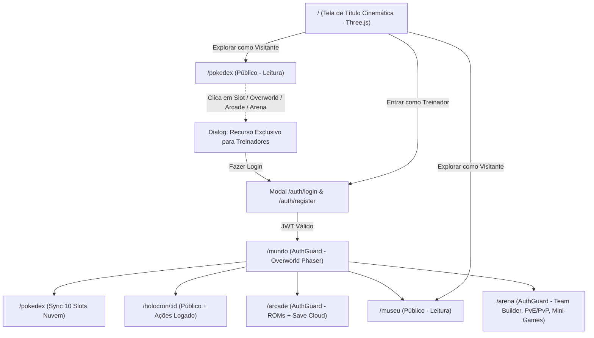

# 02 — Front-end Angular, HUD de Jogo e Gerenciamento de Estado

## 1. Papel do Angular na Plataforma

Enquanto **Phaser 3 / PixiJS** desenha o mundo explorável 2D/HD-2D e **Three.js** renderiza cenas 3D e hardwares virtuais em WebGL2, o **Angular** atua como o **Sistema Operacional (Shell + HUD)** de toda a aplicação:

- **Standalone Components + Signals + Zoneless Change Detection:** elimina o custo global de `Zone.js` durante loops gráficos de `60–120 FPS` nos canvas do Phaser e Three.js. As atualizações da interface reagem apenas aos *Signals* explicitamente alterados.
- **Roteamento Modular com Lazy Loading:** cada grande área (*Title Screen*, *Overworld*, *Pokédex/Holocron*, *Museu*, *Arcade*, *Battle Frontier*) é carregada sob demanda via `loadComponent` / `loadChildren`, mantendo o bundle inicial enxuto para rápido **LCP**.

---

## 2. Mapa de Rotas e Proteção de Acesso



### Implementação dos Guards e Diretivas de Bloqueio
- **`authGuard` (CanActivateFn):** verifica `AuthStore.isAuthenticated()`. Se o usuário for visitante, bloqueia o acesso direto via URL às rotas `/mundo`, `/arcade` e `/arena`, redireciona de forma limpa ou abre o prompt de login mantendo a URL de destino (`returnUrl`) para retorno automático após autenticação.
- **`VisitorLockDirective` (`[appRequiresTrainer]`):** diretiva estrutural/de atributo aplicada a botões protegidos dentro de módulos mistos (por exemplo, botões de gravação nos slots da Pokédex ou botão *"Adicionar ao Time"* dentro do Holocron). Em modo visitante, aplica visual de cadeado semântico (`aria-disabled="true"` / badge de cadeado) e intercepta o clique abrindo o modal de autenticação.

---

## 3. Arquitetura do HUD de Videogame

O HUD envolve o canvas sem bloquear cliques nos momentos de exploração e segue estética tática consistente com a paleta semântica em `oklch` e superfícies translúcidas com alto contraste (`WCAG 2.2 AA`):

1. **Top Bar Tática (`.hud-topbar`):**
   - À esquerda: emblema de status (**Modo Visitante** com botão *Entrar / Criar Conta*, ou **Cartão do Treinador** com avatar pixel/3D, nível/insígnias, pontuação global e indicador de conexão WebSocket ao vivo).
   - Ao centro-direita: **Ticker de Eventos Globais** alimentado pelo Kafka -> WebSocket (ex.: *"Treinador_Ash venceu Líder Brock na Battle Frontier"* ou *"Novo recorde no Quem é esse Pokémon?"*), com controle de silenciar/expandir.
   - À direita: controles globais de **Áudio Mestre** (Mudo/Volume), alternância de ambiente/tema e botão de saída/logout.
2. **Dock Inferior de Viagem Rápida & Inventário (`.hud-quick-dock`):**
   - Botões rápidos com atalho de teclado (`1` a `5`) e ícone de cadeado visível quando visitante:
     1. **Overworld (Vila Central)** — *cadeado se visitante*;
     2. **Pokédex 3D & Holocron** — *sempre liberado*;
     3. **Museu das Regiões & Jogos** — *sempre liberado*;
     4. **Arcade Retrô 3D** — *cadeado se visitante*;
     5. **Battle Frontier (Team Builder / Arena / Mini-Games)** — *cadeado se visitante*.
3. **Overlay Dinâmico de Módulos (`.hud-stage-overlay`):**
   - Quando o treinador entra em um prédio no Overworld ou clica na Viagem Rápida, o Phaser pausa seu loop de física/renderização enquanto o módulo Angular/Three.js abre suavemente sobre o palco (e retoma instantaneamente ao fechar com `Escape` ou botão *Voltar ao Mapa*).

---

## 4. Gerenciamento de Estado com Signal Stores

Em vez de dependências pesadas como Redux/NgRx completo, cada domínio utiliza um serviço injetável (`providedIn: 'root'`) baseado em **`signal`**, **`computed`** e **`effect`**, expondo apenas leituras imutáveis (`asReadonly()`) e ações explícitas:

```typescript
@Injectable({ providedIn: 'root' })
export class AuthStore {
  private readonly state = signal<AsyncState<TrainerProfile>>({ status: 'idle' });

  readonly profile = computed(() => {
    const current = this.state();
    return current.status === 'success' ? current.data : null;
  });

  readonly isAuthenticated = computed(() => this.profile() !== null);
  readonly isLoading = computed(() => this.state().status === 'loading');
  readonly accessMode = computed<'visitor' | 'trainer'>(() =>
    this.isAuthenticated() ? 'trainer' : 'visitor'
  );
}
```

### Catálogo de Stores do Front-end

| Store | Responsabilidade Principal | Fonte de Verdade |
| :--- | :--- | :--- |
| **`AuthStore`** | Sessão atual, perfil do treinador, refresh silencioso de token e modo Visitante/Treinador | NestJS `/auth/me` + `Access Token` em memória + Refresh Cookie HttpOnly |
| **`WorldStore`** | Mapa atual, coordenadas do jogador no Overworld, treinadores online próximos e Ticker global | WebSocket `WorldGateway` + Phaser `EventBus` |
| **`PokedexSlotsStore`** | Estado dos 10 slots da Pokédex 3D; modo bloqueado para visitante, sincronizado na nuvem para logado | NestJS `/pokedex/slots` (PostgreSQL) |
| **`ArcadeStore`** | Catálogo de ROMs disponíveis, jogo ativo no console 3D, progresso do download e slots de Save State | NestJS `/arcade/roms` + MinIO Stream + WebAssembly |
| **`BattleStore`** | Fila de matchmaking PvP, estado turno-a-turno da partida, HP, buffs, log de combate e times salvos | WebSocket `BattleGateway` + NestJS `/teams` |
| **`AudioStore`** | Controle de volume mestre, trilha ambiente de tela de título/museu/mapa e reprodução de *cries* | Web Audio API + preferência local não sensível |
| **`QualityStore`** | Perfil gráfico detectado automaticamente (`ULTRA`, `BALANCED`, `LITE`), override manual do usuário e watchdog de FPS | `HardwareDetectorService` + `FpsWatchdog` + preferência local |

---

## 5. Design System, Estados Obrigatórios de UI e Acessibilidade

- **Tokens Semânticos (`oklch`) sem valores mágicos:** evolução direta dos tokens de [css/style.css](../css/style.css) (`--bg-surface`, `--fg-primary`, `--border-subtle`, `--accent`, espaçamento em escala `4px/8px`).
- **Os 5 Estados Obrigatórios em toda tela assíncrona:**
  1. `loading`: *Skeleton screens* com proporções fiéis ao conteúdo (evitando *CLS*);
  2. `empty`: ilustração/estado semântico claro + CTA contextual;
  3. `error`: mensagem humana sem stack trace + botão explícito de **Tentar novamente**;
  4. `success`: tratamento de nomes extensos (`min-width: 0`, `truncate`, `overflow-wrap: anywhere`), `tabular-nums` em estatísticas e fallback de imagens;
  5. `mutating`: desabilitação imediata durante envio (prevenção de duplo clique em gravação de slot, save state ou envio de jogada).
- **Acessibilidade WCAG 2.2 AA:**
  - Todo canvas (Phaser e Three.js) é acompanhado de controles alternativos completos em HTML semântico (`<nav>`, `<button>`, `<dialog>` nativo, listas `<ul>`) para garantir **100% de operação por teclado e leitores de tela** mesmo quando o usuário preferir navegar pelo HUD de Viagem Rápida em vez de caminhar com setas no canvas.
  - Suporte nativo a `:focus-visible`, `@media (prefers-reduced-motion: reduce)` (suspende partículas, câmera cinemática e shaders pesados) e `@media (forced-colors: active)`.

---

## 6. Ponte de Comunicação com Motores Gráficos

O Angular **nunca** manipula variáveis internas do Three.js ou do Phaser dentro de templates diretamente. A comunicação acontece por um **Barramento de Eventos Tipado (`WorldEngineBridge`)** + adaptadores dedicados:

- **Angular -> Engine:** comandos imperativos (`enterBuilding('arcade')`, `inspectPokemon3d(25)`, `mountWasmCanvasToHandheld(canvas)`, `setWeather('rain')`).
- **Engine -> Angular:** eventos emitidos para atualizar Signals (`onPortalEntered`, `onPlayerMoved`, `onTitleStartPressed`, `onWebGlContextLost`).
- Caso o navegador não suporte **WebGL2** ou ocorra perda de contexto GPU (`webglcontextlost`), o HUD Angular intercepta o evento e ativa um modo de degradação elegante em CSS/HTML sem quebrar a navegação.
