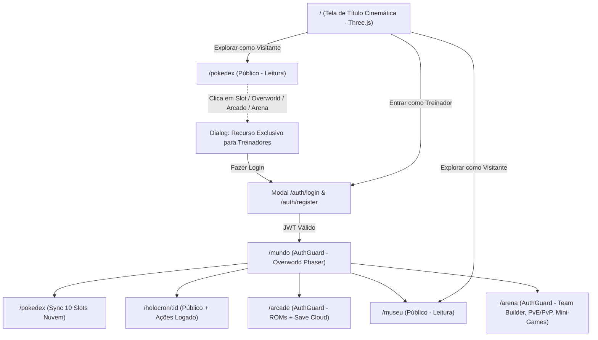

# 02 — Front-end Angular, HUD de Jogo e Gerenciamento de Estado

> **Nota de Estado Real (pós-Onda 3 do Doc 18):** A autenticação evoluiu de JWT em RAM para **sessão BFF opaca no Redis + cookies `HttpOnly`**. `AuthStore` foi decomposta com `AuthRecoveryService` (incluindo `resolveAuthOutcomeError`) e `AuthCrossTabSyncService` (+ `extractApiErrorMessage` em `core/http/api-error.util.ts`); `VisitorLockDialogComponent` usa `auth-dialog-validator.util.ts`; o painel de segurança ganhou `SecurityIamStore` (com exclusão LGPD em 2 etapas); `PrivacyConsentStore` gere cookies/opt-in; a Pokédex 3D foi modularizada para `< 300` linhas nos stores/serviços (`PokedexApiClient`, `pokedex-view-mapper.util.ts`, `PokedexLocalSlotsStorage`, `pokedex-rpg-nav.util.ts`, `PokedexInputShortcutsService`, `PokedexLidPhysicsService`) e `< 200` linhas nos componentes (`PokedexPhysicalControlsComponent`, `PokedexSlotsGridComponent`, templates/SCSS dedicados), com foco declarativo via `[pvRpgFocusable]` / `[pvRpgContainer]` / `[pvRpgEditForm]` e `[pvMainHeading]` / `[pvMainLandmark]` (`MainLandmarkFocusService`) sem nenhum `getElementById`/`querySelector` e tokens semânticos `--pv-hud-*` no HUD. Veja [14 — Status Real](14-status-e-changelog-implementacao.md), [17 — Plano SOLID](17-plano-solid-clean-code-e-engenharia-big-tech.md) e [18 — Auditoria Técnica](18-auditoria-e-plano-divida-tecnica-arquitetura.md).

## 1. Papel do Angular na Plataforma

Enquanto **Phaser 3 / PixiJS** desenha o mundo explorável 2D/HD-2D e **Three.js** renderiza cenas 3D e hardwares virtuais em WebGL2, o **Angular** atua como o **Sistema Operacional (Shell + HUD)** de toda a aplicação:

- **Standalone Components + Signals + Zoneless Change Detection:** elimina o custo global de `Zone.js` durante loops gráficos de `60–120 FPS` nos canvas do Phaser e Three.js. As atualizações da interface reagem apenas aos *Signals* explicitamente alterados.
- **Roteamento Modular com Lazy Loading:** cada grande área (*Title Screen*, *Overworld*, *Pokédex/Holocron*, *Museu*, *Arcade*, *Battle Frontier*) é carregada sob demanda via `loadComponent` / `loadChildren`, mantendo o bundle inicial enxuto para rápido **LCP**.

---

## 2. Mapa de Rotas e Proteção de Acesso



### Implementação dos Guards e Diretivas de Bloqueio
- **`authGuard` (`CanActivateFn` em `apps/web/src/app/core/guards/auth.guard.ts`):** verifica `AuthStore.isAuthenticated()`. Se o usuário for visitante, bloqueia o acesso direto via URL às rotas `/mundo`, `/arcade` e `/arena` (atualmente apontando temporariamente para `TitleScreenComponent` até a entrega das Fases 3–6), abre o diálogo de autenticação com contexto do módulo (`targetRoute`) e mantém o usuário na rota pública com segurança.
- **`RequiresTrainerDirective` (`[pvRequiresTrainer]` em `apps/web/src/app/shared/directives/requires-trainer.directive.ts`):** diretiva de atributo aplicada a controles protegidos dentro de módulos mistos (por exemplo, os botões de slots na Pokédex quando em modo visitante e os atalhos bloqueados do dock). Mantém a focabilidade por teclado usando `aria-disabled="true"` e classe `.is-trainer-locked`, interceptando o clique para abrir o `<dialog>` de Login/Criar Conta (`VisitorLockDialogComponent`).

---

## 3. Arquitetura do HUD de Videogame

O HUD envolve o canvas sem bloquear cliques nos momentos de exploração e segue estética tática consistente com a paleta semântica em `oklch` e superfícies translúcidas com alto contraste (`WCAG 2.2 AA`):

1. **Top Bar Tática (`.hud-topbar`):**
   - À esquerda: emblema de status (**Modo Visitante** com botão *Entrar / Criar Conta*, ou **Cartão do Treinador** com avatar pixel/3D, nível/insígnias, pontuação global e indicador de conexão WebSocket ao vivo).
   - Ao centro-direita: **Ticker de Eventos Globais** alimentado pelo Kafka -> WebSocket (ex.: *"Treinador_Ash venceu Líder Brock na Battle Frontier"* ou *"Novo recorde no Quem é esse Pokémon?"*), com controle de silenciar/expandir.
   - À direita: controles globais de **Áudio Mestre** (Mudo/Volume), alternância de ambiente/tema e botão de saída/logout.
2. **Dock Inferior de Viagem Rápida & Inventário (`.hud-quick-dock`):**
   - Botões rápidos com atalho de teclado (`1` a `5`) e ícone de cadeado visível quando visitante:
     1. **Overworld (Vila Central)** — *cadeado se visitante*;
     2. **Pokédex 3D & Holocron** — *sempre liberado*;
     3. **Museu das Regiões & Jogos** — *sempre liberado*;
     4. **Arcade Retrô 3D** — *cadeado se visitante*;
     5. **Battle Frontier (Team Builder / Arena / Mini-Games)** — *cadeado se visitante*.
3. **Overlay Dinâmico de Módulos (`.hud-stage-overlay`):**
   - Quando o treinador entra em um prédio no Overworld ou clica na Viagem Rápida, o Phaser pausa seu loop de física/renderização enquanto o módulo Angular/Three.js abre suavemente sobre o palco (e retoma instantaneamente ao fechar com `Escape` ou botão *Voltar ao Mapa*).

---

## 4. Gerenciamento de Estado com Signal Stores

Em vez de dependências pesadas como Redux/NgRx completo, cada domínio utiliza um serviço injetável (`providedIn: 'root'`) baseado em **`signal`**, **`computed`** e **`effect`**, expondo apenas leituras imutáveis (`asReadonly()`) e ações explícitas:

```typescript
@Injectable({ providedIn: 'root' })
export class AuthStore {
  private readonly state = signal<AsyncState<TrainerProfile>>({ status: 'idle' });

  readonly profile = computed(() => {
    const current = this.state();
    return current.status === 'success' ? current.data : null;
  });

  readonly isAuthenticated = computed(() => this.profile() !== null);
  readonly isLoading = computed(() => this.state().status === 'loading');
  readonly accessMode = computed<'visitor' | 'trainer'>(() =>
    this.isAuthenticated() ? 'trainer' : 'visitor'
  );
}
```

### Catálogo de Stores do Front-end (Implementados vs. Planejados)

| Store | Status | Responsabilidade Principal | Fonte de Verdade |
| :--- | :---: | :--- | :--- |
| **`AuthStore`** *(e `AuthSessionStore`)* | **Implementada + Refatorada SOLID** | Estado reativo da sessão BFF opaca (zero JWT no JS), login/registro/refresh, delegando OTP/recuperação a `AuthRecoveryService` e multi-aba a `AuthCrossTabSyncService` | NestJS `/api/v1/auth/*` + Cookies `HttpOnly` + `BroadcastChannel` |
| **`SecurityIamStore`** | **Implementada (2B + LGPD)** | Visão geral IAM, setup/ativação/desativação TOTP, registro/exclusão de Passkeys WebAuthn, vínculo Google PKCE, revogação de sessões, exportação JSON e exclusão definitiva (`deleteAccount`) | NestJS `/api/v1/auth/security/*`, `/passkeys/*`, `/me/export`, `DELETE /me` |
| **`PrivacyConsentStore`** | **Implementada (LGPD)** | Cookie versionado `pokeverse_consent`, registro extensível de chaves opcionais (`registerNonEssentialStorageKey`) e limpeza automática sem opt-in explícito | Cookie first-party `pokeverse_consent` + `BroadcastChannel` |
| **`WorldTickerStore`** | **Implementada (Fase 2)** | Ticker global em tempo real no HUD com importação dinâmica lazy de `socket.io-client` | WebSocket `/ws/world` (`world:recent-events` / `world:global-event`) |
| **`PokedexStore`, `PokedexSlotsStore`, `PokedexApiClient`, `PokedexLocalSlotsStorage`, `PokedexRpgNavService` & `PokedexInputShortcutsService`** | **Implementadas + Decompostas SRP (Onda 3)** | Catálogo/detalhes via `PokedexApiClient` + `pokedex-view-mapper.util.ts` (`/api/v1/pokedex/*` + fallback direto PokéAPI), CRUD dos 10 slots via `PokedexLocalSlotsStorage`, cinemática em `PokedexLidPhysicsService`, atalhos de documento em `PokedexInputShortcutsService` e foco declarativo via `[pvRpgFocusable]` / `[pvRpgEditForm]` + `styles/pokedex/` | NestJS `/api/v1/pokedex/*` + PokéAPI fallback + `localStorage` (visitante) |
| **`QualityStore` & `ScenarioStore`** | **Implementadas (Fases 1–4A)** | Perfil gráfico detectado (`ULTRA`, `BALANCED`, `LITE`) com `FpsWatchdog` e rotação de cenários WebP (`-desktop`/`-mobile`) com opt-in LGPD | Hardware probe + preferências opcionais via `PrivacyConsentStore` |
| **`SystemStatusStore`** | **Implementada (Fase 1)** | Sonda visual de saúde de PostgreSQL, Redis, Kafka e S3 no Título e Topbar + fase dinâmica (`POKEVERSE_PHASE`) | NestJS `/health/ready` e `/api/v1/system/bootstrap` |
| **`WorldStore`** | **Planejada (Fase 3)** | Mapa atual, coordenadas do jogador no Overworld e treinadores conectados | WebSocket `WorldGateway` + Phaser `EventBus` |
| **`ArcadeStore`** | **Planejada (Fase 5)** | Catálogo de ROMs disponíveis, jogo ativo no console 3D, progresso do download e Save States | NestJS `/arcade/roms` + MinIO Stream + WebAssembly |
| **`BattleStore`** | **Planejada (Fase 6)** | Fila de matchmaking PvP, estado turno-a-turno da partida, HP, buffs, log e times | WebSocket `BattleGateway` + NestJS `/teams` |
| **`AudioStore`** | **Planejada (Fases 3–4)** | Volume mestre, trilhas ambiente e *cries* via Web Audio API | Web Audio API + preferência local não sensível |

---

## 5. Design System, Estados Obrigatórios de UI e Acessibilidade

- **Tokens Semânticos (`oklch`) sem valores mágicos:** evolução direta dos tokens de [css/style.css](../css/style.css) (`--bg-surface`, `--fg-primary`, `--border-subtle`, `--accent`, espaçamento em escala `4px/8px`).
- **Os 5 Estados Obrigatórios em toda tela assíncrona:**
  1. `loading`: *Skeleton screens* com proporções fiéis ao conteúdo (evitando *CLS*);
  2. `empty`: ilustração/estado semântico claro + CTA contextual;
  3. `error`: mensagem humana sem stack trace + botão explícito de **Tentar novamente**;
  4. `success`: tratamento de nomes extensos (`min-width: 0`, `truncate`, `overflow-wrap: anywhere`), `tabular-nums` em estatísticas e fallback de imagens;
  5. `mutating`: desabilitação imediata durante envio (prevenção de duplo clique em gravação de slot, save state ou envio de jogada).
- **Acessibilidade WCAG 2.2 AA:**
  - Todo canvas (Phaser e Three.js) é acompanhado de controles alternativos completos em HTML semântico (`<nav>`, `<button>`, `<dialog>` nativo, listas `<ul>`) para garantir **100% de operação por teclado e leitores de tela** mesmo quando o usuário preferir navegar pelo HUD de Viagem Rápida em vez de caminhar com setas no canvas.
  - Suporte nativo a `:focus-visible`, `@media (prefers-reduced-motion: reduce)` (suspende partículas, câmera cinemática e shaders pesados) e `@media (forced-colors: active)`.

---

## 6. Ponte de Comunicação com Motores Gráficos

O Angular **nunca** manipula variáveis internas do Three.js ou do Phaser dentro de templates diretamente. A comunicação acontece por um **Barramento de Eventos Tipado (`WorldEngineBridge`)** + adaptadores dedicados:

- **Angular -> Engine:** comandos imperativos (`enterBuilding('arcade')`, `inspectPokemon3d(25)`, `mountWasmCanvasToHandheld(canvas)`, `setWeather('rain')`).
- **Engine -> Angular:** eventos emitidos para atualizar Signals (`onPortalEntered`, `onPlayerMoved`, `onTitleStartPressed`, `onWebGlContextLost`).
- Caso o navegador não suporte **WebGL2** ou ocorra perda de contexto GPU (`webglcontextlost`), o HUD Angular intercepta o evento e ativa um modo de degradação elegante em CSS/HTML sem quebrar a navegação.
