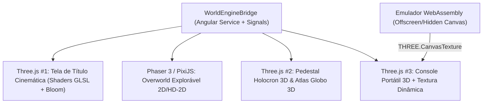

# 03 — Motores Gráficos: Phaser 3 e Three.js (WebGL2 / GLSL / GSAP)

## 1. Arquitetura Gráfica Híbrida

Para entregar sensação real de videogame mantendo fluidez e clareza arquitetural, os motores gráficos são divididos por especialidade e nunca disputam o mesmo `<canvas>`:

**Regra de Ouro de Performance:** apenas **um motor gráfico renderiza ativamente por vez** na camada principal (com exceção controlada do canvas oculto do emulador WebAssembly alimentando a textura do portátil 3D durante uma partida). Ao trocar de tela pelo Overworld ou pelo HUD, a cena anterior executa `pause()` no seu *loop* `requestAnimationFrame`.

---

## 2. Camada Three.js (WebGL2 + Shaders GLSL + GSAP)

### 2.1. Tela de Título Cinemática (*"Press Start"*)
- **Cena:** palco tridimensional atmosférico com iluminação volumétrica simulada, partículas flutuantes em `THREE.Points` com *Vertex Shader* customizado, plano de horizonte com *Fragment Shader* procedural e silhueta/esfera energética metálica central em movimento contínuo.
- **Pós-processamento:** `EffectComposer` + `UnrealBloomPass` calibrado de forma sutil para realçar reflexos neon e bordas emissivas sem ofuscar a tipografia do título.
- **Animação de Transição (GSAP):** ao clicar em *Entrar como Treinador* ou *Explorar como Visitante*, a câmera executa *dolly-in* suave com **GSAP** enquanto o HTML overlay realiza *crossfade* para o Overworld ou módulo escolhido.

### 2.2. Console Portátil 3D (Módulo Arcade Retrô)
- **Modelagem:** estrutura 3D modular com variantes visuais por plataforma selecionada (**Game Boy Color**, **Game Boy Advance**, **Nintendo DS**), construída com materiais `MeshPhysicalMaterial` (simulando plástico texturizado com `roughness`/`clearcoat`, vidro protetor da tela e LED de bateria emissivo).
- **Mapeamento Ao Vivo da Tela (`THREE.CanvasTexture`):**
  - O emulador WebAssembly escreve seus quadros (`160x144` GB/GBC ou `240x160` GBA) em um `<canvas>` dedicado com `imageSmoothingEnabled = false` (pixel-art nítido).
  - A cada frame ativo do Arcade, a tela interna do portátil 3D lê esse canvas como `CanvasTexture` com `minFilter = THREE.NearestFilter` e `magFilter = THREE.NearestFilter`.
  - O usuário pode alternar entre **Modo Imersivo 3D** (console inclinado reativo sutilmente ao ponteiro, botões 3D animando ao apertar teclado/gamepad) e **Modo Tela Cheia / Zoom Direto** (câmera aproxima a tela para foco máximo no jogo).

### 2.3. Holocron 3D & Atlas 3D das Regiões
- **Pedestal Holocron 3D:** base metálica hexagonal com anel luminoso dinâmico cuja cor responde automaticamente aos tipos do Pokémon inspecionado (ex.: Fogo = âmbar/carmesim, Água = ciano/safira). Inclui projeção 3D (ou sprite billboard HD/voxel/modelo `glTF` com rotação orbital `OrbitControls` amortecida), *Fragment Shader* de varredura holográfica e aura de partículas elementais.
- **Atlas 3D (Museu):** mapa estilizado com marcadores espaciais (*Raycasting* no ponteiro) que destacam cada região ao passar o mouse e aproximam a câmera com GSAP ao selecionar um ponto histórico.

---

## 3. Camada Phaser 3 / PixiJS (Overworld Explorável 2D/HD-2D)

### 3.1. Vila Central (**PokéVerse Town**) e Edifícios-Portais
O Overworld funciona como o hub interativo conectado para treinadores logados:
- **Mapa em Camadas (Tilemap JSON):** chão, caminhos, água animada por shader/frames, vegetação em balanço e elevações com camada de profundidade dinâmica (`y-sorting` para o personagem passar atrás de telhados e na frente de paredes).
- **Os 4 Edifícios Principais (Gatilhos de Portal):**
  1. **Laboratório Pokémon:** abre a **Pokédex 3D Clássica** e o **Holocron 3D**;
  2. **Museu Nacional de História:** abre o **Atlas das Regiões & Linha do Tempo**;
  3. **Game Corner (Arcade):** abre o **Arcade Retrô 3D**;
  4. **Battle Frontier Arena:** abre **Team Builder**, **Mini-Games** e **Simulador PvE/PvP**.
- **Atmosfera Dinâmica:**
  - **Ciclo Dia / Entardecer / Noite** baseado no relógio local (ou alternável nas configurações), aplicando *pipeline* de iluminação 2D (`Light2D` / *color grading*) e acendendo automaticamente postes, janelas e letreiros neon à noite.
  - **Clima Procedural:** partículas leves de folhas ao vento, garoa ou vagalumes noturnos.

### 3.2. Sincronização Multiplayer e Controles
- **Movimentação Suave:** suporte a teclado (`WASD` / Setas + `Shift` para correr + `E`/`Enter` para interagir), toque/clique no destino (*pathfinding* simples / joystick virtual no mobile) e controle físico via **Gamepad API**.
- **Avatares Remotos:** posições enviadas em *throttling* (`~10 Hz`, apenas quando há movimento) via `WorldGateway` WebSocket, interpoladas suavemente no cliente (`lerp`) para evitar saltos bruscos de rede entre treinadores online na mesma sala.

---

## 4. Gestão de Memória GPU e Acessibilidade Visual

Vazamentos de memória em WebGL são a principal causa de travamentos em apps 3D de longa sessão. Todo componente Three.js/Phaser no PokéVerse OS segue um protocolo rígido de ciclo de vida:

1. **Pausa Automática por Visibilidade (`visibilitychange` e troca de rota):** ao sair da aba do navegador ou abrir um modal sobreposto, o *ticker* suspende atualizações pesadas.
2. **Descarte Explícito no `ngOnDestroy()` (`DisposableRegistry`):**
   - Chamada obrigatória de `geometry.dispose()`, `material.dispose()`, `texture.dispose()`, `composer.dispose()` e `renderer.dispose()` ao desmontar módulos pesados como o Arcade ou o Holocron fora da cache de cena.
3. **Detecção de Capacidade & Degradação Graciosa:**
   - Redução automática de `devicePixelRatio` máximo para `Math.min(window.devicePixelRatio, 2)` evitando sobrecarga em telas 4K.
   - Modo `prefers-reduced-motion: reduce`: desliga rotação automática de câmera, tremor de tela, partículas contínuas e transições longas GSAP.
   - Fallback para renderização reduzida caso o dispositivo tenha WebGL limitado ou `webglcontextlost`.
