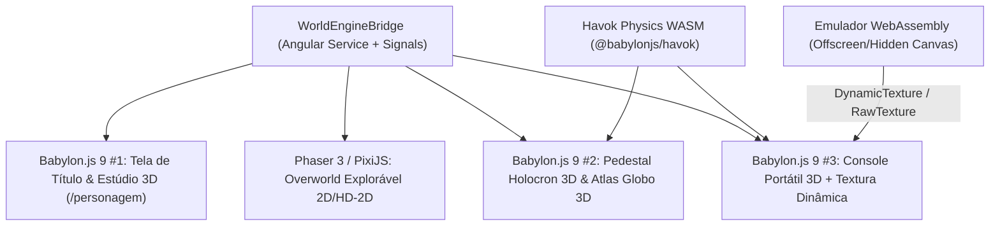

# 03 — Motores Gráficos: Phaser 3 e Babylon.js 9 + Havok Physics (WebGL2 / GLSL / GSAP)

> **Migração Concluída (`apps/web`):** O motor 3D anteriormente desenhado com `Three.js` foi migrado integralmente para **Babylon.js 9 (`@babylonjs/core` + `@babylonjs/loaders`) + Havok Physics WASM (`@babylonjs/havok`)**, com decodificação Draco (`/assets/draco/`) e `HavokPhysics.wasm` (`/assets/havok/`) auto-hospedados em `apps/web/public/assets/` para conformidade CSP estrita. O nome histórico deste arquivo (`03-motores-graficos-phaser-e-threejs.md`) foi mantido por compatibilidade de links existentes no repositório.

## 1. Arquitetura Gráfica Híbrida

Para entregar sensação real de videogame mantendo fluidez e clareza arquitetural, os motores gráficos são divididos por especialidade e nunca disputam o mesmo `<canvas>`:

**Regra de Ouro de Performance:** apenas **um motor gráfico renderiza ativamente por vez** na camada principal (com exceção controlada do canvas oculto do emulador WebAssembly alimentando a textura do portátil 3D durante uma partida). Ao trocar de tela pelo Overworld ou pelo HUD, a cena anterior executa `pause()` / interrompe `runRenderLoop`.

---

## 2. Camada Babylon.js 9 + Havok WASM (WebGL2 + Shaders GLSL + PBR)

### 2.1. Núcleo Compartilhado (`babylon-stage.util.ts` & `babylon-physics.util.ts`)
- **Infra de Renderização (`apps/web/src/app/core/engine-ports/babylon-stage.util.ts`):** encapsula criação de `Engine` (respeitando `devicePixelRatio` dos perfis `ULTRA`/`BALANCED`/`LITE` e `preserveDrawingBuffer` quando necessário), `Scene`, `ArcRotateCamera`, iluminação PBR (`HemisphericLight` + `DirectionalLight`), resize reativo e descarte determinístico (`scene.dispose()` + `engine.dispose()`).
- **Decodificação Draco & Física (`apps/web/src/app/core/engine-ports/babylon-physics.util.ts`):** configura `DracoDecoder.DefaultConfiguration` / `DracoCompression.Configuration` apontando para `/assets/draco/` auto-hospedado e inicializa `HavokPhysics({ locateFile })` + `HavokPlugin` apontando para `/assets/havok/HavokPhysics.wasm` sob `@defer`.
- **Estúdio de Personagem (`/personagem` — `CharacterHologramBabylonRenderer`):** projeta os avatares `.glb` CC0 com nomeação GLTF preservada (`UpperArm.L`/`UpperArm.R`) e composição local em `Quaternion` para pose heroica relaxada, além de controles orbitais e descarte seguro.

### 2.2. Console Portátil 3D (Módulo Arcade Retrô — Planejado Fase 6)
- **Modelagem:** estrutura 3D modular com variantes visuais por plataforma selecionada (**Game Boy Color**, **Game Boy Advance**, **Nintendo DS**), construída com materiais `PBRMaterial` (simulando plástico texturizado com `roughness`/`clearcoat`, vidro protetor da tela e LED emissivo).
- **Mapeamento Ao Vivo da Tela (`DynamicTexture` / `RawTexture`):**
  - O emulador WebAssembly escreve seus quadros (`160x144` GB/GBC ou `240x160` GBA) em um `<canvas>` dedicado com `imageSmoothingEnabled = false` (pixel-art nítido).
  - A cada frame ativo do Arcade, a tela interna do portátil 3D lê esse canvas via `DynamicTexture` com `Texture.NEAREST_SAMPLINGMODE`.
  - O usuário pode alternar entre **Modo Imersivo 3D** (console inclinado reativo sutilmente ao ponteiro, botões 3D animando ao apertar teclado/gamepad) e **Modo Tela Cheia / Zoom Direto** (câmera aproxima a tela para foco máximo no jogo).

### 2.3. Holocron 3D & Atlas 3D das Regiões
- **Pedestal Holocron 3D (`HolocronBabylonRenderer`):** base metálica hexagonal em PBR com anel luminoso dinâmico cuja cor responde automaticamente aos tipos do Pokémon inspecionado (ex.: Fogo = âmbar/carmesim, Água = ciano/safira). Carrega modelos `.glb` comprimidos via Draco (`Pokemon-3D-api/assets`) com `AnimationGroup` selecionável ou movimento *idle* procedural, feixe com `ShaderMaterial`, partículas elementais, `ArcRotateCamera` 360° e fallback para prisma 3D ou vista 2D em `LITE`/`webglcontextlost`.
- **Atlas 3D (Museu):** mapa estilizado com marcadores espaciais (`scene.pick`) que destacam cada região ao passar o ponteiro e aproximam a câmera suavemente ao selecionar um ponto histórico.

---

## 3. Camada Phaser 3 / PixiJS (Overworld Explorável 2D/HD-2D)

### 3.1. Vila Central (**PokéVerse Town**) e Edifícios-Portais
O Overworld funciona como o hub interativo conectado para treinadores logados:
- **Mapa em Camadas (Tilemap JSON):** chão, caminhos, água animada por shader/frames, vegetação em balanço e elevações com camada de profundidade dinâmica (`y-sorting` para o personagem passar atrás de telhados e na frente de paredes).
- **Os 4 Edifícios Principais (Gatilhos de Portal):**
  1. **Laboratório Pokémon:** abre a **Pokédex 3D Clássica** e o **Holocron 3D**;
  2. **Museu Nacional de História:** abre o **Atlas das Regiões & Linha do Tempo**;
  3. **Game Corner (Arcade):** abre o **Arcade Retrô 3D**;
  4. **Battle Frontier Arena:** abre **Team Builder**, **Mini-Games** e **Simulador PvE/PvP**.
- **Atmosfera Dinâmica:**
  - **Ciclo Dia / Entardecer / Noite** baseado no relógio local (ou alternável nas configurações), aplicando *pipeline* de iluminação 2D (`Light2D` / *color grading*) e acendendo automaticamente postes, janelas e letreiros neon à noite.
  - **Clima Procedural:** partículas leves de folhas ao vento, garoa ou vagalumes noturnos.

### 3.2. Sincronização Multiplayer e Controles
- **Movimentação Suave:** suporte a teclado (`WASD` / Setas + `Shift` para correr + `E`/`Enter` para interagir), toque/clique no destino (*pathfinding* simples / joystick virtual no mobile) e controle físico via **Gamepad API**.
- **Avatares Remotos:** posições enviadas em *throttling* (`~10 Hz`, apenas quando há movimento) via `WorldGateway` WebSocket, interpoladas suavemente no cliente (`lerp`) para evitar saltos bruscos de rede entre treinadores online na mesma sala.

---

## 4. Gestão de Memória GPU e Acessibilidade Visual

Vazamentos de memória em WebGL são a principal causa de travamentos em apps 3D de longa sessão. Todo componente Babylon.js/Phaser no PokéVerse OS segue um protocolo rígido de ciclo de vida:

1. **Pausa Automática por Visibilidade (`visibilitychange` e troca de rota):** ao sair da aba do navegador ou abrir um modal sobreposto, o *ticker* / `runRenderLoop` suspende atualizações pesadas.
2. **Descarte Explícito no `ngOnDestroy()` (`dispose()`):**
   - Chamada obrigatória de `scene.dispose()` e `engine.dispose()` (liberando malhas, `PBRMaterial`, texturas, `ShaderMaterial`, `AnimationGroup`, pipelines de partículas e instância física Havok) ao desmontar módulos 3D como o Estúdio de Personagem, o Holocron ou o futuro Arcade.
3. **Detecção de Capacidade, Mobile-First & Degradação Graciosa (Ver [doc 11](11-performance-hardware-gates-e-mobile.md)):**
   - O `HardwareDetectorService` classifica o dispositivo automaticamente entre **`ULTRA`**, **`BALANCED`** e **`LITE`** (`deviceMemory`, `hardwareConcurrency`, `saveData`, suporte WebGL2 e interface touch), ajustando `devicePixelRatio` (`2.0` / `1.5` / `1.0`), contagem de partículas e *post-processing* Bloom.
   - Em tempo de execução, um *FpsWatchdog* rebaixa o perfil automaticamente se a média cair abaixo de `45 FPS` por mais de 3 segundos em celulares modestos; o modo `LITE` oferece fallback em CSS/2D leve quando não houver WebGL2 adequado.
   - Modo `prefers-reduced-motion: reduce`: desliga rotação automática de câmera, tremor de tela, partículas contínuas e transições longas GSAP.
   - Fallback seguro caso ocorra `webglcontextlost`, além de joysticks/botões virtuais touch `>= 44×44px` no Overworld e Arcade em telas móveis.
