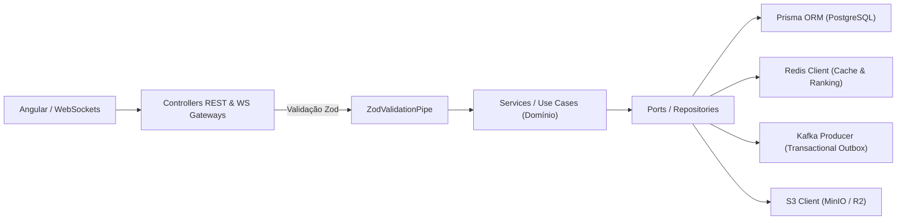
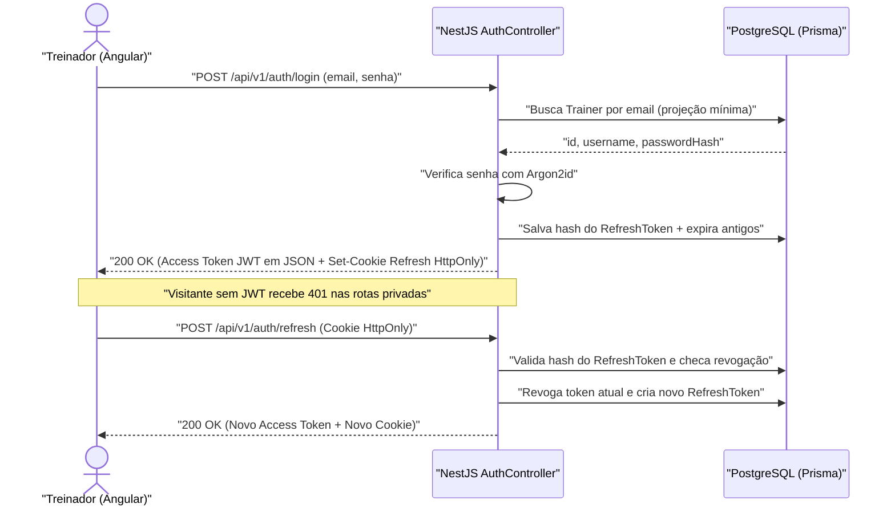

# 04 — Back-end NestJS, Autenticação e Segurança

## 1. Arquitetura Interna do Back-end (`apps/api`)

O back-end em **NestJS (TypeScript estrito)** concentra regras de negócio autoritativas, persistência relacional, integração com cache/storage/mensageria e comunicação em tempo real via WebSockets.

Cada módulo segue separação em camadas para evitar acoplamento com HTTP ou ORM:

### Catálogo de Módulos NestJS

| Módulo | Responsabilidade Principal | Acesso |
| :--- | :--- | :--- |
| **`AuthModule`** | Registro, login, rotação de *Refresh Token*, logout e `/auth/me` | Público (`/register`, `/login`, `/refresh`) + Protegido (`/logout`, `/me`) |
| **`TrainersModule`** | Perfil do treinador, avatar, últimas coordenadas no Overworld e insígnias | Protegido (`JwtAuthGuard`) |
| **`PokedexModule`** | Proxy com cache Redis da PokéAPI + CRUD dos 10 slots na nuvem | Leitura pública (`GET /pokemon`) + Slots protegidos (`JWT`) |
| **`MuseumModule`** | Entrega estruturada de regiões, ginásios, líderes e linha do tempo de jogos | Público (`@Public()`) |
| **`ArcadeModule`** | Catálogo fixo de ROMs, geração de URL/stream autenticado e *Cloud Save States* | Protegido (`JwtAuthGuard`) |
| **`TeamsModule`** | CRUD de equipes (6 slots), validação de regras e disparo de análise assíncrona | Protegido (`JwtAuthGuard`) |
| **`MinigamesModule`** | Sessões temporizadas anti-cheat + pontuação no Redis *Sorted Sets* | Protegido (`JwtAuthGuard`) |
| **`BattleModule`** | Engine determinística turn-based (PvE e PvP), Matchmaking Kafka e `BattleGateway` | Protegido (`JwtAuthGuard` / `WsJwtGuard`) |
| **`WorldModule`** | `WorldGateway` WebSocket para presença online e Ticker global de eventos | Protegido (`WsJwtGuard`) |
| **`HealthModule`** | Endpoints `/health/live` e `/health/ready` verificando dependências críticas | Público controlado (infraestrutura) |

---

## 2. Fluxo de Autenticação, Sessão e RBAC

### Política de Tokens
- **Hashing de Senha:** **Argon2id** com *salt* criptográfico por usuário e parâmetros resistentes a força bruta.
- **`Access Token` (JWT curto — 15 minutos):** assinado assimetricamente ou com segredo rotacionável via `.env`, mantido **em memória RAM** no front-end Angular (nunca salvo em `localStorage` ou `sessionStorage`).
- **`Refresh Token` (opaco — 7 dias):** armazenado no cliente exclusivamente em cookie **`HttpOnly`**, **`Secure`**, **`SameSite=Lax`** (restrito ao path `/api/v1/auth`), com hash SHA-256 persistido na tabela `RefreshToken` no PostgreSQL.
- **Rotação com Detecção de Reuso (*Refresh Token Rotation*):** ao renovar o token em `/auth/refresh`, o registro anterior é marcado como revogado e um novo par é emitido. Se um token já revogado for reutilizado (sinal de roubo de cookie), toda a família de sessões daquele treinador é imediatamente invalidada.

### Matriz RBAC (`@Public()` vs. `JwtAuthGuard`)
- O `JwtAuthGuard` é registrado como **Guard Global (`APP_GUARD`)** no NestJS para adotar o princípio *Secure by Default*: toda rota é protegida por padrão.
- Endpoints estritamente abertos a **Visitantes** recebem explicitamente o decorator `@Public()` (ex.: consulta à PokéAPI via proxy cacheado, catálogo de nomes para busca *fuzzy*, dados do Museu das Regiões e `/health/*`).
- Qualquer endpoint que grava dados, transmite ROMs do catálogo, sincroniza Overworld, cria equipes ou inicia batalha/mini-game exige token JWT válido e verifica posse do recurso (`resource.trainerId === currentTrainer.id` — prevenção de **IDOR / Broken Object Level Authorization**).

---

## 3. Segurança de Aplicação (AppSec & OWASP Top 10)

1. **Validação Estrita na Fronteira (`ZodValidationPipe`):**
   - Nenhuma entrada vinda de `body`, `query`, `params` ou payload WebSocket chega aos serviços sem passar por schemas **Zod** de `packages/shared`. Campos desconhecidos são rejeitados (`strict()`).
2. **Prevenção contra Injeção:**
   - Queries relacionais executadas via Prisma parametrizado; qualquer SQL bruto excepcional usa exclusivamente `$queryRaw` com *tagged template literals* parametrizadas (jamais `$queryRawUnsafe` com concatenação de strings).
   - Zero concatenação de argumentos de sistema ou caminhos de bucket (chaves de objeto S3/MinIO sempre vêm do banco ou padrão UUID controlado).
3. **Rate Limiting Distribuído (`@nestjs/throttler` + Redis):**
   - Limites mais rígidos em endpoints sensíveis:
     - `/auth/login` e `/auth/register`: máximo de `10 req/min` por IP/usuário;
     - `/arcade/roms/:slug/session`: limite anti-abuso de geração de URLs assinadas;
     - Eventos WebSocket de movimento no Overworld: limite de frequência por conexão para impedir *flooding*.
4. **Hardening HTTP e Sanitização de Erros:**
   - **Helmet:** CSP (*Content Security Policy*), `X-Frame-Options`, `X-Content-Type-Options: nosniff` e ocultação de `X-Powered-By`.
   - **CORS Estrito:** lista explícita de origens permitidas (`FRONTEND_URL`) com `credentials: true` para suportar cookies `HttpOnly`.
   - **`GlobalExceptionFilter`:** converte exceções internas em JSON padronizado (`{ code, message, correlationId }`), registrando detalhes completos somente em logs estruturados internos e **nunca expondo stack traces, queries SQL ou segredos ao cliente**.

---

## 4. Arquitetura dos Gateways WebSocket

O NestJS mantém dois *namespaces* WebSocket dedicados sobre conexão autenticada via `WsJwtGuard` no *handshake*:

- **`/ws/world` (`WorldGateway`):**
  - Mantém presença na sala da Vila Central (`world:join`, `world:move`, `world:leave`);
  - Faz *broadcast* do feed global vindo do consumidor Kafka (`world:global-event`), exibindo conquistas, recordes e vitórias no Ticker do HUD Angular.
- **`/ws/battle` (`BattleGateway`):**
  - Gerencia salas autoritativas de batalha PvE e PvP (`match:ready`, `turn:submit-action`, `turn:resolved`, `match:finished`);
  - O cliente envia apenas a **intenção** (*usar golpe #2* ou *trocar para Pokémon #4*), e nunca envia cálculo de dano ou alteração de HP — toda resolução matemática roda no servidor para impedir qualquer trapaça.
