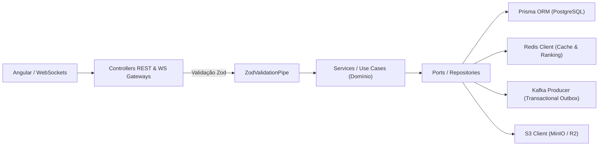
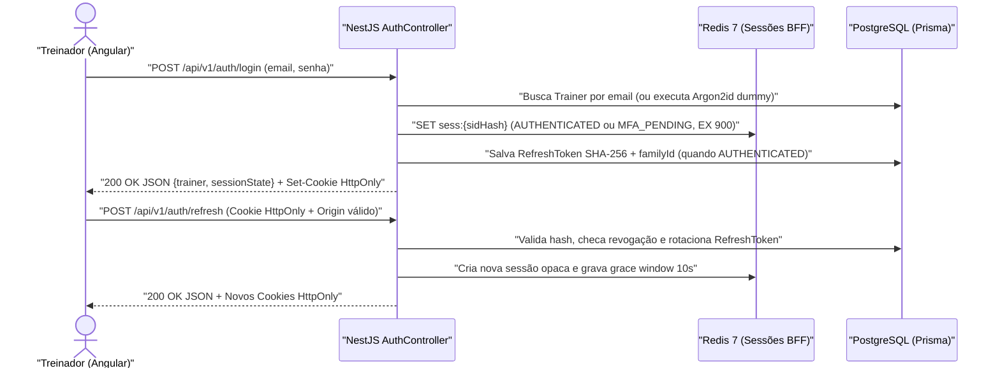

# 04 — Back-end NestJS, Autenticação e Segurança

> **Nota de Estado Real (Arquitetura BFF + Decomposição SOLID + Repositórios Isolados — Doc 13 / Doc 17 / Doc 18):** O `AuthModule` opera integralmente com **sessões BFF opacas no Redis + cookies `HttpOnly` (`__Host-` / `__Secure-`)**, máquina de estados `MFA_PENDING -> AUTHENTICATED`, `CsrfOriginGuard`, `RedisThrottlerStorage`, contadores atômicos em Lua (zero TOCTOU), `MailService` em tabela OCP, além da decomposição SOLID completa com 5 repositórios isolados por ISP (`TrainerAccountRepository`, `AuthTokenRepository`, `MfaTotpRepository`, `PasskeyRepository`, `TrainerOAuthRepository`), `totp-crypto.util.ts` e validação Zod na borda HTTP (`GoogleOAuthCallbackQuerySchema`, `PasskeyIdParamSchema`). As seções históricas 2–5 preservam o desenho inicial da Fase 2 como referência evolutiva; detalhes correntes estão em [13 — Dossiê de Segurança](13-dossie-de-seguranca-e-blindagem.md), [14 — Status Real](14-status-e-changelog-implementacao.md), [17 — Plano SOLID](17-plano-solid-clean-code-e-engenharia-big-tech.md) e [18 — Auditoria Técnica](18-auditoria-e-plano-divida-tecnica-arquitetura.md).

## 1. Arquitetura Interna do Back-end (`apps/api`)

O back-end em **NestJS (TypeScript estrito)** concentra regras de negócio autoritativas, persistência relacional, integração com cache/storage/mensageria e comunicação em tempo real via WebSockets.

Cada módulo segue separação estrita em camadas conforme o **[Contrato de Qualidade](ARCHITECTURE.md)** para evitar acoplamento com HTTP ou ORM:

- **Controllers finos (SoC):** apenas recebem requisições já validadas na borda (`ZodValidationPipe`), delegam aos Services de negócio e devolvem HTTP status codes/cookies BFF — nenhuma regra de negócio pode residir em Controllers.
- **Services desacoplados & Repositórios isolados:** consultas diretas via Prisma não poluem os Services de negócio, ficando isoladas em Repositórios/Portas dedicadas; o backend permanece estritamente **Stateless** (estado transitório no Redis; arquivos pesados via URLs MinIO/S3).

### Catálogo de Módulos NestJS (Implementados vs. Planejados)

| Módulo | Status | Responsabilidade Principal | Acesso |
| :--- | :---: | :--- | :--- |
| **`AuthModule`** | **Implementado + Refatorado SOLID & Repos (2A–2B + Docs 17–18)** | Fachada `AuthService` + `CredentialsAuthService`, `TokenRefreshService`, `AccountRecoveryService`, `SessionManagementService` (`distinct: ['familyId']` + `take` + expurgo `OutboxStatus.PUBLISHED`), `TrainerGdprService` (`/me/export`, `DELETE /me`), `TrainerSessionIssuer`, `AuthOutboxPublisher` (`OutboxStatus.PENDING`), `GoogleOAuthService` (`GoogleOAuthHttpClient`, `GoogleOidcVerifier`, `GoogleAccountLinker`), `MfaTotpService` + `totp-crypto.util.ts`, `PasskeyService`, `OtpService`, `SessionService`, 5 repositórios Prisma isolados (`TrainerAccountRepository`, `AuthTokenRepository`, `MfaTotpRepository`, `PasskeyRepository`, `TrainerOAuthRepository`) e borda Zod (`GoogleOAuthCallbackQuerySchema`, `PasskeyIdParamSchema`) | `@Public()` em `/providers`, `/register`, `/login`, `/refresh`, `/logout`, `/verify-email`, `/resend-verification`, `/forgot-password`, `/reset-password`, `/google/*`, `/passkeys/login/*` + BFF/CSRF no restante |
| **`PokedexModule`** | **Implementado (2–4B Passo 2A.3)** | Proxy com cache Redis da PokéAPI (`24h` + `stale-fallback` `7d`, `/catalog/enriched` GraphQL + fallback REST, `/meta/filters` `7d`, `/bundle` + matriz `0x..4x`, `/encounters`, `/forms` e enciclopédia paginada + busca reversa em `PokedexEncyclopediaController`/`Service`, `22/51` recursos ativos) + CRUD atômico dos 10 slots (`409` unicidade e `DELETE /slots`) | Leitura pública (`@Public()` em `GET /pokedex/*` com `ZodValidationPipe` na borda) + Slots protegidos (`SessionAuthGuard` + `RbacGuard` + escopo `pokedex:read`/`pokedex:write`) |
| **`WorldModule`, `EventsModule` & `NotificationsModule`** | **Implementado (2–Doc 17)** | `OutboxRelayService` (*atomic lease* `UPDATE ... RETURNING`) -> Redpanda -> `BaseIdempotentKafkaConsumer` (`WorldEventsConsumerService` + `EmailNotificationsConsumerService`, rollback de idempotência no `catch`) -> `WorldGateway` (`/ws/world`) e `MailService` via porta `EmailTransport` (`SmtpEmailTransport` / `ResendEmailTransport` + tabela OCP) | Handshake ticker aberto nesta fase (`WsAuthGuard` obrigatório na Fase 6/Overworld) |
| **`HealthModule` & `SystemModule`** | **Implementados (1–Doc 19)** | Endpoints `/health/live`, `/health/ready` (via `ObjectStoragePort` / `S3ObjectStorageAdapter`), `/api/v1/system/bootstrap` (`POKEVERSE_PHASE` dinâmico), `/api/v1/system/telemetry` (métricas RED + snapshot OpenTelemetry/Sentry), túnel BFF `POST /api/v1/telemetry/rum` & `/errors` (`ClientTelemetryController` + `TelemetryIngestionService`) e captura de 5xx via `SentryErrorReporterService` (`ErrorReporterPort`) no `GlobalExceptionFilter` | `@Public()` em `/health/*`, `/system/bootstrap` e `/telemetry/{rum,errors}` (throttle 30/min + Zod `.strict()`); `@Roles('MODERATOR', 'ADMIN')` + `@Scopes('ops:audit')` em `/system/telemetry` |
| **`TrainersModule`** | **Planejado (Fase 3)** | Perfil do treinador, avatar, últimas coordenadas no Overworld e insígnias | Protegido (`AuthGuard`) |
| **`MuseumModule`** | **Planejado (Fase 4)** | Entrega estruturada de regiões, ginásios, líderes e linha do tempo de jogos | `@Public()` |
| **`ArcadeModule`** | **Planejado (Fase 5)** | Catálogo fixo de ROMs, geração de URL/stream autenticado e *Cloud Save States* | Protegido (`AuthGuard`) |
| **`TeamsModule` & `MinigamesModule`** | **Planejados (Fase 6)** | CRUD de equipes (6 slots), análise assíncrona e sessões temporizadas + Leaderboard Redis | Protegido (`AuthGuard`) |
| **`BattleModule`** | **Planejado (Fase 6)** | Engine determinística turn-based (PvE e PvP), Matchmaking Kafka e `BattleGateway` | Protegido (`AuthGuard` / `WsAuthGuard`) |

---

## 2. Fluxo de Autenticação, Sessão e RBAC

### Política de Sessão BFF (Estado Real em Produção)

- **Hashing de Senha:** **Argon2id** com *salt* criptográfico por usuário e **verificação dummy (`DUMMY_ARGON2_HASH`)** no `login()` para impedir *timing enumeration* de e-mails.
- **Sessão Opaca no Redis (`900s`) + Cookie `HttpOnly` (`__Host-pokeverse_session` em HTTPS):** zero token JWT ou bearer exposto ao JavaScript do navegador; revogação imediata no `/logout`, na troca/redefinição de senha e no `DELETE /auth/me`.
- **Máquina de Estados `MFA_PENDING -> AUTHENTICATED`:** contas com 2FA ativo recebem sessão restrita `MFA_PENDING` (bloqueada por padrão no `SessionAuthGuard` até conclusão em `/auth/mfa/verify` ou Passkey, liberando apenas rotas com `@AllowMfaPending()`).
- **Refresh Token Opaco (`7 dias`):** armazenado exclusivamente em cookie `HttpOnly` (`__Secure-pokeverse_refresh` restrito ao path `/api/v1/auth`), com hash SHA-256 e `familyId` no PostgreSQL, grace window de `10s` no Redis e revogação integral da família + sessões ativas em caso de reuso.

### Matriz RBAC (`@Public()` vs. `SessionAuthGuard`) e Evolução por Escopos

- O `SessionAuthGuard` é registrado como **Guard Global (`APP_GUARD`)** no NestJS (*Secure by Default*): toda rota exige cookie de sessão válido no Redis em estado `AUTHENTICATED`.
- Endpoints abertos a **Visitantes** recebem explicitamente `@Public()` (ex.: catálogo e detalhe cacheados da PokéAPI, bootstrap de sessão e health checks).
- Endpoints de conclusão de 2FA ou logout recebem `@AllowMfaPending()`.
- Toda mutação autenticada (`PokedexSlot`, futuro `PokemonTeam`, `ArcadeSaveState`, `BattleMatch`) deriva `trainerId` exclusivamente da sessão validada no servidor e aplica-o na cláusula `where` da consulta (**IDOR / BOLA zero**).
- **RBAC Granular & Escopos (`REQ-SEC-02` — Ativo):** além de `@Public()` e `SessionAuthGuard`, o [`RbacGuard`](../apps/api/src/common/guards/rbac.guard.ts) aplica política *deny-by-default* em todas as rotas privadas exigindo `@Roles(...)` (`VISITOR`, `TRAINER`, `MODERATOR`, `ADMIN`) e `@Scopes(...)` (`pokedex:read`, `pokedex:write`, `account:read`, `account:manage`, `lab:run`, `ops:audit`), preservando `Trainer.role` na sessão Redis inclusive após `/auth/refresh` e login por Passkey e rotacionando o `sid` na promoção `MFA_PENDING -> AUTHENTICATED`.
- **Evolução de Governança (`REQ-SEC-01`, `16`, `20`, `23`, `28`, `33`, `34`):** autenticação M2M assinada/mTLS para eventual gateway de IA (Onda 5), WAF/DDoS gerenciado na borda, rotina trimestral de revisão de permissões de terceiros, controle estrito de acesso aos consoles de logs/métricas e restrição contínua de CSP/CORS ([doc 13 §9](13-dossie-de-seguranca-e-blindagem.md#9-governança-ampliada-de-segurança-privacidade-operações-e-ia-35-controles) e [doc 16 §4.3](16-cookies-lgpd-e-requisitos.md#43-catálogo-normativo-de-requisitos-de-segurança-req-sec-01-a-req-sec-35)).

---

## 3. Segurança de Aplicação (AppSec & OWASP Top 10)

1. **Validação Estrita na Fronteira (`ZodValidationPipe` + `bodyParser: false`):**
   - Nenhuma entrada de `body`, `query` ou `params` chega aos serviços sem passar por schemas **Zod** de `@pokeverse/shared` (com `.strict()`).
   - `main.ts` desabilita o body-parser implícito (`bodyParser: false`) para que `app.setup.ts` aplique exclusivamente `express.json({ limit: '64kb' })` e `express.urlencoded({ limit: '16kb', extended: false })`, com respostas padronizadas `413` / `400` no `GlobalExceptionFilter`.
2. **Prevenção contra Injeção:**
   - Queries relacionais via Prisma parametrizado; SQL bruto excepcional usa exclusivamente `$queryRaw` com *tagged template literals* parametrizadas (jamais `$queryRawUnsafe`).
3. **Rate Limiting Distribuído (`RedisThrottlerStorage`) & Consumo Atômico (`GETDEL`):**
   - `TrainerThrottlerGuard` sobre `RedisThrottlerStorage` usa script Lua atômico (`INCR` + `PEXPIRE`) chaveando por `trainer:{id}` quando autenticado ou `ip:{addr}`, com limites específicos em `/register`, `/login` (`10/min` + trava `(IP, email)`), `/refresh` (`20/min`), OTP (`5–10/min`), `/mfa/totp/{enable,disable}` (`5/min` + bloqueio acumulado de falhas), `/passkeys/*` (`10–20/min`), `DELETE /auth/me` (`5/min`), `GET /auth/me/export` (`10/min`) e escrita de slots Pokédex (`30/min`), estendendo-se na Onda 5 para API Keys e orçamento de tokens (`REQ-SEC-03`).
   - Desafios single-use de Google OAuth PKCE e Passkeys WebAuthn são consumidos atomicamente com `GETDEL` (`consumeString` / `consumeJson`), eliminando janelas TOCTOU.
4. **Hardening HTTP, CSRF, DLP & Redação de Logs:**
   - **Helmet:** `defaultSrc: 'none'`, `frameAncestors: 'none'`, `baseUri: 'none'`, `CORP: same-site`, `Permissions-Policy` e ocultação de `X-Powered-By`.
   - **CsrfOriginGuard:** valida `Sec-Fetch-Site`, `Origin`/`Referer` contra `CORS_ORIGINS` e bloqueia `Content-Type` de formulário HTML simples em mutações.
   - **GlobalExceptionFilter & StructuredLoggerService:** retorna apenas `{ code, message, correlationId }`, loga somente `req.path` (sem query string OAuth/token) e aplica redação automática de campos e headers sensíveis (`password`, `token`, `cookie`, `authorization`, `otp`).
   - **DLP, Anti-SSRF, Auditoria Imutável & Gate Pré-IA (`REQ-SEC-06..17, 21, 22, 24, 29, 30, 33, 35`):** redação ampliada DLP (JWT/PEM/e-mail) em `StructuredLoggerService`, `assertSafeOutboundUrl` pós-DNS nos clientes externos (PokéAPI, Google OAuth e Resend) e trilha `AuditLog` append-only no PostgreSQL com trigger contra `UPDATE`/`DELETE` via `AuditTrailService` já ativos; permanecem para governança cloud/Onda 5 cofre centralizado de segredos, alertas automatizados + playbooks IRP, *hard limits* EDoS, tokenização pré-modelo, filtragem de *prompt injection*, moderação de saída, sandboxing sem rede e assinatura de respostas críticas.

---

## 4. Arquitetura dos Gateways WebSocket

- **`/ws/world` (`WorldGateway` — Ativo):**
  - Entrega eventos globais públicos consumidos do Kafka (`world:recent-events` e `world:global-event`) para o Ticker da topbar.
  - Em `NODE_ENV=production`, `isAllowedWebSocketOrigin` **rejeita conexões sem cabeçalho `Origin`** e valida pertencimento exato a `CORS_ORIGINS` (com normalização de barra final).
  - Aplica cota simultânea por IP (`10` conexões/IP) e global (`1000` conexões), desconectando excedentes com `WS_CONNECTION_LIMIT_HIT`.
  - **Evolução para Fase 6 (Overworld):** antes de aceitar eventos `@SubscribeMessage` (`world:join`, `world:move`, `world:leave`), adicionar `WsAuthGuard` lendo o cookie `HttpOnly` de sessão no handshake, validação Zod por mensagem e rate limit por pacote.
- **`/ws/battle` (`BattleGateway` — Planejado para Fase 6):**
  - Gerencia salas autoritativas de batalha PvE e PvP (`match:ready`, `turn:submit-action`, `turn:resolved`, `match:finished`) com `WsAuthGuard` obrigatório e resolução matemática integral no servidor.

---

## 5. Referência Completa de Segurança e Higiene Temporal

Para o mapa completo de ameaças STRIDE, status atualizado controle a controle, política Redis/Kafka, containers não-root e portões DevSecOps no CI/CD, consulte o **[13 — Dossiê Completo de Segurança e Blindagem](13-dossie-de-seguranca-e-blindagem.md)**. O expurgo de `RefreshToken` expirados/revogados e `OutboxEvent` publicados roda periodicamente em runtime a cada `6h` via `SessionManagementService`.
