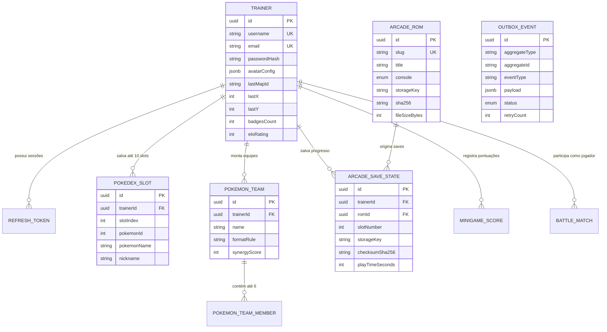

# 05 — Banco de Dados PostgreSQL e Prisma ORM

## 1. Papel do Banco Relacional no Sistema

O **PostgreSQL** é a fonte de verdade transacional (**ACID**) para contas de treinadores, sincronização dos 10 slots da Pokédex, catálogo e *Cloud Save States* do Arcade Retrô, equipes competitivas, histórico de batalhas e fila de saída confiável (*Outbox*). O acesso é feito exclusivamente via **Prisma ORM** com tipagem gerada e regras rígidas de desempenho.

---

## 2. Diagrama Entidade-Relacionamento



---

## 3. Especificação de Referência (`schema.prisma`)

```prisma
generator client {
  provider = "prisma-client-js"
}

datasource db {
  provider = "postgresql"
  url      = env("DATABASE_URL")
}

enum ArcadeConsole {
  GB
  GBC
  GBA
  NDS
}

enum OutboxStatus {
  PENDING
  PUBLISHED
  FAILED
}

enum BattleMode {
  PVE
  PVP
}

enum BattleStatus {
  WAITING
  IN_PROGRESS
  FINISHED
  CANCELLED
}

model Trainer {
  id           String    @id @default(uuid()) @db.Uuid
  username     String    @unique @db.VarChar(32)
  email        String    @unique @db.VarChar(255)
  passwordHash String    @db.Text
  avatarConfig Json      @default("{}")
  lastMapId    String    @default("pokeverse-town") @db.VarChar(64)
  lastX        Int       @default(400)
  lastY        Int       @default(320)
  badgesCount  Int       @default(0)
  eloRating    Int       @default(1000)
  createdAt    DateTime  @default(now()) @db.Timestamptz(6)
  updatedAt    DateTime  @updatedAt @db.Timestamptz(6)

  refreshTokens RefreshToken[]
  pokedexSlots  PokedexSlot[]
  teams         PokemonTeam[]
  saveStates    ArcadeSaveState[]
  scores        MinigameScore[]
  matchesAsP1   BattleMatch[]     @relation("MatchPlayerOne")
  matchesAsP2   BattleMatch[]     @relation("MatchPlayerTwo")

  @@index([eloRating(sort: Desc), id])
}

model RefreshToken {
  id         String    @id @default(uuid()) @db.Uuid
  trainerId  String    @db.Uuid
  tokenHash  String    @unique @db.VarChar(64)
  familyId   String    @db.Uuid
  expiresAt  DateTime  @db.Timestamptz(6)
  revokedAt  DateTime? @db.Timestamptz(6)
  createdAt  DateTime  @default(now()) @db.Timestamptz(6)

  trainer Trainer @relation(fields: [trainerId], references: [id], onDelete: Cascade)

  @@index([trainerId, revokedAt, expiresAt])
}

model PokedexSlot {
  id          String   @id @default(uuid()) @db.Uuid
  trainerId   String   @db.Uuid
  slotIndex   Int      @db.SmallInt
  pokemonId   Int
  pokemonName String   @db.VarChar(64)
  nickname    String?  @db.VarChar(40)
  spriteUrl   String?  @db.VarChar(512)
  updatedAt   DateTime @updatedAt @db.Timestamptz(6)

  trainer Trainer @relation(fields: [trainerId], references: [id], onDelete: Cascade)

  @@unique([trainerId, slotIndex])
  @@index([trainerId, pokemonId])
}

model PokemonTeam {
  id           String   @id @default(uuid()) @db.Uuid
  trainerId    String   @db.Uuid
  name         String   @db.VarChar(60)
  formatRule   String   @default("standard-6v6") @db.VarChar(32)
  synergyScore Int?
  createdAt    DateTime @default(now()) @db.Timestamptz(6)
  updatedAt    DateTime @updatedAt @db.Timestamptz(6)

  trainer Trainer             @relation(fields: [trainerId], references: [id], onDelete: Cascade)
  members PokemonTeamMember[]

  @@index([trainerId, updatedAt(sort: Desc), id])
}

model PokemonTeamMember {
  id        String   @id @default(uuid()) @db.Uuid
  teamId    String   @db.Uuid
  position  Int      @db.SmallInt
  pokemonId Int
  species   String   @db.VarChar(64)
  nickname  String?  @db.VarChar(40)
  level     Int      @default(50) @db.SmallInt
  nature    String   @db.VarChar(24)
  ability   String   @db.VarChar(48)
  heldItem  String?  @db.VarChar(48)
  ivs       Json
  evs       Json
  moves     String[] @db.VarChar(48)

  team PokemonTeam @relation(fields: [teamId], references: [id], onDelete: Cascade)

  @@unique([teamId, position])
}

model ArcadeRom {
  id            String        @id @default(uuid()) @db.Uuid
  slug          String        @unique @db.VarChar(80)
  title         String        @db.VarChar(120)
  console       ArcadeConsole
  generation    Int           @db.SmallInt
  releaseYear   Int           @db.SmallInt
  regionName    String        @db.VarChar(40)
  storageKey    String        @unique @db.VarChar(255)
  coverUrl      String        @db.VarChar(512)
  sha256        String        @db.Char(64)
  fileSizeBytes Int
  isActive      Boolean       @default(true)
  createdAt     DateTime      @default(now()) @db.Timestamptz(6)

  saveStates ArcadeSaveState[]

  @@index([isActive, console, generation])
}

model ArcadeSaveState {
  id              String   @id @default(uuid()) @db.Uuid
  trainerId       String   @db.Uuid
  romId           String   @db.Uuid
  slotNumber      Int      @db.SmallInt
  storageKey      String   @unique @db.VarChar(255)
  screenshotKey   String?  @db.VarChar(255)
  checksumSha256  String   @db.Char(64)
  byteLength      Int
  playTimeSeconds Int      @default(0)
  updatedAt       DateTime @updatedAt @db.Timestamptz(6)

  trainer Trainer   @relation(fields: [trainerId], references: [id], onDelete: Cascade)
  rom     ArcadeRom @relation(fields: [romId], references: [id], onDelete: Cascade)

  @@unique([trainerId, romId, slotNumber])
  @@index([trainerId, updatedAt(sort: Desc)])
}

model MinigameScore {
  id        String   @id @default(uuid()) @db.Uuid
  trainerId String   @db.Uuid
  gameKey   String   @db.VarChar(40)
  score     Int
  streak    Int      @default(0)
  createdAt DateTime @default(now()) @db.Timestamptz(6)

  trainer Trainer @relation(fields: [trainerId], references: [id], onDelete: Cascade)

  @@index([gameKey, score(sort: Desc), createdAt, id])
  @@index([trainerId, gameKey, createdAt(sort: Desc)])
}

model BattleMatch {
  id            String       @id @default(uuid()) @db.Uuid
  mode          BattleMode
  status        BattleStatus @default(WAITING)
  playerOneId   String       @db.Uuid
  playerTwoId   String?      @db.Uuid
  npcOpponentId String?      @db.VarChar(64)
  winnerId      String?      @db.Uuid
  turnCount     Int          @default(0)
  summaryLog    Json         @default("[]")
  createdAt     DateTime     @default(now()) @db.Timestamptz(6)
  finishedAt    DateTime?    @db.Timestamptz(6)

  playerOne Trainer  @relation("MatchPlayerOne", fields: [playerOneId], references: [id], onDelete: Cascade)
  playerTwo Trainer? @relation("MatchPlayerTwo", fields: [playerTwoId], references: [id], onDelete: SetNull)

  @@index([playerOneId, createdAt(sort: Desc), id])
  @@index([status, mode, createdAt(sort: Desc)])
}

model OutboxEvent {
  id            String       @id @default(uuid()) @db.Uuid
  aggregateType String       @db.VarChar(48)
  aggregateId   String       @db.VarChar(64)
  eventType     String       @db.VarChar(80)
  payload       Json
  status        OutboxStatus @default(PENDING)
  retryCount    Int          @default(0)
  lastError     String?      @db.Text
  createdAt     DateTime     @default(now()) @db.Timestamptz(6)
  processedAt   DateTime?    @db.Timestamptz(6)
}
```

---

## 4. Regras de Otimização e Concorrência

1. **Zero `SELECT *` (Projeção Estrita):**
   - Todas as chamadas Prisma usam `select: { ... }` explícito (jamais retornam `passwordHash` ou campos JSON pesados em listagens).
2. **Zero N+1 Queries:**
   - Times e seus 6 membros são carregados em uma única operação (`include: { members: { orderBy: { position: 'asc' }, select: { ... } } }`), nunca iterando `teams` para consultar membros dentro de loops.
3. **Paginação Eficiente via *Keyset Pagination* (Cursor):**
   - Rankings, histórico de batalhas e listas paginadas nunca usam `OFFSET` gigante (`skip: 50000`). Utilizam cursores determinísticos compostos `(createdAt, id)` ou `(score, id)` compatíveis com os índices definidos.
4. **Índices Cirúrgicos e Índices Parciais:**
   - Em índices compostos (`[trainerId, revokedAt, expiresAt]` ou `[gameKey, score, createdAt, id]`), igualdades precedem colunas de ordenação/faixa (Regra do Prefixo).
   - Uma migration SQL dedicada cria um **índice parcial** na tabela `OutboxEvent` exclusivamente para eventos pendentes, mantendo o índice minúsculo mesmo após milhões de eventos históricos:
     ```sql
     CREATE INDEX idx_outbox_pending
       ON "OutboxEvent" ("createdAt" ASC)
       WHERE "status" = 'PENDING';
     ```
5. **Transações Ultracurtas e Prevenção de Deadlocks:**
   - Chamadas à PokéAPI, uploads para o MinIO/S3 ou publicações no Kafka **nunca ocorrem dentro de `prisma.$transaction()`**. A transação abre apenas para gravar as entidades locais + o registro correspondente em `OutboxEvent` e faz commit imediato.
   - Em atualizações simultâneas de múltiplos registros (ex.: reordenação de membros do time ou slots), os IDs são sempre ordenados de forma determinística antes do `UPDATE` para eliminar ciclos de *lock* (deadlocks).

---

## 5. Status Atual de Aplicação (Fase 2)

- **Versão instalada:** Prisma **`6.19.3`** (`prisma` e `@prisma/client`) escolhido para compatibilidade direta CJS com NestJS 11 e Jest.
- **Migration aplicada:** `apps/api/prisma/migrations/20261118073124_init_pokeverse_schema/migration.sql`, criando as 10 tabelas de domínio no PostgreSQL (`pokeverse-postgres`) mais o índice parcial `"idx_outbox_pending"` em `"OutboxEvent" ("createdAt" ASC) WHERE "status" = 'PENDING'`.
- **Segurança & Higiene pendentes:** ver política de privilégio mínimo da role de runtime e worker de expurgo para `RefreshToken`/`OutboxEvent` publicados no [13 — Dossiê de Segurança e Blindagem](13-dossie-de-seguranca-e-blindagem.md#71-postgresql--prisma-orm).
