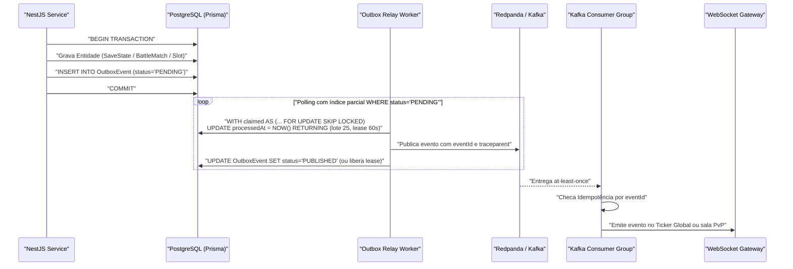

# 06 — Cache com Redis e Mensageria com Apache Kafka / Redpanda

## 1. Papel Estratégico do Redis

O **Redis** atua como camada em memória de baixíssima latência (`< 5ms`) complementar ao PostgreSQL, evitando sobrecarga na PokéAPI externa e sustentando rankings e presença online:

| Domínio | Padrão & Estrutura de Chave | Estrutura Redis | TTL / Retenção |
| :--- | :--- | :--- | :--- |
| **Cache da PokéAPI** | `pokeapi:v2:pokemon:{slugOrId}` e `pokeapi:v2:catalog` | String (JSON comprimido) | `24h` (PokéAPI é quase imutável) |
| **Presença no Overworld** | `world:presence:{mapId}` -> `{trainerId: payload}` | Hash + Expiração por heartbeat | `45s` por heartbeat |
| **Ranking de Mini-Games** | `leaderboard:minigame:{gameKey}` | **Sorted Set** (`ZADD`, `ZREVRANGE`) | Permanente (sincronizado com Postgres) |
| **Ranking Battle ELO** | `leaderboard:battle:elo` | **Sorted Set** | Permanente |
| **Rate Limiting** | `ratelimit:{route}:{ipOrTrainer}` | Contador atômico (`INCR` + `PEXPIRE`) | `60s` janela deslizante |
| **Sessões Ativas de Mini-Game** | `minigame:session:{sessionId}` | String (JSON com resposta secreta + início) | `120s` (anti-trapaça no servidor) |

### Estratégia Cache-Aside na PokéAPI

1. O visitante ou treinador busca um Pokémon (`GET /api/v1/pokedex/pokemon/pikachu`).
2. `PokedexService` consulta `pokeapi:v2:pokemon:pikachu` no Redis.
3. Em caso de **Cache Hit**, devolve instantaneamente sem tocar na PokéAPI externa.
4. Em caso de **Cache Miss**, aplica *Singleflight / Lock leve* por chave para evitar múltiplas chamadas simultâneas ao mesmo recurso (*cache stampede*), consulta `https://pokeapi.co/api/v2/pokemon/pikachu` com `AbortController` e timeout explícito, salva no Redis com `TTL 24h` e responde ao cliente.

---

## 2. Arquitetura Orientada a Eventos com Apache Kafka / Redpanda

Usamos **Redpanda** (engine 100% compatível com o protocolo **Apache Kafka**, sem JVM/Zookeeper e com Console Web integrado) para desacoplar fluxos pesados e transmitir acontecimentos do mundo em tempo real.

### 2.1. Transactional Outbox Pattern (Zero Eventos Perdidos)

Nunca publicamos no Kafka diretamente no meio de uma requisição HTTP após alterar o banco, pois se o broker falhar logo após o commit no PostgreSQL, o evento seria perdido (ou publicado sem transação confirmada). O fluxo garantido segue o padrão **Transactional Outbox**:

---

## 3. Catálogo Oficial de Tópicos Kafka

Para operar tanto em **Redpanda local** quanto em **planos gratuitos gerenciados em nuvem (como o Free Tier da Aiven for Apache Kafka, que permite até `5` tópicos com `2` partições cada sem cartão de crédito)**, a topologia é consolidada em **4 tópicos de domínio + 1 tópico unificado de Dead Letter Queue (`5` tópicos no total)**:

| Tópico | Chave de Partição | Produtor | Consumidores | Propósito |
| :--- | :--- | :--- | :--- | :--- |
| **`pokeverse.world.events.v1`** | `trainerId` | `Pokedex`, `Battle`, `Minigames`, `Teams` | `WorldGateway` + `TeamAnalyzerWorker` | Eventos sociais (slots, conquistas, recordes) e gatilhos de análise assíncrona de times (diferenciados por header `eventType`) |
| **`pokeverse.arcade.savestate.v1`** | `trainerId:romId` | `ArcadeModule` | `ArcadeSaveWorker` | Validar integridade SHA-256, gerenciar revisões antigas no MinIO/R2 e confirmar cloud save |
| **`pokeverse.battle.matchmaking.v1`** | `formatRule` | `BattleModule` | `MatchmakerWorker` | Parear treinadores na fila PvP por faixa de `eloRating` e abrir sala no Redis + WebSocket |
| **`pokeverse.battle.results.v1`** | `matchId` | `BattleModule` | `StatsWorker` + `WorldGateway` | Atualizar ELO no Postgres + Redis Sorted Set e publicar resultado no feed global |
| **`pokeverse.dlq.v1`** | Original | Consumers em falha | Alerta & Inspeção | **DLQ unificada**: isola eventos inválidos ou falhos após limite de tentativas preservando header `originalTopic`, `trace_id`, payload e erro |

---

## 4. Resiliência, Idempotência e Tolerância a Falhas

1. **Idempotência Obrigatória nos Consumidores:**
   - A garantia padrão do Kafka é *at-least-once* (um evento pode ser entregue mais de uma vez após rebalanceamento de partições ou queda de rede).
   - Todo evento carrega um `eventId` (UUID v4) no cabeçalho/envelope. O consumidor verifica no Redis (`SET idemp:{consumerGroup}:{eventId} 1 NX EX 86400`) ou por constraint única no PostgreSQL antes de aplicar efeitos colaterais (como somar pontos de ELO ou contabilizar vitória).
2. **Retentativas com *Exponential Backoff* + *Jitter*:**
   - Falhas transitórias de IO reprocessam com atraso crescente aleatorizado (`baseMs * 2^attempt + randomJitter`), evitando efeito *thundering herd* caso um serviço volte após queda.
3. **Dead Letter Queue (DLQ):**
   - Mensagens corrompidas (que falham na validação de schema Zod) ou que esgotam o limite máximo de tentativas (ex.: `5` tentativas) são encaminhadas imediatamente para o respectivo tópico `.dlq.v1` com cabeçalhos originais, `trace_id`, motivo da exceção e timestamp — nunca travando a fila principal da partição.
4. **Circuit Breaker:**
   - Ao consumir serviços externos instáveis (como a PokéAPI durante pico de acessos), um disjuntor abre após taxa configurada de falhas consecutivas e responde com *fallback* em cache degradado ou erro amigável rápido sem esgotar *threads*/conexões do servidor.
5. **Graceful Shutdown:**
   - Ao receber `SIGTERM` ou `SIGINT`, os consumidores e produtores NestJS pausam novas leituras, aguardam o término dos eventos em processamento, fazem *commit* limpo dos *offsets* no Kafka e fecham pools de conexão do Prisma e Redis antes de encerrar o processo.

---

## 5. Estado Real da Implementação & Evolução Planejada (Pós-4A -> Pokédex Suprema)

- **Ativos hoje no código (`Etapas 1–4A` + Hardening):**
  - **Cache-Aside + Stale-If-Error (`PokeApiCacheService`):** ativos em `/api/v1/pokedex/catalog` e `/api/v1/pokedex/pokemon/:idOrName` com TTL fresco de `24h`, cópia `stale-fallback` de `7 dias`, singleflight in-memory, validação Zod na entrada/saída do Redis, `AbortController` (`POKEAPI_TIMEOUT_MS`), `redirect: 'error'` e header `X-Cache` (`MISS` / `HIT` / `STALE-FALLBACK`).
  - **Sessão Opaca BFF, Throttling Lua & Consumo Atômico `GETDEL` (`SessionService`, `OtpService`, `RedisThrottlerStorage`):** chaves `sess:*`, `trainer_sessions:*`, `otp:*`, `rl:hits:*` / `rl:block:*` (Lua atômico), `login_fail:*` / `otp_attempts:*` (`INCR` + `EXPIRE` Lua), `GETDEL` (`consumeString` / `consumeJson`) para OAuth PKCE e desafios WebAuthn, e `DEL` atômico no consumo de OTP.
  - **Outbox CTE Atomic Lease + Kafka + Consumidores Idempotentes (`OutboxEventRepository`, `OutboxRelayService`, `WorldEventsConsumerService`, `EmailNotificationsConsumerService`):** reivindicação concorrente segura por `UPDATE ... RETURNING` (lote `25`, lease `60s`), publicação paralela (`Promise.all`), retentativa (`MAX_OUTBOX_RETRIES = 5`), tópico `pokeverse.dlq.v1`, e-mails cifrados em AES-256-GCM (`pokeverse.notifications.email.v1`), rollback do lock de idempotência no `catch` em falhas transitórias, expurgo periódico a cada `6h`, suíte de caos [`events-chaos.spec.ts`](../apps/api/src/modules/events/events-chaos.spec.ts) e suíte real de integração `app.integration-spec.ts` no CI com PostgreSQL, Redis e Kafka reais (mais Testcontainers local via `npm run test:integration:tc`).
- **Próxima Evolução para a Pokédex Suprema (Fase 4B):**
  1. **Expansão Multi-Upstream:** chaves adicionais para `pokeapi:v2:species:{id}`, `pokeapi:v2:evolution:{id}`, `pokeapi:v2:move:{id}`, `pokeapi:v2:ability:{id}`, `pokeapi:v2:encounters:{id}`, `pokemontcg:v2:cards:{query}` e `media:lore:{pokemonId}` (anime/filmes/jogos).
  2. **Integração com `TrainerPokemonSnapshot` no PostgreSQL:** para Pokémon favoritos salvos pelo treinador, o PostgreSQL passa a guardar snapshot estruturado independente da expiração do Redis.
- **Entregue na Onda 4 (Código):** `TrainerThrottlerGuard` chaveando por `trainerId` (`REQ-SEC-03`), redação DLP ampliada para JWT/PEM/e-mail em `StructuredLoggerService`, consumidor `EmailNotificationsConsumerService` exigindo envelope cifrado AES-256-GCM obrigatório (sem fallback em texto claro) e tabela `AuditLog` append-only no PostgreSQL (`REQ-SEC-35`).
- **Pendente para as Fases de Jogo & Cloud/Onda 5:** presença Overworld (`world:presence:*`), Rankings Sorted Sets, sessões anti-cheat de Mini-Games, segregação estrita de eviction/sessão no Redis ([Dossiê 13 §7.2](13-dossie-de-seguranca-e-blindagem.md#72-redis-7-segregação-de-domínios-e-política-de-eviction)), políticas ampliadas de TTL/retenção (`REQ-SEC-19`), proteção EDoS por orçamento Redis/billing (`REQ-SEC-29`), RBAC estrito sobre o Redpanda Console e métricas (`REQ-SEC-23`) e detectores de exfiltração/anomalia em runtime (`REQ-SEC-10`) definidas em [doc 13 §9](13-dossie-de-seguranca-e-blindagem.md#9-governança-ampliada-de-segurança-privacidade-operações-e-ia-35-controles) e [doc 16 §4.3](16-cookies-lgpd-e-requisitos.md#43-catálogo-normativo-de-requisitos-de-segurança-req-sec-01-a-req-sec-35).
