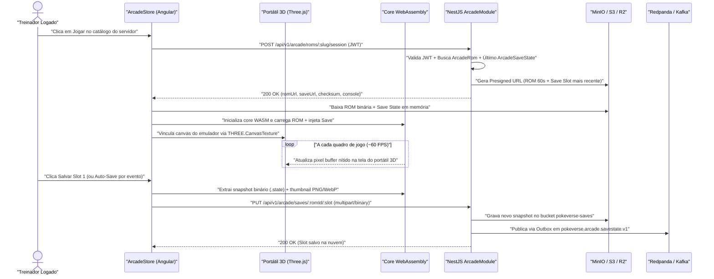

# 07 — Arcade Retrô 3D (WebAssembly) e Cloud Save States

## 1. Visão Geral do Módulo

O **Game Corner (Arcade Retrô 3D)** permite que treinadores autenticados selecionem jogos clássicos diretamente de um **catálogo curado hospedado no servidor** e joguem em 1 clique dentro do navegador, com o vídeo do emulador **WebAssembly** projetado em tempo real sobre a tela de um **Console Portátil 3D (Three.js)** e progresso sincronizado via **Cloud Save States**.

---

## 2. Armazenamento de ROMs e Save States (MinIO / R2 / S3)

Como arquivos binários de ROMs (entre `512 KB` e `64 MB`) e snapshots de memória de emulador (`.state` / `.sram`) não devem inflar tabelas transacionais nem ser versionados no Git:

- **Buckets dedicados em Object Storage S3-compatible** (**MinIO** no `docker-compose.yml` local; **Cloudflare R2** ou **AWS S3** em produção):
  - **`pokeverse-roms` (privado):** armazena os binários catalogados indexados na tabela `ArcadeRom` (`roms/gba/emerald.gba`, `roms/gbc/crystal.gbc`, etc.) com hash `SHA-256` verificado no catálogo.
  - **`pokeverse-saves` (privado):** armazena os saves individuais segmentados por usuário e jogo (`saves/{trainerId}/{romId}/slot-{0..5}.state` e `preview.webp`), onde o **Slot 0** atua como *Auto-Save* contínuo.
- **Controle de Acesso:** nenhum bucket é exposto publicamente. Somente treinadores autenticados obtêm acesso por meio de **Presigned URLs de curtíssima duração (60 segundos)** ou streaming autenticado intermediado pela API NestJS após validação de sessão JWT.

---

## 3. Fluxo Completo: 1-Click Play & Cloud Save States

---

## 4. Integração Técnica: WebAssembly + Portátil 3D + Controles

### 4.1. Núcleos WebAssembly Isolados por Console
O carregamento do emulador acontece de forma modular e assíncrona (**Lazy Loading** — os módulos `.wasm` só são baixados quando o usuário abre o Arcade):
- **Game Boy / Game Boy Color (`GB` / `GBC`):** núcleo leve (`mGBA` / `Gambatte` / *EmulatorJS core*), resolução nativa `160 × 144`.
- **Game Boy Advance (`GBA`):** núcleo `mGBA` WebAssembly, resolução nativa `240 × 160`.
- **Nintendo DS (`NDS`):** núcleo `MelonDS` WebAssembly com mapeamento das duas telas (`256 × 192` cada) na dobradiça dupla do modelo 3D de DS.

### 4.2. Qualidade Visual na Tela do Portátil 3D
- **Nitidez Pixel-Perfect:** no `<canvas>` oculto onde o WASM escreve, `imageSmoothingEnabled` é desligado; na textura Three.js (`THREE.CanvasTexture`), `magFilter` e `minFilter` utilizam `THREE.NearestFilter` (ou filtro LCD opcional de subpixels via *Fragment Shader* simulando a matriz de pontos original do GBA/GBC!).
- **Botões Físicos Reativos:** ao pressionar setas, `Z`/`X` (`A`/`B`), `Enter` (`Start`), `Shift` (`Select`) ou um controle USB/Bluetooth (**Gamepad API**), o modelo 3D no Three.js anima os botões correspondentes afundando milímetros em tempo real.
- **Modo Imersivo vs. Foco Total:** botão no HUD alterna entre a visão estilizada do console 3D flutuando na mesa do *Game Corner* e o modo expandido em tela inteira com atalhos rápidos de Save/Load (`F5` / `F8`).

---

## 5. Proteções de Integridade, Limpeza e Offline Guard

1. **Verificação de Checksum (SHA-256):**
   - Ao baixar a ROM do bucket e antes de persistir qualquer *Save State*, a integridade binária é verificada por SHA-256 para evitar corrupção em trânsito.
2. **Prevenção contra Perda de Progresso:**
   - Ao detectar mudança de rota, botão de fechar ou evento `beforeunload` / `visibilitychange`, o Arcade dispara automaticamente uma captura no **Slot 0 (Auto-Save)** caso tenha havido avanço desde a última gravação.
3. **Limpeza de Áudio e Threads (`AudioContext` + Web Workers):**
   - Quando o treinador sai do Arcade, o contexto de áudio do emulador é encerrado (`audioContext.close()`), Web Workers do WASM são terminados e texturas Three.js passam por `dispose()`, liberando integralmente CPU e GPU para o restante da plataforma.
4. **Limites Estritos de Upload:**
   - Mesmo em Save States enviados pelo cliente autenticado, o endpoint aplica limite rígido de tamanho por console (ex.: máximo `16 MB`), verificação de cabeçalho binário esperado e *Rate Limiting* para impedir abuso de storage.
