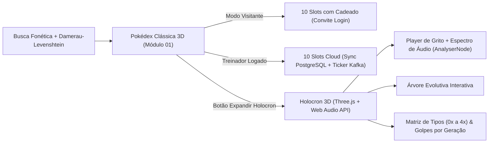

# 08 — Museu das Regiões, Lore e Pokédex Holocron 3D

## 1. Acesso Aberto: A Vitrine Pública da Plataforma

A **Pokédex 3D / Holocron** e o **Museu das Regiões & Jogos** formam os dois pilares acessíveis já para **Visitantes (sem login)**. Enquanto recursos de gravação, jogo em emulador e batalhas competitivas exigem autenticação, qualquer visitante explora o universo Pokémon com fluidez gráfica completa logo após a tela *"Press Start"*.

---

## 2. Módulo 01: Pokédex Clássica 3D + Expansão Holocron 3D

### 2.1. Integração da Pokédex Clássica 3D Existente
A Pokédex construída inicialmente ([index.html](../index.html), [css/style.css](../css/style.css) e [js/app.js](../js/app.js)) continua sendo a peça central de consulta rápida:
- **Preservação Integral:** abertura 3D com transição para modo plano nítido (`1260ms`), carcaça metálica semi-opaca com iluminação dinâmica no ponteiro, busca tolerante a erros de digitação (normalização `NFD`, chave fonética e distância Damerau-Levenshtein), navegação estilo RPG por D-Pad/teclado e as duas fileiras inferiores de botões iluminados sob tampa transparente.
- **Comportamento por Permissão:**
  - **Visitante:** navega livremente pelo catálogo, pesquisa qualquer Pokémon via PokéAPI cacheada no Redis e abre a ficha completa; os 10 botões inferiores exibem estado bloqueado (ao clicar, abre o modal amigável de Login/Cadastro).
  - **Treinador Logado:** grava, renomeia e organiza seus 10 Pokémon favoritos diretamente na nuvem (`PokedexSlot` no PostgreSQL), sincronizando instantaneamente entre dispositivos e publicando eventos de captura rara no Feed Global.

### 2.2. Expansão Holocron 3D (Inspeção Profunda)
Ao clicar em **Inspecionar no Holocron 3D** dentro da ficha de qualquer Pokémon, a interface abre o palco **Three.js**:
1. **Pedestal Holográfico Elemental:** base em metal escuro com shader de energia parametrizado pela cor do tipo primário e secundário, rotação orbital suave (`OrbitControls`) e partículas atmosféricas combinando com o elemento.
2. **Sintetizador & Analisador de Grito (*Cry* via Web Audio API):** reproduz o áudio oficial (`.ogg`/`.mp3`) capturado da PokéAPI ligado a um `AnalyserNode`, desenhando barras/ondas de frequência em tempo real diretamente no HUD do Holocron.
3. **Árvore Evolutiva Completa:** grafo interativo mostrando pré-evoluções, ramificações (ex.: Eevee, Tyrogue, Wurmple) e gatilhos exatos (*nível*, *pedra evolutiva*, *amizade*, *horário dia/noite*, *troca*).
4. **Calculadora Instantânea de Fraquezas e Resistências:** cruza a matriz `18 × 18` oficial para o par de tipos do Pokémon, agrupando multiplicadores em **`4x`**, **`2x`**, **`1x`**, **`0.5x`**, **`0.25x`** e **`0x` (Imune)**, além de listar movimentos aprendidos por nível, TM/HM e Egg Moves.

---

## 3. Módulo 02: Museu das Regiões & Linha do Tempo dos Jogos

O Museu funciona como um **atlas geográfico interativo + cronologia histórica** da franquia principal desde 1996, alimentado por dados estruturados curados em `MuseumModule` (NestJS + Redis cache):

### 3.1. Atlas Interativo das 9 Regiões
Cada região (**Kanto, Johto, Hoenn, Sinnoh, Unova, Kalos, Alola, Galar e Paldea**) possui visualização dedicada com pontos clicáveis (*waypoints*):
- **Cidades e Rotas Principais:** descrição de lore, pontos turísticos e conexões geográficas.
- **Liga Pokémon Local:** ficha ilustrada de todos os **Líderes de Ginásio** (ou *Trial Captains*), **Elite Four** e **Campeão**, exibindo seus times canônicos e insígnias — funcionando também como ponte para desafiar esses treinadores no modo **PvE** quando logado!
- **Pokémon Nativos & Lendários Guardiões:** lista rápida ligada diretamente ao Holocron 3D.

### 3.2. Linha do Tempo Histórica dos Jogos (1996 — Presente)
Uma barra temporal navegável por gerações (**Gen I a Gen IX**):
- **Fichas Técnicas dos Lançamentos:** Pokémon Red/Blue/Yellow (GB) -> Gold/Silver/Crystal (GBC) -> Ruby/Sapphire/Emerald & FireRed/LeafGreen (GBA) -> Diamond/Pearl/Platinum & HeartGold/SoulSilver (NDS) -> gerações modernas em 3D.
- **Comparador de Evolução Visual:** exibe lado a lado como a representação gráfica (sprites 1-bit/8-bit, pixel art avançada em 16-bit, 2.5D isométrico e modelos 3D) evoluiu entre consoles.
- **Conexão Direta com o Arcade Retrô:** nas fichas dos jogos portáteis suportados (GB/GBC/GBA/NDS), um botão de atalho **Jogar no Arcade 3D** leva direto ao emulador (ou solicita Login caso o usuário seja visitante).
- **Trilha Sonora Ambiente:** controle opcional de música temática no Museu usando Web Audio API, com alternância suave e respeito às preferências de silenciamento do treinador.
