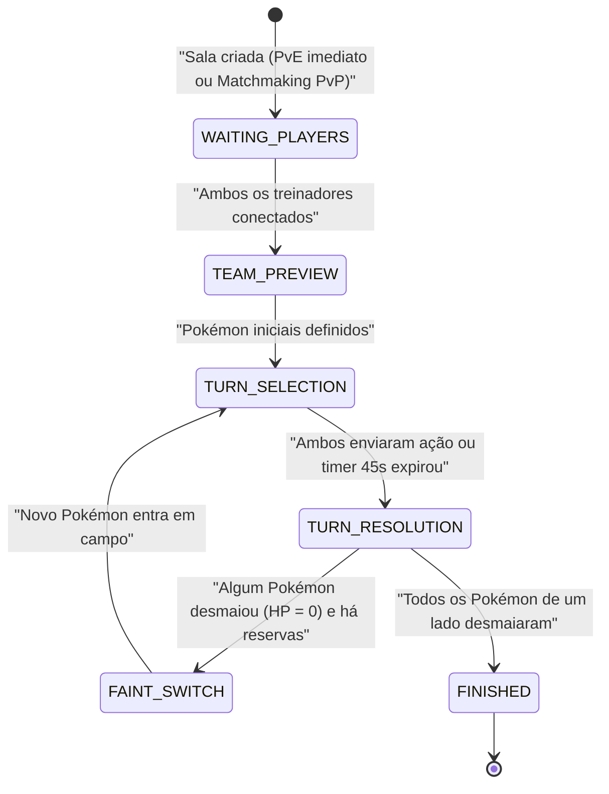

# 09 — Arena de Batalha (PvE/PvP), Team Builder e Mini-Games

## 1. Visão Geral da Battle Frontier

A **Battle Frontier (Arena de Batalha)** concentra a camada competitiva e interativa em tempo real da plataforma para **Treinadores Autenticados**. É dividida em três sub-módulos integrados:
1. **Team Builder Competitivo** (montagem, validação e análise assíncrona de sinergia);
2. **Mini-Games Competitivos** (pontuação auditada no servidor + placares em tempo real no Redis);
3. **Simulador de Batalha Turn-Based** (modo **PvE** contra IA de Líderes/Campeões e modo **PvP** via WebSockets + Matchmaking Kafka).

---

## 2. Team Builder Competitivo

### 2.1. Regras de Validação (`packages/shared` + NestJS)
- Até **6 Pokémon** por equipe (`PokemonTeam` + `PokemonTeamMember`).
- **IVs (*Individual Values*):** inteiros de `0` a `31` por atributo (HP, Atk, Def, SpA, SpD, Spe).
- **EVs (*Effort Values*):** inteiros de `0` a `252` por atributo, com teto rígido de **`510` pontos totais** por Pokémon.
- **Natures:** tabela completa das 25 natures (modificador `+10%` e `-10%` nos atributos não-HP).
- **Moves & Abilities:** validados contra os golpes realmente aprendíveis pela espécie no cache da PokéAPI (impedindo golpes inválidos manipulados via payload HTTP).

### 2.2. Cálculo Exato de Atributos (Nível Configurável, Padrão `50` ou `100`)
- **HP:**
  `HP = Math.floor(((2 * Base + IV + Math.floor(EV / 4)) * Level) / 100) + Level + 10`
- **Demais Atributos (Atk, Def, SpA, SpD, Spe):**
  `Stat = Math.floor((Math.floor(((2 * Base + IV + Math.floor(EV / 4)) * Level) / 100) + 5) * NatureMultiplier)`

### 2.3. Analisador Assíncrono de Sinergia (Kafka Worker)
Ao salvar uma equipe, `TeamsModule` grava no PostgreSQL e publica em `pokeverse.world.events.v1` (`eventType: 'team.saved'`). O `TeamAnalyzerWorker` calcula o mapa completo de cobertura defensiva (quais tipos causam `2x`/`4x` sem resposta segura no time), distribuição física vs. especial, faixas de velocidade e grava `synergyScore` notificando o HUD em tempo real.

---

## 3. Mini-Games Competitivos e Ranking Global (Redis)

1. **"Quem é esse Pokémon?" (Silhueta, Grito & Zoom):**
   - **Modos:** silhueta clássica escurecida, desafio auditivo (*cry* via Web Audio) e zoom extremo progressivo em textura.
2. **"Desafio de Tipos & Lore Quiz":**
   - Perguntas cronometradas sobre eficácia elemental, habilidades, evoluções e história das regiões.
3. **Segurança Anti-Trapaça no Servidor:**
   - O cliente **nunca** recebe a resposta correta no payload da rodada e **nunca** calcula a pontuação final sozinho.
   - Ao iniciar rodada, o servidor gera um `sessionId` no Redis (`minigame:session:{sessionId}`) com o ID esperado e o timestamp exato de início (`startedAt`).
   - Ao receber o palpite, a API calcula o tempo real decorrido (`serverNow - startedAt`), valida o acerto, aplica bônus de velocidade e *streak*, persiste em `MinigameScore` (Postgres) e atualiza o **Redis Sorted Set (`ZADD`)** com leitura instantânea do Top 50 mundial (`ZREVRANGE ... WITHSCORES`).

---

## 4. Simulador de Batalha Turn-Based (PvE e PvP)

Toda batalha é **100% autoritativa no back-end NestJS**. Os clientes Angular enviam apenas comandos de ação (`USE_MOVE` ou `SWITCH_POKEMON`), recebem eventos de resolução turno-a-turno via `BattleGateway` WebSocket e reproduzem animações visuais sincronizadas (barras de HP animadas, efeitos de golpe, mensagens de combate e som).

### 4.1. Máquina de Estados da Partida

### 4.2. Ordem de Turno e Fórmula de Dano Autoritativa
1. **Ordem de Execução:** trocas têm prioridade sobre golpes; depois compara-se a *Priority* do movimento (`+1` Quick Attack, `0` padrão, etc.); em empate de prioridade, compara-se a **Speed efetiva** (considerando Paralisia `-50%` e estágios `-6..+6`); em empate exato, sorteio justo no servidor.
2. **Fórmula Base de Dano:**
   - `BaseDamage = Math.floor((Math.floor((2 * Level) / 5 + 2) * Power * (Atk / Def)) / 50) + 2`
   - Multiplicadores aplicados na sequência: **STAB** (`1.5x` se o golpe tiver o mesmo tipo do atacante), **Eficácia de Tipos** (`0x`, `0.25x`, `0.5x`, `1x`, `2x`, `4x`), **Acerto Crítico** (`1.5x`), **Queimadura (*Burn*)** (`0.5x` em golpes físicos), **Clima** e **Roll aleatório** (`0.85` a `1.00`).
3. **Condições de Status:** suporte inicial estruturado a *Burn*, *Paralysis*, *Poison*, *Sleep* e *Freeze* com transições explícitas de estado.

### 4.3. Modo PvE (IA de Líderes de Ginásio, Elite Four e Campeões)
- Cada NPC temático cadastrado pelo Museu possui um time pré-configurado e perfil tático.
- A IA calcula a matriz de dano esperado de seus 4 golpes contra o Pokémon ativo do jogador (considerando STAB e fraquezas) e aplica heurística ponderada: prioriza golpes que garantem nocaute (*KO*), troca para um contra-ataque resistente quando enfrenta desvantagem `2x`/`4x` clara e injeta pequena variação controlada para manter partidas desafiadoras e imprevisíveis.

### 4.4. Modo PvP (Matchmaking Kafka + WebSockets)
1. O treinador seleciona um de seus times salvos e entra na fila (`POST /api/v1/battle/queue`).
2. `BattleModule` publica no tópico `pokeverse.battle.matchmaking.v1`.
3. `MatchmakerWorker` pareia dois treinadores em faixa próxima de `eloRating` (ampliando a tolerância a cada `10s` de espera), cria o registro `BattleMatch` em transação curta e emite o aviso de sala pronta via WebSockets.
4. O estado ativo do turno fica mantido com baixa latência; cada turno tem **timer de 45 segundos** para impedir travamentos intencionais (*stalling*). Se um jogador perder conexão momentaneamente, pode reconectar à sala usando seu JWT e recuperar exatamente o estado do turno atual.
5. Ao concluir a partida, `OutboxEvent` publica em `pokeverse.battle.results.v1` para recalcular o **ELO Rating** no Postgres/Redis e anunciar o campeão no Feed Global do mundo.
