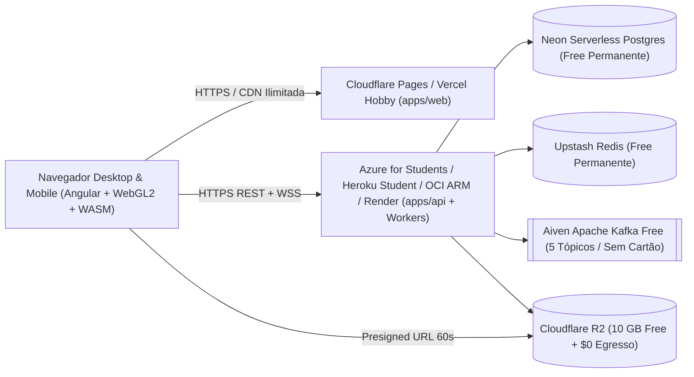

# 10 — Infraestrutura Docker, Observabilidade e Deploy

## 1. Ambiente Local Unificado (`infra/docker/docker-compose.yml`)

1. Copie `.env.example` para `.env` na raiz do repositório (arquivo ignorado pelo Git — **nunca versione senhas reais** nem deixe segredos hardcoded no YAML).
2. Suba toda a infraestrutura distribuída com verificações de saúde (`healthcheck`) em um único comando:

```bash
docker compose --env-file .env -f infra/docker/docker-compose.yml up -d
```

- **Portas padrão parametrizadas no `.env`:** `POSTGRES_PORT=5433`, `REDPANDA_CONSOLE_PORT=8085` e `GRAFANA_PORT=3005` evitam conflito com eventuais instâncias nativas do Windows/Linux nas portas `5432`, `8080` e com a `pokeverse-api` na porta `3000`.
- **Stack Completa de Observabilidade Local + Perfil SaaS (`infra/observability/`):** além dos serviços transacionais (`postgres`, `redis`, `redpanda`, `redpanda-console`, `minio`/`pgsty/silo`, `mailpit`), o `docker-compose.yml` orquestra `otel-collector` (`:4317/:4318/:8889`), `prometheus` (`:9090` + `alerts.yml`), `postgres-exporter` (`:9187`), `redis-exporter` (`:9121`), `loki` (`:3100`, retenção `30d`), `promtail`, `tempo` (`:3200`), `grafana` (`:3005` autenticado em `127.0.0.1`) e o `datadog-agent` isolado em `--profile datadog` (`npm run infra:datadog:up`). Consulte a arquitetura completa em [19 — Observabilidade Híbrida, Telemetria e Monitoramento](19-observabilidade-telemetria-e-monitoramento.md).
- **Object Storage S3 local (`pgsty/silo`):** como as imagens públicas antigas `minio/minio` e `minio/mc` no Docker Hub tiveram o acesso público restringido, o ambiente usa a release pinada `pgsty/silo:RELEASE.2026-11-12T00-00-00Z` (drop-in 100% compatível com a API S3, console na `:9001` e cliente `mc` embutido na mesma imagem), reduzindo também o número de downloads.

```yaml
services:
  postgres:
    image: postgres:16-alpine
    container_name: pokeverse-postgres
    restart: unless-stopped
    environment:
      POSTGRES_USER: ${POSTGRES_USER:?Defina POSTGRES_USER no .env}
      POSTGRES_PASSWORD: ${POSTGRES_PASSWORD:?Defina POSTGRES_PASSWORD no .env}
      POSTGRES_DB: ${POSTGRES_DB:?Defina POSTGRES_DB no .env}
    ports:
      - "${POSTGRES_PORT:-5433}:5432"
    volumes:
      - pg_data:/var/lib/postgresql/data
    healthcheck:
      test: ["CMD-SHELL", "pg_isready -U \"$${POSTGRES_USER}\" -d \"$${POSTGRES_DB}\""]
      interval: 5s
      timeout: 5s
      retries: 10
      start_period: 10s

  redis:
    image: redis:7-alpine
    container_name: pokeverse-redis
    restart: unless-stopped
    command: ["redis-server", "--appendonly", "yes"]
    ports:
      - "${REDIS_PORT:-6379}:6379"
    volumes:
      - redis_data:/data
    healthcheck:
      test: ["CMD", "redis-cli", "ping"]
      interval: 5s
      timeout: 3s
      retries: 10
      start_period: 5s

  redpanda:
    image: redpandadata/redpanda:v24.2.4
    container_name: pokeverse-redpanda
    restart: unless-stopped
    command:
      - redpanda
      - start
      - --kafka-addr internal://0.0.0.0:9092,external://0.0.0.0:19092
      - --advertise-kafka-addr internal://redpanda:9092,external://localhost:${REDPANDA_KAFKA_PORT:-19092}
      - --pandaproxy-addr internal://0.0.0.0:8082,external://0.0.0.0:18082
      - --advertise-pandaproxy-addr internal://redpanda:8082,external://localhost:${REDPANDA_PROXY_PORT:-18082}
      - --smp 1
      - --memory 1G
      - --mode dev-container
    ports:
      - "${REDPANDA_KAFKA_PORT:-19092}:19092"
      - "${REDPANDA_PROXY_PORT:-18082}:18082"
    volumes:
      - redpanda_data:/var/lib/redpanda/data
    healthcheck:
      test: ["CMD-SHELL", "rpk cluster health | grep -E 'Healthy:.+true'"]
      interval: 10s
      timeout: 5s
      retries: 10
      start_period: 15s

  redpanda-console:
    image: redpandadata/console:v2.7.2
    container_name: pokeverse-redpanda-console
    restart: unless-stopped
    depends_on:
      redpanda:
        condition: service_healthy
    environment:
      KAFKA_BROKERS: redpanda:9092
    ports:
      - "${REDPANDA_CONSOLE_PORT:-8085}:8080"

  minio:
    image: pgsty/silo:RELEASE.2026-11-12T00-00-00Z
    container_name: pokeverse-minio
    restart: unless-stopped
    command: server /data --console-address ":9001"
    environment:
      MINIO_ROOT_USER: ${MINIO_ROOT_USER:?Defina MINIO_ROOT_USER no .env}
      MINIO_ROOT_PASSWORD: ${MINIO_ROOT_PASSWORD:?Defina MINIO_ROOT_PASSWORD no .env}
    ports:
      - "${MINIO_API_PORT:-9000}:9000"
      - "${MINIO_CONSOLE_PORT:-9001}:9001"
    volumes:
      - minio_data:/data
    healthcheck:
      test: ["CMD", "mc", "ready", "local"]
      interval: 5s
      timeout: 5s
      retries: 10
      start_period: 10s

  minio-init:
    image: pgsty/silo:RELEASE.2026-11-12T00-00-00Z
    container_name: pokeverse-minio-init
    restart: "no"
    depends_on:
      minio:
        condition: service_healthy
    environment:
      MINIO_ROOT_USER: ${MINIO_ROOT_USER:?Defina MINIO_ROOT_USER no .env}
      MINIO_ROOT_PASSWORD: ${MINIO_ROOT_PASSWORD:?Defina MINIO_ROOT_PASSWORD no .env}
      S3_BUCKET_ROMS: ${S3_BUCKET_ROMS:-pokeverse-roms}
      S3_BUCKET_SAVES: ${S3_BUCKET_SAVES:-pokeverse-saves}
    entrypoint:
      - /bin/sh
      - -c
      - |
        set -eu
        mc alias set local http://minio:9000 "$$MINIO_ROOT_USER" "$$MINIO_ROOT_PASSWORD"
        mc mb --ignore-existing "local/$${S3_BUCKET_ROMS}"
        mc mb --ignore-existing "local/$${S3_BUCKET_SAVES}"
        mc anonymous set none "local/$${S3_BUCKET_ROMS}"
        mc anonymous set none "local/$${S3_BUCKET_SAVES}"
        mc ls local

  mailpit:
    image: axllent/mailpit:v1.22
    container_name: pokeverse-mailpit
    restart: unless-stopped
    environment:
      MP_MAX_MESSAGES: 500
      MP_SMTP_AUTH_ACCEPT_ANY: 1
      MP_SMTP_AUTH_ALLOW_INSECURE: 1
    ports:
      - "${MAILPIT_SMTP_PORT:-1025}:1025"
      - "${MAILPIT_UI_PORT:-8025}:8025"
    healthcheck:
      test: ["CMD", "/mailpit", "readyz"]
      interval: 5s
      timeout: 3s
      retries: 10
      start_period: 5s

volumes:
  pg_data:
  redis_data:
  redpanda_data:
  minio_data:
```

---

## 2. Padrão de Containers em Produção (Dockerfiles)

Todos os serviços empacotados em container (`apps/api`, Workers, Web SSR/Nginx) seguem rigorosamente:

1. **Multi-Stage Build:** etapa `builder` instala dependências e compila TypeScript; etapa `runner` copia apenas o artefato compilado e dependências de produção sobre base mínima (`node:22-alpine` ou `distroless`).
2. **Execução sem privilégios de `root`:** usuário e grupo dedicados (`USER node` / `appuser`) com permissões mínimas de escrita.
3. **`HEALTHCHECK` nativo no Dockerfile** apontando para `/health/live`.
4. **12-Factor App:** configuração integral via variáveis de ambiente (`.env` fora do repositório) e processos *stateless*.
5. **Graceful Shutdown:** tratamento de sinais `SIGTERM` e `SIGINT` para drenar conexões HTTP/WebSocket, concluir mensagens em voo no Kafka com *commit* limpo de offsets e encerrar conexões Prisma/Redis.

---

## 3. Observabilidade & SRE (Os 3 Pilares)

### 3.1. Logs Estruturados em JSON

Proibido `console.log("erro no usuario " + id)` em texto solto. Toda aplicação emite JSON estruturado com campos padronizados (via `StructuredLoggerService` customizado sobre `process.stdout.write`):

- `timestamp`, `level`, `service_name`, `trace_id`, `span_id`, `error_code`, `message` — mascarando e nunca registrando senhas, tokens JWT, cookies ou PII sensível.

### 3.2. Distributed Tracing, Logs OTLP e APM SaaS (**OpenTelemetry + Tempo + Sentry + Datadog**)

- Instrumentação **OpenTelemetry SDK (3 Sinais)** ([`otel-sdk.bootstrap.ts`](../apps/api/src/common/telemetry/otel-sdk.bootstrap.ts) + [`opentelemetry.service.ts`](../apps/api/src/common/telemetry/opentelemetry.service.ts) + [`otel-instruments.util.ts`](../apps/api/src/common/telemetry/otel-instruments.util.ts) + [`telemetry.port.ts`](../apps/api/src/common/telemetry/telemetry.port.ts)) cobrindo HTTP (`CorrelationMiddleware`), Prisma (`PrismaService` query events), Redis (`RedisService` + `PokeApiCacheService`), KafkaJS (`KafkaService` + *Child Spans* `kafka.consume` nos consumidores), WebSocket (`WorldGateway`), Logs OTLP (`StructuredLoggerService`), RUM Angular (`WebTelemetryService` + `telemetryTraceInterceptor` via `POST /api/v1/telemetry/rum`) e endpoint protegido `/api/v1/system/telemetry` (`TelemetrySnapshotSchema`).
- **Crash Reporting & APM SaaS:** [`SentryErrorReporterService`](../apps/api/src/common/telemetry/sentry-error-reporter.service.ts) (`ErrorReporterPort`) envia exceções 5xx do `GlobalExceptionFilter` e crashes do `GlobalErrorHandler` Angular (via túnel BFF `/api/v1/telemetry/errors` sob gate LGPD) usando Sentry Envelope v7 com `assertSafeOutboundUrl` anti-SSRF pós-DNS; em paralelo, o perfil Docker `datadog` ativa o `datadog-agent` para Datadog Pro (GitHub Student Pack). Consulte os detalhes completos em [doc 19](19-observabilidade-telemetria-e-monitoramento.md).
- Propagação explícita do cabeçalho **W3C Trace Context (`traceparent`)** através de chamadas HTTP do Angular, eventos gravados em `OutboxEvent`, mensagens Kafka e notificações WebSocket, permitindo rastrear uma ação do usuário do clique no Angular até o processamento assíncrono em Worker no **Grafana Tempo**.

### 3.3. Métricas RED/USE e Probes de Saúde Distintos

- **Métricas RED (APIs/Consumers):** *Rate* (req/s), *Errors* (5xx / DLQ rate) e *Duration* (latência `p50`, `p95`, `p99`).
- **Métricas USE (Infraestrutura):** *Utilization*, *Saturation* (fila do `OutboxEvent` e *consumer lag* no Kafka) e *Errors*.
- **Separação rigorosa de Health Checks:**
  - `GET /health/live`: responde `200` enquanto o event loop do Node/NestJS estiver responsivo (usado pelo orquestrador para reiniciar travamentos).
  - `GET /health/ready`: valida ativamente conectividade com PostgreSQL, Redis, Redpanda e MinIO/S3 (usado pelo Load Balancer para liberar tráfego apenas quando as dependências estão saudáveis).

### 3.4. Governança Operacional, WAF, Cofre, CI/CD DevSecOps, Auditoria e SLAs (`Ondas 4–5`)

Conforme o catálogo normativo de **35 controles** em [doc 13 §9–10](13-dossie-de-seguranca-e-blindagem.md#9-governança-ampliada-de-segurança-privacidade-operações-e-ia-35-controles) e [doc 16 §4.3](16-cookies-lgpd-e-requisitos.md#43-catálogo-normativo-de-requisitos-de-segurança-req-sec-01-a-req-sec-35):

- **Borda WAF/DDoS, CORS/CSP & Anti-SSRF (`REQ-SEC-28, 33, 34`):** WAF + anti-bot Cloudflare com restrição de tráfego direto à origem Azure, `CORS_ORIGINS` explícito sem `*`, CSP estrita em `_headers`/`helmet()` e bloqueio pós-DNS contra IPs internos/metadados em qualquer fetch dinâmico.
- **Cofre Centralizado, KMS & Revisão de Terceiros (`REQ-SEC-05, 20, 30`):** migração progressiva de segredos distribuídos para cofre centralizado criptografado (Azure Key Vault / HashiCorp Vault / Doppler) com rotação periódica e auditoria trimestral de permissões em Cloudflare, Azure, Neon, Upstash, Aiven, Resend e Google.
- **Logs Restritos, Trilha Imutável, Alertas & Playbooks IRP (`REQ-SEC-04, 19, 21, 23, 35`):** consoles (Redpanda Console, Azure logs, OTel) restritos por RBAC/SSO/rede privada, redação sem PII (`TTL <= 30–90d`), armazenamento *append-only* (WORM) imutável para eventos críticos de segurança/LGPD e roteamento automático dos `errorCode`s para playbooks IRP.
- **SCA/SBOM, SAST/DAST, Sonar Gate, EDoS, Drift, Rollback & SLAs (`REQ-SEC-12, 13, 22, 25, 27, 29, 31, 32`):** `ci.yml` já executa `npm audit --omit=dev --audit-level=high`, Trivy + SBOM CycloneDX, Gitleaks, SAST bloqueante (CodeQL + ESLint/SonarJS), Zero Duplicação (`audit:duplication`), job bloqueante `sonarqube` (`0` issues/`0` hotspots/`0` duplicação) e Edge/Integration E2E — restando incluir DAST automatizado (OWASP ZAP/Nuclei), além de *hard limits* de billing contra EDoS, sandbox efêmero sem rede para execução dinâmica de código, monitoramento de *drift*, rollback rápido e matriz de responsabilidade compartilhada ([doc 13 §9.6](13-dossie-de-seguranca-e-blindagem.md#96-matriz-de-responsabilidade-compartilhada-contratos-e-slas-27--req-sec-27)).

---

## 4. Topologia Cloud 100% Gratuita (Free Tiers + Benefícios de Estudante) e CI/CD

Para publicar a plataforma Full-Stack completa sem custo mensal fixo, a arquitetura combina **Free Tiers permanentes** (sem expiração de 30 dias) com **créditos do GitHub Student Developer Pack / e-mail acadêmico**:



### Matriz de Hospedagem Custo Zero

| Camada | Provedor Gratuito Recomendado | Benefício / Limite Atual | Notas de Arquitetura |
| :--- | :--- | :--- | :--- |
| **Front-end Angular + WASM** | **Cloudflare Pages** (ou **Vercel Hobby**) | Gratuito permanente; banda estática ilimitada no Cloudflare Pages | *Cloudflare for Students* também isenta `$5/mês` do Workers Paid por 12 meses |
| **PostgreSQL** | **Neon** (ou **Supabase**) | Free Tier permanente sem cartão | Evitar Postgres gratuito do Render porque expira após 30 dias |
| **Redis** | **Upstash Redis** | Free Tier serverless permanente sem cartão | Ideal para cache da PokéAPI, sessões anti-cheat e *Sorted Sets* |
| **Storage ROMs & Saves** | **Cloudflare R2** | `10 GB` grátis sempre com **`$0` de taxa de tráfego (egress)** | Compatível com SDK S3; impede cobranças por downloads repetidos de ROMs |
| **Apache Kafka** | **Aiven for Apache Kafka Free** (ou **CloudAMQP Free** se optar por AMQP) | Até `5` tópicos (`2` partições cada, retenção `3d`) sem cartão | Tópicos consolidados em `4` de domínio + `1` DLQ unificada (ver [doc 06](06-cache-redis-e-eventos-kafka.md)) |
| **Back-end NestJS + Workers** | **Azure for Students** / **Heroku Student Pack** / **Oracle Always Free** / **Render Free** | Azure: `$100` por 12m sem cartão; Heroku Student: `$13/mês` por 24m; Oracle: VM ARM Always Free; Render: 750h/mês com *spin-down* 15m | Azure/Heroku Student mantêm WebSockets ativos 24/7 sem hibernação; DigitalOcean/Fly/Koyeb não possuem mais free tier equivalente |
| **Domínio Customizado** | **Namecheap / Name.com** (GitHub Student Pack) | `1` ano gratuito (`.me` ou `.tech`) | HTTPS automático via Cloudflare DNS |

### Pipeline CI/CD & Performance Release Gates (GitHub Actions)

- **Trigger em Pull Requests e pushes para `main` (portões obrigatórios de bloqueio descritos aqui e em [doc 11](11-performance-hardware-gates-e-mobile.md)):**
  1. `gitleaks` (secret scanning pré-`npm ci`) + `npm audit --omit=dev --audit-level=high` (`0` vulnerabilidades);
  2. `typecheck` compartilhado (`packages/shared`, `apps/web`, `apps/api`), `lint` (`--max-warnings=0`, `eslint-plugin-sonarjs`, `no-await-in-loop`, `complexity <= 15`, `max-depth <= 3`, `max-lines` e `max-lines-per-function`) + `format:check`;
  3. **Gate Local de Zero Duplicação (`npm run audit:duplication`):** executa detector CPD (`jscpd` via [`scripts/sonar-quality-gate.mjs`](../scripts/sonar-quality-gate.mjs)) sobre `sonar.sources` (`apps,packages`), respeitando `.sonarcloud.properties` e falhando imediatamente com tolerância **`0%`** para qualquer bloco/linha duplicada;
  4. Testes unitários/caos, E2E HTTP edge, `build` (orçamentos de bundle), `npm run audit:ui`, suíte **Playwright E2E Web**, `docker build` + **Trivy** (`CRITICAL`) + **SBOM CycloneDX**, além dos jobs paralelos `sast` (**CodeQL**) e `integration-e2e` (PostgreSQL, Redis, Apache Kafka e S3 `pgsty/silo` reais);
  5. **Gate Bloqueante SonarQube Cloud (job `sonarqube` em `ci.yml`, `needs: [verify]`):** aguarda a análise do SonarQube Cloud referente ao commit/PR (`--wait --sha`) — ou executa `SonarSource/sonarqube-scan-action` quando `vars.SONAR_CI_SCAN == 'true'` e `secrets.SONAR_TOKEN` estiverem configurados — e **reprova automaticamente o pipeline** se qualquer uma das condições ocorrer:
     - `Quality Gate !== 'OK'`;
     - **Qualquer issue em aberto (`resolved=false` > `0`)**, independentemente de tipo (`BUG`, `VULNERABILITY`, `CODE_SMELL`) ou severidade (inclusive `MINOR` e `INFO`);
     - **Qualquer Security Hotspot pendente (`TO_REVIEW` > `0`)**;
     - **Qualquer duplicação de código (`duplicated_lines > 0`, `duplicated_blocks > 0`, `new_duplicated_lines > 0` ou `new_duplicated_blocks > 0`)**.
  6. *(Fases seguintes / Release Gates futuros em [doc 11](11-performance-hardware-gates-e-mobile.md)):* **Lighthouse CI (perfil mobile lento)** + teste de carga **`k6`** e DAST automatizado (OWASP ZAP/Nuclei).
- **Obrigação Pré-Push (Desenvolvimento Local & Agentes):**
  - Antes de executar qualquer `git push`, rode `npm run audit:sonar:local` (`npm run lint && npm run audit:duplication`) e `npm run audit:sonar` ([`scripts/sonar-quality-gate.mjs`](../scripts/sonar-quality-gate.mjs) `--mode=remote`). Se houver qualquer issue ou duplicação (local ou pendente no SonarCloud), corrija e revalide antes de enviar ao remoto.
- **Trigger em Merge na `main` (`deploy.yml`):**
  - Executa migrations seguras do Prisma (`prisma migrate deploy` via `DATABASE_URL_UNPOOLED`), atualiza o container da API no Azure Container Apps, valida `/health/live`, compila o front-end Angular, roda `npm run audit:ui` e publica no Cloudflare Pages.

---

## 5. Estado Atual & Checklist da Migração Oficial (GitHub Pages -> Produção)

- **Infra local implementada:** `infra/docker/docker-compose.yml` com PostgreSQL 16 (`5433`), Redis 7 (`6379`), Redpanda (`19092`), Redpanda Console (`8085`), S3 compatível `pgsty/silo:RELEASE.2026-11-12T00-00-00Z` (`9000/9001`) e **Mailpit (`axllent/mailpit:v1.22` nas portas `1025/8025`)** com adaptador `MailService` pronto para **Resend / SMTP** em produção, além de `CorrelationMiddleware` (`x-correlation-id` + `traceparent`), `StructuredLoggerService`, `/health/live`, `/health/ready` e `.sonarcloud.properties` configurado na raiz.
- **Ponto Crítico para o Deploy de Sessão BFF (`HttpOnly` Cookies):**
  - Como a autenticação usa cookies `HttpOnly` (`__Host-pokeverse_session`, `SameSite=Lax`) e `CsrfOriginGuard`, hospedar Front-end (`*.pages.dev` / `*.vercel.app`) e Back-end (`*.onrender.com` / `*.azurecontainerapps.io`) em domínios distintos faz o navegador tratar as chamadas como *cross-site* e bloquear o cookie se não houver topologia compatível.
  - **Soluções arquiteturais previstas antes do go-live:**
    1. **Domínio compartilhado (Recomendado):** apontar `app.<dominio>` (Cloudflare Pages / Vercel) e `api.<dominio>` (Host API) ou fazer proxy reverso **`/api/*` e `/ws/*` no mesmo host do front-end** (Cloudflare Pages Functions / Worker ou Vercel Rewrites) — preservando `__Host-*` e `SameSite=Lax` intactos.
    2. **Subdomínios gratuitos sem domínio próprio:** configurar explicitamente `SameSite=None; Secure` (sem prefixo `__Host-` quando cross-site) combinado com allowlist estrita em `CORS_ORIGINS` e validação de `Origin` no `CsrfOriginGuard`.
- **Artefatos de Deploy Já Implementados no Repositório (Item 1 / Fase 3 Base):**
  1. **Container de Produção da API ([api.Dockerfile](../infra/docker/api.Dockerfile) + [.dockerignore](../.dockerignore)):** build multi-stage (`node:22-slim`), usuário sem privilégios `USER node`, `.prisma/client` gerado no stage `prod-deps` e copiado para o runtime **sem CLI `/opt/prisma` nem migrations embutidas**, `HEALTHCHECK` nativo e boot stateless (`CMD ["node", "apps/api/dist/main.js"]`) sem risco de corrida DDL entre réplicas.
  2. **Suporte Cloud Gerenciado no Back-end:** `env.schema.ts`, `RedisService`, `KafkaService`, `InfraProbesService`, `app.setup.ts`, `schema.prisma` (`directUrl = env("DATABASE_URL_UNPOOLED")`), [`neon.ts`](../neon.ts) e `SessionService` preparados para **Neon** (`DATABASE_URL` `-pooler` + `DATABASE_URL_UNPOOLED` direta + timeout `4000ms` para *scale-to-zero*), **Upstash** (`rediss://` TLS + guard contra quedas transitórias), **Aiven Kafka** (`KAFKA_SSL`, `KAFKA_SSL_CA_PEM`, `KAFKA_SSL_CERT_PEM`, `KAFKA_SSL_KEY_PEM`, `KAFKA_SASL_*`), **`S3_ENABLED=false`** antes do R2, **`TRUST_PROXY=1`** atrás do proxy Azure/Cloudflare e cookies flexíveis (`COOKIE_SAMESITE`, `COOKIE_DOMAIN`).
  3. **Proxy Same-Origin & Headers no Cloudflare Pages:** [api-proxy.ts](../apps/web/cloudflare/api-proxy.ts) (com timeout `15s` e `502` JSON seguro), rotas em `apps/web/functions/{api,health,socket.io}/[[path]].ts`, [apps/web/public/_routes.json](../apps/web/public/_routes.json) e [apps/web/public/_headers](../apps/web/public/_headers) (`Strict-Transport-Security` + `connect-src 'self' https://pokeapi.co` sem `ws: wss:` wildcard) — garantindo cookies `__Host-*` e WebSocket no mesmo host (`*.pages.dev` hoje ou `pokedex.digooow.<ext>` amanhã).
  4. **Pipelines GitHub Actions:**
     - [ci.yml](../.github/workflows/ci.yml): job `verify` (**Gitleaks** pré-`npm ci` com [`.gitleaks.toml`](../.gitleaks.toml), `npm audit --omit=dev --audit-level=high` com `0` vulnerabilidades via `overrides` + `@prisma/config` na raiz, `typecheck`, `lint` com `eslint-plugin-sonarjs` e `no-await-in-loop`, `format:check`, **`audit:duplication`** com `jscpd` a `0%` via [`scripts/sonar-quality-gate.mjs`](../scripts/sonar-quality-gate.mjs), unitários/caos, E2E HTTP edge ([app.e2e-spec.ts](../apps/api/test/app.e2e-spec.ts) e [oauth-cache-storage.e2e-spec.ts](../apps/api/test/oauth-cache-storage.e2e-spec.ts)), `build`, `audit:ui`, **Playwright E2E Web** (`npm run test:e2e:web` em [pokeverse-journey.e2e.ts](../apps/web/e2e/pokeverse-journey.e2e.ts)), `docker build` + **Trivy** via `aquasecurity/trivy-action` pinado por commit SHA de `v0.36.0` + SBOM CycloneDX), job **`sonarqube`** (`needs: [verify]`, validando `Quality Gate OK`, **`0` issues de qualquer severidade**, **`0` Security Hotspots `TO_REVIEW`** e **`0` linhas/blocos duplicados** via [`scripts/sonar-quality-gate.mjs`](../scripts/sonar-quality-gate.mjs) e opcionalmente `SonarSource/sonarqube-scan-action` quando `SONAR_CI_SCAN=true`), job `sast` (**CodeQL**) e job `integration-e2e` com `services:` reais (`postgres:16-alpine`, `redis:7-alpine`, `apache/kafka:3.9.2`, corrigindo o bug `KAFKA-18281` da `3.9.0`) e container S3 compatível (`pgsty/silo:RELEASE.2026-11-12T00-00-00Z`, `S3_ENABLED=true`), aplicando `prisma migrate deploy` e executando [app.integration-spec.ts](../apps/api/test/app.integration-spec.ts) (também executável localmente via `npm run test:integration:tc --workspace=pokeverse-api` com **Testcontainers** subindo Postgres, Redis, Redpanda e `pgsty/silo`). Governança complementada por [`.github/CODEOWNERS`](../.github/CODEOWNERS) e [`.github/pull_request_template.md`](../.github/pull_request_template.md).
     - [deploy.yml](../.github/workflows/deploy.yml): build/push ACR, detecção prévia do secret `DATABASE_URL_UNPOOLED` via step `db-secret` (sem acessar `secrets.*` diretamente em `if:`) e **step pré-deploy único de `prisma migrate deploy`**, atualização do Azure Container App e deploy no Cloudflare Pages (`ENABLE_CLOUD_DEPLOY=true` ou *dispatch* manual).
- **Provisionamento Externo (Checklist Executado em Produção):**
  - [x] **Neon (Lakebase Postgres 18 — `aws-sa-east-1`):** projeto `pokeverse` (`weathered-tooth-28070740`), branch `production`, `neon.ts` na raiz, migrations aplicadas e smoke E2E aprovado.
  - [x] **Upstash (Redis `rediss://` — `sa-east-1`):** banco gratuito `pokeverse-redis` (`saved-ewe-133250.upstash.io:6379`) validado em TLS com `PING`, `SET NX EX`, script Lua de throttling e `X-Cache=HIT` em produção.
  - [x] **Aiven for Apache Kafka Free (`aws-sa-east-1`):** cluster `pokeverse-kafka` (`free-0`) conectado em mTLS (`ca.pem`, `service.cert`, `service.key`), com os `3` tópicos ativos (`pokeverse.world.events.v1`, `pokeverse.notifications.email.v1`, `pokeverse.dlq.v1`, `replication=2`, `partitions=2`).
  - [x] **Resend (`MAIL_TRANSPORT=resend`):** API key de envio configurada (`onboarding@resend.dev` validada inicialmente; quando o domínio `digooow.<ext>` for conectado, verificar domínio remetente no Resend/Cloudflare DNS para liberar envio a qualquer destinatário).
  - [x] **Azure for Students (`brazilsouth`):** Resource Group `rg-pokeverse-prod`, ACR `acrpokeverseprod.azurecr.io`, Container Apps Env `cae-pokeverse-prod` e App `pokeverse-api` (`0.25 vCPU`, `0.5 Gi`, `min/max=1`) online em `https://pokeverse-api.gentlebeach-3a27c858.brazilsouth.azurecontainerapps.io` com segredos criptografados.
  - [x] **Cloudflare Pages + GitHub Secrets/Variables:** projeto `pokeverse` publicado em `https://pokeverse.pages.dev` com `API_ORIGIN` configurado e todas as variáveis/segredos (`AZURE_CREDENTIALS`, `CLOUDFLARE_API_TOKEN`, `CLOUDFLARE_ACCOUNT_ID`, `AZURE_ACR_NAME`, `AZURE_CONTAINER_APP_NAME`, `AZURE_RESOURCE_GROUP`, `AZURE_API_FQDN`, `CF_PAGES_PROJECT`, `ENABLE_CLOUD_DEPLOY=true`) gravados no GitHub.
  - [ ] **Pendência opcional de domínio customizado (Student Pack):** registrar `digooow.<ext>`, vincular `pokedex.digooow.<ext>` no Cloudflare Pages/DNS, verificar domínio remetente no Resend e atualizar `CORS_ORIGINS`, `WEBAUTHN_RP_ID`, `WEBAUTHN_ORIGIN` e `GOOGLE_REDIRECT_URI` na Azure.
  - Hardening entregue na **Onda 4 (Código + CI/CD)**: RBAC granular (`@Roles`/`@Scopes` + `RbacGuard` *deny-by-default*), `TrainerThrottlerGuard`, `assertSafeOutboundUrl`, `AuditLog` append-only no PostgreSQL + `AuditTrailService`, redação DLP ampliada, SBOM CycloneDX e SAST CodeQL em `ci.yml`. Permanece pendente em Cloud/Ops e Fases futuras (`Ondas 2–5`): `WsAuthGuard`/WASM, WAF/DDoS Cloudflare na origem, cofre centralizado/KMS, DAST automatizado, proteção EDoS de faturamento, revisão de terceiros, alertas/playbooks IRP e Gate Pré-IA ([13 — Dossiê de Segurança e Blindagem](13-dossie-de-seguranca-e-blindagem.md) e [16 — Requisitos (`REQ-SEC-01..35`)](16-cookies-lgpd-e-requisitos.md)).
