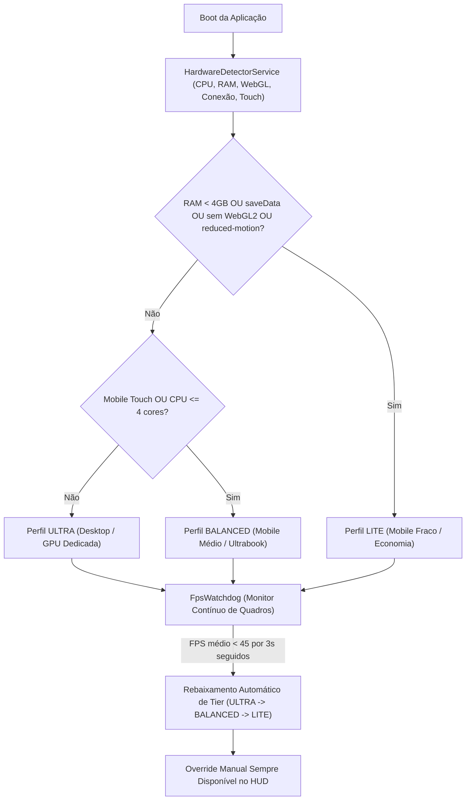
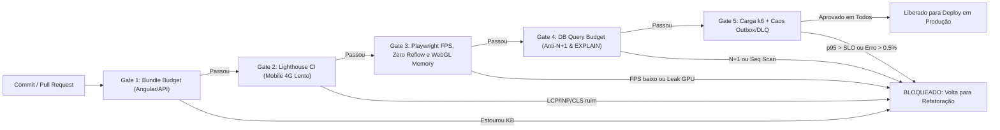

# 11 — Desempenho Ponta a Ponta, Detecção de Hardware, Mobile e Release Gates

## 1. Objetivo Arquitetural & Origem Real (Post-Mortem Mobile)

Desempenho no **PokéVerse OS** não é otimização opcional de fim de projeto: é um **requisito funcional bloqueante** em todas as camadas — gráficos WebGL2/2D, CSS mobile, APIs NestJS, PostgreSQL, Redis, Apache Kafka e pipeline de CI/CD.

### Por que esta arquitetura nasceu? (Post-Mortem de Campo)

Na versão inicial da Pokédex 3D publicada no GitHub Pages, o desempenho parecia fluido em desktops potentes, mas **testes reais em smartphone revelaram travamentos severos** durante carregamento e abertura. A investigação técnica apontou 4 gargalos concretos no código:

| Gargalo Medido na Versão Original | Impacto Real no Celular | Solução Aplicada & Regra Arquitetural Derivada |
| :--- | :--- | :--- |
| **4 JPEGs 4K simultâneos no DOM** (`3840×2160` e `4096×2316`, totalizando `9,34 MB`) | Mais de `100 MB` em texturas RGBA decodificadas na GPU mobile desde o boot | Imagens responsivas `.webp` (`1920px` desktop / `820px` mobile de `50,7–104,5 KB`) + carga sob demanda mantendo **apenas 1 cenário decodificado** (`-99%` bytes iniciais) |
| **Transição de `padding-top` no mobile** (`1160ms` abrindo a tampa 3D) | *Reflow* + *repaint* da página inteira em todo quadro (~60x/s) | Removida a transição de `padding-top`: o espaço das duas alas (`--wing-h: clamp(41.5rem, 86dvh, 45.5rem)`) é reservado estaticamente enquanto `rotateX(180deg)` anima apenas na GPU (`0` reflows por quadro) |
| **Filtros SVG `feTurbulence` + `mix-blend-mode` + `backdrop-filter: blur(6px)`** em layers 3D | Rasterização pesada por CPU/GPU móvel em cada rotação/rolagem | Microtexturas pré-assadas em `.webp` suaves (`5,88 KB` e `5,93 KB`), blur removido no mobile e `content-visibility: auto` nas listas |
| **Animações `filter` + `box-shadow`** nos LEDs + falta de perfil adaptado | Repaint contínuo por quadro em aparelhos de entrada | Keyframes migrados para `opacity` + `transform` e criação de **Detecção Automática de Hardware (`ULTRA` / `BALANCED` / `LITE`)** já em produção no módulo |

Essa experiência real motivou estender a mesma disciplina de desempenho — **orçamentos numéricos, detecção de hardware, telemetria registrável e portas de bloqueio automatizadas no CI/CD** — para o front-end WebGL2/2D, APIs NestJS, queries SQL/Prisma, cache Redis e filas Kafka. **Qualquer funcionalidade que violar os orçamentos definidos nesta especificação reprova no Release Gate e volta para refatoração.**

---

## 2. Detecção Automática de Hardware e Perfis Adaptativos (`ULTRA`, `BALANCED`, `LITE`)

Ao inicializar a plataforma (`apps/web`), o serviço `HardwareDetectorService` inspeciona de forma não bloqueante as capacidades reais do dispositivo do usuário e escolhe o perfil ideal antes de instanciar engines 2D/3D ou baixar assets pesados:

### 2.1. Sinais Inspecionados no Boot (`HardwareProbe`)

| Sinal do Navegador | O que Revela | Regra de Decisão |
| :--- | :--- | :--- |
| `navigator.deviceMemory` | Memória RAM aproximada do dispositivo (GB) | `<= 2 GB` força `LITE`; `4 GB` sugere `BALANCED`; `>= 8 GB` permite `ULTRA` |
| `navigator.hardwareConcurrency` | Núcleos lógicos de CPU disponíveis | `<= 4` núcleos evita *post-processing* e reduz partículas |
| `navigator.connection?.saveData` / `effectiveType` | Economia de dados ativada ou rede `2g`/`3g` | Ativa `LITE` para baixar apenas imagens compactas (`< 120 KB`) e adiar áudio pesado |
| `matchMedia('(pointer: coarse)')` | Dispositivo primariamente touch (celular/tablet) | Ativa ergonomia Mobile-First, controles virtuais e teto de `BALANCED` por padrão |
| `matchMedia('(prefers-reduced-motion: reduce)')` | Sensibilidade vestibular / preferência de acessibilidade | Desativa câmera cinemática, tremores, partículas contínuas e gira em transição instantânea |
| `WebGL2RenderingContext` (`UNMASKED_RENDERER` / `MAX_TEXTURE_SIZE`) | Capacidade real de GPU e suporte a shaders | Ausência de WebGL2 ou `SwiftShader`/software rasterizer ativa modo `LITE` 2D sem travar |

### 2.2. Matriz de Qualidade por Perfil (`ULTRA` vs. `BALANCED` vs. `LITE`)

| Subsistema | `ULTRA` (Desktop GPU) | `BALANCED` (Mobile Médio / Laptop) | `LITE` (Celular de Entrada / Hardware Fraco) |
| :--- | :--- | :--- | :--- |
| **Pixel Ratio (`DPR`)** | `Math.min(dpr, 2.0)` | `Math.min(dpr, 1.5)` | `1.0` fixo (reduz pixels renderizados em até 75%) |
| **Three.js (Title / Holocron / Console)** | Bloom + GLSL shaders + `100%` partículas + sombras suaves | Sem *UnrealBloomPass*, `40%` partículas, materiais *Lambert/Standard* leves | Substituição elegante para visualização 2D CSS/Sprite HD sem contexto WebGL pesado (ou malha mínima sem shader complexo) |
| **Phaser Overworld** | Ciclo dia/noite com `Light2D` + partículas de chuva/vagalumes + `60–120 FPS` | Iluminação por tintura leve, `30%` partículas, alvo `60 FPS` | Mapa limpo sem filtros por câmera, partículas desligadas, alvo `30–60 FPS` estável |
| **Assets & Cenários** | Desktop WebP/AVIF (`1920px`, `~300–500 KB`), apenas ativo decodificado | Mobile/Tablet WebP/AVIF (`1080px`, `~150–250 KB`), apenas ativo no DOM | Mobile WebP (`720px–800px`, `< 100 KB`), carregamento único sob demanda |
| **CSS Skeuomórfico (Pokédex 3D)** | Gradientes `oklch`, reflexos e microtexturas em bitmap pré-assado | Mesmo visual nítido sem animar `filter`/`box-shadow` ou `backdrop-filter` | Sem `backdrop-filter`, sem `mix-blend-mode`, sombras simplificadas para compositing instantâneo |

### 2.3. Degradação Dinâmica em Tempo de Execução (*FpsWatchdog*)

- Mesmo se um aparelho declarar boas especificações no papel (ex.: modo economia de bateria ativo ou superaquecimento térmico), um monitor leve baseado em janela deslizante de `requestAnimationFrame` observa os quadros durante cenas ativas:
  - Se `180` quadros consecutivos (~3 segundos) registrarem **média abaixo de `45 FPS`** ou picos frequentes de frame `> 30ms`, o `AdaptiveQualityManager` reduz o tier em um degrau (`ULTRA -> BALANCED` ou `BALANCED -> LITE`) em tempo real e notifica discretamente no HUD.
  - O usuário pode fixar manualmente sua preferência (**Auto / Ultra / Balanceado / Lite**) no menu de configurações do HUD.

---

## 3. Engenharia Mobile-First, Toque, Memória e Bateria

Como a plataforma atende Web Desktop e Smartphones modernos ou modestos:

1. **Zero Animação de Propriedades de Layout (Anti-Reflow):**
   - Proibido animar `padding`, `margin`, `top`, `left`, `width` ou `height` em transições visuais. Toda abertura/movimento no mobile e no desktop deve usar exclusivamente **`transform` (`translateX`, `translateY`, `rotateX`, `rotateY`, `scale`) e `opacity`** na *compositor thread* da GPU.
2. **Orçamento Estrito de VRAM para Imagens de Fundo:**
   - Proibido manter múltiplos cenários `4K` simultâneos escondidos com `opacity: 0` no DOM. O container de cenário renderiza somente o background ativo (usando `<picture>` com `srcset` responsivo e formato **AVIF/WebP**) e descarta referências antigas após a transição.
3. **Pré-Renderização de Microtexturas (*Texture Baking*):**
   - Filtros SVG pesados (`feTurbulence`, `feDiffuseLighting`) não devem ser recalculados pelo navegador sobre elementos com `mix-blend-mode` durante rotações 3D; texturas granuladas de metal e plástico devem ser pré-geradas em bitmap pequeno *tileable* (`96×96` PNG/WebP cacheado) ou *OffscreenCanvas* único no boot.
4. **Ergonomia Touch-First & Safe Areas:**
   - Todos os alvos interativos (botões de cenário, dock HUD, slots, D-Pad virtual do Overworld e botões do portátil) respeitam área mínima de toque **`44 × 44 px`** e `touch-action: manipulation` (elimina atraso de `300ms` e zoom acidental por toque duplo).
   - O Overworld e o Arcade em mobile exibem controles táteis nas laterais respeitando recortes de tela (`env(safe-area-inset-bottom)`, `safe-area-inset-left/right`) e alternando suavemente entre retrato e paisagem.
5. **Isolamento de Pintura em Listas Longas:**
   - Listagens como o catálogo de `1.300+` Pokémon e inventário usam `contain: layout style paint` e `content-visibility: auto` (com `contain-intrinsic-size` exato) ou virtualização quando visíveis simultaneamente.
6. **Economia de Bateria:**
   - Pausa automática de áudio (`AudioContext.suspend()`), timers e render loops Three.js/Phaser no evento `visibilitychange` quando o navegador móvel vai para segundo plano.

---

## 4. Orçamentos Mensuráveis de Desempenho (SLIs, SLOs e Budgets)

Nenhuma estimativa subjetiva: toda camada tem metas numéricas verificáveis.

### 4.1. Front-end, Mobile & WebGL

| Métrica / Indicador (SLI) | Meta `ULTRA` / Desktop | Meta `BALANCED` / `LITE` Mobile | Como é Medido |
| :--- | :---: | :---: | :--- |
| **LCP (*Largest Contentful Paint*)** | `<= 1.8 s` | `<= 2.5 s` (4G lento emulado) | Lighthouse CI + RUM `PerformanceObserver` |
| **INP (*Interaction to Next Paint*)** | `<= 100 ms` | `<= 200 ms` | Chrome Traces + RUM `event` observer |
| **CLS (*Cumulative Layout Shift*)** | `<= 0.02` | `<= 0.05` | Lighthouse CI + Playwright |
| **Bundle JS Inicial (Shell Angular)** | `<= 220 KB` gzip | `<= 220 KB` gzip (Phaser/Three/WASM em *lazy chunks*) | `angular.json` budgets no build |
| **Sustained Frame Rate (Cenas Ativas)** | `>= 58 FPS` | `>= 50 FPS` (`BALANCED`) / `>= 45 FPS` (`LITE`) | `FpsWatchdog` + Playwright trace |
| **Long Tasks (`> 50ms` na Main Thread)** | `<= 2` no boot | `<= 3` no boot; `0` durante scroll/abertura | `PerformanceObserver('longtask')` |
| **Vazamento de Memória GPU (WebGL)** | `0` objetos retidos após unmount | `0` objetos retidos após unmount | `renderer.info.memory` no E2E |

### 4.2. Back-end NestJS, PostgreSQL, Redis e Kafka

| Camada | Indicador (SLI) | Orçamento Máximo (SLO) | Regra de Auditoria |
| :--- | :--- | :---: | :--- |
| **API HTTP (Cache Hit)** | Latência `p95` / `p99` | `p95 <= 50 ms` \| `p99 <= 120 ms` | Load Test `k6` + OpenTelemetry |
| **API HTTP (DB Read/Write)** | Latência `p95` / `p99` | `p95 <= 150 ms` \| `p99 <= 350 ms` | Load Test `k6` + OpenTelemetry |
| **WebSockets (Overworld / Batalha)** | Latência de propagação de turno/movimento | `p95 <= 80 ms` | Teste sintético WS multi-cliente |
| **PostgreSQL / Prisma** | Queries por requisição HTTP | `<= 3` queries em rotas críticas (**zero N+1**) | Contador via `prisma.$on('query')` em testes |
| **PostgreSQL Planos de Execução** | Varreduras em tabelas quentes | `0 Seq Scan` em tabelas `> 1.000` linhas | `EXPLAIN ANALYZE` automatizado na suíte DB |
| **Redis Cache** | Cache Hit Ratio (PokéAPI e Museu) | `>= 90%` após aquecimento | Métrica customizada `cache_hits / requests` |
| **Kafka + Outbox Relay** | Latência fim-a-fim (DB commit -> Consumer) | `p95 <= 250 ms` \| Lag `<= 500` msgs sob carga | Consumer lag exporter + OTel `traceparent` |
| **Confiabilidade HTTP** | Taxa de erro `5xx` sob carga nominal | `< 0.5%` | `k6` thresholds bloqueantes |

---

## 5. Telemetria Real (RUM) e Painel Interno de Diagnóstico (`PerfHUD`)

1. **Coleta Real de Usuários (*Real User Monitoring* — Implementada via Gate LGPD):**
   - [`WebTelemetryService`](../apps/web/src/app/core/telemetry/web-telemetry.service.ts) no Angular observa nativamente via `PerformanceObserver` as métricas `largest-contentful-paint` (`LCP`), `layout-shift` (`CLS`) e `longtask` (`LONG_TASK`), anexando a rota normalizada e o perfil de hardware ativo (`ULTRA` / `BALANCED` / `LITE`) sem nenhum dado pessoal (sem PII) e respeitando estritamente o opt-in `PrivacyConsentStore.optionalTelemetryEnabled()`.
   - Ao sair ou ocultar a página (`visibilitychange` -> `hidden`), envia em JSON (`fetch(..., { keepalive: true, credentials: 'same-origin' })`) para `POST /api/v1/telemetry/rum` ([`ClientTelemetryController`](../apps/api/src/modules/system/client-telemetry.controller.ts)), alimentando o histograma `web.vitals.value` no OpenTelemetry Collector -> Prometheus/Grafana ([doc 19](19-observabilidade-telemetria-e-monitoramento.md)).
   - Em paralelo, [`telemetryTraceInterceptor`](../apps/web/src/app/core/interceptors/telemetry-trace.interceptor.ts) propaga `traceparent` W3C nas chamadas `/api/*` e [`GlobalErrorHandler`](../apps/web/src/app/core/telemetry/global-error-handler.ts) encaminha crashes de UI (sob opt-in LGPD) para `POST /api/v1/telemetry/errors` -> `SentryErrorReporterService`.
2. **Painel Técnico Ativável (`PerfHUD` para Desenvolvimento e Portfólio):**
   - Um atalho discreto (`Ctrl+Shift+P` ou opção de diagnóstico no HUD) exibe um medidor compacto ao vivo com:
     - **FPS atual e frame time (ms)**;
     - **Hardware Tier ativo (`ULTRA` / `BALANCED` / `LITE`)** com alternância imediata para comparação ao vivo;
     - **Uso de memória JS (`performance.memory` quando disponível)** e contadores do Three.js (`geometries`, `textures`, `calls`);
     - **Últimas latências HTTP/WebSocket e Cache Hit/Miss**.

---

## 6. Testes Obrigatórios e Performance Release Gates (Bloqueio no CI/CD)

Toda alteração em Pull Request ou candidata a release passa por **5 Portões de Desempenho automatizados** no GitHub Actions. **Se qualquer gate falhar, o merge e o deploy são bloqueados até que o gargalo seja refatorado:**

### Especificação de cada Gate

1. **Gate 1 — Orçamento de Bundle & Dependências (`angular.json` + Script CI):**
   - Reprova automaticamente o build caso o JavaScript inicial ultrapasse `220 KB` gzipados ou se bibliotecas pesadas (`three`, `phaser`, cores WASM) vazarem para o bundle principal em vez de *lazy chunks*.
2. **Gate 2 — Lighthouse CI no Perfil Mobile Emulado (`Moto G Power / Slow 4G`):**
   - Executa auditoria automatizada na rota pública (`/`, `/pokedex`, `/museu`) exigindo `Performance >= 90`, `Accessibility >= 95`, `LCP <= 2.5s`, `CLS <= 0.05`.
3. **Gate 3 — Suíte Playwright de Renderização, FPS e Vazamento WebGL:**
   - Emula viewport mobile `375×812` com throttling de CPU `4x`:
     - Abre e fecha a Pokédex 3D validando que o tempo de layout/reflow durante a transição fica dentro do limite (garantindo que nenhum `padding`/`height` esteja sendo animado);
     - Navega Title Screen -> Holocron 3D -> desmonta -> verifica via janela de inspeção de teste que `renderer.info.memory.geometries` e `textures` foram devidamente descartados (`dispose()`).
4. **Gate 4 — Auditoria de Queries SQL & Anti-N+1 em Integração:**
   - Executa suíte de testes contra PostgreSQL real usando `prisma.$on('query')`: cada endpoint crítico declara um teto máximo de queries (ex.: listar times com membros <= `2` queries; carregar slots <= `1` query). Consultas fora do orçamento ou planos `EXPLAIN ANALYZE` acusando `Seq Scan` em índices obrigatórios quebram o teste.
5. **Gate 5 — Teste de Carga (`k6`) e Resiliência sob Caos:**
   - Script `k6` em ambiente de staging/CI simula usuários virtuais buscando Pokémon, listando rankings no Redis, gravando slots e disparando partidas WebSocket, falhando automaticamente caso `p95` ultrapasse o SLO ou falhas `5xx` superem `0.5%`.
   - Cenário automatizado de caos valida degradação segura se PokéAPI responder `500`/timeout (Circuit Breaker servindo cache) e reprocessamento limpo sem duplicação quando o broker Kafka reinicia.
