# 12 — Pokédex 2.0: Catálogo Completo da PokéAPI v2 e Arquitetura de Controles sem Novos Botões

## 1. Motivação e Premissa Visual Inegociável

Atualmente, a Pokédex consome apenas `https://pokeapi.co/api/v2/pokemon/{nomeOuId}` e exibe um recorte básico: **Nome, ID, Altura, Peso, Tipos, Sprite principal e Habilidades**. Ao inspecionar os recursos públicos expostos pela **PokéAPI v2**, constatamos que existem **51 endpoints raiz** com dados completos de combate, biologia, evoluções, sprites retrô/animados, áudios (*cries*), golpes, itens e localizações — fundamentais tanto para enriquecer a ficha na Pokédex quanto para sustentar o **Museu, Overworld, Team Builder, Mini-Games e Simulador de Batalha**.

### Restrição Absoluta de Hardware (Aparência Física Preservada)
A evolução para a **Pokédex 2.0** deve comportar todos esses novos dados **sem adicionar nenhum botão físico novo à carcaça**:
- A silhueta skeuomórfica atual em [index.html](../index.html) e [style.css](../css/style.css) permanece **100% intacta** (`4` setas do D-Pad, `2` botões em fenda vermelho/azul, `1` botão circular `A`, `10` teclas iluminadas inferiores e `1` botão amarelo compacto).
- Toda a expansão acontece **por software dentro dos visores LCD existentes** (abas paginadas no visor direito, filtros internos no terminal de busca) e **pelo comportamento contextual dos botões físicos existentes**, exatamente como ocorre em sistemas de consoles portáteis.

---

## 2. Pokédex 2.0: Fluxo de Navegação sem Novos Botões na Carcaça

```mermaid
flowchart TD
  Dpad["D-Pad Físico (Cima / Baixo / Esq / Dir)"] -->|"Raiz: escolhe tela"| Screens["Busca / Catálogo / Visor / Slots"]
  Dpad -->|"Dentro do Visor (Esq / Dir)"| Tabs["Alterna as 5 Abas LCD da Pokédex 2.0"]
  Dpad -->|"Dentro do Visor (Cima / Baixo)"| TabScroll["Rola conteúdo ou move foco entre evoluções/golpes/áudio"]

  BtnA["Botão Redondo A (#btn-controle-selecionar)"] -->|"Item em foco"| TriggerAction["Executa ação (tocar Cry, alternar Shiny, abrir Evolução)"]
  BtnBlue["Fenda Azul (#btn-limpar-visor)"] -->|"No Busca/Catálogo"| FilterBar["Alterna Filtros Internos (Tipo / Geração / Lendário)"]
  BtnBlue -->|"No Visor (folha)"| ClearOrNext["Limpa visor quando sem submenu"]
  BtnRed["Fenda Vermelha (#btn-limpar-form)"] -->|"Qualquer submenu/aba"| StepBack["Volta 1 nível na navegação (estilo B)"]
  BtnYellow["Tecla Amarela (#btn-config-slots)"] -->|"Menu Sistema"| SystemMode["Abre Gerenciador dos 10 Slots + Modo Comparador 1v1"]
  SlotKeys["10 Teclas Iluminadas (#grade-slots-azuis)"] -->|"Modo Padrão / Filtro"| SlotOrGen["Salva/Carrega 10 Slots (ou seleciona Geração I-IX + Todos no Filtro)"]
```

### 2.1. Os 5 Visores Paginados dentro de `#resultado-conteudo`
Para evitar uma lista única gigante difícil de rolar no celular e no desktop, o visor escuro (`#resultado-conteudo`) ganha uma barra de abas tática interna (**5 sub-telas**):

| Aba | Conteúdo Exibido no LCD | Endpoints PokéAPI Usados | Estratégia de Carga (Performance) |
| :--- | :--- | :--- | :--- |
| **1. Resumo & Lore** | Sprite animado (`showdown`) + estático, botão discreto **Ouvir Grito (`cry`)** e alternador **Normal / Shiny** no próprio quadro da imagem, Genus (*"Mouse Pokémon"*), *Flavor Text*, Geração, Habitat e selos (*Bebê / Lendário / Mítico*) | `/pokemon/{id}` + `/pokemon-species/{id}` | Carrega em paralelo (`Promise.all`) e cacheia no Redis (`24h`) |
| **2. Atributos & Tipos** | Gráfico em barras dos **6 Base Stats** (`HP`, `Atk`, `Def`, `SpA`, `SpD`, `Spe` + `BST` total e `EV Yield`), Habilidades (destacando *Hidden Ability* e descrição real), `capture_rate`, `base_happiness` e tabela automática de fraquezas (`4x`, `2x`, `0.5x`, `0.25x`, `0x`) | `/pokemon/{id}` + `/type/{id}` + `/ability/{id}` | Matriz `18 × 18` estática em memória (`packages/shared`); zero fetch extra por tipo |
| **3. Evolução & Formas** | Árvore evolutiva clicável (*Baby -> Base -> Estágio 2* e ramificações) mostrando gatilhos exatos (*nível, pedra, amizade, chuva, horário, troca*) + **Variedades/Formas** (*Mega, Gmax, Alola, Galar, Hisui, Paldea*) | `/evolution-chain/{id}` + `/pokemon-form/{id}` | Carregada sob demanda ao abrir a Aba 3 (`lazy fetch`) |
| **4. Golpes & Itens** | Golpes agrupados por método (`Level-up`, `TM/Machine`, `Egg`, `Tutor`), exibindo Poder, Precisão, `PP`, Classe (*Physical/Special/Status*) e itens que pode segurar selvagem (`held_items` + raridade) | `/pokemon/{id}` + `/move/{id}` (sob clique/expansão) | Metadados dos golpes carregados somente ao expandir linha ou abrir Team Builder |
| **5. Mapa & Sprites** | Áreas de captura por versão de jogo (`/encounters`) com chance e método + galeria compacta com sprites de gerações anteriores (*Gen I Red/Blue -> Gen V Black/White -> Gen IX*) | `/pokemon/{id}/encounters` + `sprites.versions` | Carregamento estritamente sob demanda ao abrir a Aba 5 |

### 2.2. Mapeamento Completo dos Botões Físicos Existentes (Zero Botões Novos)

| Botão Físico Atual (`index.html`) | Função Atual (`v1.0`) | Nova Função Contextual (`v2.0` — sem alterar aparência) |
| :--- | :--- | :--- |
| **D-Pad `▲ ▼ ◀ ▶`** | Navega telas e itens | No `Visor`, **`◀` / `▶`** troca instantaneamente entre as **5 abas**, e **`▲` / `▼`** navega/rola os elementos dentro da aba ativa |
| **Botão Redondo `A`** (`#btn-controle-selecionar`) | Confirma item/slot | Executa ação contextual no item destacado: abre evolução clicada na árvore, reproduz **Cry**, alterna **Shiny** ou aplica filtro no módulo de busca |
| **Fenda Vermelha (`B`)** (`#btn-limpar-form`) | Volta menu / limpa busca | Funciona como botão universal de **Voltar 1 nível** (Sair de sub-lista -> Sair do Visor -> Raiz; na raiz, limpa o formulário) |
| **Fenda Azul (`Menu`)** (`#btn-limpar-visor`) | Avança menu / limpa visor | No `Módulo de Busca` / `Catálogo`, alterna a **barra compacta de Filtros** dentro da tela (Tipo, Geração, Lendário); nos `Slots`, entra no submenu; em aba folha do visor, limpa o visor |
| **Botão Compacto Amarelo** (`#btn-config-slots`) | Abre gerenciador de 10 slots | Abre o **Painel do Sistema no Visor**: gerenciamento dos 10 Slots **e** modo **Comparador 1v1** (selecionar 2 slots salvos para comparar *Stats*, tipos e habilidades lado a lado) |
| **10 Teclas Iluminadas** (`#grade-slots-azuis`) | Salva/carrega 10 Pokémon | Quando o filtro de Geração estiver ativo na tela de busca, permite selecionar **Gen I a IX + Todas** nos 10 botões numerados (ou operar normalmente os 10 slots fora desse estado) |

---

## 3. Catálogo Oficial dos Endpoints da PokéAPI v2 (`https://pokeapi.co/api/v2/`)

A PokéAPI v2 expõe **`51` endpoints raiz** (auditados diretamente contra `https://pokeapi.co/api/v2/`). Abaixo estão classificados os **comandos (endpoints) estratégicos** para a Pokédex 2.0 e para os módulos do **PokéVerse OS**:

### 3.1. Endpoints de Pokémon, Formas e Evolução (Pokédex 2.0 & Holocron)

| Endpoint (`GET`) | O que Entrega | Uso Direto na Plataforma |
| :--- | :--- | :--- |
| **`/pokemon/{id ou nome}`** | Núcleo de combate, stats, habilidades, tipos, sprites, sons e lista de golpes | Ficha base, sprites HD/animados (`showdown`), sons (`cries`), EV yield e golpes válidos no Team Builder |
| **`/pokemon-species/{id ou nome}`** | Lore (*flavor text*), gênero (*taxa macho/fêmea*), `capture_rate`, `egg_groups`, `habitat`, flags `is_baby`/`is_legendary`/`is_mythical`, variedades | Aba 1 da Pokédex 2.0, filtros por raridade/habitat e busca de descrições no Museu & Quiz |
| **`/pokemon-form/{id ou nome}`** | Detalhes de formas alternativas (*Mega*, *Gmax*, *Alola*, *Galar*, *Hisui*, *Paldea*), `is_mega`, `is_battle_only` | Troca visual de formas na Aba 3 e no Holocron 3D |
| **`/evolution-chain/{id}`** | Árvore recursiva completa (`chain.evolves_to`) + `evolution_details` (nível, item, amizade, chuva, horário, pedra) | Grafo clicável na Aba 3 da Pokédex 2.0 e no Holocron 3D |
| **`/pokemon/{id}/encounters`** | Lista de `location_area` + chance/método/versão de captura | Aba 5 ("Onde encontrar") e mapa do Museu das Regiões |
| **`/pokemon?limit=100000&offset=0`** | Lista enxuta com todos os nomes e URLs para extração rápida de ID | Carga preguiçosa do catálogo + busca *fuzzy* / Damerau-Levenshtein |

### 3.2. Endpoints de Combate & Mecânicas (Team Builder + Simulador PvE/PvP)

| Endpoint (`GET`) | O que Entrega | Uso Direto na Plataforma |
| :--- | :--- | :--- |
| **`/type/{id ou nome}`** | `damage_relations` (`double_damage_from/to`, `half_damage_from/to`, `no_damage_from/to`), sprites de insígnia e Pokémon/golpes do tipo | Cálculo de fraquezas `0x..4x`, analisador de sinergia do time e motor de dano na Batalha |
| **`/move/{id ou nome}`** | `power`, `accuracy`, `pp`, `priority`, `damage_class` (physical/special/status), `meta` (*ailment, crit_rate, drain, healing, flinch_chance, min_hits..max_hits*), `stat_changes` | Tooltip técnico de golpe, regras no Team Builder e execução turno-a-turno no servidor NestJS |
| **`/ability/{id ou nome}`** | `effect_entries`, `flavor_text_entries`, `is_main_series`, lista de Pokémon | Explicação detalhada das habilidades na Pokédex 2.0 e efeitos passivos na Arena |
| **`/nature/{id ou nome}`** | `increased_stat` (`+10%`), `decreased_stat` (`-10%`), sabores favoritos (*likes/hates_flavor*) | Modificadores exatos no Team Builder competitivo |
| **`/stat/{id ou nome}`** | Metadados dos atributos (`hp`, `attack`, `defense`, `special-attack`, `special-defense`, `speed`, `accuracy`, `evasion`) | Rótulos localizados e validação de fórmulas de stats |
| **`/item/{id ou nome}`** & **`/item-category/{id}`** | Itens seguráveis em batalha (*Leftovers*, *Choice Band*, *Focus Sash*), Pokébolas, pedras evolutivas, preços, sprites e efeitos | Escolha de `heldItem` no Team Builder, exibição de `held_items` na Pokédex e drops/loja no Overworld |
| **`/characteristic/{id}`** | Pistas de qual IV é o maior do Pokémon conforme o resto por 5 | Detalhes extras no inspetor competitivo / perfil de Pokémon |

### 3.3. Endpoints de Mundo, Regiões e Linha do Tempo (Museu & Mini-Games)

| Endpoint (`GET`) | O que Entrega | Uso Direto na Plataforma |
| :--- | :--- | :--- |
| **`/region/{id ou nome}`** | As regiões (`kanto` .. `paldea`), suas localizações, geração principal e Pokédexes regionais | Atlas interativo do Museu das Regiões |
| **`/pokedex/{id ou nome}`** | Entradas numeradas por Pokédex regional (*kanto*, *hoenn*, *sinnoh*, etc.) | Filtro por região dentro do catálogo e quizzes do Museu |
| **`/generation/{id ou nome}`** | Pokémon, movimentos, tipos e versões introduzidos em cada geração (`I` a `IX`) | Filtros rápidos pelas 10 teclas inferiores (Modo Sistema) e Linha do Tempo do Museu |
| **`/version/{id}`** & **`/version-group/{id}`** | Jogos específicos (*Red, Blue, Crystal, Emerald, Platinum, Scarlet, Violet*) | Ficha histórica dos jogos no Museu e tag de versões nos encontros/golpes |
| **`/location/{id}`** & **`/location-area/{id}`** | Áreas exatas e taxas de encontro por método (`walk`, `surf`, `old-rod`, etc.) | Enciclopédia de rotas e spawns temáticos |
| **`/pokemon-color/{id}`**, **`/pokemon-shape/{id}`**, **`/pokemon-habitat/{id}`** | Classificação por cor predominante, silhueta corporal e bioma | Filtros visuais avançados e dicas no mini-game *"Quem é esse Pokémon?"* |
| **`/growth-rate/{id}`** & **`/egg-group/{id}`** | Curvas de XP por nível e compatibilidade de cruzamento (*breeding*) | Simulador de progressão/nível e fichas avançadas da Pokédex |
| **`/berry/{id}`** & **`/contest-type/{id}`** | Frutas (*Oran*, *Sitrus*, *Lum Berry*), sabores e efeitos em batalha/contest | Itens consumíveis no Simulador de Batalha e mecânicas de *Game Corner* / Overworld |

*(Nota sobre idioma: vários endpoints trazem campos `names` e `flavor_text_entries` com `language.name`, priorizando `"en"` e traduções disponíveis via fallback controlado; nomes técnicos de combate e UI são normalizados e mapeados para PT-BR onde aplicável em `packages/shared`.)*

---

## 4. Todos os Dados que a PokéAPI Expõe Sobre um Pokémon

Abaixo está o mapeamento exato de todas as propriedades auditadas nos JSONs de resposta da PokéAPI para uma espécie/espécime completo:

### 4.1. Núcleo de `/pokemon/{id ou nome}` (`21` chaves raiz auditadas)

- **Identificação e Biometria:** `id`, `name`, `order` (ordem na Pokédex Nacional), `is_default`, `height` (em decímetros: `/ 10 = m`), `weight` (em hectogramas: `/ 10 = kg`), `base_experience` (XP base ao derrotar).
- **Estatísticas Base (`stats`):** array com os 6 atributos (`hp`, `attack`, `defense`, `special-attack`, `special-defense`, `speed`), trazendo `base_stat` (valor base) e `effort` (quantos **EVs** fornece ao ser derrotado — ex.: Pikachu dá `2` EVs de Speed!). Também existe `past_stats` caso tenha mudado entre gerações.
- **Tipagem e Habilidades:** `types` (1 ou 2 tipos + `past_types`), `abilities` (`ability.name`, `slot` e booleano **`is_hidden`** + `past_abilities`).
- **Áudio Oficial (`cries`):**
  - `cries.latest`: URL direta em `.ogg` do grito atual;
  - `cries.legacy`: URL do som clássico 8-bit/portátil retrô (ideal para o *Modo Clássico / Mini-Game Auditivo*!).
- **Biblioteca Completa de Imagens (`sprites`):**
  - Padrão plano: `front_default`, `back_default`, `front_shiny`, `back_shiny` + variantes femininas (`front_female`, `back_female`, `front_shiny_female`, `back_shiny_female`);
  - `sprites.other.official-artwork` (`front_default`, `front_shiny`);
  - `sprites.other.home` (`front_default`, `front_shiny`, variantes femininas — renders estilo 3D suave);
  - `sprites.other.showdown` (GIFs **animados** frente/costas normal e shiny — perfeitos para animar o Pokémon vivo no visor LCD e na Arena!);
  - `sprites.other.dream_world` (ilustrações vetoriais SVG);
  - `sprites.versions` (`generation-i` até `generation-ix`, incluindo sprites animados de Gen V Black/White e clássicos de Game Boy).
- **Combate, Captura e Variantes:**
  - `moves`: todos os golpes aprendíveis, com `version_group_details` (`level_learned_at`, `move_learn_method` como `level-up`/`machine`/`egg`/`tutor` e `version_group`);
  - `held_items`: itens que podem vir equipados quando selvagens + `rarity` por versão de jogo;
  - `location_area_encounters`: endpoint pronto (`/api/v2/pokemon/{id}/encounters`) listando onde capturar;
  - `forms`, `species` (link para o recurso de espécie) e `game_indices`.

### 4.2. Biologia, Lore e Evolução de `/pokemon-species/{id ou nome}` (`27` chaves raiz auditadas)

- **Classificação:** `genera` (título da espécie por idioma, ex.: `"Mouse Pokémon"`), `names` (nomes em japonês, inglês, francês, etc.), `color`, `shape`, `habitat`, `generation`, `pokedex_numbers` (números nas Pokédex regionais).
- **Raridade & Flags Especiais:** `is_baby`, `is_legendary`, `is_mythical`, `capture_rate` (`0..255`, quanto menor mais difícil capturar), `base_happiness` (`0..255`).
- **Reprodução & Genética:** `gender_rate` (em oitavos para fêmea: `-1` = sem gênero, `0` = 100% macho, `4` = 50/50, `8` = 100% fêmea), `has_gender_differences`, `egg_groups`, `hatch_counter` (ciclos para chocar o ovo), `growth_rate`.
- **Evolução & Variedades:** `evolves_from_species`, `evolution_chain` (URL da cadeia evolutiva completa), `forms_switchable`, `varieties` (lista todas as variantes alternativas como *Mega*, *Gigantamax*, *Alola*, *Galar*, *Hisui*, *Paldea*), `flavor_text_entries` (textos oficiais da Pokédex em dezenas de jogos!), `form_descriptions` e `pal_park_encounters`.

---

## 5. Regras de Implementação & Cache para Não Degradar o Desempenho

Consultar múltiplos endpoints sem critério derrubaria a performance mobile (e violaria os SLOs em [doc 11](11-performance-hardware-gates-e-mobile.md)). Por isso a Pokédex 2.0 aplica 4 regras estritas:

1. **Busca Inicial Leve em 2 Chamadas Máximas:** ao selecionar um Pokémon, busca em paralelo apenas `/pokemon/{id}` + `/pokemon-species/{id}` (ou em chamada consolidada `/api/v1/pokedex/pokemon/:id/bundle` quando o back-end NestJS + Redis estiver ativo em produção).
2. **Carga Preguiçosa por Aba (*Tab-Level Lazy Loading*):** `/evolution-chain`, detalhes individuais de `/move/{id}`, `/ability/{id}` e `/encounters` só são buscados **quando o usuário realmente abre a Aba 2/3/4/5**, com *cache* em memória na sessão e no Redis por `24h`.
3. **Respeito aos Perfis `ULTRA` / `BALANCED` / `LITE`:** no modo **`LITE`**, sprites animados GIF (`showdown`) e gráficos pesados são substituídos pela arte estática leve (`official-artwork` / `front_default`), protegendo RAM e bateria em celulares simples.
4. **Proibido Poluir o DOM Oculto:** apenas o conteúdo da aba ativa dentro de `#resultado-conteudo` é montado no DOM (via `replaceChildren()` + `createElement()` sem `innerHTML`), evitando centenas de nós invisíveis de listas de golpes pesados em segundo plano.
