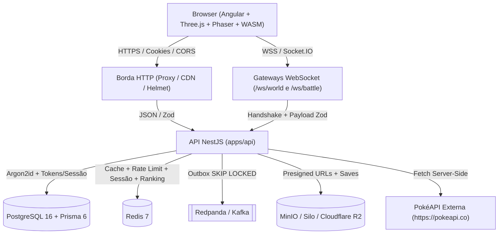
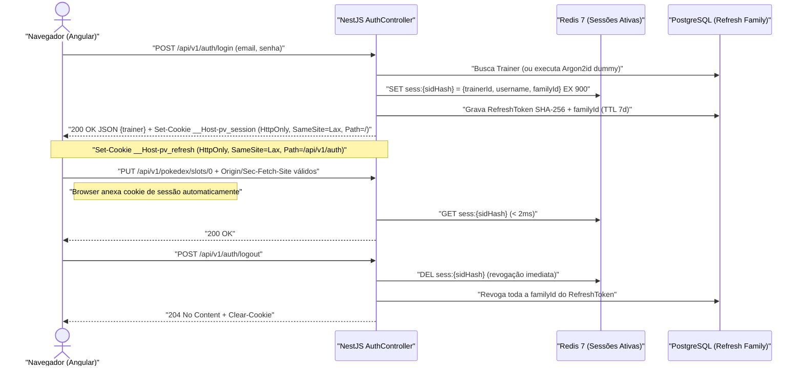
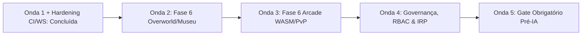

# 13 — Dossiê Completo de Segurança e Blindagem (AppSec, Auth & Infra)

> **Objetivo deste documento:** consolidar todas as práticas, decisões criptográficas, controles de borda, blindagens de banco/cache/mensageria/WebGL, governança operacional/LGPD, requisitos normativos de segurança para IA/modelos e o plano de endurecimento em ondas para tornar o **PokéVerse OS** resistente às classes críticas de ataque (**OWASP Top 10**, **OWASP API Security Top 10**, **OWASP Top 10 for LLM Applications** e **ASVS L2+**).
>
> **Regra de ouro:** todo controle abaixo está mapeado diretamente para o estado real do monorepo (implementado vs. lacuna aberta vs. requisito normativo condicional antes de habilitar módulos com IA/modelos) — nada genérico ou em contradição com o código.

---

## 1. Modelo de Ameaças (STRIDE) do PokéVerse OS

| Vetor / Ativo | Ameaça Principal (STRIDE) | Superfície no Projeto | Impacto se Explorado |
| :--- | :--- | :--- | :--- |
| **Sessão / Identidade** | Roubo de token via XSS, reuso de cookie, *session fixation*, força bruta e *timing enumeration* | `AuthModule`, `SessionAuthGuard`, `RbacGuard`, `AuthStore`, `authInterceptor` | Tomada de conta de treinador, gravação/exclusão indevida de slots e saves |
| **Cookies & Mutações** | **CSRF (*Cross-Site Request Forgery*)** em rotas que confiam no cookie de sessão/refresh | `POST /auth/refresh`, `/auth/logout` e futuros endpoints cookie-based | Renovação/encerramento ou mutação forçada por site terceiro malicioso |
| **Controle de Acesso** | **BOLA / IDOR** (*Broken Object Level Authorization*) e escalonamento entre Visitante e Treinador | `PokedexSlotsService`, futuros `Teams`, `ArcadeSaveState`, `BattleMatch` | Um treinador ler/alterar slots, times ou *cloud saves* de outro usuário |
| **Proxy PokéAPI** | **SSRF**, poluição de cache no Redis, esgotamento de banda/slots por parâmetros gigantes | `PokeApiCacheService` (`GET /pokedex/pokemon/:idOrName`) | Indisponibilidade da Pokédex, explosão de chaves no Redis ou redirecionamento malicioso |
| **WebSockets** | Conexão anônima em ações privadas, *flood* de pacotes de movimento/batalha, fraude de score/dano | `WorldGateway` (`/ws/world`) e futuro `BattleGateway` | Cheating no Overworld/Arena, crash por broadcast em massa |
| **Front-end / 3D / WASM** | **XSS**, injeção de URL (`javascript:`), **Open Redirect** em `returnUrl`, abuso de memória GPU/WASM | `apps/web`, templates Angular, Three.js, Phaser, emulador WASM (Fase 5) | Execução de script no navegador, phishing de redirecionamento, travamento do cliente |
| **Dados, Cache & Kafka** | SQL Injection, vazamento de hash/segredo em erro ou log, *poison pill* no Kafka, *eviction* silenciosa | `PrismaService`, `RedisService`, `OutboxRelayService`, `WorldEventsConsumerService`, `GlobalExceptionFilter` | Perda de integridade, negação de serviço em partições Kafka, vazamento de PII/credenciais |
| **Storage S3/R2 & Docker** | Path traversal em chaves de arquivo, ROM/Save malicioso (zip-bomb), container como `root`, segredos em Git | `docker-compose.yml`, futuros `Dockerfiles`, módulo Arcade (Fase 5) | Exaustão de disco/RAM, download não autorizado, comprometimento de runtime |

---

## 2. Radiografia Atual: Controles Implementados vs. Lacunas Abertas

Baseado na auditoria direta do código atual pós-**Hardening de Segurança, Concorrência & CI/CD** (após Fases 2A/2B/3/4A e Ondas 1–4 de [`ARCHITECTURE.md`](ARCHITECTURE.md)):

| Controle | Estado Atual no Código | Lacuna Aberta / Trade-off Documentado | Severidade Atual |
| :--- | :--- | :--- | :---: |
| **Hashing de senha & timing shield** | `argon2` (`argon2id`) + `DUMMY_ARGON2_HASH` em [credentials-auth.service.ts](../apps/api/src/modules/auth/credentials-auth.service.ts) igualando latência quando o e-mail não existe | Resolvido. | **Resolvido** |
| **Armazenamento de sessão no navegador** | **Sessão Opaca BFF no Redis + cookies `HttpOnly`** em [session.service.ts](../apps/api/src/modules/auth/session.service.ts) e [session-cookies.util.ts](../apps/api/src/modules/auth/session-cookies.util.ts); **zero JWT no JS** e proxy same-origin Cloudflare Pages | Resolvido (`__Host-` ativo quando HTTPS sem `COOKIE_DOMAIN` e `SameSite != none`). | **Resolvido** |
| **Refresh Token, Rotação & Revogação Imediata** | Token opaco (`randomBytes`), hash SHA-256 no Postgres, `familyId`, detecção de reuso, grace window de `10s`, revogação imediata no Redis via `/auth/logout` e expurgo periódico ativo a cada 6h em [session-management.service.ts](../apps/api/src/modules/auth/session-management.service.ts) | Resolvido. | **Resolvido** |
| **Consumo one-time sem TOCTOU (OAuth / Passkey / OTP)** | `GETDEL` atômico (`consumeString` / `consumeJson`) em [redis.service.ts](../apps/api/src/infra/redis.service.ts) usado por [google-oauth.service.ts](../apps/api/src/modules/auth/google-oauth.service.ts) e [passkey.service.ts](../apps/api/src/modules/auth/passkey.service.ts); `DEL` atômico no [otp.service.ts](../apps/api/src/modules/auth/otp.service.ts) + contadores Lua (`INCR` + `EXPIRE`) | Resolvido. | **Resolvido** |
| **OIDC RS256 & WebAuthn FIDO2** | Verificação RS256 estrita por JWKS cacheado (`iss`, `aud`, `nonce`, `exp`, `email_verified`) em [google-oidc.verifier.ts](../apps/api/src/modules/auth/google-oidc.verifier.ts) sem auto-link em conta não verificada; Passkeys + TOTP criptografado | Resolvido. | **Resolvido** |
| **Proteção CSRF** | [CsrfOriginGuard](../apps/api/src/common/guards/csrf-origin.guard.ts) global validando `Sec-Fetch-Site`, `Origin`/`Referer` contra `CORS_ORIGINS`, bloqueio de `Content-Type` de formulário e rejeição de mutação com cookie sem `Origin`/`same-origin` | Resolvido. | **Resolvido** |
| **Rate Limiting Distribuído** | `@nestjs/throttler` conectado ao [RedisThrottlerStorage](../apps/api/src/common/guards/redis-throttler.storage.ts) (script Lua atômico no Redis), limites estritos por rota (`/login`, `/register`, `/refresh`, `/verify-email`, `/resend-verification`, `/forgot-password`, `/reset-password`, `/mfa/totp/*`, `/mfa/verify`, `/passkeys/*`, `DELETE /auth/me`, `GET /auth/me/export`, `/pokedex/slots*`) e trava `(IP, email)` no login | **Trade-off conhecido:** `RedisThrottlerStorage` opera em modo *fail-open* se o Redis ficar inacessível para preservar disponibilidade. | **Baixa** |
| **Cabeçalhos HTTP, CSP & Body Limits** | API com `helmet()` (`defaultSrc: 'none'`, `frameAncestors: 'none'`, `baseUri: 'none'`, `CORP: same-site`), `Permissions-Policy`, `TRUST_PROXY`, `bodyParser: false` + `express.json({ limit: '64kb' })` + `urlencoded({ limit: '16kb' })` e tratamento `413`/`400` em [global-exception.filter.ts](../apps/api/src/common/filters/global-exception.filter.ts); Front com CSP + HSTS em [apps/web/public/_headers](../apps/web/public/_headers) (`script-src 'self' 'wasm-unsafe-eval'`, `worker-src 'self' blob:`, `connect-src 'self' https://pokeapi.co https://raw.githubusercontent.com` para Draco WASM e `.glb` do Holocron 3D sem `ws: wss:` wildcard) e timeout `15s` / `502` seguro em [api-proxy.ts](../apps/web/cloudflare/api-proxy.ts) | `style-src` no front ainda usa `'unsafe-inline'` até adoção futura de `ngCspNonce`; `COOP`/`COEP` para threads WASM ficam para a Fase 6 (Arcade WASM). | **Média** |
| **Validação de Entrada & SSRF** | `ZodValidationPipe` `.strict()` em corpo/query/params, `PokemonIdentifierParamSchema` (`{1,64}`), `redirect: 'error'` em `PokeApiCacheService`, `GoogleOAuthHttpClient` e `MailService`, e validação Zod na ida/volta do Redis | Resolvido. | **Resolvido** |
| **WebSockets (`/ws/world`)** | [WorldGateway](../apps/api/src/modules/world/world.gateway.ts) rejeita `!origin` em `NODE_ENV=production`, valida `CORS_ORIGINS` com normalização e aplica cota simultânea (`10` conexões/IP, `1000` globais) com log `WS_CONNECTION_LIMIT_HIT` | Conexão permanece read-only para ticker público na topbar; **`WsAuthGuard` obrigatório**, validação Zod por `@SubscribeMessage` e rate limit por pacote ficam pendentes antes de abrir ações do Overworld/Arena na **Fase 6**. | **Média (Pré-Fase 6)** |
| **Open Redirect no Front** | [auth.guard.ts](../apps/web/src/app/core/guards/auth.guard.ts) restringe `targetRoute` por regex `^\/[a-zA-Z0-9/_-]*$` e o callback Google redireciona apenas para `WEBAUTHN_ORIGIN` | Resolvido. | **Resolvido** |
| **Segredos, Logs & Supply Chain** | [StructuredLoggerService](../apps/api/src/common/telemetry/structured-logger.service.ts) aplica redação recursiva (`authorization`, `cookie`, `password`, `token`, `otp`, `Bearer`, query OAuth) + logs HTTP usam `req.path` sem query string; Docker Compose usa `${VAR:?}`; `ci.yml` executa **Gitleaks**, **Trivy** (`CRITICAL`), **`npm audit --omit=dev --audit-level=critical`** e job **`integration-e2e`** com Postgres/Redis/Kafka reais | Triagem aberta: `npm audit --omit=dev` reporta `4` avisos `high` transitivos em `@prisma/config` (CLI do `prisma@6.19.3` listado sob `@prisma/client`, dependente de `prisma@7` ESM). Em runtime de produção o impacto é mitigado porque o CLI `/opt/prisma` foi removido do [api.Dockerfile](../infra/docker/api.Dockerfile). | **Baixa** |

---

## 3. Camada 1 — Blindagem de Autenticação (Evoluindo além do JWT Padrão)

A crítica mais importante ao fluxo atual é estrutural: **em uma arquitetura onde front-end e back-end convivem sob o mesmo domínio/proxy (`127.0.0.1:4200` -> `/api` e `/socket.io`, ou domínio/subdomínio único em produção), expor um JWT Bearer ao JavaScript do navegador é risco desnecessário**.

### 3.1. Comparativo das Arquiteturas Alvo de Sessão

| Critério | **Opção A: Sessão Opaca no Redis + Cookie `HttpOnly` (BFF Puro — Recomendado)** | **Opção B: JWT Hardened (`EdDSA` + Revogação `jti` no Redis + Cookie/Bearer)** |
| :--- | :--- | :--- |
| **Token acessível via JavaScript (XSS)** | **Zero.** O browser nunca recebe token no JSON nem envia `Authorization: Bearer`. | Em Cookie `HttpOnly`: zero no JS. Em Bearer RAM: ainda exposto a XSS ativo. |
| **Revogação instantânea (logout/ban/troca de senha)** | **Imediata (`< 1ms`).** `DEL session:{id}` no Redis invalida HTTP e novas conexões WS na hora. | Exige consulta adicional de blacklist `jti` ou `sessionVersion` no Redis em toda requisição protegida (perde a vantagem "stateless"). |
| **Superfície criptográfica** | ID opaco de 256 bits (`randomBytes(32)`); nenhum parser JWT, sem risco de `alg=none` ou confusão de chave. | Requer pinagem estrita de algoritmo (`EdDSA`/`ES256`), `iss`, `aud`, rotação de chave `kid`. |
| **Compatibilidade com WebSocket (`/ws/world`, `/ws/battle`)** | Excelente no modelo **same-origin / proxy** (handshake envia o cookie `HttpOnly` automaticamente; servidor valida no Redis). | Funciona tanto por cookie quanto por token no `auth` do handshake, útil se um cliente não-browser externo existir no futuro. |
| **Dependência operacional** | Exige alta disponibilidade do **Redis** para autenticar (que já é crítico para cache, ranking e idempotência no PokéVerse). | Em fallback extremo sem Redis, assinatura pode validar expiração curta, mas sem revogação imediata. |

### 3.2. Arquitetura Alvo Recomendada: BFF com Sessão Opaca no Redis + Refresh Rotacionado

### 3.3. Autenticação Moderna Sem Atrito (Adicional à Sessão)

- **Passkeys (WebAuthn / FIDO2):**
  - Fluxo resistente a *phishing* vinculado à origem (`rpID`) com desafio criptográfico único gravado no Redis (`TTL 120s`).
  - Nova tabela `TrainerPasskey` no Prisma (`credentialId`, `publicKey`, `counter` monotônico anti-clonagem, `transports`, `deviceType`).
- **Login Social via OAuth2 + OIDC PKCE (`S256`):**
  - Provedores de desenvolvedor/gamer: **GitHub**, **Google** e **Discord**;
  - `state` (anti-CSRF) + `nonce` + `code_verifier` armazenados exclusivamente no lado do servidor/Redis ligados a cookie `HttpOnly` temporário;
  - Tabela `TrainerOAuthAccount` vinculando `(provider, providerAccountId)` sem sobrescrever conta existente de mesmo e-mail não verificado (*Account Takeover Prevention*).

### 3.4. Controles Obrigatórios em Qualquer Estratégia de Auth

1. **Equalização de Tempo no Login (Anti-*Timing Enumeration*):**
   - Pré-computar um hash Argon2id fictício (`DUMMY_ARGON2_HASH`) na inicialização do `AuthService`. Se o `email` não existir no banco, executar `await argon2.verify(DUMMY_ARGON2_HASH, input.password)` antes de responder `401 Credenciais inválidas.`, mantendo exatamente a mesma latência (`~40–100ms`).
   - Padronizar mensagens de `/register` quando possível ou aplicar cooldown por IP para impedir coleta de e-mails cadastrados.
2. **Throttling Multidimensional em Banco/Redis no Login:**
   - Limitar por **IP + e-mail normalizado** (ex.: 5 falhas -> backoff exponencial / bloqueio temporário de 5 min no Redis para a dupla `(ip, email)`, impedindo *credential stuffing* distribuído sem causar bloqueio permanente da conta por atacante).
3. **Semântica Máxima de Cookies em Produção (`NODE_ENV=production`):**
   - Prefixos **`__Host-`** quando sobre HTTPS sem atributo `Domain`:
     - Cookie de Sessão: `__Host-pv_session` (`HttpOnly`, `Secure`, `SameSite=Lax`, `Path=/`).
     - Cookie de Refresh: `__Host-pv_refresh` (`HttpOnly`, `Secure`, `SameSite=Lax`, `Path=/api/v1/auth`).
   - Em desenvolvimento HTTP local (`http://127.0.0.1:4200`), manter nomes sem `__Host-` com flag `COOKIE_SECURE=false` somente quando `NODE_ENV=development`.
4. **Expurgo Automático de Sessões:**
   - Cron/worker leve diário removendo `RefreshToken` cujo `expiresAt < NOW() - INTERVAL '7 days'` ou revogados há mais de 30 dias.
5. **Regra de Segredos e Políticas de Senha:**
   - Mínimo de **8 caracteres** no schema atual (`PasswordSchema` — padrão NIST SP 800-63B, recomendando passphrases de 12+ caracteres ao usuário), máximo até **128** (aceitando espaços sem regras arbitrárias que enfraquecem senhas), nunca truncando antes do Argon2id.
   - Se mantiver JWT (`EdDSA`/`ES256` ou `HS256`): exigir segredo com entropia alta (`>= 256 bits`) no `.env`, validar `algorithms`, `iss: 'pokeverse-api'` e `aud: 'pokeverse-web'`, e incluir `jti` + verificação de revogação no Redis.

---

## 4. Camada 2 — Segurança Web: Anti-CSRF, XSS, CSP e Redirecionamento Seguro

### 4.1. Defesa em Profundidade Contra CSRF

Como cookies `HttpOnly` são anexados automaticamente pelo navegador, todas as rotas de mutação (`POST`, `PUT`, `PATCH`, `DELETE`) devem passar por um **`CsrfOriginGuard` global**:

1. Exigir `SameSite=Lax` (ou `Strict` onde não quebre retorno de OAuth2) em todos os cookies de sessão e refresh.
2. Verificar os cabeçalhos modernos **Fetch Metadata** enviados pelo navegador:
   - Rejeitar (`403`) requisições com `Sec-Fetch-Site: cross-site` em métodos mutáveis (exceto endpoints estritamente públicos que não lêem cookies, se houver).
3. Validar explicitamente `Origin` (e `Referer` como fallback para clientes sem `Origin`) contra a allowlist `CORS_ORIGINS` em todo `POST`/`PUT`/`PATCH`/`DELETE` autenticado por cookie (exigindo presença de `Origin` ou `Sec-Fetch-Site: same-origin` em navegadores).
4. Bloquear `Content-Type: text/plain` ou `application/x-www-form-urlencoded` nas rotas JSON da API REST para que formulários HTML simples cross-origin não consigam disparar requisições sem *preflight* CORS.

### 4.2. Content Security Policy (CSP) e Hardening HTTP

O `helmet()` atual precisa de configuração explícita por ambiente para proteger o **Angular + Three.js + Phaser + WebAssembly** sem enfraquecer diretivas:

| Diretiva / Header | Valor Recomendado em Produção | Justificativa Técnica no PokéVerse |
| :--- | :--- | :--- |
| `default-src` | `'self'` | Bloqueia qualquer origem externa não autorizada por padrão |
| `script-src` | `'self' 'wasm-unsafe-eval'` | Zero `'unsafe-inline'` e zero `'unsafe-eval'` JS; `'wasm-unsafe-eval'` habilitado para decodificação WASM do Draco (`DRACOLoader` em `/assets/draco/`) e futuro Arcade WASM; `ngCspNonce` no Angular caso estilos/scripts precisem de nonce |
| `style-src` | `'self' 'unsafe-inline'` (ou preferencialmente **nonces via `ngCspNonce`** + hashes) | Eliminar `'unsafe-inline'` completamente usando nonce dinâmico do Angular (`CSP_NONCE`) |
| `img-src` | `'self' https://raw.githubusercontent.com data: blob:` | Sprites oficiais da PokéAPI, texturas locais WebP e snapshots `CanvasTexture`/Blob do WebGL/Arcade |
| `media-src` | `'self' https://raw.githubusercontent.com blob:` | *Cries* de Pokémon e trilhas locais via Web Audio |
| `connect-src` | `'self' https://pokeapi.co https://raw.githubusercontent.com` (com `wss://<seu-dominio>` / bucket R2 na Fase 6) | Proxy `/api/v1/pokedex/*`, fallback PokéAPI e download CORS de modelos 3D `.glb` (`Pokemon-3D-api/assets`) |
| `worker-src` | `'self' blob:` | Web Workers do `DRACOLoader` (Holocron 3D) e futuro emulador WASM (Fase 6) |
| `frame-ancestors` | `'none'` | Previne **Clickjacking** |
| `object-src` | `'none'` | Bloqueia plugins legados (Flash/PDF embutido) |
| `base-uri` | `'self'` | Impede ataques de hijacking de `<base href>` |
| `form-action` | `'self'` | Impede sequestro de destino de `<form>` |
| `Cross-Origin-Opener-Policy` / `COEP` | `same-origin` / `credentialless` *(quando Arcade WASM usar `SharedArrayBuffer`)* | Habilita threads WASM com isolamento de processo (*Spectre mitigation*) |
| `Permissions-Policy` | `camera=(), microphone=(), geolocation=(), payment=()` | Desativa APIs de hardware sensíveis não utilizadas pela aplicação |
| `Strict-Transport-Security` | `max-age=31536000; includeSubDomains` *(apenas HTTPS)* | Obriga TLS contínuo em produção |

### 4.3. Segurança no Front-end Angular (`apps/web`)

- **Zero bypass de sanitização:** proibido `bypassSecurityTrustHtml`, `bypassSecurityTrustScript` e `[innerHTML]` com entrada da PokéAPI, apelidos de Pokémon ou nomes de treinadores.
- **Validação estrita de URLs de mídia e links:** todo `spriteUrl`, `cryUrl` ou link vindo da API passa por Zod (`z.url()`) e por verificação explícita `protocol === 'https:'` (bloqueando `javascript:` e `data:text/html`).
- **Prevenção de Open Redirect:** ao implementar retorno automático para `targetRoute` / `returnUrl` após login em [auth.guard.ts](../apps/web/src/app/core/guards/auth.guard.ts), aceitar exclusivamente caminhos relativos internos da allowlist (`/mundo`, `/pokedex`, `/museu`, `/arcade`, `/arena`, `/holocron/...`), rejeitando `//evil.com`, `https://...` ou `\`.
- **Zero exposição de segredos em bundle ou Storage:** `localStorage` e `sessionStorage` só podem guardar preferências não sensíveis (`pv_quality_pref`, volume de áudio) — **nunca tokens, emails ou IDs privados manipuláveis para bypass de autorização**.

---

## 5. Camada 3 — Blindagem da API NestJS (`apps/api`)

1. **BOLA / IDOR Zero (Regra Inviolável em Todos os Serviços):**
   - Toda consulta/mutação em recursos de usuário (`PokedexSlot`, futuro `PokemonTeam`, `ArcadeSaveState`, `BattleMatch`) recebe `trainer.trainerId` extraído exclusivamente da sessão/token validado no servidor e inclui `trainerId` diretamente na cláusula `where` da query Prisma (`where: { trainerId_slotIndex: { trainerId, slotIndex } }`).
   - Nunca aceitar `trainerId` no corpo JSON (`SavePokedexSlotSchema.strict()` já bloqueia campos extras).
2. **Hardening da Integração Externa (`PokeApiCacheService` — SSRF & Cache Poisoning):**
   - Limitar comprimento do parâmetro `:idOrName` para **`1..64` caracteres** (`SAFE_POKEMON_PARAM = /^[a-z0-9-]{1,64}$/`) para barrar abuso de chaves gigantes no Redis e *log flooding*.
   - Passar `redirect: 'error'` em todas as chamadas `fetch()` para a PokéAPI, travando qualquer possibilidade de redirecionamento aberto para rede interna (*SSRF*).
   - Continuar validando tanto a resposta da PokéAPI quanto o JSON lido do Redis com `PokemonDetailSchema.safeParse(...)` antes de devolver ao cliente.
3. **Rate Limiting Distribuído com Redis & Quotas de Payload:**
   - Conectar `@nestjs/throttler` ao **Redis** (`RedisService`) para que múltiplas réplicas compartilhem contadores de limite.
   - Definir limites por rota:
     - `/api/v1/auth/login` e `/register`: `5–10 req/min` por IP + janela progressiva por e-mail;
     - `/api/v1/auth/refresh`: `20 req/min`;
     - `/api/v1/pokedex/slots` (escritas): `30 req/min`;
     - Global fallback: `120 req/min`.
   - Configurar limites explícitos de corpo no Express (`json({ limit: '64kb' })`, `urlencoded({ limit: '16kb', extended: false })`) em [app.setup.ts](../apps/api/src/app.setup.ts), desabilitar `x-powered-by` e configurar `trust proxy` numérico exato (`1`) apenas quando atrás de proxy reverso confiável (Nginx/Cloudflare) para evitar falsificação de `X-Forwarded-For`.
4. **Sanitização de Erros & Prevenção de Vazamentos:**
   - [global-exception.filter.ts](../apps/api/src/common/filters/global-exception.filter.ts) nunca devolve `stack`, código Prisma (`P2002`, SQL) ou chaves de ambiente; apenas `{ code, message, correlationId }`.
   - Adicionar higienização em logs de requisições/exceções para mascarar automaticamente cabeçalhos `authorization`, `cookie`, `set-cookie` e chaves `password`/`token`/`secret`.

---

## 6. Camada 4 — WebSockets Seguros (`/ws/world` e futuro `/ws/battle`)

| Controle WebSocket | Estado Atual (Implementado) | Como Deve Evoluir Antes da Fase 6 (Overworld / Arena) |
| :--- | :--- | :--- |
| **Autenticação no Handshake** | `WorldGateway` entrega apenas ticker público read-only sem mutações do cliente | Criar **`WsAuthGuard`** lendo o cookie `HttpOnly` de sessão no handshake (`client.handshake.headers.cookie` validado no Redis), exigindo sessão autenticada para `world:join` / `world:move` / `match:*` |
| **Validação de Origem (`CORS` WS)** | `isAllowedWebSocketOrigin` **rejeita `Origin` ausente quando `NODE_ENV=production`** e valida `CORS_ORIGINS` normalizada | Mantido estrito por allowlist em todos os namespaces |
| **Cota de Conexões por IP** | Limite ativo em `WorldGateway`: máx. `10` sockets simultâneos por IP e `1000` globais (`WS_CONNECTION_LIMIT_HIT` + `disconnect(true)`) | Migrar contador de presença/conexão para Redis se escalar para múltiplas réplicas com sticky sessions ou Redis adapter |
| **Validação Zod & Flood por Evento** | Sem `@SubscribeMessage` de entrada nesta fase | **Todo** `@SubscribeMessage(...)` validado com `ZodValidationPipe` / `.safeParse` + sliding window por pacote (`<= 20` movimentos/s) |
| **Autoridade 100% no Servidor** | Ainda não aplicável (Fase 6) | Cliente envia apenas **direção/intenção** (`{ dx, dy }` ou `{ moveIndex }`); servidor calcula colisão, HP, turnos e RNG |

---

## 7. Camada 5 — Infraestrutura de Dados: PostgreSQL, Redis, Kafka/Redpanda e S3/MinIO

### 7.1. PostgreSQL + Prisma ORM

- **Separação de migrations vs. runtime stateless:** [api.Dockerfile](../infra/docker/api.Dockerfile) **não executa** `prisma migrate deploy` no startup nem carrega o CLI `/opt/prisma` em runtime; as migrations rodam em **etapa única pré-deploy** no [.github/workflows/deploy.yml](../.github/workflows/deploy.yml) via `DATABASE_URL_UNPOOLED`, eliminando competição entre réplicas simultâneas e permitindo uso de role restrita (`DML` sem `DDL`) para a aplicação em nuvem.
- **SSL obrigatório em nuvem:** `DATABASE_URL` no Neon/Supabase sempre com `?sslmode=verify-full` (ou padrão TLS estrito gerenciado).
- **SQL bruto seguro:** única query raw atual está em [outbox-event.repository.ts](../apps/api/src/modules/events/outbox-event.repository.ts) usando *tagged template* parametrizado (`tx.$queryRaw`). Fica **proibido** `$queryRawUnsafe` ou `$executeRawUnsafe`.
- **Higiene periódica (`OutboxEvent` & `RefreshToken`):** [SessionManagementService](../apps/api/src/modules/auth/session-management.service.ts) executa expurgo periódico a cada `6h` (janela de retenção de `7` dias) removendo `RefreshToken` expirados/revogados e `OutboxEvent` já publicados.

### 7.2. Redis 7 (Segregação de Domínios e Política de Eviction)

- **Alerta crítico de arquitetura Redis:**
  - Dados **voláteis recomputáveis** (cache da PokéAPI `pokeapi:v2:*`) toleram `eviction` (`allkeys-lru`), mas **Sessões opacas (`sess:*`), Idempotência Kafka (`idemp:*`), Rate Limiting (`rl:*`) e Sessões Anti-Cheat de Mini-Games (`minigame:session:*`) NÃO podem sofrer despejo aleatório** se o cache crescer.
  - **Solução prática:** usar `noeviction` no Redis principal controlando limite máximo do cache da PokéAPI (apenas ~1.350 Pokémon + catálogo cabem em `< 40 MB`), **ou** separar instâncias/databases lógicos distintos no ambiente gerenciado.
- **Produção Upstash / Redis gerenciado:** exigir TLS (`rediss://`), senha forte e ACL impedindo comandos administrativos perigosos (`FLUSHALL`, `FLUSHDB`, `CONFIG`, `EVAL` se desnecessário) para o usuário da API.

### 7.3. Redpanda / Kafka

- **Autenticação & Criptografia em produção:** SASL (`SCRAM-SHA-256` / `SCRAM-SHA-512`) + TLS habilitados (padrão suportado pela Aiven Free).
- **Validação na entrada e saída (*Defense in Depth*):** produtor valida evento via `WorldTickerEventSchema.parse` dentro da transação; consumidor valida novamente com `.safeParse(...)` e encaminha mensagens corrompidas (*poison pills*) para `pokeverse.dlq.v1` sem travar a partição nem aplicar efeitos duplicados (`SET idemp:... NX EX 86400`).
- **Teto de DLQ & Privacidade:** nunca gravar `password`, `email` sensível ou `cookie` em `payload` de `OutboxEvent`, já que eventos em `pokeverse.world.events.v1` são transmitidos globalmente no Ticker e auditáveis no Redpanda Console.

### 7.4. Object Storage (MinIO / Silo / Cloudflare R2 — Fase 5 Arcade)

- **Buckets privados por padrão:** `mc anonymous set none` já aplicado em `infra/docker/docker-compose.yml` para `pokeverse-roms` e `pokeverse-saves`.
- **Zero Path Traversal em chaves S3:** chaves sempre derivadas no back-end (`saves/${trainerId}/${romId}/slot-${slot}.sav`), jamais montadas por input textual do usuário.
- **Upload/Download seguro de Cloud Save States:**
  - Emissão de **Presigned URL com expiração de `60s`** e `ContentLengthRange` fixo;
  - Validação do checksum **SHA-256**, magic bytes esperados do emulador e teto rígido de tamanho (ex.: `<= 8 MB` por save state) no back-end/worker antes de marcar o save como válido.

---

## 8. Camada 6 — Containers Docker, Supply Chain & CI/CD DevSecOps

1. **Hardening do Container da API ([api.Dockerfile](../infra/docker/api.Dockerfile)):**
   - Multi-stage (`node:22-slim`), copiando apenas `dist/`, `node_modules` de produção com `.prisma/client` gerado (sem CLI `/opt/prisma` e sem pasta `prisma/` de migrations);
   - Execução sem privilégios (`USER node`), `HEALTHCHECK` apontando para `/health/live` e `CMD ["node", "apps/api/dist/main.js"]`;
   - Para ambientes orquestrados adicionais: aplicar `read_only: true`, `cap_drop: [ALL]`, `security_opt: [no-new-privileges:true]` e tetos de memória/CPU.
2. **Pipeline de Segurança & Integração Real ([ci.yml](../.github/workflows/ci.yml)):**
   - **Secret Scanning:** `gitleaks` em container (`--no-git --redact`) executado antes de `npm ci` (apoiado por [`.gitleaks.toml`](../.gitleaks.toml)) em todo push/PR;
   - **Dependências (SCA):** `npm ci` + `npm audit --omit=dev --audit-level=high` bloqueante (`0` vulnerabilidades via `overrides` + `@prisma/config`) e geração de **SBOM CycloneDX**;
   - **Qualidade Estática, Zero Duplicação & SonarQube Gate (`ci.yml`):** `npm run lint` (`eslint-plugin-sonarjs` + `no-await-in-loop` + complexidade/profundidade/tamanho), `npm run audit:duplication` (`jscpd` a `0%` respeitando `.sonarcloud.properties`) e job bloqueante `sonarqube` ([`scripts/sonar-quality-gate.mjs`](../scripts/sonar-quality-gate.mjs) reprovando qualquer issue de qualquer severidade, Security Hotspot `TO_REVIEW` ou duplicação);
   - **Varredura de Imagem (Trivy):** `aquasecurity/trivy-action` pinado por commit SHA imutável (`v0.36.0`) falhando o pipeline em vulnerabilidades `CRITICAL` na imagem `pokeverse-api:ci`;
   - **Backing Services Reais no CI:** job dedicado `integration-e2e` provisionando `postgres:16-alpine`, `redis:7-alpine` e `apache/kafka:3.9.2` reais, aplicando `prisma migrate deploy` e executando [app.integration-spec.ts](../apps/api/test/app.integration-spec.ts), separado da suíte HTTP edge ([app.e2e-spec.ts](../apps/api/test/app.e2e-spec.ts)).
3. **Observabilidade de Segurança (Alertas Acionáveis):**
   - Eventos estruturados com `errorCode` explícito em [StructuredLoggerService](../apps/api/src/common/telemetry/structured-logger.service.ts) (com redação automática de segredos/tokens/PII):
     - `REFRESH_REUSE_DETECTED`
     - `LOGIN_RATE_LIMIT_HIT`
     - `CSRF_ORIGIN_BLOCKED`
     - `WS_CONNECTION_LIMIT_HIT`
     - `POKEAPI_CIRCUIT_OPEN`
     - `REDIS_THROTTLE_DEGRADED`
     - `PURGE_EXPIRED_WARN`

---

## 9. Governança Ampliada de Segurança, Privacidade, Operações e IA (35 Controles)

> **Contexto real da arquitetura:** até a **Fase 4A**, o PokéVerse OS **não opera modelos de IA generativa ou LLM em produção** (apenas heurística determinística planejada para NPCs PvE na Fase 6 — [doc 09](09-arena-batalha-teambuilder-e-minigames.md#L70-L73) — e síntese de voz opcional do navegador via `SpeechSynthesis` prevista na Fase 4B). Ainda assim, toda a matriz de **35 controles** abaixo passa a vigorar como **baseline normativo** da plataforma: os itens aplicáveis a API/Web/Dados/CI-CD/Operações entram como **endurecimento contínuo de plataforma (Onda 4)**, e os itens específicos de modelo/LLM atuam como **portão bloqueante obrigatório (Onda 5 — Gate Pré-IA)** caso qualquer assistente conversacional, recomendador ML ou API de modelo venha a ser integrado.

### 9.1. Pilar 1 — Acesso, Borda e Controle de Permissões (`#1, #2, #16, #20, #23, #28, #33, #34`)

| # | Controle | Estado Atual no Código | Lacuna / Extensão Adicionada | Regra & Implementação Alvo (`REQ-SEC`) |
| :-: | :--- | :--- | :--- | :--- |
| **1** | **Autenticação forte para chamadas de API** | **Parcial:** BFF opaco no Redis + cookies `__Host-`/`__Secure-`, Argon2id, TOTP, Passkeys FIDO2 e Google OAuth PKCE para usuários humanos. | Sem autenticação M2M dedicada (API keys rotacionáveis / HMAC / mTLS / tokens escopados) para chamadas a eventual gateway de modelo ou serviços internos privilegiados. | Exigir `SessionAuthGuard` + MFA para rotas sensíveis humanas e credenciais M2M efêmeras/assinadas (`Authorization` server-to-server, zero exposição no client) antes de integrar qualquer API de modelo (**`REQ-SEC-01`**). |
| **2** | **Autorização baseada em escopos e papéis (RBAC)** | **Implementado (Onda 4):** `@Roles(...)` (`VISITOR`, `TRAINER`, `MODERATOR`, `ADMIN`) e `@Scopes(...)` (`pokedex:read`, `pokedex:write`, `account:read`, `account:manage`, `lab:run`, `ops:audit`) no [`RbacGuard`](../apps/api/src/common/guards/rbac.guard.ts) com política *deny-by-default* em todas as rotas privadas (`AuthController`, `MfaController`, `GoogleOAuthController`, `PokedexController`) e preservação de `Trainer.role` no refresh/passkey. | Expandir aplicação de escopos `lab:run` e `ops:audit` quando Laboratório/moderação forem ativados (Fases 5–6). | Manter *deny-by-default* em qualquer novo controller/handler e princípio do menor privilégio (**`REQ-SEC-02`**). |
| **16** | **Limitação de capacidade contra geração/execução automática de comandos** | **Não coberto:** sem modelo/agente gerador de código ou execução dinâmica no sistema. | Ausência de trava formal de *Least Agency* proibindo que futuras integrações de IA gerem/executem comandos de shell, SQL arbitrário ou mutações destrutivas automáticas. | Proibir execução automática de código/comandos gerados por IA no servidor; ferramentas expostas devem usar schemas Zod estritos, whitelist read-only e confirmação humana explícita (**`REQ-SEC-16`**). |
| **20** | **Rotinas de revisão de permissões concedidas a terceiros** | **Não coberto:** operadores listados na LGPD ([doc 16](16-cookies-lgpd-e-requisitos.md)), mas sem cadência formal de auditoria de escopos e chaves. | Faltam rotina periódica e checklist de revisão de tokens, roles IAM, webhooks e escopos OAuth (Cloudflare, Azure, Neon, Upstash, Aiven, Resend, Google). | Instituir revisão trimestral obrigatória (e imediata após incidentes ou saída de mantenedores) com rotação de chaves e poda de escopos ociosos (**`REQ-SEC-20`**). |
| **23** | **Controle estrito de acesso aos logs e métricas sensíveis** | **Parcial -> Endurecido (Doc 19):** `StructuredLoggerService` mascara segredos/PII e registra apenas `req.path`; `GET /api/v1/system/telemetry` exige RBAC `MODERATOR`/`ADMIN` + `ops:audit`; stack local (`Grafana`, `Prometheus`, `Loki`, `Tempo`, `OTel`) vinculada exclusivamente a `127.0.0.1` com `GF_AUTH_ANONYMOUS_ENABLED=false` e `GF_USERS_ALLOW_SIGN_UP=false`. | Em ambiente cloud/produção, manter RBAC/SSO administrativo ou VPN sobre consoles (Redpanda Console, logs Azure e dashboards Grafana). | Restringir consoles de observabilidade e logs por SSO/RBAC administrativo, rede privada/VPN ou túnel autenticado e proibir exposição pública sem auth (**`REQ-SEC-23`**). |
| **28** | **Proteção contra DDoS e WAF (Web Application Firewall)** | **Parcial:** Cloudflare Pages na borda web + `RedisThrottlerStorage` na API + body limits `64kb`/`16kb` + cota WS (`10`/IP, `1000` globais). | Falta WAF com regras gerenciadas OWASP/bot-mitigation na borda da API e bloqueio de tráfego direto à origem Azure fora do proxy/WAF. | Ativar regras gerenciadas WAF + anti-bot + rate limit L7 no Cloudflare antes do runtime NestJS/IA e restringir ingress direto da origem Azure por header/IP confiável (**`REQ-SEC-28`**). |
| **33** | **Prevenção contra SSRF (Server-Side Request Forgery)** | **Implementado pós-DNS (Onda 4 + Fase 4B):** utilitário [`assertSafeOutboundUrl`](../apps/api/src/common/http/safe-outbound-http.ts) ativo em `PokeApiHttpCacheClient` (`pokeapi.co` e `graphql.pokeapi.co`), `GoogleOAuthHttpClient` e `MailService` (allowlist HTTPS + `redirect: 'error'` + bloqueio RFC1918/loopback/`169.254.169.254`/IPv6 local pós-DNS). | Se futuras *tools* de IA buscarem hosts arbitrários dinâmicos, considerar fixação do IP validado em conector customizado contra *DNS rebinding* em janelas curtas. | Manter allowlist estrita de domínios HTTPS, `redirect: 'error'` e bloqueio pós-DNS antes de qualquer fetch externo/IA (**`REQ-SEC-33`**). |
| **34** | **Configuração estrita de CORS e CSP** | **Implementado com ressalva:** `CORS_ORIGINS` explícito em [app.setup.ts](../apps/api/src/app.setup.ts) (`credentials: true`), `!origin` bloqueado no `WorldGateway` em prod, `helmet()` e CSP em [apps/web/public/_headers](../apps/web/public/_headers) (`script-src 'self'`, `object-src 'none'`, `frame-ancestors 'none'`). | `style-src` no front ainda usa `'unsafe-inline'` até adoção de `ngCspNonce`; Arcade WASM exigirá `'wasm-unsafe-eval'`/`COOP`/`COEP` isolados em `/arcade`. | Manter zero wildcard (`*`) em CORS, remover `'unsafe-inline'` via `ngCspNonce` (Onda 2) e manter isolamento estrito de CSP por rota e ambiente (**`REQ-SEC-34`**). |

### 9.2. Pilar 2 — Privacidade e Proteção de Dados (`#4, #5, #6, #8, #10, #18, #19, #26, #30`)

| # | Controle | Estado Atual no Código | Lacuna / Extensão Adicionada | Regra & Implementação Alvo (`REQ-SEC`) |
| :-: | :--- | :--- | :--- | :--- |
| **4** | **Logging mínimo e seguro (zero PII)** | **Coberto na API/Web:** redação recursiva no `StructuredLoggerService`, HTTP logs só com `req.path`, Kafka ticker e RUM sem PII. | Necessidade de estender formalmente a proibição de registro de prompts brutos, respostas pessoais ou identificadores de usuário caso haja telemetria de IA. | Proibir logging de prompts/respostas com PII, e-mails, tokens ou IPs em claro; usar apenas hashes correlacionados e metadados operacionais (**`REQ-SEC-04`**). |
| **5** | **Criptografia de ponta a ponta (em trânsito e em repouso)** | **Parcial:** HTTPS/TLS + HSTS na borda, `sslmode=verify-full` no Postgres, `rediss://` TLS, mTLS+SASL no Kafka e AES-256-GCM para TOTP, grace refresh e Outbox de e-mail. | Falta cobertura documental explícita para criptografia gerenciada em repouso (KMS/disco/snapshots/S3-R2) e proteção ponta a ponta para cargas sensíveis em eventual pipeline de IA. | Exigir TLS 1.2+/1.3 estrito em todos os saltos, criptografia em repouso com rotação de chaves (KMS + `APP_ENCRYPTION_KEY`) e cifragem adicional para payloads sensíveis (**`REQ-SEC-05`**). |
| **6** | **Tokenização de dados sensíveis pré-modelo** | **Não coberto.** | Ausência de camada de pseudonimização/tokenização antes de enviar contexto a provedores ou modelos de IA. | Substituir PII (`email`, `trainerId`, `ip`, credenciais) por tokens opacos efêmeros antes de qualquer inferência externa/interna de modelo (**`REQ-SEC-06`**). |
| **8** | **Sanitização de saída contra segredos e chaves internas** | **Parcial:** `GlobalExceptionFilter`, `env.schema.ts` e `StructuredLoggerService` bloqueiam stack traces, SQL, env vars e segredos na API HTTP. | Sem varredor DLP dedicado na camada de saída para respostas generativas ou fluxos textuais dinâmicos. | Aplicar detector de padrões de segredos (chaves API, JWTs, `Bearer`, strings de conexão, PII) na saída antes da entrega ao cliente (**`REQ-SEC-08`**). |
| **10** | **Detectores de vazamento de dados e exfiltração** | **Parcial (CI + Redação DLP):** **Gitleaks** no `ci.yml` e redação DLP ampliada (JWT, PEM e e-mail) em `StructuredLoggerService`, além de *rate limit* em `GET /auth/me/export`. | Falta detecção comportamental automatizada de exfiltração anômala em runtime (scrapes em série / alertas de volume em exports). | Manter Gitleaks + DLP em logs/auditoria e implantar alertas de volume/exfiltração anômala em runtime (**`REQ-SEC-10`**). |
| **18** | **Consentimento explícito para uso/processamento de dados pessoais** | **Coberto para cookies/conta LGPD (parcial para IA):** `PrivacyConsentStore` com opt-in sem *dark patterns*, exportação e `DELETE /auth/me`. | Falta categoria específica de consentimento explícito caso dados pessoais sejam usados para personalização por IA, análise comportamental avançada ou fine-tuning. | Exigir opt-in granular e revogável no `PrivacyConsentSchema` antes de qualquer processamento por IA ou treinamento com dados do usuário (**`REQ-SEC-18`**). |
| **19** | **Políticas automatizadas de retenção e deleção (TTL)** | **Parcial:** TTLs Redis (`15m` sessão, `10m` OTP, `24h/7d` cache), retenção `3d` no Kafka, expurgo `6h` (`7d`) de `RefreshToken`/`OutboxEvent` e `DELETE /auth/me`. | Falta matriz formal automatizada de TTL para logs operacionais/auditoria, snapshots inativos e eventual histórico de prompts/respostas de IA. | Definir TTLs máximos automáticos por classe de dado (logs `<= 30–90d`, prompts/contextos efêmeros `<= 24h` ou zero retenção em provedores) com expurgo automatizado (**`REQ-SEC-19`**). |
| **26** | **Testes de privacidade diferencial / anonimização estrutural** | **Não coberto.** | Sem validação formal contra reidentificação caso datasets agregados (batalhas, rankings, telemetria ou treino) sejam compartilhados ou usados em ML. | Exigir *k*-anonimato, agregação mínima de coorte ou testes de privacidade diferencial (`epsilon` documentado) antes de publicar datasets ou treinar modelos (**`REQ-SEC-26`**). |
| **30** | **Cofre de segredos centralizado** | **Parcial:** GitHub Actions Secrets, segredos criptografados em Azure Container Apps/Cloudflare Pages, `.env` local validado por `env.schema.ts` e Gitleaks no CI. | Sem cofre único dedicado (Azure Key Vault, HashiCorp Vault ou Doppler) com rotação automática centralizada e auditoria de leitura entre ambientes. | Migrar credenciais de produção/staging (`DATABASE_URL`, `APP_ENCRYPTION_KEY`, chaves de API e eventuais tokens de IA) para cofre centralizado com rotação periódica e zero `.env` estático em servidores (**`REQ-SEC-30`**). |

### 9.3. Pilar 3 — Segurança de Conteúdo e Comportamento do Modelo (`#7, #9, #11, #14, #15, #22, #24`)

| # | Controle | Estado Atual no Código | Lacuna / Extensão Adicionada | Regra & Implementação Alvo (`REQ-SEC`) |
| :-: | :--- | :--- | :--- | :--- |
| **7** | **Filtragem ativa de prompts maliciosos na entrada** | **Não coberto:** hoje há apenas `ZodValidationPipe` `.strict()` para contratos estruturados REST/WS. | Ausência de inspeção e isolamento contra *prompt injection* direto/indireto, *jailbreaks* e tentativa de sobrescrita de instruções do sistema. | Separar instruções de sistema de dados não confiáveis, validar tamanho/formato por Zod e aplicar classificador/regras de filtragem antes da inferência (**`REQ-SEC-07`**). |
| **9** | **Filtros de conteúdo seguro na camada de saída** | **Não coberto:** há prevenção de XSS/HTML injection, mas não moderação semântica de texto gerado. | Sem bloqueio automático de injúria, violência explícita, discurso de ódio ou conteúdo impróprio em respostas generativas ou futuras áreas sociais. | Aplicar filtro de moderação na camada de saída (e em futuras entradas de texto livre comunitário) com fallback neutro seguro (**`REQ-SEC-09`**). |
| **11** | **Treinamento e fine-tuning com dados anotados e auditáveis** | **Não coberto:** plataforma não treina nem ajusta modelos próprios hoje. | Ausência de governança de linhagem (*data lineage*), curadoria e licença para eventual conjunto de treino/RAG. | Proibir uso de dados não auditados, sem consentimento (`#18`) ou sem procedência registrada em fine-tuning ou bases RAG (**`REQ-SEC-11`**). |
| **14** | **Testes adversariais regulares (Red Teaming)** | **Não coberto.** | Sem bateria periódica de ataque adversarial visando extração de prompt, bypass de guardrails ou abuso lógico de modelo. | Executar suíte automatizada + sessões periódicas de *Red Teaming* antes do go-live de qualquer módulo com IA e após mudanças de modelo/prompt (**`REQ-SEC-14`**). |
| **15** | **Avaliação técnica e mitigação de vieses (bias)** | **Não coberto.** | Sem métricas de equidade e neutralidade para respostas ou classificações baseadas em modelo. | Exigir benchmark de avaliação de vieses (*fairness/bias evaluation*) e revisão de prompts/pesos antes de promover modelos à produção (**`REQ-SEC-15`**). |
| **22** | **Sandboxing para isolar execução dinâmica de código sugerido pela IA** | **Parcial apenas para emulador cliente:** Arcade WASM planejado roda ROMs curadas no navegador com `COOP`/`COEP`. | Nenhum isolamento definido caso a plataforma passe a executar dinamicamente código, fórmulas ou scripts sugeridos por IA. | Proibir execução no processo principal da API; qualquer execução dinâmica futura exige sandbox efêmero isolado (container/microVM/WebWorker sem rede, filesystem read-only e cota estrita de CPU/RAM/tempo) (**`REQ-SEC-22`**). |
| **24** | **Assinatura e verificação de integridade de respostas** | **Parcial:** verificação SHA-256 em ROMs/Saves do Arcade e RS256 JWKS em OIDC. | Sem assinatura criptográfica (HMAC/Ed25519) para respostas/decisões geradas dinamicamente por modelo em fluxos de alta criticidade. | Assinar payloads/respostas críticas (ex.: decisões competitivas, artefatos auditáveis ou respostas verificáveis) e validar assinatura antes de persistir ou exibir (**`REQ-SEC-24`**). |

### 9.4. Pilar 4 — Monitoramento, Operações e Conformidade (`#3, #12, #13, #17, #21, #25, #27, #29, #31, #32, #35`)

| # | Controle | Estado Atual no Código | Lacuna / Extensão Adicionada | Regra & Implementação Alvo (`REQ-SEC`) |
| :-: | :--- | :--- | :--- | :--- |
| **3** | **Rate limiting configurado por chave ou por usuário** | **Implementado por Usuário/IP (Onda 4):** [`TrainerThrottlerGuard`](../apps/api/src/common/guards/trainer-throttler.guard.ts) sobre `RedisThrottlerStorage` Lua chaveia por `trainer:{trainerId}` autenticado ou `ip:{addr}`, somado à trava `(IP, email)` no login e cota WS por IP (com salto confiável pela direita em `TRUST_PROXY`). | Falta cota por `apiKeyId` e orçamento diário de tokens/custo para eventuais chamadas de IA (**Onda 5**). | Manter cota por `trainerId`/IP em Redis Lua e adicionar orçamento por `apiKeyId`/tokens antes de qualquer API de modelo (**`REQ-SEC-03`**). |
| **12** | **Monitoramento contínuo de performance e deriva (`data/model drift`)** | **Parcial:** OTel, métricas RED/USE, `FpsWatchdog` e RUM cobrem latência, erro HTTP e FPS WebGL. | Sem rastreamento de queda de qualidade semântica, alucinações ou *data/model drift* em modelos/heurísticas em produção. | Definir métricas de qualidade/latência/distribuição de entrada-saída e alertas de *drift* com reavaliação programada (**`REQ-SEC-12`**). |
| **13** | **Versionamento controlado e rollback rápido de modelos em produção** | **Parcial:** versionamento de imagens Docker e deploy via GitHub Actions (`deploy.yml`). | Sem registro imutável de versão de modelo/prompt/pesos nem *feature flag* de *rollback* instantâneo em segundos. | Registrar versão exata de modelo/prompt em cada resposta auditada e manter *feature flag* / ponteiro de *rollback* imediato sem rebuild completo (**`REQ-SEC-13`**). |
| **17** | **Gatilhos de revisão humana (`Human-in-the-loop`) para alto risco** | **Não coberto:** apenas `DELETE /auth/me` exige confirmação em 2 etapas do próprio titular. | Falta fluxo HITL para moderação de conteúdo sinalizado, desbloqueio de contas suspeitas, ações irreversíveis assistidas por IA ou decisões de alto impacto. | Bloquear efetivação automática de ações críticas/alto risco até aprovação humana auditada (**`REQ-SEC-17`**). |
| **21** | **Alertas automatizados e playbooks de resposta rápida a incidentes** | **Parcial -> Alertas Provisionados (Doc 19):** `7` `errorCode`s estruturados no `StructuredLoggerService` + regras em [`alerts.yml`](../infra/observability/prometheus/alerts.yml) (`PokeVerseHigh5xxErrorRate`, `PokeVerseHighHttpLatencyP95`, `PokeVerseKafkaDlqMessagesDetected`, `PokeVerseLowPokeApiCacheHitRatio`, `PokeVersePostgresDown`, `PokeVerseRedisDown`, `PokeVerseClientCrashSpike`) e Sentry Crash Reporting. | Faltam canais externos de despacho (Alertmanager webhook/e-mail/on-call em produção) e playbooks formais passo a passo para contenção. | Configurar alertas automatizados por severidade e manter **Playbooks IRP** (roubo de sessão/reuso de refresh, brute-force, vazamento de chave, exfiltração, indisponibilidade de dependência) (**`REQ-SEC-21`**). |
| **25** | **Documentação clara de limitações arquitetônicas e casos proibidos** | **Parcial -> Formalizado:** aviso legal em [README.md](../README.md) e trade-offs neste dossiê. | Consolidado na **Seção 9.5** abaixo. | Limitações conhecidas e Política de Uso Proibido (AUP) mantidas em dia a cada fase (**`REQ-SEC-25`**). |
| **27** | **Contratos e SLAs mapeando responsabilidades e garantias** | **Parcial -> Formalizado:** operadores LGPD ([doc 16](16-cookies-lgpd-e-requisitos.md)) e SLOs de performance ([doc 11](11-performance-hardware-gates-e-mobile.md)). | Consolidado na **Seção 9.6** abaixo. | Matriz de Responsabilidade Compartilhada e SLAs mantidos por provedor e fase (**`REQ-SEC-27`**). |
| **29** | **Proteção contra EDoS (Economic Denial of Sustainability)** | **Não coberto:** há cotas Free nos provedores cloud e throttling req/min, sem teto de tokens ou *kill-switch* financeiro. | Sem *hard limits* de faturamento, teto rígido de tamanho de contexto/tokens por prompt nem *circuit breaker* de custo contra abuso econômico de APIs pagas/IA. | Configurar *hard limits* e alertas progressivos de billing (50%/80%/100%) nos provedores, impor teto máximo de entrada/saída (`max_tokens`) no Zod e ativar *circuit breaker* financeiro automático por usuário/global (**`REQ-SEC-29`**). |
| **31** | **Escaneamento de dependências (SCA / SBOM)** | **Implementado (Onda 4 + Fechamento Doc 17):** [ci.yml](../.github/workflows/ci.yml) executa `npm audit --omit=dev --audit-level=high` (`0` vulnerabilidades `high`/`critical` após `overrides` de `deepmerge-ts` e `effect` com `@prisma/config` na raiz), **Trivy** (`os,library`, `CRITICAL`) na imagem `pokeverse-api:ci` e gera/publica artefato **SBOM CycloneDX** (`sbom-cyclonedx.json`). | Manter atualização contínua dos `overrides` caso novos alertas `high` surjam em transitivos. | Manter SBOM CycloneDX + Trivy + `npm audit --audit-level=high` bloqueante a cada build (**`REQ-SEC-31`**). |
| **32** | **Testes de segurança no CI/CD (SAST e DAST)** | **Parcial (SAST + Sonar Gate bloqueantes; falta DAST):** [ci.yml](../.github/workflows/ci.yml) executa **CodeQL** (`sast`), ESLint com `eslint-plugin-sonarjs` + `no-await-in-loop` + `max-params` + `prefer-optional-chain`/`prefer-readonly`, `audit:duplication` (`0%` CPD + paridade estática TS/HTML/SCSS incluindo prevenção de ReDoS `S8786` e Security Hotspots), TypeScript, Gitleaks, Trivy, `app.e2e-spec.ts`, `integration-e2e` e job bloqueante **`sonarqube`** ([sonar-quality-gate.mjs](../scripts/sonar-quality-gate.mjs) reprovando `>0` issues/hotspots/duplicação no SonarCloud), apoiado pelas skills preventivas `sonarqube-clean-code` e `sonarqube-quality-gate` ([doc 21](21-qualidade-de-codigo-sonarqube-e-regras.md)). | Falta suíte **DAST** automatizada (OWASP ZAP / Nuclei) contra container efêmero antes do merge na `main`. | Manter CodeQL SAST + SonarQube Gate bloqueantes no CI e adicionar suíte DAST automatizada contra container de staging/CI (**`REQ-SEC-32`**). |
| **35** | **Trilha de auditoria imutável** | **Implementado no PostgreSQL (Onda 4):** tabela `"AuditLog"` protegida por trigger SQL `prevent_audit_log_mutation()` (proíbe `UPDATE`/`DELETE`), fora do expurgo de `6h`, com [`AuditTrailService`](../apps/api/src/common/telemetry/audit-trail.service.ts) registrando LGPD (`export`/`delete` pseudonimizado), negações RBAC e reuso de refresh token (`REFRESH_REUSE_DETECTED`). | Estender auditoria aos eventos TOTP/Passkey/OAuth/troca de `TrainerRole` e considerar replicação externa WORM (ex.: bucket S3 Object Lock) em escala futura. | Manter triggers append-only no PostgreSQL + metadados sanitizados com `trace_id` e expandir eventos auditados conforme novos módulos (**`REQ-SEC-35`**). |

### 9.5. Limitações Arquitetônicas e Casos de Uso Estritamente Proibidos (`#25` / `REQ-SEC-25`)

- **Limitações Arquitetônicas Conhecidas e Aceitas:**
  1. *Modo Degradado sem Redis (`RedisThrottlerStorage`):* opera em *fail-open* controlado caso o Redis caia momentaneamente para preservar disponibilidade de leitura pública, emitindo `REDIS_THROTTLE_DEGRADED`.
  2. *Modo Visitante Offline/Fallback PokéAPI:* em caso de indisponibilidade total da API NestJS, o front-end consulta apenas dados públicos de leitura diretamente na PokéAPI sem acesso a recursos privados, slots ou gravações.
  3. *CSP `style-src` atual:* utiliza `'unsafe-inline'` exclusivamente para estilos até a adoção futura de `ngCspNonce`, sem liberar scripts inline.
  4. *Escopo de IA atual:* a plataforma não executa inferência generativa de LLM em produção; a "IA PvE" planejada na Fase 6 limita-se a heurística determinística de combate no servidor ([doc 09](09-arena-batalha-teambuilder-e-minigames.md)).
- **Casos de Uso Estritamente Proibidos (Política de Uso Aceitável):**
  1. Uso da plataforma ou futura API/IA para coleta automatizada em massa (*scraping* abusivo), enumeração de contas, ataques de força bruta ou tentativa de contornar controles de sessão/CSRF/rate limit.
  2. Submissão de segredos corporativos, dados bancários, documentos civis ou dados sensíveis de terceiros (Art. 5º, II da LGPD) em campos de apelido, perfil ou futuros prompts.
  3. Uso de eventual assistente ou motor de IA para aconselhamento médico, jurídico, financeiro, geração de malware, execução não autorizada de código no host ou produção de discurso de ódio/assédio.
  4. Upload ou distribuição de ROMs não curadas pelo catálogo autorizado ou adulteração de *Save States* fora do protocolo SHA-256 validado no servidor.

### 9.6. Matriz de Responsabilidade Compartilhada, Contratos e SLAs (`#27` / `REQ-SEC-27`)

| Parte Envolvida | Responsabilidades de Segurança & Proteção | Garantias / SLAs / Referências |
| :--- | :--- | :--- |
| **PokéVerse OS (Aplicação & Time Mantenedor)** | Código-fonte validado (Zod, BFF, CSRF, Argon2id, AES-256-GCM), pipeline DevSecOps (`Gitleaks`, `Trivy`, `npm audit`, `integration-e2e`), gestão de consentimento/exportação/exclusão LGPD, aplicação de TTLs e acionamento dos Playbooks IRP. | Contenção inicial de incidentes críticos (`P1`, ex.: vazamento de chave ou `REFRESH_REUSE_DETECTED` em massa) alvo `<= 1h`; comunicação de incidentes com dados pessoais em prazo legal LGPD (ANPD/titulares); SLOs internos de API e UI conforme [doc 11](11-performance-hardware-gates-e-mobile.md). |
| **Provedores Gerenciados (Cloudflare Pages, Azure Container Apps, Neon, Upstash, Aiven, Resend, Google OAuth)** | Segurança física dos data centers, isolamento de rede/runtime gerenciado, patches do sistema operacional/engine base, disponibilidade de infraestrutura TLS/mTLS e cumprimento de seus respectivos DPAs/Termos. | Regido pelos contratos, Termos de Serviço e DPAs oficiais de cada operador (planos Free/Student sem SLA financeiro contratual; disponibilidade dependente dos limites de cota de cada plano, mitigada por *stale-fallback* 7d e *health checks*). |
| **Usuário / Treinador** | Guarda das próprias credenciais/dispositivos Passkey/TOTP, uso exclusivo para fins lícitos dentro da Política de Uso Aceitável (`#25`) e não compartilhamento de contas ou tentativas de exploração. | Direitos LGPD garantidos em autoatendimento (`GET /auth/me/export`, `DELETE /auth/me`, gestão de sessões e consentimento de cookies). |

---

## 10. Plano de Execução em Ondas (Roadmap de Blindagem)

| Onda | Momento de Execução | Entregas Concretas de Segurança | Status |
| :--- | :--- | :--- | :---: |
| **Onda 1 — Blindagem Imediata de Auth, HTTP, WS & CI/CD** | **Entregue (Fases 2A–4A + Hardening Atual)** | Sessão opaca no Redis + `__Host-`/`__Secure-`, `CsrfOriginGuard`, dummy Argon2id, `RedisThrottlerStorage` + throttling por rota, `GETDEL` atômico (OAuth/Passkeys) + `DEL` atômico (OTP), `bodyParser: false` + `64kb` + `413`/`400` no `GlobalExceptionFilter`, CSP + HSTS sem `ws: wss:` no `_headers`, `WorldGateway` com `!origin` bloqueado em prod e cota/IP, redator de logs + `req.path`, expurgo agendado 6h, `api.Dockerfile` sem migrations/CLI no runtime, `deploy.yml` com step pré-deploy único e `ci.yml` com `integration-e2e` (Postgres/Redis/Kafka) + Gitleaks/Trivy/`npm audit` | **Concluída** |
| **Onda 2 — Segurança WebSocket Mutável & Gráficos** | **Pré-Fase 6 (Overworld / Museu)** | 1) `WsAuthGuard` obrigatório para `world:join`/`world:move` + Zod por evento + rate limit por pacote; 2) Migrar `style-src` para `ngCspNonce` removendo `'unsafe-inline'`; 3) Segregação estrita de TTL/`noeviction` no Redis para sessões/presença vs. cache PokéAPI. | **Pendente (Fase 6)** |
| **Onda 3 — Arcade WASM & Arena PvP** | **Junto à Fase 6 (Arcade / Arena)** | 1) Validação SHA-256, magic bytes e teto de bytes para *Cloud Save States* no R2 + Presigned URLs `60s` + headers `COOP`/`COEP` e `'wasm-unsafe-eval'` restritos à rota `/arcade`; 2) Engine PvE/PvP 100% autoritativa no servidor + anti-cheat temporizado para Mini-Games; 3) Role Postgres sem DDL em produção (OpenTelemetry SDK + OTLP exporter e métricas RED em `/api/v1/system/telemetry` já implementados). | **Parcial (OTel entregue; Arcade/DDL na Fase 6)** |
| **Onda 4 — Governança de Plataforma, RBAC Granular, WAF/Cofre, DLP, CI/CD & Auditoria** | **Código/CI Entregues; Cloud/Ops Contínuo** | **Implementado em Código/CI:** 1) RBAC granular `@Roles`/`@Scopes` + `RbacGuard` *deny-by-default* em todas as rotas privadas + preservação de `role` no refresh/passkey + rotação de `sid` no MFA (`#2`), `TrainerThrottlerGuard` por `trainerId` (`#3`), proteção anti-SSRF pós-DNS em PokéAPI/Google OAuth/Resend (`#33`) e verificação direita-para-esquerda de proxies no `WorldGateway`; 2) Trilha de auditoria append-only `AuditLog` (trigger SQL bloqueando `UPDATE`/`DELETE`) + `AuditTrailService` em LGPD/RBAC/Refresh reuse (`#35`) e redação DLP ampliada (JWT/PEM/e-mail) em `StructuredLoggerService` (`#10`); 3) Geração de SBOM CycloneDX (Trivy) e SAST CodeQL no `ci.yml` (`#31`, `#32`). **Pendente em Cloud/Ops:** WAF/DDoS Cloudflare + bloqueio de origem direta (`#28`), cofre centralizado/KMS (`#5`, `#30`), billing alerts EDoS (`#29`), DAST automatizado (`#32`) e alertas/playbooks IRP (`#21`). | **Parcial (Código/CI Concluídos)** |
| **Onda 5 — Gate Bloqueante Pré-IA / Modelos** | **Obrigatória antes de habilitar qualquer API de IA/LLM** | Auth M2M/assinada (`#1`), *hard limits* de orçamento/EDoS (`#29`), bloqueio SSRF pós-DNS para tools (`#33`), tokenizador de PII (`#6`), filtro de *prompt injection* (`#7`), sanitizador DLP e moderação na saída (`#8`, `#9`), bloqueio de execução automática de comandos (`#16`), sandboxing efêmero sem rede para código (`#22`), gatilhos HITL (`#17`), opt-in explícito de IA (`#18`), datasets auditáveis (`#11`), monitoramento de *drift* (`#12`), versionamento/rollback rápido (`#13`), *Red Teaming* (`#14`), avaliação de vieses (`#15`), assinatura criptográfica de respostas (`#24`) e testes de privacidade diferencial (`#26`). | **Condicional (Gate Pré-IA)** |

---

### Checklist Rápido Antes de Cada Commit e Gate Pré-IA

- [ ] Nenhuma rota privada sem autenticação nem query sem filtro `trainerId` da sessão no servidor (e escopo/papel RBAC quando aplicável);
- [ ] Todo payload externo (HTTP body, params, query, WebSocket, Kafka, resposta da PokéAPI e JSON do Redis) validado por Zod `.safeParse` / `.parse`, com `redirect: 'error'` e proteção anti-SSRF em fetches externos;
- [ ] Nenhum segredo, token JWT, `passwordHash`, `tokenHash`, cookie ou PII em código, logs JSON, eventos públicos ou `localStorage`;
- [ ] Cabeçalhos `CSP`, `CORS`, `Origin`/`Sec-Fetch-Site` e cookies `HttpOnly` validados por testes automatizados E2E;
- [ ] `audit:sonar:local` (`lint` com `eslint-plugin-sonarjs` + `audit:duplication` `0%` + paridade estática TS/HTML/SCSS), `audit:sonar` (SonarCloud `0` issues/`0` hotspots/`0` duplicação), `typecheck`, testes unitários, E2E, `build`, SCA/Trivy/Gitleaks e futuras checagens SAST/DAST aprovados sem violações bloqueantes — aplicando as skills preventivas `sonarqube-clean-code` e `sonarqube-quality-gate` conforme [21 — Qualidade de Código, SonarQube e Regras](21-qualidade-de-codigo-sonarqube-e-regras.md);
- [ ] Se houver qualquer nova integração de terceiro ou módulo de IA/modelo: validar cofre de segredos (`REQ-SEC-30`), revisão de escopos (`REQ-SEC-20`), limites financeiros EDoS (`REQ-SEC-29`), trilha imutável (`REQ-SEC-35`), consentimento (`REQ-SEC-18`), TTL (`REQ-SEC-19`) e 100% dos portões da **Onda 5 (Gate Pré-IA)**.
