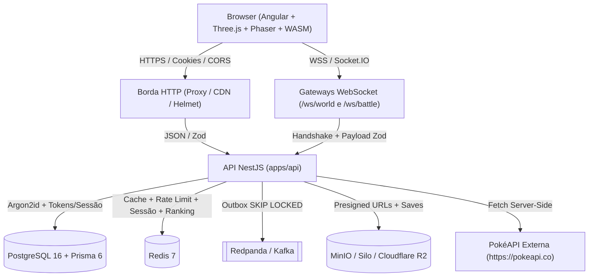
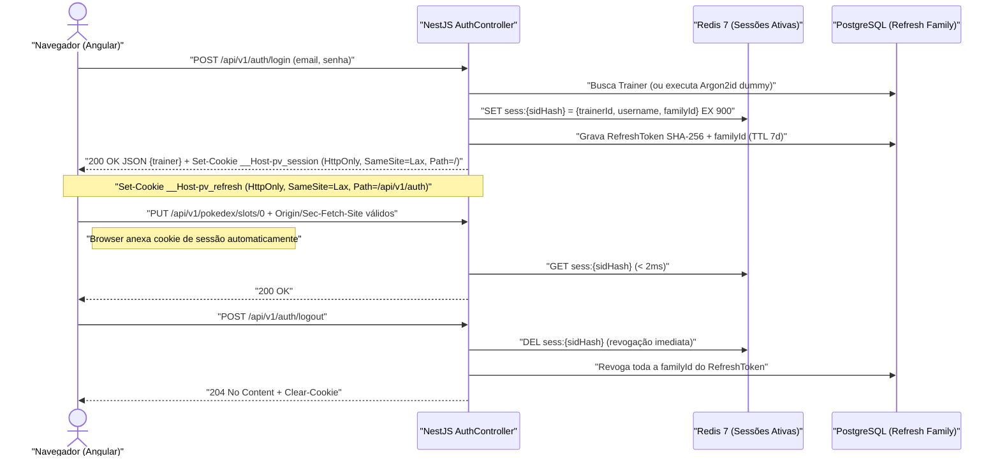
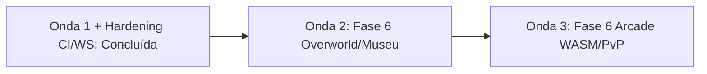

# 13 — Dossiê Completo de Segurança e Blindagem (AppSec, Auth & Infra)

> **Objetivo deste documento:** consolidar todas as práticas, decisões criptográficas, controles de borda, blindagens de banco/cache/mensageria/WebGL e o plano de endurecimento em ondas para tornar o **PokéVerse OS** resistente às classes críticas de ataque (**OWASP Top 10**, **OWASP API Security Top 10**, **ASVS L2+**).
>
> **Regra de ouro:** todo controle abaixo está mapeado diretamente para os arquivos e camadas reais deste monorepo — nada genérico, nenhum código ilustrativo solto sem impacto direto no projeto.

---

## 1. Modelo de Ameaças (STRIDE) do PokéVerse OS

| Vetor / Ativo | Ameaça Principal (STRIDE) | Superfície no Projeto | Impacto se Explorado |
| :--- | :--- | :--- | :--- |
| **Sessão / Identidade** | Roubo de token via XSS, reuso de cookie, *session fixation*, força bruta e *timing enumeration* | `AuthModule`, `JwtAuthGuard`, `AuthStore`, `authInterceptor` | Tomada de conta de treinador, gravação/exclusão indevida de slots e saves |
| **Cookies & Mutações** | **CSRF (*Cross-Site Request Forgery*)** em rotas que confiam no cookie de sessão/refresh | `POST /auth/refresh`, `/auth/logout` e futuros endpoints cookie-based | Renovação/encerramento ou mutação forçada por site terceiro malicioso |
| **Controle de Acesso** | **BOLA / IDOR** (*Broken Object Level Authorization*) e escalonamento entre Visitante e Treinador | `PokedexSlotsService`, futuros `Teams`, `ArcadeSaveState`, `BattleMatch` | Um treinador ler/alterar slots, times ou *cloud saves* de outro usuário |
| **Proxy PokéAPI** | **SSRF**, poluição de cache no Redis, esgotamento de banda/slots por parâmetros gigantes | `PokeApiCacheService` (`GET /pokedex/pokemon/:idOrName`) | Indisponibilidade da Pokédex, explosão de chaves no Redis ou redirecionamento malicioso |
| **WebSockets** | Conexão anônima em ações privadas, *flood* de pacotes de movimento/batalha, fraude de score/dano | `WorldGateway` (`/ws/world`) e futuro `BattleGateway` | Cheating no Overworld/Arena, crash por broadcast em massa |
| **Front-end / 3D / WASM** | **XSS**, injeção de URL (`javascript:`), **Open Redirect** em `returnUrl`, abuso de memória GPU/WASM | `apps/web`, templates Angular, Three.js, Phaser, emulador WASM (Fase 5) | Execução de script no navegador, phishing de redirecionamento, travamento do cliente |
| **Dados, Cache & Kafka** | SQL Injection, vazamento de hash/segredo em erro ou log, *poison pill* no Kafka, *eviction* silenciosa | `PrismaService`, `RedisService`, `OutboxRelayService`, `WorldEventsConsumerService`, `GlobalExceptionFilter` | Perda de integridade, negação de serviço em partições Kafka, vazamento de PII/credenciais |
| **Storage S3/R2 & Docker** | Path traversal em chaves de arquivo, ROM/Save malicioso (zip-bomb), container como `root`, segredos em Git | `docker-compose.yml`, futuros `Dockerfiles`, módulo Arcade (Fase 5) | Exaustão de disco/RAM, download não autorizado, comprometimento de runtime |

---

## 2. Radiografia Atual: Controles Implementados vs. Lacunas Abertas

Baseado na auditoria direta do código atual pós-**Hardening de Segurança, Concorrência & CI/CD** (após Fases 2A/2B/3/4A e Ondas 1–4 de [`ARCHITECTURE.md`](ARCHITECTURE.md)):

| Controle | Estado Atual no Código | Lacuna Aberta / Trade-off Documentado | Severidade Atual |
| :--- | :--- | :--- | :---: |
| **Hashing de senha & timing shield** | `argon2` (`argon2id`) + `DUMMY_ARGON2_HASH` em [credentials-auth.service.ts](../apps/api/src/modules/auth/credentials-auth.service.ts) igualando latência quando o e-mail não existe | Resolvido. | **Resolvido** |
| **Armazenamento de sessão no navegador** | **Sessão Opaca BFF no Redis + cookies `HttpOnly`** em [session.service.ts](../apps/api/src/modules/auth/session.service.ts) e [session-cookies.util.ts](../apps/api/src/modules/auth/session-cookies.util.ts); **zero JWT no JS** e proxy same-origin Cloudflare Pages | Resolvido (`__Host-` ativo quando HTTPS sem `COOKIE_DOMAIN` e `SameSite != none`). | **Resolvido** |
| **Refresh Token, Rotação & Revogação Imediata** | Token opaco (`randomBytes`), hash SHA-256 no Postgres, `familyId`, detecção de reuso, grace window de `10s`, revogação imediata no Redis via `/auth/logout` e expurgo periódico ativo a cada 6h em [session-management.service.ts](../apps/api/src/modules/auth/session-management.service.ts) | Resolvido. | **Resolvido** |
| **Consumo one-time sem TOCTOU (OAuth / Passkey / OTP)** | `GETDEL` atômico (`consumeString` / `consumeJson`) em [redis.service.ts](../apps/api/src/infra/redis.service.ts) usado por [google-oauth.service.ts](../apps/api/src/modules/auth/google-oauth.service.ts) e [passkey.service.ts](../apps/api/src/modules/auth/passkey.service.ts); `DEL` atômico no [otp.service.ts](../apps/api/src/modules/auth/otp.service.ts) + contadores Lua (`INCR` + `EXPIRE`) | Resolvido. | **Resolvido** |
| **OIDC RS256 & WebAuthn FIDO2** | Verificação RS256 estrita por JWKS cacheado (`iss`, `aud`, `nonce`, `exp`, `email_verified`) em [google-oidc.verifier.ts](../apps/api/src/modules/auth/google-oidc.verifier.ts) sem auto-link em conta não verificada; Passkeys + TOTP criptografado | Resolvido. | **Resolvido** |
| **Proteção CSRF** | [CsrfOriginGuard](../apps/api/src/common/guards/csrf-origin.guard.ts) global validando `Sec-Fetch-Site`, `Origin`/`Referer` contra `CORS_ORIGINS`, bloqueio de `Content-Type` de formulário e rejeição de mutação com cookie sem `Origin`/`same-origin` | Resolvido. | **Resolvido** |
| **Rate Limiting Distribuído** | `@nestjs/throttler` conectado ao [RedisThrottlerStorage](../apps/api/src/common/guards/redis-throttler.storage.ts) (script Lua atômico no Redis), limites estritos por rota (`/login`, `/register`, `/refresh`, `/verify-email`, `/resend-verification`, `/forgot-password`, `/reset-password`, `/mfa/totp/*`, `/mfa/verify`, `/passkeys/*`, `DELETE /auth/me`, `GET /auth/me/export`, `/pokedex/slots*`) e trava `(IP, email)` no login | **Trade-off conhecido:** `RedisThrottlerStorage` opera em modo *fail-open* se o Redis ficar inacessível para preservar disponibilidade. | **Baixa** |
| **Cabeçalhos HTTP, CSP & Body Limits** | API com `helmet()` (`defaultSrc: 'none'`, `frameAncestors: 'none'`, `baseUri: 'none'`, `CORP: same-site`), `Permissions-Policy`, `TRUST_PROXY`, `bodyParser: false` + `express.json({ limit: '64kb' })` + `urlencoded({ limit: '16kb' })` e tratamento `413`/`400` em [global-exception.filter.ts](../apps/api/src/common/filters/global-exception.filter.ts); Front com CSP + HSTS em [apps/web/public/_headers](../apps/web/public/_headers) (`connect-src 'self' https://pokeapi.co` sem `ws: wss:` wildcard) e timeout `15s` / `502` seguro em [api-proxy.ts](../apps/web/cloudflare/api-proxy.ts) | `style-src` no front ainda usa `'unsafe-inline'` até adoção futura de `ngCspNonce`; ajustar `wasm-unsafe-eval` e `COOP`/`COEP` apenas na Fase 6 (Arcade WASM). | **Média** |
| **Validação de Entrada & SSRF** | `ZodValidationPipe` `.strict()` em corpo/query/params, `PokemonIdentifierParamSchema` (`{1,64}`), `redirect: 'error'` em `PokeApiCacheService`, `GoogleOAuthHttpClient` e `MailService`, e validação Zod na ida/volta do Redis | Resolvido. | **Resolvido** |
| **WebSockets (`/ws/world`)** | [WorldGateway](../apps/api/src/modules/world/world.gateway.ts) rejeita `!origin` em `NODE_ENV=production`, valida `CORS_ORIGINS` com normalização e aplica cota simultânea (`10` conexões/IP, `1000` globais) com log `WS_CONNECTION_LIMIT_HIT` | Conexão permanece read-only para ticker público na topbar; **`WsAuthGuard` obrigatório**, validação Zod por `@SubscribeMessage` e rate limit por pacote ficam pendentes antes de abrir ações do Overworld/Arena na **Fase 6**. | **Média (Pré-Fase 6)** |
| **Open Redirect no Front** | [auth.guard.ts](../apps/web/src/app/core/guards/auth.guard.ts) restringe `targetRoute` por regex `^\/[a-zA-Z0-9/_-]*$` e o callback Google redireciona apenas para `WEBAUTHN_ORIGIN` | Resolvido. | **Resolvido** |
| **Segredos, Logs & Supply Chain** | [StructuredLoggerService](../apps/api/src/common/telemetry/structured-logger.service.ts) aplica redação recursiva (`authorization`, `cookie`, `password`, `token`, `otp`, `Bearer`, query OAuth) + logs HTTP usam `req.path` sem query string; Docker Compose usa `${VAR:?}`; `ci.yml` executa **Gitleaks**, **Trivy** (`CRITICAL`), **`npm audit --omit=dev --audit-level=critical`** e job **`integration-e2e`** com Postgres/Redis/Kafka reais | Triagem aberta: `npm audit --omit=dev` reporta `4` avisos `high` transitivos em `@prisma/config` (CLI do `prisma@6.19.3` listado sob `@prisma/client`, dependente de `prisma@7` ESM). Em runtime de produção o impacto é mitigado porque o CLI `/opt/prisma` foi removido do [api.Dockerfile](../infra/docker/api.Dockerfile). | **Baixa** |

---

## 3. Camada 1 — Blindagem de Autenticação (Evoluindo além do JWT Padrão)

A crítica mais importante ao fluxo atual é estrutural: **em uma arquitetura onde front-end e back-end convivem sob o mesmo domínio/proxy (`127.0.0.1:4200` -> `/api` e `/socket.io`, ou domínio/subdomínio único em produção), expor um JWT Bearer ao JavaScript do navegador é risco desnecessário**.

### 3.1. Comparativo das Arquiteturas Alvo de Sessão

| Critério | **Opção A: Sessão Opaca no Redis + Cookie `HttpOnly` (BFF Puro — Recomendado)** | **Opção B: JWT Hardened (`EdDSA` + Revogação `jti` no Redis + Cookie/Bearer)** |
| :--- | :--- | :--- |
| **Token acessível via JavaScript (XSS)** | **Zero.** O browser nunca recebe token no JSON nem envia `Authorization: Bearer`. | Em Cookie `HttpOnly`: zero no JS. Em Bearer RAM: ainda exposto a XSS ativo. |
| **Revogação instantânea (logout/ban/troca de senha)** | **Imediata (`< 1ms`).** `DEL session:{id}` no Redis invalida HTTP e novas conexões WS na hora. | Exige consulta adicional de blacklist `jti` ou `sessionVersion` no Redis em toda requisição protegida (perde a vantagem "stateless"). |
| **Superfície criptográfica** | ID opaco de 256 bits (`randomBytes(32)`); nenhum parser JWT, sem risco de `alg=none` ou confusão de chave. | Requer pinagem estrita de algoritmo (`EdDSA`/`ES256`), `iss`, `aud`, rotação de chave `kid`. |
| **Compatibilidade com WebSocket (`/ws/world`, `/ws/battle`)** | Excelente no modelo **same-origin / proxy** (handshake envia o cookie `HttpOnly` automaticamente; servidor valida no Redis). | Funciona tanto por cookie quanto por token no `auth` do handshake, útil se um cliente não-browser externo existir no futuro. |
| **Dependência operacional** | Exige alta disponibilidade do **Redis** para autenticar (que já é crítico para cache, ranking e idempotência no PokéVerse). | Em fallback extremo sem Redis, assinatura pode validar expiração curta, mas sem revogação imediata. |

### 3.2. Arquitetura Alvo Recomendada: BFF com Sessão Opaca no Redis + Refresh Rotacionado

### 3.3. Autenticação Moderna Sem Atrito (Adicional à Sessão)

- **Passkeys (WebAuthn / FIDO2):**
  - Fluxo resistente a *phishing* vinculado à origem (`rpID`) com desafio criptográfico único gravado no Redis (`TTL 120s`).
  - Nova tabela `TrainerPasskey` no Prisma (`credentialId`, `publicKey`, `counter` monotônico anti-clonagem, `transports`, `deviceType`).
- **Login Social via OAuth2 + OIDC PKCE (`S256`):**
  - Provedores de desenvolvedor/gamer: **GitHub**, **Google** e **Discord**;
  - `state` (anti-CSRF) + `nonce` + `code_verifier` armazenados exclusivamente no lado do servidor/Redis ligados a cookie `HttpOnly` temporário;
  - Tabela `TrainerOAuthAccount` vinculando `(provider, providerAccountId)` sem sobrescrever conta existente de mesmo e-mail não verificado (*Account Takeover Prevention*).

### 3.4. Controles Obrigatórios em Qualquer Estratégia de Auth

1. **Equalização de Tempo no Login (Anti-*Timing Enumeration*):**
   - Pré-computar um hash Argon2id fictício (`DUMMY_ARGON2_HASH`) na inicialização do `AuthService`. Se o `email` não existir no banco, executar `await argon2.verify(DUMMY_ARGON2_HASH, input.password)` antes de responder `401 Credenciais inválidas.`, mantendo exatamente a mesma latência (`~40–100ms`).
   - Padronizar mensagens de `/register` quando possível ou aplicar cooldown por IP para impedir coleta de e-mails cadastrados.
2. **Throttling Multidimensional em Banco/Redis no Login:**
   - Limitar por **IP + e-mail normalizado** (ex.: 5 falhas -> backoff exponencial / bloqueio temporário de 5 min no Redis para a dupla `(ip, email)`, impedindo *credential stuffing* distribuído sem causar bloqueio permanente da conta por atacante).
3. **Semântica Máxima de Cookies em Produção (`NODE_ENV=production`):**
   - Prefixos **`__Host-`** quando sobre HTTPS sem atributo `Domain`:
     - Cookie de Sessão: `__Host-pv_session` (`HttpOnly`, `Secure`, `SameSite=Lax`, `Path=/`).
     - Cookie de Refresh: `__Host-pv_refresh` (`HttpOnly`, `Secure`, `SameSite=Lax`, `Path=/api/v1/auth`).
   - Em desenvolvimento HTTP local (`http://127.0.0.1:4200`), manter nomes sem `__Host-` com flag `COOKIE_SECURE=false` somente quando `NODE_ENV=development`.
4. **Expurgo Automático de Sessões:**
   - Cron/worker leve diário removendo `RefreshToken` cujo `expiresAt < NOW() - INTERVAL '7 days'` ou revogados há mais de 30 dias.
5. **Regra de Segredos e Políticas de Senha:**
   - Mínimo de **10 a 12 caracteres**, máximo até **128** (aceitando espaços/passphrases sem regras arbitrárias que enfraquecem senhas), nunca truncando antes do Argon2id.
   - Se mantiver JWT (`EdDSA`/`ES256` ou `HS256`): exigir segredo com entropia alta (`>= 256 bits`) no `.env`, validar `algorithms`, `iss: 'pokeverse-api'` e `aud: 'pokeverse-web'`, e incluir `jti` + verificação de revogação no Redis.

---

## 4. Camada 2 — Segurança Web: Anti-CSRF, XSS, CSP e Redirecionamento Seguro

### 4.1. Defesa em Profundidade Contra CSRF
Como cookies `HttpOnly` são anexados automaticamente pelo navegador, todas as rotas de mutação (`POST`, `PUT`, `PATCH`, `DELETE`) devem passar por um **`CsrfOriginGuard` global**:
1. Exigir `SameSite=Lax` (ou `Strict` onde não quebre retorno de OAuth2) em todos os cookies de sessão e refresh.
2. Verificar os cabeçalhos modernos **Fetch Metadata** enviados pelo navegador:
   - Rejeitar (`403`) requisições com `Sec-Fetch-Site: cross-site` em métodos mutáveis (exceto endpoints estritamente públicos que não lêem cookies, se houver).
3. Validar explicitamente `Origin` (e `Referer` como fallback para clientes sem `Origin`) contra a allowlist `CORS_ORIGINS` em todo `POST`/`PUT`/`PATCH`/`DELETE` autenticado por cookie (exigindo presença de `Origin` ou `Sec-Fetch-Site: same-origin` em navegadores).
4. Bloquear `Content-Type: text/plain` ou `application/x-www-form-urlencoded` nas rotas JSON da API REST para que formulários HTML simples cross-origin não consigam disparar requisições sem *preflight* CORS.

### 4.2. Content Security Policy (CSP) e Hardening HTTP
O `helmet()` atual precisa de configuração explícita por ambiente para proteger o **Angular + Three.js + Phaser + WebAssembly** sem enfraquecer diretivas:

| Diretiva / Header | Valor Recomendado em Produção | Justificativa Técnica no PokéVerse |
| :--- | :--- | :--- |
| `default-src` | `'self'` | Bloqueia qualquer origem externa não autorizada por padrão |
| `script-src` | `'self'` (ou `'wasm-unsafe-eval'` **somente na rota `/arcade`** via proxy/header ou quando WASM exigir) | Zero `'unsafe-inline'` e zero `'unsafe-eval'` JS; `ngCspNonce` no Angular caso estilos/scripts precisem de nonce |
| `style-src` | `'self' 'unsafe-inline'` (ou preferencialmente **nonces via `ngCspNonce`** + hashes) | Eliminar `'unsafe-inline'` completamente usando nonce dinâmico do Angular (`CSP_NONCE`) |
| `img-src` | `'self' https://raw.githubusercontent.com data: blob:` | Sprites oficiais da PokéAPI, texturas locais WebP e snapshots `CanvasTexture`/Blob do WebGL/Arcade |
| `media-src` | `'self' https://raw.githubusercontent.com blob:` | *Cries* de Pokémon e trilhas locais via Web Audio |
| `connect-src` | `'self' wss://<seu-dominio>` (em dev: `ws://127.0.0.1:4200 wss://127.0.0.1:4200`) + bucket R2 para *presigned URL* no Arcade | Todo tráfego da PokéAPI passa idealmente pelo proxy `/api/v1/pokedex/*` (Redis) — reduz superfície de dados do cliente |
| `worker-src` | `'self' blob:` | Web Workers do emulador WASM (Fase 5) e decodificação em background |
| `frame-ancestors` | `'none'` | Previne **Clickjacking** |
| `object-src` | `'none'` | Bloqueia plugins legados (Flash/PDF embutido) |
| `base-uri` | `'self'` | Impede ataques de hijacking de `<base href>` |
| `form-action` | `'self'` | Impede sequestro de destino de `<form>` |
| `Cross-Origin-Opener-Policy` / `COEP` | `same-origin` / `credentialless` *(quando Arcade WASM usar `SharedArrayBuffer`)* | Habilita threads WASM com isolamento de processo (*Spectre mitigation*) |
| `Permissions-Policy` | `camera=(), microphone=(), geolocation=(), payment=()` | Desativa APIs de hardware sensíveis não utilizadas pela aplicação |
| `Strict-Transport-Security` | `max-age=31536000; includeSubDomains` *(apenas HTTPS)* | Obriga TLS contínuo em produção |

### 4.3. Segurança no Front-end Angular (`apps/web`)
- **Zero bypass de sanitização:** proibido `bypassSecurityTrustHtml`, `bypassSecurityTrustScript` e `[innerHTML]` com entrada da PokéAPI, apelidos de Pokémon ou nomes de treinadores.
- **Validação estrita de URLs de mídia e links:** todo `spriteUrl`, `cryUrl` ou link vindo da API passa por Zod (`z.url()`) e por verificação explícita `protocol === 'https:'` (bloqueando `javascript:` e `data:text/html`).
- **Prevenção de Open Redirect:** ao implementar retorno automático para `targetRoute` / `returnUrl` após login em [auth.guard.ts](../apps/web/src/app/core/guards/auth.guard.ts), aceitar exclusivamente caminhos relativos internos da allowlist (`/mundo`, `/pokedex`, `/museu`, `/arcade`, `/arena`, `/holocron/...`), rejeitando `//evil.com`, `https://...` ou `\`.
- **Zero exposição de segredos em bundle ou Storage:** `localStorage` e `sessionStorage` só podem guardar preferências não sensíveis (`pv_quality_pref`, volume de áudio) — **nunca tokens, emails ou IDs privados manipuláveis para bypass de autorização**.

---

## 5. Camada 3 — Blindagem da API NestJS (`apps/api`)

1. **BOLA / IDOR Zero (Regra Inviolável em Todos os Serviços):**
   - Toda consulta/mutação em recursos de usuário (`PokedexSlot`, futuro `PokemonTeam`, `ArcadeSaveState`, `BattleMatch`) recebe `trainer.trainerId` extraído exclusivamente da sessão/token validado no servidor e inclui `trainerId` diretamente na cláusula `where` da query Prisma (`where: { trainerId_slotIndex: { trainerId, slotIndex } }`).
   - Nunca aceitar `trainerId` no corpo JSON (`SavePokedexSlotSchema.strict()` já bloqueia campos extras).
2. **Hardening da Integração Externa (`PokeApiCacheService` — SSRF & Cache Poisoning):**
   - Limitar comprimento do parâmetro `:idOrName` para **`1..64` caracteres** (`SAFE_POKEMON_PARAM = /^[a-z0-9-]{1,64}$/`) para barrar abuso de chaves gigantes no Redis e *log flooding*.
   - Passar `redirect: 'error'` em todas as chamadas `fetch()` para a PokéAPI, travando qualquer possibilidade de redirecionamento aberto para rede interna (*SSRF*).
   - Continuar validando tanto a resposta da PokéAPI quanto o JSON lido do Redis com `PokemonDetailSchema.safeParse(...)` antes de devolver ao cliente.
3. **Rate Limiting Distribuído com Redis & Quotas de Payload:**
   - Conectar `@nestjs/throttler` ao **Redis** (`RedisService`) para que múltiplas réplicas compartilhem contadores de limite.
   - Definir limites por rota:
     - `/api/v1/auth/login` e `/register`: `5–10 req/min` por IP + janela progressiva por e-mail;
     - `/api/v1/auth/refresh`: `20 req/min`;
     - `/api/v1/pokedex/slots` (escritas): `30 req/min`;
     - Global fallback: `120 req/min`.
   - Configurar limites explícitos de corpo no Express (`json({ limit: '64kb' })`, `urlencoded({ limit: '16kb', extended: false })`) em [app.setup.ts](../apps/api/src/app.setup.ts), desabilitar `x-powered-by` e configurar `trust proxy` numérico exato (`1`) apenas quando atrás de proxy reverso confiável (Nginx/Cloudflare) para evitar falsificação de `X-Forwarded-For`.
4. **Sanitização de Erros & Prevenção de Vazamentos:**
   - [global-exception.filter.ts](../apps/api/src/common/filters/global-exception.filter.ts) nunca devolve `stack`, código Prisma (`P2002`, SQL) ou chaves de ambiente; apenas `{ code, message, correlationId }`.
   - Adicionar higienização em logs de requisições/exceções para mascarar automaticamente cabeçalhos `authorization`, `cookie`, `set-cookie` e chaves `password`/`token`/`secret`.

---

## 6. Camada 4 — WebSockets Seguros (`/ws/world` e futuro `/ws/battle`)

| Controle WebSocket | Estado Atual (Implementado) | Como Deve Evoluir Antes da Fase 6 (Overworld / Arena) |
| :--- | :--- | :--- |
| **Autenticação no Handshake** | `WorldGateway` entrega apenas ticker público read-only sem mutações do cliente | Criar **`WsAuthGuard`** lendo o cookie `HttpOnly` de sessão no handshake (`client.handshake.headers.cookie` validado no Redis), exigindo sessão autenticada para `world:join` / `world:move` / `match:*` |
| **Validação de Origem (`CORS` WS)** | `isAllowedWebSocketOrigin` **rejeita `Origin` ausente quando `NODE_ENV=production`** e valida `CORS_ORIGINS` normalizada | Mantido estrito por allowlist em todos os namespaces |
| **Cota de Conexões por IP** | Limite ativo em `WorldGateway`: máx. `10` sockets simultâneos por IP e `1000` globais (`WS_CONNECTION_LIMIT_HIT` + `disconnect(true)`) | Migrar contador de presença/conexão para Redis se escalar para múltiplas réplicas com sticky sessions ou Redis adapter |
| **Validação Zod & Flood por Evento** | Sem `@SubscribeMessage` de entrada nesta fase | **Todo** `@SubscribeMessage(...)` validado com `ZodValidationPipe` / `.safeParse` + sliding window por pacote (`<= 20` movimentos/s) |
| **Autoridade 100% no Servidor** | Ainda não aplicável (Fase 6) | Cliente envia apenas **direção/intenção** (`{ dx, dy }` ou `{ moveIndex }`); servidor calcula colisão, HP, turnos e RNG |

---

## 7. Camada 5 — Infraestrutura de Dados: PostgreSQL, Redis, Kafka/Redpanda e S3/MinIO

### 7.1. PostgreSQL + Prisma ORM
- **Separação de migrations vs. runtime stateless:** [api.Dockerfile](../infra/docker/api.Dockerfile) **não executa** `prisma migrate deploy` no startup nem carrega o CLI `/opt/prisma` em runtime; as migrations rodam em **etapa única pré-deploy** no [.github/workflows/deploy.yml](../.github/workflows/deploy.yml) via `DATABASE_URL_UNPOOLED`, eliminando competição entre réplicas simultâneas e permitindo uso de role restrita (`DML` sem `DDL`) para a aplicação em nuvem.
- **SSL obrigatório em nuvem:** `DATABASE_URL` no Neon/Supabase sempre com `?sslmode=verify-full` (ou padrão TLS estrito gerenciado).
- **SQL bruto seguro:** única query raw atual está em [outbox-event.repository.ts](../apps/api/src/modules/events/outbox-event.repository.ts) usando tagged template parametrizado (`tx.$queryRaw\`...\``). Fica **proibido** `$queryRawUnsafe` ou `$executeRawUnsafe`.
- **Higiene periódica (`OutboxEvent` & `RefreshToken`):** [SessionManagementService](../apps/api/src/modules/auth/session-management.service.ts) executa expurgo periódico a cada `6h` (janela de retenção de `7` dias) removendo `RefreshToken` expirados/revogados e `OutboxEvent` já publicados.

### 7.2. Redis 7 (Segregação de Domínios e Política de Eviction)
- **Alerta crítico de arquitetura Redis:**
  - Dados **voláteis recomputáveis** (cache da PokéAPI `pokeapi:v2:*`) toleram `eviction` (`allkeys-lru`), mas **Sessões opacas (`sess:*`), Idempotência Kafka (`idemp:*`), Rate Limiting (`rl:*`) e Sessões Anti-Cheat de Mini-Games (`minigame:session:*`) NÃO podem sofrer despejo aleatório** se o cache crescer.
  - **Solução prática:** usar `noeviction` no Redis principal controlando limite máximo do cache da PokéAPI (apenas ~1.350 Pokémon + catálogo cabem em `< 40 MB`), **ou** separar instâncias/databases lógicos distintos no ambiente gerenciado.
- **Produção Upstash / Redis gerenciado:** exigir TLS (`rediss://`), senha forte e ACL impedindo comandos administrativos perigosos (`FLUSHALL`, `FLUSHDB`, `CONFIG`, `EVAL` se desnecessário) para o usuário da API.

### 7.3. Redpanda / Kafka
- **Autenticação & Criptografia em produção:** SASL (`SCRAM-SHA-256` / `SCRAM-SHA-512`) + TLS habilitados (padrão suportado pela Aiven Free).
- **Validação na entrada e saída (*Defense in Depth*):** produtor valida evento via `WorldTickerEventSchema.parse` dentro da transação; consumidor valida novamente com `.safeParse(...)` e encaminha mensagens corrompidas (*poison pills*) para `pokeverse.dlq.v1` sem travar a partição nem aplicar efeitos duplicados (`SET idemp:... NX EX 86400`).
- **Teto de DLQ & Privacidade:** nunca gravar `password`, `email` sensível ou `cookie` em `payload` de `OutboxEvent`, já que eventos em `pokeverse.world.events.v1` são transmitidos globalmente no Ticker e auditáveis no Redpanda Console.

### 7.4. Object Storage (MinIO / Silo / Cloudflare R2 — Fase 5 Arcade)
- **Buckets privados por padrão:** `mc anonymous set none` já aplicado em `infra/docker/docker-compose.yml` para `pokeverse-roms` e `pokeverse-saves`.
- **Zero Path Traversal em chaves S3:** chaves sempre derivadas no back-end (`saves/${trainerId}/${romId}/slot-${slot}.sav`), jamais montadas por input textual do usuário.
- **Upload/Download seguro de Cloud Save States:**
  - Emissão de **Presigned URL com expiração de `60s`** e `ContentLengthRange` fixo;
  - Validação do checksum **SHA-256**, magic bytes esperados do emulador e teto rígido de tamanho (ex.: `<= 8 MB` por save state) no back-end/worker antes de marcar o save como válido.

---

## 8. Camada 6 — Containers Docker, Supply Chain & CI/CD DevSecOps

1. **Hardening do Container da API ([api.Dockerfile](../infra/docker/api.Dockerfile)):**
   - Multi-stage (`node:22-slim`), copiando apenas `dist/`, `node_modules` de produção com `.prisma/client` gerado (sem CLI `/opt/prisma` e sem pasta `prisma/` de migrations);
   - Execução sem privilégios (`USER node`), `HEALTHCHECK` apontando para `/health/live` e `CMD ["node", "apps/api/dist/main.js"]`;
   - Para ambientes orquestrados adicionais: aplicar `read_only: true`, `cap_drop: [ALL]`, `security_opt: [no-new-privileges:true]` e tetos de memória/CPU.
2. **Pipeline de Segurança & Integração Real ([ci.yml](../.github/workflows/ci.yml)):**
   - **Secret Scanning:** `gitleaks` em container (`--no-git --redact`) executado antes de `npm ci` (apoiado por [`.gitleaks.toml`](../.gitleaks.toml)) em todo push/PR;
   - **Dependências (SCA):** `npm ci` + `npm audit --omit=dev --audit-level=critical` bloqueante (com triagem documentada dos `4` avisos `high` CLI-only em `@prisma/config` da linha `prisma@6.19.3`, ausentes da imagem final de runtime);
   - **Varredura de Imagem (Trivy):** `aquasecurity/trivy-action` pinado por commit SHA imutável (`v0.36.0`) falhando o pipeline em vulnerabilidades `CRITICAL` na imagem `pokeverse-api:ci`;
   - **Backing Services Reais no CI:** job dedicado `integration-e2e` provisionando `postgres:16-alpine`, `redis:7-alpine` e `apache/kafka:3.9.2` reais, aplicando `prisma migrate deploy` e executando [app.integration-spec.ts](../apps/api/test/app.integration-spec.ts), separado da suíte HTTP edge ([app.e2e-spec.ts](../apps/api/test/app.e2e-spec.ts)).
3. **Observabilidade de Segurança (Alertas Acionáveis):**
   - Eventos estruturados com `errorCode` explícito em [StructuredLoggerService](../apps/api/src/common/telemetry/structured-logger.service.ts) (com redação automática de segredos/tokens/PII):
     - `REFRESH_REUSE_DETECTED`
     - `LOGIN_RATE_LIMIT_HIT`
     - `CSRF_ORIGIN_BLOCKED`
     - `WS_CONNECTION_LIMIT_HIT`
     - `POKEAPI_CIRCUIT_OPEN`
     - `REDIS_THROTTLE_DEGRADED`
     - `PURGE_EXPIRED_WARN`

---

## 9. Plano de Execução em Ondas (Roadmap de Blindagem)

| Onda | Momento de Execução | Entregas Concretas de Segurança | Status |
| :--- | :--- | :--- | :---: |
| **Onda 1 — Blindagem Imediata de Auth, HTTP, WS & CI/CD** | **Entregue (Fases 2A–4A + Hardening Atual)** | Sessão opaca no Redis + `__Host-`/`__Secure-`, `CsrfOriginGuard`, dummy Argon2id, `RedisThrottlerStorage` + throttling por rota, `GETDEL` atômico (OAuth/Passkeys) + `DEL` atômico (OTP), `bodyParser: false` + `64kb` + `413`/`400` no `GlobalExceptionFilter`, CSP + HSTS sem `ws: wss:` no `_headers`, `WorldGateway` com `!origin` bloqueado em prod e cota/IP, redator de logs + `req.path`, expurgo agendado 6h, `api.Dockerfile` sem migrations/CLI no runtime, `deploy.yml` com step pré-deploy único e `ci.yml` com `integration-e2e` (Postgres/Redis/Kafka) + Gitleaks/Trivy/`npm audit` | **Concluída** |
| **Onda 2 — Segurança WebSocket Mutável & Gráficos** | **Pré-Fase 6 (Overworld / Museu)** | 1) `WsAuthGuard` obrigatório para `world:join`/`world:move` + Zod por evento + rate limit por pacote; 2) Migrar `style-src` para `ngCspNonce` removendo `'unsafe-inline'`; 3) Segregação estrita de TTL/`noeviction` no Redis para sessões/presença vs. cache PokéAPI. | **Pendente (Fase 6)** |
| **Onda 3 — Arcade WASM & Arena PvP** | **Junto à Fase 6 (Arcade / Arena)** | 1) Validação SHA-256, magic bytes e teto de bytes para *Cloud Save States* no R2 + Presigned URLs `60s` + headers `COOP`/`COEP` e `'wasm-unsafe-eval'` restritos à rota `/arcade`; 2) Engine PvE/PvP 100% autoritativa no servidor + anti-cheat temporizado para Mini-Games; 3) OpenTelemetry OTLP exporter + role Postgres sem DDL em produção. | **Pendente (Fase 6)** |

---

### Checklist Rápido Antes de Cada Commit

- [ ] Nenhuma rota privada sem autenticação nem query sem filtro `trainerId` da sessão no servidor;
- [ ] Todo payload externo (HTTP body, params, query, WebSocket, Kafka, resposta da PokéAPI e JSON do Redis) validado por Zod `.safeParse` / `.parse`;
- [ ] Nenhum segredo, token JWT, `passwordHash`, `tokenHash` ou cookie em código, logs JSON ou `localStorage`;
- [ ] Cabeçalhos `CSP`, `CORS`, `Origin`/`Sec-Fetch-Site` e cookies `HttpOnly` validados por testes automatizados E2E;
- [ ] `lint`, `typecheck`, testes unitários, E2E e `build` aprovados sem avisos de orçamento ou segurança.
