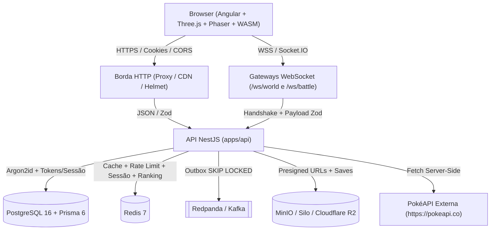
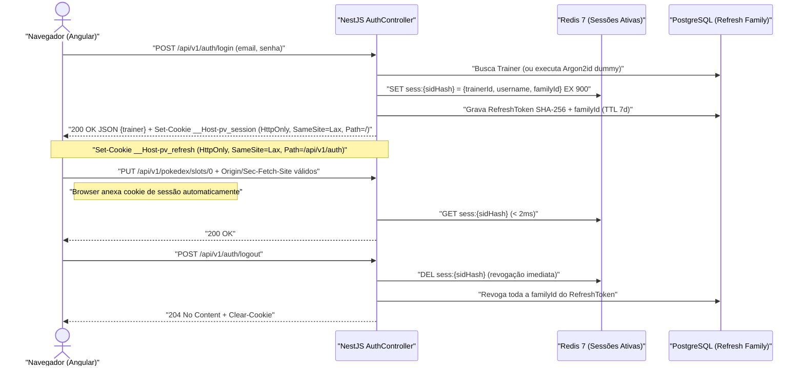
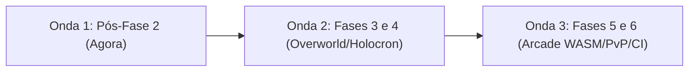

# 13 — Dossiê Completo de Segurança e Blindagem (AppSec, Auth & Infra)

> **Objetivo deste documento:** consolidar todas as práticas, decisões criptográficas, controles de borda, blindagens de banco/cache/mensageria/WebGL e o plano de endurecimento em ondas para tornar o **PokéVerse OS** resistente às classes críticas de ataque (**OWASP Top 10**, **OWASP API Security Top 10**, **ASVS L2+**).
>
> **Regra de ouro:** todo controle abaixo está mapeado diretamente para os arquivos e camadas reais deste monorepo — nada genérico, nenhum código ilustrativo solto sem impacto direto no projeto.

---

## 1. Modelo de Ameaças (STRIDE) do PokéVerse OS

| Vetor / Ativo | Ameaça Principal (STRIDE) | Superfície no Projeto | Impacto se Explorado |
| :--- | :--- | :--- | :--- |
| **Sessão / Identidade** | Roubo de token via XSS, reuso de cookie, *session fixation*, força bruta e *timing enumeration* | `AuthModule`, `JwtAuthGuard`, `AuthStore`, `authInterceptor` | Tomada de conta de treinador, gravação/exclusão indevida de slots e saves |
| **Cookies & Mutações** | **CSRF (*Cross-Site Request Forgery*)** em rotas que confiam no cookie de sessão/refresh | `POST /auth/refresh`, `/auth/logout` e futuros endpoints cookie-based | Renovação/encerramento ou mutação forçada por site terceiro malicioso |
| **Controle de Acesso** | **BOLA / IDOR** (*Broken Object Level Authorization*) e escalonamento entre Visitante e Treinador | `PokedexSlotsService`, futuros `Teams`, `ArcadeSaveState`, `BattleMatch` | Um treinador ler/alterar slots, times ou *cloud saves* de outro usuário |
| **Proxy PokéAPI** | **SSRF**, poluição de cache no Redis, esgotamento de banda/slots por parâmetros gigantes | `PokeApiCacheService` (`GET /pokedex/pokemon/:idOrName`) | Indisponibilidade da Pokédex, explosão de chaves no Redis ou redirecionamento malicioso |
| **WebSockets** | Conexão anônima em ações privadas, *flood* de pacotes de movimento/batalha, fraude de score/dano | `WorldGateway` (`/ws/world`) e futuro `BattleGateway` | Cheating no Overworld/Arena, crash por broadcast em massa |
| **Front-end / 3D / WASM** | **XSS**, injeção de URL (`javascript:`), **Open Redirect** em `returnUrl`, abuso de memória GPU/WASM | `apps/web`, templates Angular, Three.js, Phaser, emulador WASM (Fase 5) | Execução de script no navegador, phishing de redirecionamento, travamento do cliente |
| **Dados, Cache & Kafka** | SQL Injection, vazamento de hash/segredo em erro ou log, *poison pill* no Kafka, *eviction* silenciosa | `PrismaService`, `RedisService`, `OutboxRelayService`, `WorldEventsConsumerService`, `GlobalExceptionFilter` | Perda de integridade, negação de serviço em partições Kafka, vazamento de PII/credenciais |
| **Storage S3/R2 & Docker** | Path traversal em chaves de arquivo, ROM/Save malicioso (zip-bomb), container como `root`, segredos em Git | `docker-compose.yml`, futuros `Dockerfiles`, módulo Arcade (Fase 5) | Exaustão de disco/RAM, download não autorizado, comprometimento de runtime |

---

## 2. Radiografia Atual: O que Já Está Implementado vs. Lacunas Abertas

Baseado na auditoria direta do código atual pós-**Fase 2**:

| Controle | Estado Atual no Código | Lacuna Identificada | Severidade da Lacuna |
| :--- | :--- | :--- | :---: |
| **Hashing de senha** | `argon2` (`argon2id`) em [auth.service.ts](../apps/api/src/modules/auth/auth.service.ts) | `login()` retorna cedo quando o e-mail não existe sem executar verificação dummy em tempo equivalente | **Média** |
| **Armazenamento de Token no Front** | Access token JWT (`900s`) apenas em Signal/RAM em [auth.store.ts](../apps/web/src/app/core/stores/auth.store.ts) (nunca em `localStorage`) | Token ainda trafega em JSON e fica legível por JS/extensões no runtime do browser | **Alta** |
| **Refresh Token & Rotação** | Token opaco (`randomBytes(48)`), hash SHA-256 no Postgres, cookie `HttpOnly` + `SameSite=Lax` + revogação por `familyId` em reuso | Cookie ainda sem prefixo `__Host-` em produção; sem job periódico de expurgo de tokens antigos | **Média** |
| **Revogação Imediata / Logout** | `/auth/logout` revoga a família de refresh tokens no PostgreSQL | **Access JWT já emitido continua aceito pelo `JwtAuthGuard` até expirar (`900s`)** por falta de check `jti`/versão no Redis (ou troca para sessão opaca) | **Alta** |
| **Criptografia & Claims JWT** | `JwtService.signAsync` / `verifyAsync` com segredo simétrico `HS256` em `.env` | Sem pinagem explícita de `algorithms`, `issuer`, `audience` nem migração para assimétrico (`EdDSA`/`ES256`) ou Sessão Opaca | **Média** |
| **Proteção CSRF** | Cookie usa `SameSite=Lax` | Sem validação explícita de `Origin` / `Referer` / `Sec-Fetch-Site` nas rotas mutáveis com cookie | **Alta** |
| **Rate Limiting** | `@nestjs/throttler` global (`120/min`) e estrito em `/register`, `/login` (`10/min`) e `/refresh` (`20/min`) | Armazenamento atual está em **memória** do processo (não distribuído no Redis) e não limita por e-mail/conta no login | **Alta** |
| **Cabeçalhos HTTP (CSP/Helmet)** | `helmet()` e `app.enableCors({ origin: allowedOrigins, credentials: true })` em [app.setup.ts](../apps/api/src/app.setup.ts) | CSP padrão do Helmet não foi calibrada para Three.js/Phaser/WASM/`raw.githubusercontent.com` nem bloqueia `frame-ancestors` / `object-src` de forma explícita e documentada; falta `express.json({ limit })` restrito e política de `trust proxy` | **Alta** |
| **Validação de Entrada & Erros** | `ZodValidationPipe` com `.strict()`, `$transaction`, projeções `select` explícitas (sem `passwordHash`) e `GlobalExceptionFilter` | `PokeApiCacheService` aceita `:idOrName` com regex `/^[a-z0-9-]+$/` **sem limite máximo de comprimento** e `fetch` sem `redirect: 'error'` | **Média** |
| **WebSockets (`/ws/world`)** | Check de `Origin` no `WorldGateway` | Handshake aberto para anônimos (aceitável só para ticker público somente leitura); se `!origin` chega vazio, callback permite `true`; ainda falta `WsAuthGuard` obrigatório e rate limit antes da **Fase 3** | **Alta (Pré-Fase 3)** |
| **Open Redirect no Front** | `authGuard` repassa `state.url` no prompt de login | Ao implementar redirecionamento automático pós-login (`returnUrl`), validar que o destino é rota interna relativa (`^\/[^/\\]`) | **Média** |
| **Segredos & Logs** | `.env` fora do Git, `validateApiEnv` não ecoa segredos, `StructuredLoggerService` não loga payloads de senha | Faltam redatores explícitos (*scrubbers*) caso futuros middlewares/interceptors passem objetos `headers`/`body` ao logger; falta `gitleaks` / `npm audit` bloqueantes no CI | **Média** |

---

## 3. Camada 1 — Blindagem de Autenticação (Evoluindo além do JWT Padrão)

A crítica mais importante ao fluxo atual é estrutural: **em uma arquitetura onde front-end e back-end convivem sob o mesmo domínio/proxy (`127.0.0.1:4200` -> `/api` e `/socket.io`, ou domínio/subdomínio único em produção), expor um JWT Bearer ao JavaScript do navegador é risco desnecessário**.

### 3.1. Comparativo das Arquiteturas Alvo de Sessão

| Critério | **Opção A: Sessão Opaca no Redis + Cookie `HttpOnly` (BFF Puro — Recomendado)** | **Opção B: JWT Hardened (`EdDSA` + Revogação `jti` no Redis + Cookie/Bearer)** |
| :--- | :--- | :--- |
| **Token acessível via JavaScript (XSS)** | **Zero.** O browser nunca recebe token no JSON nem envia `Authorization: Bearer`. | Em Cookie `HttpOnly`: zero no JS. Em Bearer RAM: ainda exposto a XSS ativo. |
| **Revogação instantânea (logout/ban/troca de senha)** | **Imediata (`< 1ms`).** `DEL session:{id}` no Redis invalida HTTP e novas conexões WS na hora. | Exige consulta adicional de blacklist `jti` ou `sessionVersion` no Redis em toda requisição protegida (perde a vantagem "stateless"). |
| **Superfície criptográfica** | ID opaco de 256 bits (`randomBytes(32)`); nenhum parser JWT, sem risco de `alg=none` ou confusão de chave. | Requer pinagem estrita de algoritmo (`EdDSA`/`ES256`), `iss`, `aud`, rotação de chave `kid`. |
| **Compatibilidade com WebSocket (`/ws/world`, `/ws/battle`)** | Excelente no modelo **same-origin / proxy** (handshake envia o cookie `HttpOnly` automaticamente; servidor valida no Redis). | Funciona tanto por cookie quanto por token no `auth` do handshake, útil se um cliente não-browser externo existir no futuro. |
| **Dependência operacional** | Exige alta disponibilidade do **Redis** para autenticar (que já é crítico para cache, ranking e idempotência no PokéVerse). | Em fallback extremo sem Redis, assinatura pode validar expiração curta, mas sem revogação imediata. |

### 3.2. Arquitetura Alvo Recomendada: BFF com Sessão Opaca no Redis + Refresh Rotacionado

### 3.3. Autenticação Moderna Sem Atrito (Adicional à Sessão)

- **Passkeys (WebAuthn / FIDO2):**
  - Fluxo resistente a *phishing* vinculado à origem (`rpID`) com desafio criptográfico único gravado no Redis (`TTL 120s`).
  - Nova tabela `TrainerPasskey` no Prisma (`credentialId`, `publicKey`, `counter` monotônico anti-clonagem, `transports`, `deviceType`).
- **Login Social via OAuth2 + OIDC PKCE (`S256`):**
  - Provedores de desenvolvedor/gamer: **GitHub**, **Google** e **Discord**;
  - `state` (anti-CSRF) + `nonce` + `code_verifier` armazenados exclusivamente no lado do servidor/Redis ligados a cookie `HttpOnly` temporário;
  - Tabela `TrainerOAuthAccount` vinculando `(provider, providerAccountId)` sem sobrescrever conta existente de mesmo e-mail não verificado (*Account Takeover Prevention*).

### 3.4. Controles Obrigatórios em Qualquer Estratégia de Auth

1. **Equalização de Tempo no Login (Anti-*Timing Enumeration*):**
   - Pré-computar um hash Argon2id fictício (`DUMMY_ARGON2_HASH`) na inicialização do `AuthService`. Se o `email` não existir no banco, executar `await argon2.verify(DUMMY_ARGON2_HASH, input.password)` antes de responder `401 Credenciais inválidas.`, mantendo exatamente a mesma latência (`~40–100ms`).
   - Padronizar mensagens de `/register` quando possível ou aplicar cooldown por IP para impedir coleta de e-mails cadastrados.
2. **Throttling Multidimensional em Banco/Redis no Login:**
   - Limitar por **IP + e-mail normalizado** (ex.: 5 falhas -> backoff exponencial / bloqueio temporário de 5 min no Redis para a dupla `(ip, email)`, impedindo *credential stuffing* distribuído sem causar bloqueio permanente da conta por atacante).
3. **Semântica Máxima de Cookies em Produção (`NODE_ENV=production`):**
   - Prefixos **`__Host-`** quando sobre HTTPS sem atributo `Domain`:
     - Cookie de Sessão: `__Host-pv_session` (`HttpOnly`, `Secure`, `SameSite=Lax`, `Path=/`).
     - Cookie de Refresh: `__Host-pv_refresh` (`HttpOnly`, `Secure`, `SameSite=Lax`, `Path=/api/v1/auth`).
   - Em desenvolvimento HTTP local (`http://127.0.0.1:4200`), manter nomes sem `__Host-` com flag `COOKIE_SECURE=false` somente quando `NODE_ENV=development`.
4. **Expurgo Automático de Sessões:**
   - Cron/worker leve diário removendo `RefreshToken` cujo `expiresAt < NOW() - INTERVAL '7 days'` ou revogados há mais de 30 dias.
5. **Regra de Segredos e Políticas de Senha:**
   - Mínimo de **10 a 12 caracteres**, máximo até **128** (aceitando espaços/passphrases sem regras arbitrárias que enfraquecem senhas), nunca truncando antes do Argon2id.
   - Se mantiver JWT (`EdDSA`/`ES256` ou `HS256`): exigir segredo com entropia alta (`>= 256 bits`) no `.env`, validar `algorithms`, `iss: 'pokeverse-api'` e `aud: 'pokeverse-web'`, e incluir `jti` + verificação de revogação no Redis.

---

## 4. Camada 2 — Segurança Web: Anti-CSRF, XSS, CSP e Redirecionamento Seguro

### 4.1. Defesa em Profundidade Contra CSRF
Como cookies `HttpOnly` são anexados automaticamente pelo navegador, todas as rotas de mutação (`POST`, `PUT`, `PATCH`, `DELETE`) devem passar por um **`CsrfOriginGuard` global**:
1. Exigir `SameSite=Lax` (ou `Strict` onde não quebre retorno de OAuth2) em todos os cookies de sessão e refresh.
2. Verificar os cabeçalhos modernos **Fetch Metadata** enviados pelo navegador:
   - Rejeitar (`403`) requisições com `Sec-Fetch-Site: cross-site` em métodos mutáveis (exceto endpoints estritamente públicos que não lêem cookies, se houver).
3. Validar explicitamente `Origin` (e `Referer` como fallback para clientes sem `Origin`) contra a allowlist `CORS_ORIGINS` em todo `POST`/`PUT`/`PATCH`/`DELETE` autenticado por cookie (exigindo presença de `Origin` ou `Sec-Fetch-Site: same-origin` em navegadores).
4. Bloquear `Content-Type: text/plain` ou `application/x-www-form-urlencoded` nas rotas JSON da API REST para que formulários HTML simples cross-origin não consigam disparar requisições sem *preflight* CORS.

### 4.2. Content Security Policy (CSP) e Hardening HTTP
O `helmet()` atual precisa de configuração explícita por ambiente para proteger o **Angular + Three.js + Phaser + WebAssembly** sem enfraquecer diretivas:

| Diretiva / Header | Valor Recomendado em Produção | Justificativa Técnica no PokéVerse |
| :--- | :--- | :--- |
| `default-src` | `'self'` | Bloqueia qualquer origem externa não autorizada por padrão |
| `script-src` | `'self'` (ou `'wasm-unsafe-eval'` **somente na rota `/arcade`** via proxy/header ou quando WASM exigir) | Zero `'unsafe-inline'` e zero `'unsafe-eval'` JS; `ngCspNonce` no Angular caso estilos/scripts precisem de nonce |
| `style-src` | `'self' 'unsafe-inline'` (ou preferencialmente **nonces via `ngCspNonce`** + hashes) | Eliminar `'unsafe-inline'` completamente usando nonce dinâmico do Angular (`CSP_NONCE`) |
| `img-src` | `'self' https://raw.githubusercontent.com data: blob:` | Sprites oficiais da PokéAPI, texturas locais WebP e snapshots `CanvasTexture`/Blob do WebGL/Arcade |
| `media-src` | `'self' https://raw.githubusercontent.com blob:` | *Cries* de Pokémon e trilhas locais via Web Audio |
| `connect-src` | `'self' wss://<seu-dominio>` (em dev: `ws://127.0.0.1:4200 wss://127.0.0.1:4200`) + bucket R2 para *presigned URL* no Arcade | Todo tráfego da PokéAPI passa idealmente pelo proxy `/api/v1/pokedex/*` (Redis) — reduz superfície de dados do cliente |
| `worker-src` | `'self' blob:` | Web Workers do emulador WASM (Fase 5) e decodificação em background |
| `frame-ancestors` | `'none'` | Previne **Clickjacking** |
| `object-src` | `'none'` | Bloqueia plugins legados (Flash/PDF embutido) |
| `base-uri` | `'self'` | Impede ataques de hijacking de `<base href>` |
| `form-action` | `'self'` | Impede sequestro de destino de `<form>` |
| `Cross-Origin-Opener-Policy` / `COEP` | `same-origin` / `credentialless` *(quando Arcade WASM usar `SharedArrayBuffer`)* | Habilita threads WASM com isolamento de processo (*Spectre mitigation*) |
| `Permissions-Policy` | `camera=(), microphone=(), geolocation=(), payment=()` | Desativa APIs de hardware sensíveis não utilizadas pela aplicação |
| `Strict-Transport-Security` | `max-age=31536000; includeSubDomains` *(apenas HTTPS)* | Obriga TLS contínuo em produção |

### 4.3. Segurança no Front-end Angular (`apps/web`)
- **Zero bypass de sanitização:** proibido `bypassSecurityTrustHtml`, `bypassSecurityTrustScript` e `[innerHTML]` com entrada da PokéAPI, apelidos de Pokémon ou nomes de treinadores.
- **Validação estrita de URLs de mídia e links:** todo `spriteUrl`, `cryUrl` ou link vindo da API passa por Zod (`z.url()`) e por verificação explícita `protocol === 'https:'` (bloqueando `javascript:` e `data:text/html`).
- **Prevenção de Open Redirect:** ao implementar retorno automático para `targetRoute` / `returnUrl` após login em [auth.guard.ts](../apps/web/src/app/core/guards/auth.guard.ts), aceitar exclusivamente caminhos relativos internos da allowlist (`/mundo`, `/pokedex`, `/museu`, `/arcade`, `/arena`, `/holocron/...`), rejeitando `//evil.com`, `https://...` ou `\`.
- **Zero exposição de segredos em bundle ou Storage:** `localStorage` e `sessionStorage` só podem guardar preferências não sensíveis (`pv_quality_pref`, volume de áudio) — **nunca tokens, emails ou IDs privados manipuláveis para bypass de autorização**.

---

## 5. Camada 3 — Blindagem da API NestJS (`apps/api`)

1. **BOLA / IDOR Zero (Regra Inviolável em Todos os Serviços):**
   - Toda consulta/mutação em recursos de usuário (`PokedexSlot`, futuro `PokemonTeam`, `ArcadeSaveState`, `BattleMatch`) recebe `trainer.trainerId` extraído exclusivamente da sessão/token validado no servidor e inclui `trainerId` diretamente na cláusula `where` da query Prisma (`where: { trainerId_slotIndex: { trainerId, slotIndex } }`).
   - Nunca aceitar `trainerId` no corpo JSON (`SavePokedexSlotSchema.strict()` já bloqueia campos extras).
2. **Hardening da Integração Externa (`PokeApiCacheService` — SSRF & Cache Poisoning):**
   - Limitar comprimento do parâmetro `:idOrName` para **`1..64` caracteres** (`SAFE_POKEMON_PARAM = /^[a-z0-9-]{1,64}$/`) para barrar abuso de chaves gigantes no Redis e *log flooding*.
   - Passar `redirect: 'error'` em todas as chamadas `fetch()` para a PokéAPI, travando qualquer possibilidade de redirecionamento aberto para rede interna (*SSRF*).
   - Continuar validando tanto a resposta da PokéAPI quanto o JSON lido do Redis com `PokemonDetailSchema.safeParse(...)` antes de devolver ao cliente.
3. **Rate Limiting Distribuído com Redis & Quotas de Payload:**
   - Conectar `@nestjs/throttler` ao **Redis** (`RedisService`) para que múltiplas réplicas compartilhem contadores de limite.
   - Definir limites por rota:
     - `/api/v1/auth/login` e `/register`: `5–10 req/min` por IP + janela progressiva por e-mail;
     - `/api/v1/auth/refresh`: `20 req/min`;
     - `/api/v1/pokedex/slots` (escritas): `30 req/min`;
     - Global fallback: `120 req/min`.
   - Configurar limites explícitos de corpo no Express (`json({ limit: '64kb' })`, `urlencoded({ limit: '16kb', extended: false })`) em [app.setup.ts](../apps/api/src/app.setup.ts), desabilitar `x-powered-by` e configurar `trust proxy` numérico exato (`1`) apenas quando atrás de proxy reverso confiável (Nginx/Cloudflare) para evitar falsificação de `X-Forwarded-For`.
4. **Sanitização de Erros & Prevenção de Vazamentos:**
   - [global-exception.filter.ts](../apps/api/src/common/filters/global-exception.filter.ts) nunca devolve `stack`, código Prisma (`P2002`, SQL) ou chaves de ambiente; apenas `{ code, message, correlationId }`.
   - Adicionar higienização em logs de requisições/exceções para mascarar automaticamente cabeçalhos `authorization`, `cookie`, `set-cookie` e chaves `password`/`token`/`secret`.

---

## 6. Camada 4 — WebSockets Seguros (`/ws/world` e futuro `/ws/battle`)

| Controle WebSocket | Como Está na Fase 2 | Como Deve Ficar Antes da Fase 3 e Fase 6 |
| :--- | :--- | :--- |
| **Autenticação no Handshake** | `WorldGateway` aceita conexões sem credencial apenas para entregar o ticker global | Criar **`WsAuthGuard`** lendo o cookie `HttpOnly` de sessão no handshake (`client.handshake.headers.cookie` validado no Redis). Separar namespace/sala pública somente leitura para visitantes **ou** permitir conexão anônima sem vínculo `client.data.trainerId` bloqueando qualquer evento `world:join` / `world:move` / `match:*` sem sessão autenticada |
| **Validação de Origem (`CORS` WS)** | Quando `origin` é `undefined`, callback retorna `true` | Em produção, se o cliente esperado for exclusivamente browser, exigir `origin` presente dentro da `CORS_ORIGINS` allowlist |
| **Validação Zod por Evento** | Sem eventos de entrada na Fase 2 | **Todo** `@SubscribeMessage(...)` (`world:move`, `turn:submit-action`) validado por `ZodValidationPipe` / `schema.safeParse(payload)` antes de qualquer lógica |
| **Rate Limit por Socket (Anti-Flood)** | Ainda não aplicado | Token bucket ou sliding window em memória/Redis por `socket.id` + `trainerId` (ex.: máx. `20` pacotes de movimento por segundo no Overworld; excedeu -> warning -> `disconnect(true)`) |
| **Autoridade 100% no Servidor** | Ainda não aplicável (Fase 3/6) | Cliente envia apenas **direção/intenção** (`{ dx, dy }` ou `{ moveIndex }`); o servidor valida velocidade máxima de caminhada, colisão, HP, turnos e RNG |

---

## 7. Camada 5 — Infraestrutura de Dados: PostgreSQL, Redis, Kafka/Redpanda e S3/MinIO

### 7.1. PostgreSQL + Prisma ORM
- **Menores privilégios em produção:** criar uma role exclusiva da aplicação (`pokeverse_app`) com `SELECT, INSERT, UPDATE, DELETE` apenas nas tabelas de aplicação, sem permissões `DDL` (`CREATE`/`DROP`) ou superuser; rodar `prisma migrate deploy` com role separada apenas na etapa de CI/CD de deploy.
- **SSL obrigatório em nuvem:** `DATABASE_URL` no Neon/Supabase sempre com `?sslmode=verify-full` (ou padrão TLS estrito gerenciado).
- **SQL bruto seguro:** única query raw atual está em [outbox-relay.service.ts](../apps/api/src/modules/events/outbox-relay.service.ts#L44-L51) usando tagged template parametrizado (`tx.$queryRaw\`...\``). Fica **proibido** `$queryRawUnsafe` ou `$executeRawUnsafe`.
- **Higiene periódica (`OutboxEvent` & `RefreshToken`):** worker semanal removendo linhas `PUBLISHED` com mais de 14 dias e `RefreshToken` expirados/revogados para manter o índice parcial `idx_outbox_pending` compacto em memória.

### 7.2. Redis 7 (Segregação de Domínios e Política de Eviction)
- **Alerta crítico de arquitetura Redis:**
  - Dados **voláteis recomputáveis** (cache da PokéAPI `pokeapi:v2:*`) toleram `eviction` (`allkeys-lru`), mas **Sessões opacas (`sess:*`), Idempotência Kafka (`idemp:*`), Rate Limiting (`rl:*`) e Sessões Anti-Cheat de Mini-Games (`minigame:session:*`) NÃO podem sofrer despejo aleatório** se o cache crescer.
  - **Solução prática:** usar `noeviction` no Redis principal controlando limite máximo do cache da PokéAPI (apenas ~1.350 Pokémon + catálogo cabem em `< 40 MB`), **ou** separar instâncias/databases lógicos distintos no ambiente gerenciado.
- **Produção Upstash / Redis gerenciado:** exigir TLS (`rediss://`), senha forte e ACL impedindo comandos administrativos perigosos (`FLUSHALL`, `FLUSHDB`, `CONFIG`, `EVAL` se desnecessário) para o usuário da API.

### 7.3. Redpanda / Kafka
- **Autenticação & Criptografia em produção:** SASL (`SCRAM-SHA-256` / `SCRAM-SHA-512`) + TLS habilitados (padrão suportado pela Aiven Free).
- **Validação na entrada e saída (*Defense in Depth*):** produtor valida evento via `WorldTickerEventSchema.parse` dentro da transação; consumidor valida novamente com `.safeParse(...)` e encaminha mensagens corrompidas (*poison pills*) para `pokeverse.dlq.v1` sem travar a partição nem aplicar efeitos duplicados (`SET idemp:... NX EX 86400`).
- **Teto de DLQ & Privacidade:** nunca gravar `password`, `email` sensível ou `cookie` em `payload` de `OutboxEvent`, já que eventos em `pokeverse.world.events.v1` são transmitidos globalmente no Ticker e auditáveis no Redpanda Console.

### 7.4. Object Storage (MinIO / Silo / Cloudflare R2 — Fase 5 Arcade)
- **Buckets privados por padrão:** `mc anonymous set none` já aplicado em `infra/docker/docker-compose.yml` para `pokeverse-roms` e `pokeverse-saves`.
- **Zero Path Traversal em chaves S3:** chaves sempre derivadas no back-end (`saves/${trainerId}/${romId}/slot-${slot}.sav`), jamais montadas por input textual do usuário.
- **Upload/Download seguro de Cloud Save States:**
  - Emissão de **Presigned URL com expiração de `60s`** e `ContentLengthRange` fixo;
  - Validação do checksum **SHA-256**, magic bytes esperados do emulador e teto rígido de tamanho (ex.: `<= 8 MB` por save state) no back-end/worker antes de marcar o save como válido.

---

## 8. Camada 6 — Containers Docker, Supply Chain & CI/CD DevSecOps

1. **Hardening de Dockerfiles (quando empacotar `api` e `web`):**
   - Multi-stage (`node:22-alpine` ou `distroless`), copiando apenas `dist/`, `node_modules` de produção e `prisma` client gerado;
   - Rodar sempre como usuário sem privilégios (`USER node`);
   - Em `docker-compose` / orquestrador de produção: `read_only: true` no sistema de arquivos raiz, `cap_drop: [ALL]`, `security_opt: [no-new-privileges:true]`, limites de memória/CPU (`mem_limit`), e nunca montar `/var/run/docker.sock`.
2. **Pipeline de Segurança Automatizada (CI/CD):**
   - **Secret Scanning:** `gitleaks` em cada PR/push bloqueando commits com credenciais ou tokens.
   - **Dependências (SCA):** `npm ci` estrito com `package-lock.json` + `npm audit --omit=dev --audit-level=high` + bloqueio de scripts de lifecycle arbitrários em ambientes de build quando viável.
   - **SAST & Linting de Segurança:** ESLint + SonarLint/SonarQube (`0` vulnerabilidades e `0` hotspots pendentes) + varredura de imagens Docker (Trivy) antes de publicar release.
3. **Observabilidade de Segurança (Alertas Acionáveis):**
   - Emitir eventos estruturados com `errorCode` explícito para:
     - `REFRESH_REUSE_DETECTED` (já ativo!)
     - `LOGIN_RATE_LIMIT_HIT`
     - `CSRF_ORIGIN_BLOCKED`
     - `WS_FLOOD_DISCONNECTED`
     - `POKEAPI_CIRCUIT_OPEN` (já ativo!)
     - `OUTBOX_DLQ_ESCALATED`

---

## 9. Plano de Execução em Ondas (Roadmap de Blindagem)

| Onda | Momento de Execução | Entregas Concretas de Segurança |
| :--- | :--- | :--- |
| **Onda 1 — Blindagem Imediata de Auth & HTTP** | **Próxima tarefa (antes da Fase 3)** | 1) Decidir entre **Sessão Opaca no Redis + Cookie `HttpOnly` (BFF)** ou **JWT EdDSA + Revogação `jti` no Redis**; 2) `CsrfOriginGuard` (`Origin` + `Sec-Fetch-Site`) nas rotas mutáveis; 3) Dummy `argon2.verify` no `login()` + Throttling multidimensional no Redis (`@nestjs/throttler` + Redis + lock IP/email); 4) Limite de tamanho `express.json({ limit: '64kb' })`, `trust proxy` configurável, CSP explícita e `Permissions-Policy` no `helmet()`; 5) `SAFE_POKEMON_PARAM` com limite `{1,64}` + `redirect: 'error'` em `PokeApiCacheService`; 6) Redação de headers/tokens no logger, sanitização de `returnUrl` no Angular (`authGuard`), remoção dos textos legados `"Fase 2"` em `auth.guard.ts`/`requires-trainer.directive.ts` e atualização de `SystemController` para `'phase-2'`. |
| **Onda 2 — Segurança WebSocket & Gráficos** | **Junto às Fases 3 e 4** | 1) `WsAuthGuard` obrigatório para `world:join`/`world:move` + checagem estrita de `Origin`; 2) Rate limiting por pacote WebSocket e validação Zod em todos os eventos de entrada; 3) Ajuste fino de CSP para WebGL2/Three.js/Phaser sem `'unsafe-eval'`; 4) Segregação de TTL/`noeviction` no Redis para sessões e presença vs. cache PokéAPI. |
| **Onda 3 — Arcade WASM, Arena PvP & DevSecOps** | **Junto às Fases 5 e 6** | 1) Validação SHA-256, magic bytes e teto de bytes para *Cloud Save States* no MinIO/R2 + Presigned URLs `60s`; 2) Engine PvE/PvP 100% autoritativa no servidor + anti-cheat temporizado para Mini-Games; 3) Passkeys (WebAuthn) e/ou OAuth2 PKCE (se escolhidos); 4) `Dockerfiles` non-root + `gitleaks`, `npm audit` e Trivy bloqueantes no GitHub Actions. |

---

### Checklist Rápido Antes de Cada Commit

- [ ] Nenhuma rota privada sem autenticação nem query sem filtro `trainerId` da sessão no servidor;
- [ ] Todo payload externo (HTTP body, params, query, WebSocket, Kafka, resposta da PokéAPI e JSON do Redis) validado por Zod `.safeParse` / `.parse`;
- [ ] Nenhum segredo, token JWT, `passwordHash`, `tokenHash` ou cookie em código, logs JSON ou `localStorage`;
- [ ] Cabeçalhos `CSP`, `CORS`, `Origin`/`Sec-Fetch-Site` e cookies `HttpOnly` validados por testes automatizados E2E;
- [ ] `lint`, `typecheck`, testes unitários, E2E e `build` aprovados sem avisos de orçamento ou segurança.
