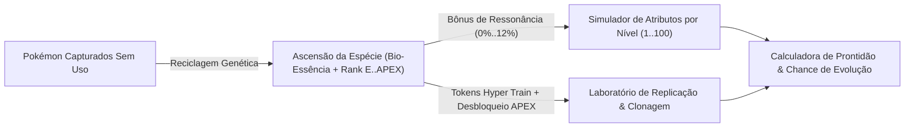

# 15 — Pokédex Suprema: Auditoria Completa, 51 Endpoints e Laboratório Genético

> **Marco Estratégico Atual:** Consolidar a **Pokédex Suprema** (experiência visual de console/anime com fluidez nível PS5, zero travamentos e domínio completo dos endpoints da PokéAPI v2 e filtros combinados, com créditos e atribuições explícitas à PokéAPI, `PokeAPI/sprites`, `PokeAPI/cries` e detentores das marcas) antes de liberar o **Laboratório Genético e de Combate no Back-end** (evolução por nível, ganho de atributos, chances de evolução, replicação/clonagem e reciclagem de espécimes capturados sem uso).

---

## 0. Atribuição Explícita de Terceiros & Fair Use

- **Dados e metadados:** **[PokéAPI v2](https://pokeapi.co/)** (`BSD-3-Clause`, criada por **Paul Hallett** e contribuidores). Auditoria ao vivo confirmou **51 endpoints raiz** em `/api/v2/` (incluindo os recentes `currency`, `evolution-variable` e `meta`), além de `/pokemon/{id}/encounters` e `https://graphql.pokeapi.co/v1beta2`.
- **Mídia oficial da comunidade:** **[PokeAPI/sprites](https://github.com/PokeAPI/sprites)** e **[PokeAPI/cries](https://github.com/PokeAPI/cries)**.
- **Uso justo na UI e no BFF:** o front-end exibe créditos visíveis na Topbar (`Créditos & APIs`), no rodapé global (`app-credits-bar`), no visor LCD da Pokédex (`.pokemon-fonte-creditos`), no Museu e no diálogo dedicado [`ApiCreditsDialogComponent`](../apps/web/src/app/shared/hud/api-credits-dialog.component.ts); o back-end aplica cache Redis `24h` + `7d` stale e deduplicação em voo conforme a [Fair Use Policy](https://pokeapi.co/docs/v2#fairuse).

---

## 1. Relatório da Auditoria Completa (Código, Bugs, Bundle e Documentação)

Durante a revisão integral do monorepo (`packages/shared`, `apps/api`, `apps/web` e `docs/`), foram identificados e corrigidos os seguintes pontos críticos:

### 1.1. Bugs de Produção, Segurança e UX Corrigidos
1. **Conflito de CSP em Produção (`inlineCritical` × Cloudflare Pages `_headers`):**
   - O otimizador crítico do Angular (`inlineCritical: true`) transformava o CSS global em `media="print"` e injetava um `<script>` inline para reativá-lo. Em produção (`https://pokeverse.pages.dev`), a política estrita `script-src 'self'` de [apps/web/public/_headers](../apps/web/public/_headers) bloqueava esse script inline, mantendo todo o CSS da Pokédex e dos cenários desativado.
   - **Correção:** configurado `"optimization": { "styles": { "inlineCritical": false } }` em [apps/web/angular.json](../apps/web/angular.json), gerando `<link rel="stylesheet">` direto sem abrir brechas no CSP, e adicionado o cabeçalho real de `_headers` ao servidor de QA headless local.
2. **Redução de Bundle Inicial Angular com Tree-Shaking do Zod v4 (`814.44 kB -> 490.00 kB` na 4A; `498.50 kB` pós-Onda 4):**
   - Os arquivos de contrato em `@pokeverse/shared` e `5` stores em `apps/web/src/app/core/stores/` usavam `import { z } from 'zod'`, o que impedia o tree-shaking completo de Zod v4 no `esbuild` do Angular.
   - **Correção:** centralizados todos os schemas restantes (`AuthProvidersSchema`, `PasskeyChallengeObjectSchema`, `PasskeyAuthOptionsEnvelopeSchema`, `WorldTickerEventListSchema`, `PerfPreferenceSchema`, `ScenarioIdSchema`) em [packages/shared/src/schemas/](../packages/shared/src/schemas/auth.schemas.ts), removidas importações diretas de `zod` nas stores do Angular e adotado `import * as z from 'zod'` em `@pokeverse/shared`. O bundle inicial caiu de **`814.44 kB`** (`178.41 kB` transfer) para **`490.00 kB`** (`127.33 kB` transfer) na Fase 4A (mantendo-se em **`498.50 kB`** raw / **`128.16 kB`** transfer após a Onda 4, sem alertas de orçamento — `-315.94 kB` raw / `-38.8%` sobre o baseline anterior).
3. **Contingência Redis (`stale-fallback` por 7 dias) no Back-end:**
   - [PokeApiCacheService](../apps/api/src/modules/pokedex/pokeapi-cache.service.ts) já possuía schema compatível com `'stale-fallback'`, mas gravava apenas chaves de `24h`. Agora grava também `${key}:stale` com TTL de `7 dias` (`604.800 s`) e entrega os dados de reserva automaticamente caso a PokéAPI upstream falhe ou abra o Circuit Breaker.
4. **Unicidade de Slot no Servidor + Limpeza Atômica em Lote:**
   - [PokedexSlotsService](../apps/api/src/modules/pokedex/pokedex-slots.service.ts) agora rejeita no PostgreSQL (HTTP `409 Conflict`) tentativas de gravar o mesmo Pokémon em mais de um slot, espelhando a trava já aplicada no front-end.
   - Adicionado `DELETE /api/v1/pokedex/slots` em [PokedexController](../apps/api/src/modules/pokedex/pokedex.controller.ts), substituindo `10` requisições `DELETE` paralelas por uma única transação ACID em [PokedexSlotsStore](../apps/web/src/app/features/pokedex-device/services/pokedex-slots.store.ts).
5. **Restauração Fiel da UX da Pokédex Clássica:**
   - Corrigidos: fechamento animado 3D contínuo (sem perda instantânea de rotação nem atraso de sombras), interrupção e reversão imediata da tampa em pleno giro (abrindo ou fechando), foco visual RPG restrito ao teclado (zero bordas ao clicar com mouse), estados de LED nas 10 teclas inferiores (apagado / verde ocupado / amarelo ativo), diálogos de confirmação nativos (`SlotConfirmDialogComponent`) e seleção em dois passos na lista (1º clique destaca, 2º clique ou botão redondo **A** carrega no visor).
6. **Higiene Estética e de Código (Zero Comentários, Zero Emojis e Arquivo Morto Removido):**
   - Removido arquivo CSS vazio `pokedex-device.component.scss`.
   - Substituídos os `4` emojis remanescentes na UI Angular por ícones `<svg aria-hidden="true">` vetoriais nítidos.
   - Removidos todos os comentários de código-fonte nos pacotes de trabalho (`packages/shared`, `apps/api`, `apps/web`, `apps/web/functions`); durante a Fase 4A, os arquivos estáticos originais (`index.html`, `css/style.css`, `js/app.js`) haviam sido mantidos intactos até a validação da migração, sendo posteriormente removidos da raiz por desuso após substituição completa pelo motor Angular + `@pokeverse/shared` + NestJS.

---

## 2. Onde Estamos vs. Rumo à Pokédex Suprema

| Camada | Estado Atual Verificado | Próxima Evolução Planejada (Fase 4B -> Fase 5) |
| :--- | :--- | :--- |
| **Casca 3D & Hardware** | Pokédex dupla com tampa 3D reversível mid-flight, texturas OKLCH pré-assadas, reflexo dinâmico em GPU (`@property`), 4 cenários crossfade e 3 tiers de hardware (`ultra`/`balanced`/`lite`) | **Projetor Holográfico WebGL2 (Three.js)** opcional sobre o visor no modo `ultra/balanced`, partículas elementais por tipo (`Fire`, `Electric`, `Water`, etc.), câmera com *pulse* óptico e **Sintetizador Web Audio** (estalo tátil mecânico nos botões, zoom da dobradiça e analisador de espectro FFT ao vivo nos *Cries*) |
| **Motor de Consultas & PokéAPI** | `51` endpoints catalogados em `POKEAPI_V2_ENDPOINTS` + motor `filterCatalogWithAdvancedQuery` tipado em `@pokeverse/shared`; BFF atualmente serve `pokemon` + `catalog` com cache Redis 24h + stale 7 dias | Expor endpoints agregados/sob demanda no NestJS (`/api/v1/pokedex/bundle/:id`, `/evolution-chain/:id`, `/moves/:id`, `/encounters/:id`, `/index/enriched`) para alimentar as **5 abas LCD** do visor e os filtros combinados de Tipo, Geração, Habitat, Raridade e BST na tela esquerda |
| **Experiência "Pokédex de Anime"** | Ficha básica (nome, ID, sprite/artwork, altura, peso, habilidades, tipos) + 10 teclas de memória sincronizadas | Leitura por síntese neural/Voz da Pokédex opcional (SpeechSynthesis PT-BR controlada por botão), comparação 1v1 nos visores, alternador **Normal / Shiny / Animated Showdown / Home 3D Render**, árvore evolutiva navegável e matriz completa de fraquezas `0x..4x` |
| **Laboratório Genético & Back-end** | Fórmulas determinísticas modeladas e testadas unitariamente em `pokemon-lab.ts` (`calculateStatsAtLevel`, `calculateXpForLevel`, `evaluateEvolutionChance`, `calculateReplicationAndCloning`, `calculateSpeciesAscension`) | Persistência de **Espécimes Capturados do Treinador** (`TrainerCapturedSpecimen`, `SpeciesAscensionProgress`, `LabReplicationJob`) no PostgreSQL, endpoints autoritativos de evolução, clonagem e reciclagem em bio-essência |

---

## 3. Arquitetura dos 51 Endpoints e Consultas Avançadas (`@pokeverse/shared`)

O arquivo [pokeapi-endpoints.ts](../packages/shared/src/domain/pokeapi-endpoints.ts) registra e categoriza os **51 endpoints** da PokéAPI v2 em `POKEAPI_V2_ENDPOINTS` com política explícita de cache (`hot-redis-24h`, `lazy-tab-24h`, `static-lookup-7d`, `stale-snapshot`) e valida parâmetros de pesquisa composta via `PokedexAdvancedQuerySchema`:

- **Filtros Suportados sem Perder Latência:**
  - Texto livre com normalização fonética e Damerau-Levenshtein (`term`).
  - Tipagem dupla ou simples (`types`, até `2` tipos simultâneos via `POKEMON_TYPES`).
  - Região / Geração (`generation` `1..9`) e bioma (`habitat`).
  - Marcadores taxonômicos (`onlyLegendary`, `onlyMythical`, `onlyBaby`).
  - Corte competitivo (`minBst` `0..1200`) e ordenação (`id-asc`, `id-desc`, `name-asc`, `bst-desc`).
- **Estratégia de Baixo Processamento (Frontend + API):**
  - Nenhum loop faz chamadas `N+1` ao cliente: um índice compacto pré-enriquecido (`id`, `name`, `types`, `generation`, `habitat`, `rarity`, `bst`) é gerado em background no back-end, cacheado no Redis e comprimido com Brotli/Gzip (`~40 kB`), permitindo filtrar `1.300+` espécies em menos de `3 ms` na thread principal.
  - Abas pesadas (`evolution-chain`, `move`, `location-area`) continuam em **Tab-Level Lazy Loading** sob demanda.

---

## 4. Blueprint Visual Nível Anime / Console PS5 com Alto Desempenho

Para entregar sensação de **cinema e videogame de nova geração** sem fritar celulares ou violar o orçamento de `490 kB` iniciais:

1. **Arquitetura de Rendering por Camadas (Zero Reflow):**
   - `preserve-3d` restrito exclusivamente à janela de animação (`.is-animando`), revertendo para composição 2D plana em repouso (`transform-style: flat`).
   - Imagens de cenário em WebP adaptativo (`desktop`/`mobile`) carregadas sob demanda, evitando decodificação simultânea de múltiplas texturas 4K fora do modo `ultra`.
   - Micro-feedback háptico/visual nos botões usando apenas propriedades compostas por GPU (`transform`, `opacity`, `box-shadow` estático sem repaint de layout).
2. **Projetor Holográfico Three.js Sob Demanda (`@defer`):**
   - Carregado apenas quando o tier for `ultra` ou `balanced` e o usuário abrir a Pokédex ou acionar o modo Holocron.
   - Em dispositivos `lite` ou com `prefers-reduced-motion: reduce`, degrada graciosamente para o sprite oficial nítido com zero alocação WebGL.
3. **Motor Acústico Web Audio API (`AudioContext` + `AnalyserNode`):**
   - Ao reproduzir `cries.latest` ou `cries.legacy`, um `AnalyserNode` em 60 FPS anima barras espectrais no visor LCD como a Pokédex do anime.
   - Efeitos táteis curtos (abertura mecânica da dobradiça, clique dos botões D-Pad e confirmação de gravação) sintetizados em memória com osciladores Web Audio (< `4 kB` de código, zero MP3 externo extra).

---

## 5. Modelagem do Laboratório Genético, Evolução e Aproveitamento de Capturas (`pokemon-lab.ts`)

O módulo [pokemon-lab.ts](../packages/shared/src/domain/pokemon-lab.ts) centraliza as regras determinísticas puras que orientarão os próximos endpoints e tabelas do Prisma no back-end NestJS:

1. **Calculadora de Atributos e Curvas de Experiência por Nível (`calculateStatsAtLevel`, `calculateXpForLevel`):**
   - Aplica as fórmulas oficiais Gen III–IX para `HP` e atributos derivados usando `level` (`1..100`), `IVs` (`0..31`), `EVs` (`0..252`, teto `510`), multiplicadores de `Nature` (`0.9`, `1.0`, `1.1`) e escala pelo bônus de Ascensão da Espécie (`0%..12%`), além das `6` curvas oficiais de XP (`slow`, `medium`, `fast`, `medium-slow`, `erratic`, `fluctuating`).
2. **Calculadora de Prontidão e Probabilidade de Evolução (`evaluateEvolutionChance`):**
   - Verifica pré-requisitos reais extraídos da árvore da PokéAPI (nível mínimo, felicidade `0..255`, pedra/item catalisador, período do dia, clima, golpe conhecido) combinados com estabilidade do bioma e ressonância genética, retornando exatamente os requisitos faltantes, o catalisador recomendado e a chance percentual calculada.
3. **Sistema de Replicação e Clonagem Controlada (`calculateReplicationAndCloning`):**
   - Pondera `baseStatTotal`, raridade (`standard`, `pseudo-legendary`, `legendary`, `mythical`), nível do laboratório (`1..5`), estabilizadores equipados (`0..3`) e IVs perfeitos da matriz para calcular taxa de sucesso de replicação, fidelidade genética, IVs perfeitos herdados, risco de mutação instável, chance de mutação **Shiny** e custo em Bio-Energia.
4. **Sistema de Aperfeiçoamento e Ascensão para Capturados Sem Uso (`calculateSpeciesAscension`):**
   - Converte exemplares repetidos ou encostados da mesma espécie (e do mesmo `egg-group`) em **Bio-Essência** ponderada por nível médio e exemplares Shiny reciclados.
   - Promove o domínio do treinador sobre aquela espécie pelos ranks **`E -> D -> C -> B -> A -> S -> APEX`**, desbloqueando bônus permanentes de ressonância nos atributos (`+0%` até `+12%`), **Tokens de Hyper Training** para elevar IVs e a trava final `apexSpeciesEvolutionUnlocked` para evoluções especiais/formas avançadas da plataforma.

---

## 6. Próximos Marcos de Execução Recomendados

1. **Sprint Atual (Pokédex Suprema Front + API Enciclopédica):**
   - Criar `PokedexEnrichmentService` em `apps/api` servindo `/api/v1/pokedex/pokemon/:id/bundle` (cache `hot-redis-24h` + `stale-fallback`) agregando `pokemon`, `pokemon-species` e `evolution-chain`.
   - Implementar as **5 abas internas no Visor LCD** sem alterar a silhueta física da carcaça (Resumo/Lore + Áudio Waveform, Atributos/Fraquezas `0x..4x`, Evolução Clicável, Golpes/Itens e Locais de Encontro), além dos filtros de consulta avançada em `PokedexSearchPanelComponent`.
2. **Sprint Seguinte (Projetor Holográfico & Áudio Tátil):**
   - Adicionar motor sonoro Web Audio tátil + espectrograma em Canvas 2D para os *Cries* e modo Holocron Three.js em `@defer`.
3. **Sprint Laboratório & Back-end de Jogo (Fase 5):**
   - Criar tabelas Prisma para espécimes do treinador (`TrainerCapturedSpecimen`, `SpeciesAscensionProgress`, `CloningJob`), expor os endpoints `POST /api/v1/lab/*` reutilizando integralmente os cálculos já validados em `pokemon-lab.ts` e conectar a aba **Laboratório / Simulador** no sistema.
