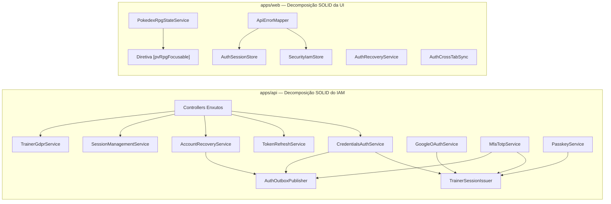

# 17 — Plano SOLID, Clean Code, Post-Mortem de Bugs e Engenharia Nível Big Tech

> **Objetivo deste documento:** registrar o *post-mortem* técnico dos bugs sutis de concorrência e dívidas arquiteturais identificados na auditoria do **PokéVerse OS**, documentar as correções críticas aplicadas e estabelecer o plano de ação concreto para atingir o ápice de **SOLID**, **Clean Code** e confiabilidade em padrão **Big Tech** (Google / Meta / Stripe), em conjunto com o contrato normativo oficial em **[ARCHITECTURE.md](ARCHITECTURE.md)**.

---

## 1. Post-Mortem & Causa Raiz: Por Que Esses Problemas Apareceram?

Os problemas encontrados não surgiram por falta de cuidado com segurança (a base criptográfica e BFF do projeto é sólida), mas sim da combinação de **4 vetores clássicos de crescimento acelerado**:

1. **Acreção Rápida por Ondas Funcionais (*Feature Accretion*):**
   - Entre as Fases 1, 2A, 2B, 3, 4A e LGPD, novos fluxos críticos (login, rotação de refresh, janela de graça multi-aba, OTP de verificação/reset, listagem/revogação de sessões, exportação de portabilidade LGPD e publicação Outbox) foram adicionados continuamente dentro dos mesmos arquivos centrais (`AuthService` atingiu **998 linhas** e `AuthStore` atingiu **606 linhas**).
   - Sem uma etapa intermediária de decomposição estrutural, a camada de serviço e a store principal acumularam múltiplos eixos de mudança — violando o **SRP (*Single Responsibility Principle*)** e gerando duplicação entre `AuthService`, `GoogleOAuthService` (`748` linhas), `MfaTotpService` (`492` linhas) e `PasskeyService` (`382` linhas).

2. **Tensão entre a Regra Zero (Fidelidade Visual 1:1 da Fase 0) e Arquitetura Reativa:**
   - Para portar a Pokédex 3D estática (`index.html`, `css/style.css` com `3.105` linhas e `js/app.js` com `2.150` linhas) para Angular sem risco de regressão visual, os seletores e a lógica de foco/navegação foram trazidos de forma quase direta para `_pokedex-classic.scss` (`3.203` linhas) e `PokedexRpgNavService` (`695` linhas).
   - Como consequência, `PokedexRpgNavService` herdou queries imperativas no DOM (`document.querySelector` / `hostEl.querySelectorAll` / `setTimeout`), violando **DIP (*Dependency Inversion Principle*)**, e `_tokens.scss` manteve simultaneamente dois vocabulários de design tokens (`--pv-*` em `oklch` e `--palette-*`/variáveis em português).

3. **Viés de Testes Sequenciais com Mocks em Memória:**
   - Testes unitários executados em série com `await` um após o outro sobre `Map` síncrono em memória validam o caminho lógico sequencial, mas **mascaram corridas concorrentes** e comportamentos reais de infraestrutura:
     - Um `Map` em memória nunca reproduz **TOCTOU** entre requisições paralelas no Redis (`get` → `set`).
     - Um mock de `$transaction` que retorna linhas estáticas não evidencia que o lock **`FOR UPDATE SKIP LOCKED`** é encerrado no momento em que `$transaction` retorna, antes da publicação no Kafka.
     - Testes que apenas mockam sucesso no `MailService` não exercitam o cenário de falha transiente após `SET NX` no Redis.

4. **Ausência de Portões Automáticos de Complexidade e Lint Uniforme no Monorepo:**
   - Apenas `apps/api` possuía ESLint configurado no CI (`lint:api`); `apps/web` e `packages/shared` não rodavam `eslint`, `max-lines`, `complexity` nem `prettier --check`. Sem guardrails automáticos, arquivos e funções puderam crescer além dos limites saudáveis sem gerar falha no pipeline.

---

## 2. Correções Críticas de Concorrência e Segurança Aplicadas

Todas as falhas críticas abaixo foram corrigidas no código e cobertas por novos testes unitários automatizados:

| # | Problema Encontrado | Risco em Produção | Solução Implementada (Antes × Depois) |
| :-: | :--- | :--- | :--- |
| **1** | **DoS no OTP em Cadastro Duplicado (`AuthService.register`)** | `issueOtp()` gravava no Redis *antes* da transação Prisma, e o `catch` executava `delKeys` mesmo em erro `P2002` — permitindo que um atacante apagasse o OTP ativo de qualquer conta ainda não verificada. | Separado em `OtpService.createOtpDraft()` (CPU/memória) e `persistOtpDraft()`, gravando no Redis **somente após** a transação SQL confirmar sucesso; removido `delKeys` do `catch`. |
| **2** | **Race Condition TOCTOU em Contadores Redis (`OtpService`, `AuthService.login`, `MfaTotpService`)** | Leituras (`GET`) seguidas de escritas (`SET` `n + 1`) permitiam que requisições concorrentes em paralelo burlassem o limite de 3 tentativas de OTP ou 5/8 falhas de login/MFA. | Criado `RedisService.incrementCounterWithTtl()` usando script Lua atômico (`INCR` + `EXPIRE`) com fallback seguro apenas para mocks legados em testes. |
| **3** | **Perda Silenciosa de Eventos Kafka (`EmailNotificationsConsumerService`, `WorldEventsConsumerService`)** | `acquireIdempotencyLock()` (`SET NX EX 86400`) era gravado *antes* do envio do e-mail/broadcast; uma falha SMTP/rede fazia o retry futuro tratar a mensagem como `'duplicate'` e descartá-la. | Adicionado `RedisService.releaseIdempotencyLock()` no bloco `catch` do efeito colateral, permitindo retry legítimo pelo broker e encaminhamento seguro à DLQ. |
| **4** | **Lock Efêmero no Outbox (`OutboxRelayService.processPendingBatch`)** | A `$transaction` com `SELECT ... FOR UPDATE SKIP LOCKED` encerrava antes do envio ao Kafka, liberando a trava para outras réplicas processarem o mesmo lote simultaneamente. | Substituído por CTE atômica (`WITH claimed AS (... FOR UPDATE SKIP LOCKED) UPDATE "OutboxEvent" SET "processedAt" = NOW() ... RETURNING ...`) atuando como *atomic lease* de 60s, liberado (`processedAt: null`) em falhas retentáveis. |
| **5** | **Divergência MFA OAuth & Binding `img[src]` Inativo** | `GoogleOAuthService` ignorava contas MFA protegidas apenas por Passkey (`totpSecretEncrypted !== null`); `CenariosBackdropComponent` ligava `[src]` a `null`. | Alinhado para `trainer.mfaEnabled && mfaMethods.length > 0` e substituído `[src]` por `[attr.src]` em `cenarios-backdrop.component.ts`. |

---

## 3. Plano de Ação Arquitetural: Ápice dos Princípios SOLID e Clean Code

### 3.1. Mapa de Decomposição Alvo (Backend + Frontend)

### 3.2. Checklist Prático por Princípio SOLID

1. **S — Single Responsibility Principle (SRP)**
   - **Meta:** máximo de `~300` linhas por Service/Store e `~150–200` linhas por Componente UI; funções com `<= 65` linhas (`max-lines-per-function` bloqueante no ESLint) e profundidade de aninhamento `<= 3` (`max-depth: ['error', 3]`).
   - **Ações (Concluídas):**
     - Fatiar `auth.service.ts` (`998` linhas) em `CredentialsAuthService`, `TokenRefreshService`, `AccountRecoveryService`, `SessionManagementService` e `TrainerGdprService`.
     - Fatiar `google-oauth.service.ts` (`748` linhas) isolando `GoogleOidcVerifier` (JWKS + RS256), `GoogleOAuthHttpClient` e `GoogleAccountLinker`.
     - Fatiar `auth.store.ts` (`606` linhas) separando estado de sessão (`AuthSessionStore`), ações de recuperação/OTP (`AuthRecoveryService`) e sincronização multi-aba (`AuthCrossTabSync`).
     - Fatiar `_pokedex-classic.scss` (`3.203` linhas) em `_chassis-3d.scss`, `_search-scanner.scss`, `_visor-lcd.scss`, `_controls-dpad.scss` e `_slots-grid.scss`, migrando 100% das cores literais dos diálogos/telas de `apps/web/src/app/**/*.scss` para tokens semânticos `--pv-*`.

2. **O — Open/Closed Principle (OCP)**
   - **Ações (Concluídas):**
     - Substituir ramificações manuais em `MailService` por mapa tipado de renderizadores (`Record<EmailTemplate, EmailRenderer>`) e estratégias plugáveis via porta `EmailTransport` (`SmtpEmailTransport` e `ResendEmailTransport`).
     - No `PrivacyConsentStore` e `QualityStore`, adotar registro declarativo de chaves sujeitas a consentimento e diferenciar explicitamente opt-in estrito (`hasExplicitFunctionalOptIn`: `functionalPreferences === true`) da permissão funcional de slots no Modo Visitante antes de revogação explícita (`canPersistFunctionalPreferences`: `functionalPreferences ?? true`).

3. **L — Liskov Substitution Principle (LSP)**
   - **Ações (Concluídas):**
     - Definidos contratos explícitos [`SessionRepository` e `OtpStore`](../apps/api/src/modules/auth/auth-storage.ports.ts), [`EmailTransport`](../apps/api/src/modules/notifications/email-transport.port.ts), [`ObjectStoragePort`](../apps/api/src/infra/object-storage.port.ts) e [`TelemetryMetricsPort`](../apps/api/src/common/telemetry/telemetry.port.ts), validados por suíte de substituição LSP ([`auth-ports-lsp.spec.ts`](../apps/api/src/modules/auth/auth-ports-lsp.spec.ts)) garantindo mesmas pré e pós-condições entre Redis/SMTP/Resend reais e implementações *in-memory*.

4. **I — Interface Segregation Principle (ISP)**
   - **Ações (Concluídas):**
     - Extrair `TrainerSessionIssuer` e `AuthOutboxPublisher` com interfaces mínimas para `GoogleOAuthService`, `MfaTotpService` e `PasskeyService`, eliminando duplicação de `TRAINER_PROFILE_SELECT`, montagem de `mfaMethods`, gravação de `RefreshToken` e envelopes cifrados.
     - No front-end, centralizar `extractApiErrorMessage()` em `core/http/api-error.util.ts` (eliminando duplicação entre `AuthRecoveryService` e `SecurityIamStore`).

5. **D — Dependency Inversion Principle (DIP)**
   - **Ações (Concluídas):**
     - Removida toda consulta direta ao DOM (`document.querySelector`, `hostEl.querySelectorAll`, `getElementById`) de `PokedexRpgNavService`, `pokedex-rpg-nav.util.ts` e `QualityStore` via `[pvRpgFocusable]` / `[pvRpgAction]` e injeção de `DOCUMENT` (`dataset['perfTier']`).
     - Extraídas portas abstratas no back-end para transporte de e-mail (`EMAIL_TRANSPORT`), sessão/OTP (`SESSION_REPOSITORY` / `OTP_STORE`), armazenamento S3 (`OBJECT_STORAGE_PORT`) e telemetria (`TELEMETRY_METRICS_PORT`).

---

## 4. Roadmap para Elevar o Projeto ao Nível Big Tech

| Pilar | Estado Anterior | Marco Implementado (100% Concluído) |
| :--- | :--- | :--- |
| **Lint & Clean Code Gates** | ESLint apenas em `apps/api`; sem limite de linhas/complexidade. | **Concluído:** `eslint-plugin-prettier/recommended`, `--max-warnings=0`, `@typescript-eslint/no-explicit-any: 'error'`, `complexity: ['error', 15]`, `max-depth: ['error', 3]`, `max-lines` (`300` geral / `200` `*.component.ts` no web) e `max-lines-per-function` (`65` em código de produção) ativos nos 3 workspaces (`@pokeverse/shared`, `apps/api`, `apps/web`), com `npm run format:check` bloqueante no CI. |
| **Testes de Integração Reais & Caos** | E2E com mocks em memória; falta cobertura em `PokeApiCacheService`, `PokedexSlotsService` e `PasskeyService`. | **Concluído:** `121` testes unitários (`17` shared + `73` api em `26` suítes incluindo `auth-ports-lsp.spec.ts`, `opentelemetry.service.spec.ts` e `events-chaos.spec.ts` + `31` web em `7` arquivos), `12` testes E2E HTTP edge (`app.e2e-spec.ts`) e `3` testes de integração real em `app.integration-spec.ts` com PostgreSQL 16, Redis 7 e Kafka/Redpanda reais no CI (`integration-e2e`) e **Testcontainers** autocontido local (`npm run test:integration:tc` via `integration-containers.helper.ts`). |
| **Observabilidade & SLOs** | Logs JSON estruturados + `traceparent` manual. | **Concluído:** **OpenTelemetry SDK** (`otel-sdk.bootstrap.ts` + `OpenTelemetryService` + `TelemetryMetricsPort`) instrumentando HTTP (`CorrelationMiddleware`), Prisma (`PrismaService` query events), Redis (`RedisService` spans + `PokeApiCacheService` hit/miss/stale), KafkaJS (`KafkaService`) e WebSocket (`WorldGateway`), com métricas RED (`p50`/`p95`/`p99`, taxa `5xx`, hit ratio Redis) expostas em `GET /api/v1/system/telemetry` (`@Roles('MODERATOR', 'ADMIN')` + `@Scopes('ops:audit')`). |
| **Segurança Contínua & LGPD** | Cookies `__Host-`/`__Secure-`, Argon2id, exportação JSON; falta exclusão de conta e expurgo automático. | **Concluído:** `DELETE /api/v1/auth/me` com confirmação na UI, `SessionManagementService.purgeExpiredTokensAndEvents()` (6h), `POKEVERSE_PHASE` dinâmico, **Gitleaks**, **Trivy** (`CRITICAL` + SBOM CycloneDX), **CodeQL** SAST e `npm audit --omit=dev --audit-level=high` zerado (`0` vulnerabilidades via `overrides` + `@prisma/config` na raiz) bloqueantes no [ci.yml](../.github/workflows/ci.yml). |
| **Higiene de Dependências & Repo** | `@neon/config` e `@neon/env` nas `dependencies` raiz; alterações WIP sem commit. | **Concluído:** `@neon/config` e `@neon/env` em `devDependencies` na raiz, [`.github/CODEOWNERS`](../.github/CODEOWNERS) e [`.github/pull_request_template.md`](../.github/pull_request_template.md) adicionados ao repositório. |

---

## 5. Cronograma de Execução & Status Real

1. **Sprint 1 (Estabilização & SOLID no Auth) — Concluída:** extraídos `TrainerSessionIssuer` + `AuthOutboxPublisher`; `AuthService` decomposto em `CredentialsAuthService`, `TokenRefreshService`, `AccountRecoveryService`, `SessionManagementService` e `TrainerGdprService`; `GoogleOAuthService` decomposto em `GoogleOAuthHttpClient`, `GoogleOidcVerifier` e `GoogleAccountLinker`; `MailService` em tabela OCP (`EMAIL_TEMPLATE_RENDERERS`); novos testes unitários em `PokeApiCacheService`, `PokedexSlotsService` e `PasskeyService`.
2. **Sprint 2 (Front-End & CSS Modular) — Concluída:** criado `api-error.util.ts`; `AuthStore` fatiado com `AuthRecoveryService` e `AuthCrossTabSyncService`; `PrivacyConsentStore` extensível via `registerNonEssentialStorageKey` + `hasExplicitFunctionalOptIn`; `PokedexRpgNavService` decomposto com `PokedexLidPhysicsService` e diretiva declarativa `[pvRpgFocusable]` / `[pvRpgContainer]` / `[pvRpgAction]`; `_pokedex-classic.scss` fatiado em 5 parciais (`styles/pokedex/`); todos os `.scss` de diálogos/telas migrados para `--pv-*`; ESLint unificado em `@pokeverse/shared`, `apps/api` e `apps/web`.
3. **Sprint 3 (Confiabilidade Big Tech & LGPD Final) — Concluída:** entregues `DELETE /api/v1/auth/me` + confirmação LGPD em `SecuritySettingsDialogComponent`, `purgeExpiredTokensAndEvents()`, `SystemController` dinâmico (`POKEVERSE_PHASE`), portas DIP/LSP (`EmailTransport`, `SessionRepository`, `OtpStore`, `ObjectStoragePort`, `TelemetryMetricsPort`) + `auth-ports-lsp.spec.ts`, **OpenTelemetry SDK + métricas RED** (`GET /api/v1/system/telemetry`), **Testcontainers** (`integration-containers.helper.ts`) + suíte de caos (`events-chaos.spec.ts`), `npm audit --omit=dev --audit-level=high` zerado no `ci.yml`, `max-depth`/`max-lines-per-function` no ESLint e `.github/CODEOWNERS` + template de PR.
