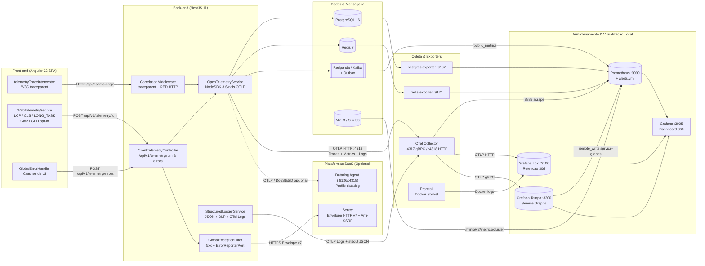
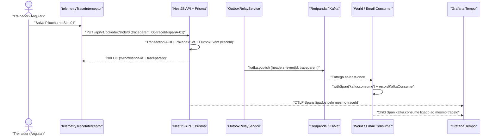

# 19 — Observabilidade Híbrida, Telemetria (OpenTelemetry) e Monitoramento (Grafana Stack + Sentry + Datadog)

> **Escopo deste documento:** consolidar o planejamento arquitetural, a instrumentação de código (Back-end NestJS + Front-end Angular + Mensageria Kafka/Outbox), a orquestração da stack local em Docker (`OTel Collector`, `Prometheus`, `Exporters`, `Grafana Loki`, `Promtail`, `Grafana Tempo`, `Grafana` e perfil paralelo `Datadog Agent`) e o fluxo de *Crash Reporting* com `Sentry`, cobrindo integralmente os **Três Pilares da Observabilidade** sem *vendor lock-in* e em conformidade com a **LGPD** e o catálogo [`REQ-SEC-01..35`](16-cookies-lgpd-e-requisitos.md#43-catálogo-normativo-de-requisitos-de-segurança-req-sec-01-a-req-sec-35).

---

## Sumário

1. [Planejamento Estratégico e Arquitetura Híbrida (Os 3 Pilares + APM SaaS)](#1-planejamento-estratégico-e-arquitetura-híbrida-os-3-pilares--apm-saas)
2. [Padrão de Coleta Unificada com OpenTelemetry (NestJS + Angular + Kafka)](#2-padrão-de-coleta-unificada-com-opentelemetry-nestjs--angular--kafka)
3. [Stack Local de Armazenamento e Visualização (Docker Compose)](#3-stack-local-de-armazenamento-e-visualização-docker-compose)
4. [APM e Crash Reporting SaaS (Sentry + Datadog Pro Student)](#4-apm-e-crash-reporting-saas-sentry--datadog-pro-student)
5. [Segurança, LGPD, Portas Locais e Guia Operacional (Runbook)](#5-segurança-lgpd-portas-locais-e-guia-operacional-runbook)

---

## 1. Planejamento Estratégico e Arquitetura Híbrida (Os 3 Pilares + APM SaaS)

Em sistemas distribuídos compostos por múltiplos processos e armazenamentos especializados (`Angular 22`, `NestJS 11`, `PostgreSQL 16`, `Redis 7`, `Redpanda/Kafka` e `MinIO/Silo S3`), falhas intermitentes raramente se limitam a um único container. Uma lentidão percebida no visor 3D da Pokédex pode nascer em um *Long Task* de renderização, em um *Cache Miss* seguido de *timeout* na PokéAPI, em uma contenção de lock no PostgreSQL ou em *retries* no `OutboxRelayService`.

Para resolver esse problema sem acoplar o código de aplicação a fornecedores proprietários, o **PokéVerse OS** adota uma **arquitetura híbrida de observabilidade**:

1. **Camada de Instrumentação Agnóstica (OpenTelemetry / W3C):** a aplicação produz **Métricas**, **Logs Estruturados** e **Traces Distribuídos** no protocolo padrão **OTLP/HTTP** (`4318`) e propaga o cabeçalho **W3C `traceparent`** ponta a ponta.
2. **Camada de Roteamento e Desacoplamento (`OTel Collector`):** um container dedicado (`otel-collector`) recebe, limita memória (`memory_limiter`), enriquece metadados e exporta cada sinal para o armazenamento local especializado — permitindo trocar backends de telemetria apenas alterando `infra/observability/otel-collector/otel-collector-config.yml`.
3. **Stack Local Open-Source (Cloud Native):** `Prometheus` + *Exporters* (Métricas), `Grafana Loki` + `Promtail` (Logs), `Grafana Tempo` (Traces e *Service Graphs*) e `Grafana` (visualização correlacionada).
4. **Camada SaaS Paralela (APM & Crash Reporting):** `Sentry` via adaptador DIP server-side + túnel BFF same-origin para erros 5xx da API e exceções de UI no Angular, somado ao `Datadog Agent` opcional via *profile* Docker (`--profile datadog`) para experimentação com **Datadog Pro** (GitHub Student Pack).



### Por que usar o `OTel Collector` como intermediário?

- **Zero acoplamento na aplicação:** `pokeverse-api` conhece apenas `OTEL_EXPORTER_OTLP_ENDPOINT`. Se em produção os traces forem para Grafana Cloud, Tempo, Jaeger ou Datadog, o código NestJS permanece intacto.
- **Proteção contra picos (*Backpressure*):** o processador `memory_limiter` (`limit_mib: 256`, `spike_limit_mib: 64`) e o `batch` (`timeout: 5s`, `send_batch_size: 512`) impedem que surtos de erro ou tráfego saturem a rede da API com envios síncronos unidade a unidade.
- **Governança centralizada de metadados:** o processador `resource` injeta atributos de ambiente (`deployment.environment`) de forma uniforme em métricas, logs e traces.

---

## 2. Padrão de Coleta Unificada com OpenTelemetry (NestJS + Angular + Kafka)

### 2.1. Instrumentação no Back-end NestJS (`apps/api`)

| Componente | Arquivo | Responsabilidade Técnica |
| :--- | :--- | :--- |
| **Bootstrap dos 3 Sinais** | [`otel-sdk.bootstrap.ts`](../apps/api/src/common/telemetry/otel-sdk.bootstrap.ts) | Inicializa `NodeSDK` com `HttpInstrumentation`, `OTLPTraceExporter` (`/v1/traces`), `PeriodicExportingMetricReader` + `OTLPMetricExporter` (`/v1/metrics` a cada `15s`), `BatchLogRecordProcessor` + `OTLPLogExporter` (`/v1/logs`) e `Resource` com `service.name`, `service.version` e `deployment.environment.name`. |
| **Porta & Serviço de Métricas/Spans** | [`telemetry.port.ts`](../apps/api/src/common/telemetry/telemetry.port.ts) + [`opentelemetry.service.ts`](../apps/api/src/common/telemetry/opentelemetry.service.ts) + [`otel-instruments.util.ts`](../apps/api/src/common/telemetry/otel-instruments.util.ts) | Implementa `TelemetryMetricsPort` (padrão DIP), expondo `withSpan()`, `recordHttpRequest()`, `recordCacheOutcome()`, `recordDatabaseQuery()`, `recordKafkaPublish()`, `recordKafkaConsume()`, `recordWsConnectionDelta()`, `recordWsBroadcast()`, `recordRumSample()`, `recordUnhandledError()` e `getSnapshot()`. |
| **Correlação HTTP & RED** | [`correlation.middleware.ts`](../apps/api/src/common/middleware/correlation.middleware.ts) | Lê ou gera `traceparent` W3C (`00-<traceId>-<spanId>-01`) e `x-correlation-id`, propaga nos headers de resposta e registra duração e código HTTP por grupo de rota. |
| **Logger Estruturado + OTel Logs** | [`structured-logger.service.ts`](../apps/api/src/common/telemetry/structured-logger.service.ts) | Emite JSON estruturado em `stdout`/`stderr` e `LogRecord` na API de Logs do OpenTelemetry, extraindo automaticamente `trace_id`/`span_id` do span ativo (`trace.getActiveSpan()`) quando não fornecidos explicitamente, após passar por redação DLP (`redactSensitiveText` / `sanitizeLogValue`). |
| **Instrumentação de Infra** | [`prisma.service.ts`](../apps/api/src/infra/prisma.service.ts), [`redis.service.ts`](../apps/api/src/infra/redis.service.ts), [`kafka.service.ts`](../apps/api/src/infra/kafka.service.ts), [`world.gateway.ts`](../apps/api/src/modules/world/world.gateway.ts) | Registra duração de queries Prisma (`$on('query')`), spans de operações Redis, spans de publicação Kafka (`kafka.publish`) e gauge/spans de WebSocket. |
| **Endpoint Protegido de Diagnóstico** | [`telemetry.controller.ts`](../apps/api/src/modules/system/telemetry.controller.ts) | Expõe `GET /api/v1/system/telemetry` (`TelemetrySnapshotSchema`) protegido por `@Roles('MODERATOR', 'ADMIN')` + `@Scopes('ops:audit')`. |

### 2.2. Instrumentação no Front-end Angular (`apps/web`) e Túnel BFF

O navegador no **PokéVerse OS** opera sob **Content Security Policy (CSP) estrito** em [`apps/web/public/_headers`](../apps/web/public/_headers) (`connect-src 'self' blob: https://pokeapi.co https://raw.githubusercontent.com`), impedindo conexões arbitrárias a endpoints externos de telemetria e protegendo o usuário contra exfiltração.

Por isso, a telemetria Web segue o padrão **Same-Origin BFF Telemetry Tunnel**:

1. **Propagação W3C (`telemetryTraceInterceptor`):** em [`telemetry-trace.interceptor.ts`](../apps/web/src/app/core/interceptors/telemetry-trace.interceptor.ts) + [`trace-context.util.ts`](../apps/web/src/app/core/telemetry/trace-context.util.ts), toda requisição HTTP para `/api/*` ou `/health/*` recebe um header `traceparent` gerado via `crypto.getRandomValues`, conectando o clique na interface ao trace distribuído do NestJS.
2. **Coleta de RUM / Core Web Vitals (`WebTelemetryService`):** em [`web-telemetry.service.ts`](../apps/web/src/app/core/telemetry/web-telemetry.service.ts), `PerformanceObserver` captura `LCP`, `CLS` e `LONG_TASK` e envia em lotes no evento `visibilitychange` (`hidden`) para `POST /api/v1/telemetry/rum` usando `fetch(..., { keepalive: true, credentials: 'same-origin', headers: { 'Content-Type': 'application/json' } })` (compatível com `CsrfOriginGuard`).
3. **Captura Global de Exceções (`GlobalErrorHandler`):** [`global-error-handler.ts`](../apps/web/src/app/core/telemetry/global-error-handler.ts) captura erros não tratados do Angular (com trava máxima de `5` envios por sessão) e encaminha via `POST /api/v1/telemetry/errors` para [`ClientTelemetryController`](../apps/api/src/modules/system/client-telemetry.controller.ts) + [`TelemetryIngestionService`](../apps/api/src/modules/system/telemetry-ingestion.service.ts), validados por Zod v4 em [`telemetry.schemas.ts`](../packages/shared/src/schemas/telemetry.schemas.ts).
4. **Gate Obrigatório de Privacidade (LGPD):** tanto `WebTelemetryService` quanto `GlobalErrorHandler` **bloqueiam qualquer envio de RUM ou crash** enquanto `PrivacyConsentStore.optionalTelemetryEnabled()` for `false` (`REQ-SEC-18`).

### 2.3. Propagação Ponta a Ponta através do Transactional Outbox e Kafka



Tanto [`WorldEventsConsumerService`](../apps/api/src/modules/events/world-events.consumer.ts) quanto [`EmailNotificationsConsumerService`](../apps/api/src/modules/events/email-notifications.consumer.ts) (via classe base compartilhada [`BaseIdempotentKafkaConsumer`](../apps/api/src/modules/events/base-idempotent-kafka.consumer.ts)) criam spans filhos `kafka.consume` com atributos semânticos `messaging.system="kafka"`, `messaging.destination.name` e `messaging.consumer.group.name`, registrando contadores e histogramas por desfecho (`processed`, `duplicate`, `dlq`).

---

## 3. Stack Local de Armazenamento e Visualização (Docker Compose)

Todos os serviços locais são declarados em [`infra/docker/docker-compose.yml`](../infra/docker/docker-compose.yml) vinculados a `127.0.0.1`, com volumes persistentes e verificações de saúde (`healthcheck`).

### 3.1. Métricas: Prometheus + Exporters + Regras de Alerta

Configuração em [`prometheus.yml`](../infra/observability/prometheus/prometheus.yml) e [`alerts.yml`](../infra/observability/prometheus/alerts.yml), com retenção TSDB local de `15d` e suporte a *Exemplars* (`--enable-feature=exemplar-storage`) + *Remote Write Receiver* (`--web.enable-remote-write-receiver`) para receber *Service Graphs* do Tempo.

| Fonte / Target | Porta Interna / Path | Métricas Coletadas |
| :--- | :--- | :--- |
| **`otel-collector`** | `:8889` | `http_server_request_duration_milliseconds_*`, `http_server_errors_5xx_total`, `cache_pokeapi_outcomes_total`, `db_prisma_query_duration_milliseconds_*`, `messaging_kafka_published_total`, `messaging_kafka_consumed_total`, `messaging_kafka_consume_duration_milliseconds_*`, `ws_world_active_connections`, `web_vitals_value_milliseconds_*`, `app_unhandled_errors_total`, `client_ui_errors_total`. |
| **`postgres-exporter`** | `:9187` (`/metrics`) | `pg_up`, conexões ativas (`pg_stat_activity_count`), *deadlocks*, *cache hit ratio* de buffers compartilhados, transações commit/rollback e tamanho de tabelas (`OutboxEvent`, `AuditLog`). |
| **`redis-exporter`** | `:9121` (`/metrics`) | `redis_up`, memória usada vs. `maxmemory`, taxa de hits/misses internos do Redis, clientes conectados, chaves expiradas e comandos por segundo. |
| **`redpanda`** | `:9644` (`/public_metrics`) | Saúde de partições, latência de produção/consumo, *consumer group lag* e taxa de bytes por tópico. |
| **`minio` (`pgsty/silo`)** | `:9000` (`/minio/v2/metrics/cluster`) | Uso de disco dos buckets `pokeverse-roms` e `pokeverse-saves`, requisições S3 e latência de API (`MINIO_PROMETHEUS_AUTH_TYPE: public` restrito ao ambiente local). |

#### Consultas PromQL de Referência

```promql
# Taxa de erros 5xx da API (SLO < 0.5%)
100 * (
  sum(rate(http_server_errors_5xx_total[5m]))
  /
  clamp_min(sum(rate(http_server_request_duration_milliseconds_count[5m])), 1)
)

# Latencia HTTP p95 em ms (SLO <= 350 ms para DB / <= 50 ms para Cache Hit)
histogram_quantile(0.95, sum by (le) (rate(http_server_request_duration_milliseconds_bucket[5m])))

# Cache Hit Ratio da PokeAPI no Redis (SLO >= 90%)
100 * (
  sum(rate(cache_pokeapi_outcomes_total{outcome="hit"}[5m]))
  /
  clamp_min(sum(rate(cache_pokeapi_outcomes_total[5m])), 0.001)
)
```

#### Alertas Provisionados (`alerts.yml`)

| Regra | Severidade | Condição / Gatilho |
| :--- | :---: | :--- |
| **`PokeVerseHigh5xxErrorRate`** | `critical` | Taxa 5xx `> 0.5%` sustentada por `2m`. |
| **`PokeVerseHighHttpLatencyP95`** | `warning` | Latência HTTP `p95 > 350 ms` por `5m`. |
| **`PokeVerseKafkaDlqMessagesDetected`** | `critical` | Qualquer mensagem publicada em `pokeverse.dlq.v1` (`dlq="true"`) em `5m`. |
| **`PokeVerseLowPokeApiCacheHitRatio`** | `warning` | Cache hit ratio `< 80%` por `10m` com tráfego ativo. |
| **`PokeVersePostgresDown` / `PokeVerseRedisDown`** | `critical` | `pg_up == 0` ou `redis_up == 0` por `1m`. |
| **`PokeVerseClientCrashSpike`** | `warning` | `>= 5` crashes de UI reportados em `5m` via `/api/v1/telemetry/errors`. |

### 3.2. Logs Centralizados: Grafana Loki + Promtail + OTLP Logs

Os logs convergem para o [`Grafana Loki`](../infra/observability/loki/loki-config.yml) por dois caminhos complementares:

1. **Via OTLP Logs (`OpenTelemetry -> OTel Collector -> Loki`):** logs emitidos pelo `StructuredLoggerService` com severidade OTel e atributos indexáveis (`service.name`, `context`, `error_code`, `trace_id`, `span_id`).
2. **Via Docker Socket (`Promtail -> Loki`):** [`promtail-config.yml`](../infra/observability/promtail/promtail-config.yml) descobre automaticamente todos os containers do Compose (`postgres`, `redis`, `redpanda`, `minio`, `mailpit`, etc.), extrai labels `container` e `compose_service`, e aplica parser JSON opcional para promover `level`, `service_name` e `error_code` em labels sem descartar logs de texto plano da infraestrutura.

- **Conformidade LGPD (`REQ-SEC-04` e `REQ-SEC-19`):** `StructuredLoggerService` mascara senhas, tokens Bearer, JWTs, chaves PEM, cookies, query strings OAuth e e-mails antes da emissão; o Loki aplica **retenção automática de `720h` (`30 dias`)** via `compactor.retention_enabled: true`.

#### Consultas LogQL de Referência

```logql
# Todos os erros estruturados da API com codigo explicito
{compose_service=~".+", level="error"} | json

# Rastrear toda a jornada de um incidente por trace_id
{compose_service=~".+"} |= "4bf92f3577b34da6a3ce929d0e0e4736"

# Incidentes de seguranca (reuso de refresh, CSRF ou throttle)
{service_name="pokeverse-api"} | json | error_code=~"REFRESH_REUSE_DETECTED|CSRF_ORIGIN_BLOCKED|LOGIN_RATE_LIMIT_HIT"
```

### 3.3. Traces Distribuídos: Grafana Tempo (+ Compatibilidade OTLP/Jaeger)

O [`Grafana Tempo`](../infra/observability/tempo/tempo-config.yml) recebe spans OTLP enviados pelo `OTel Collector` (`tempo:4317`) e habilita o **`metrics_generator`** (`service-graphs` + `span-metrics`) enviando métricas derivadas de topologia para o Prometheus via `remote_write`.

- **Por que Grafana Tempo (e equivalência com Jaeger):** assim como o Jaeger v2, o Tempo fala OTLP nativo sem necessidade de instrumentação proprietária. A vantagem direta do Tempo na stack Grafana é o armazenamento em blocos sem índice pesado de memória e a correlação nativa com **Loki** (`tracesToLogsV2`) e **Prometheus** (`tracesToMetrics` + *Service Map*). Se uma equipe preferir Jaeger para visualização pontual, basta apontar um exporter `otlp/jaeger` no `otel-collector-config.yml` sem alterar uma linha da aplicação.

### 3.4. Correlação Unificada no Grafana

O provisionamento em [`datasources.yml`](../infra/observability/grafana/provisioning/datasources/datasources.yml), [`dashboards.yml`](../infra/observability/grafana/provisioning/dashboards/dashboards.yml) e [`pokeverse-overview.json`](../infra/observability/grafana/dashboards/pokeverse-overview.json) entrega o dashboard **`PokéVerse OS — Observabilidade 360 (RED, USE, Negocio & RUM)`** pronto no primeiro boot:

- **Métrica -> Trace:** *Exemplars* no Prometheus apontam `trace_id` diretamente para o Tempo.
- **Log -> Trace:** `derivedFields` no Loki transformam `"trace_id":"..."` em link clicável para abrir a árvore de spans no Tempo.
- **Trace -> Log & Mapa de Serviços:** `tracesToLogsV2` no Tempo consulta o Loki filtrando automaticamente pelo `traceId` do span selecionado, enquanto `nodeGraph` exibe a topologia de chamadas entre serviços.

---

## 4. APM e Crash Reporting SaaS (Sentry + Datadog Pro Student)

### 4.1. Sentry — Crash Reporting Real-Time (Angular + NestJS)

Em vez de adicionar SDKs pesados e acoplados no bundle inicial do Angular (o que impactaria o orçamento `<= 501 kB` e exigiria abrir o CSP `connect-src` para domínios externos), o **PokéVerse OS** implementa uma arquitetura limpa via **Sentry HTTP Envelope v7**:

1. **Porta e Adaptador DIP:** [`ErrorReporterPort`](../apps/api/src/common/telemetry/error-reporter.port.ts) e [`SentryErrorReporterService`](../apps/api/src/common/telemetry/sentry-error-reporter.service.ts) em `apps/api`.
2. **Segurança Anti-SSRF e DLP:** o DSN é validado na inicialização (`env.schema.ts`) exigindo `https://<publicKey>@<host>/<projectId>`. No envio, `SentryErrorReporterService` restringe o host a `*.sentry.io`, valida o destino com `assertSafeOutboundUrl` (anti-SSRF pós-DNS), aplica `redactSensitiveText` em mensagens, rotas e *stack frames*, e injeta `contexts.trace.trace_id` + `span_id` para cruzar o crash do Sentry diretamente com o Grafana Tempo/Loki.
3. **Cobertura Ponta a Ponta:**
   - **Back-end NestJS:** [`GlobalExceptionFilter`](../apps/api/src/common/filters/global-exception.filter.ts) despacha qualquer erro `status >= 500` para o Sentry sem bloquear a resposta HTTP ao cliente.
   - **Front-end Angular:** [`GlobalErrorHandler`](../apps/web/src/app/core/telemetry/global-error-handler.ts) envia exceções não tratadas de interface (quando há opt-in LGPD `optionalTelemetry`) para `POST /api/v1/telemetry/errors`, que as sanitiza e encaminha ao Sentry pelo mesmo adaptador.

### 4.2. Datadog Pro (via GitHub Student Developer Pack)

O serviço `datadog-agent` (`gcr.io/datadoghq/agent:7`) já vem orquestrado em [`infra/docker/docker-compose.yml`](../infra/docker/docker-compose.yml) sob o **Docker Compose Profile `datadog`**. Essa isolação garante que:

- `npm run infra:up` sobe toda a stack open-source sem entrar em *crash-loop* quando `DD_API_KEY` não estiver preenchida.
- Ao ativar o benefício **Datadog Pro** no GitHub Student Pack e preencher `DD_API_KEY` no `.env`, basta executar `npm run infra:datadog:up` para habilitar em paralelo:
  1. **Ingestão OTLP no Datadog (`:4318`) / APM (`:8126`) e DogStatsD (`:8125/udp`)** para geração automática do **Service Dependency Map**;
  2. **Coleta de logs de todos os containers Docker** (`DD_LOGS_CONFIG_CONTAINER_COLLECT_ALL=true`);
  3. **Métricas de host/container** para correlação SaaS Enterprise comparativa lado a lado com o Grafana local.

> Para enviar os sinais OTel simultaneamente ao Grafana local e ao Datadog Agent, adicione um exporter `otlphttp/datadog` apontando para `http://datadog-agent:4318` nos pipelines desejados de `otel-collector-config.yml` (ou aponte `OTEL_EXPORTER_OTLP_ENDPOINT` para `http://localhost:8126` / `http://localhost:4318`).

---

## 5. Segurança, LGPD, Portas Locais e Guia Operacional (Runbook)

### 5.1. Conformidade de Segurança e Privacidade (`REQ-SEC`)

| Controle | Como foi atendido nesta entrega |
| :--- | :--- |
| **`REQ-SEC-04` (Logs sem PII)** | Redação recursiva em `StructuredLoggerService` e `SentryErrorReporterService` (`JWT`, `PEM`, `Bearer`, `e-mail`, `password`, `otp`, query strings OAuth). |
| **`REQ-SEC-18` (Opt-in LGPD)** | `WebTelemetryService` e `GlobalErrorHandler` não enviam amostras RUM nem relatórios de crash enquanto `PrivacyConsentStore.optionalTelemetryEnabled()` for `false`. |
| **`REQ-SEC-19` (TTL / Retenção)** | Retenção automática configurada no Prometheus (`15d`), Tempo (`72h`) e Loki (`720h` / `30 dias` via `compactor`). |
| **`REQ-SEC-21` (Alertas)** | `alerts.yml` provisionado no Prometheus cobrindo erros 5xx, latência p95, DLQ Kafka, queda de PostgreSQL/Redis, cache hit ratio e pico de crashes UI. |
| **`REQ-SEC-23` (Acesso restrito)** | Todos os binds de observabilidade escutam somente em `127.0.0.1`; **Grafana** bloqueia acesso anônimo (`GF_AUTH_ANONYMOUS_ENABLED=false`) e cadastro público (`GF_USERS_ALLOW_SIGN_UP=false`), exigindo `GRAFANA_ADMIN_USER`/`GRAFANA_ADMIN_PASSWORD` do `.env`; `GET /api/v1/system/telemetry` exige RBAC `MODERATOR`/`ADMIN` + escopo `ops:audit`. |
| **`REQ-SEC-33` (Anti-SSRF)** | `SentryErrorReporterService` valida o host do DSN (`*.sentry.io`) e passa a URL de envelope por `assertSafeOutboundUrl` pós-DNS com `redirect: 'error'`. |

### 5.2. Mapa de Portas Locais (`127.0.0.1`)

| Serviço | Porta Padrão | Variável `.env` | Observação |
| :--- | :---: | :--- | :--- |
| **Grafana** | `3005` | `GRAFANA_PORT` | Porta `3005` no host para não colidir com a `pokeverse-api` (`3000`). Login obrigatório. |
| **OTel Collector (gRPC / HTTP / Prom)** | `4317` / `4318` / `8889` | `OTEL_COLLECTOR_*` | Endpoint `OTEL_EXPORTER_OTLP_ENDPOINT=http://localhost:4318`. |
| **Prometheus** | `9090` | `PROMETHEUS_PORT` | UI de queries PromQL, `/targets` e `/alerts`. |
| **PostgreSQL / Redis Exporters** | `9187` / `9121` | `POSTGRES_EXPORTER_PORT` / `REDIS_EXPORTER_PORT` | Métricas de infra consumidas pelo Prometheus. |
| **Grafana Loki** | `3100` | `LOKI_PORT` | Armazenamento TSDB de logs. |
| **Grafana Tempo** | `3200` | `TEMPO_PORT` | API de traces distribuídos. |
| **Datadog Agent (APM / DogStatsD)** | `8126` / `8125` | `DD_APM_PORT` / `DD_DOGSTATSD_PORT` | Ativo somente com `--profile datadog`. |

### 5.3. Runbook Rápido de Operação Local

```bash
# 1. Preparar variaveis de ambiente (ajuste as senhas e, se desejar, SENTRY_DSN / DD_API_KEY)
cp .env.example .env

# 2. Subir infraestrutura base + stack completa de observabilidade (Grafana, Prometheus, Loki, Tempo, OTel)
npm run infra:up

# 3. (Opcional) Subir tambem o Datadog Agent com sua chave do GitHub Student Pack
npm run infra:datadog:up

# 4. Rodar API (com OTEL_ENABLED=true no .env) e Front-end Angular
npm run dev:api
npm run dev:web
```

Após subir os serviços:

1. Acesse **`http://127.0.0.1:3005`** e faça login com `GRAFANA_ADMIN_USER` e `GRAFANA_ADMIN_PASSWORD`.
2. Abra o dashboard **`PokéVerse OS — Observabilidade 360 (RED, USE, Negocio & RUM)`** na pasta `Pokeverse OS`.
3. Em **`http://127.0.0.1:9090/targets`**, confirme que todos os alvos (`otel-collector`, `prometheus`, `postgres-exporter`, `redis-exporter`, `redpanda`, `minio`) estão com estado **`UP`**.
4. Para testar a correlação ponta a ponta: aceite os cookies/telemetria no banner LGPD, navegue até `/pokedex`, busque um Pokémon e clique em qualquer linha de log com `trace_id` no painel **Loki** do Grafana para abrir a árvore completa de spans no **Tempo**.
