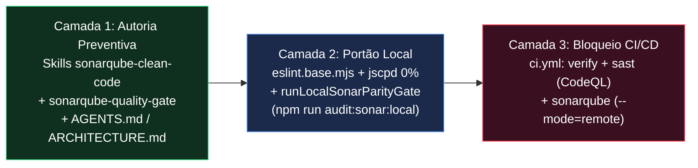

# 21 — Qualidade de Código, Regras SonarQube e Governança Preventiva

> **Documento normativo de qualidade estática do repositório (Prioridade 0 — `P0-CI`).** Complementa o [`AGENTS.md`](../AGENTS.md), o [Contrato de Qualidade (`ARCHITECTURE.md`)](ARCHITECTURE.md) e o [Dossiê de Segurança (`doc 13`)](13-dossie-de-seguranca-e-blindagem.md), consolidando as regras do **SonarQube / SonarCloud**, ESLint, CPD (`0%`), acessibilidade HTML/Angular, SCSS e segurança estática para aprovação **de primeira** no CI/CD.

---

## 0. Precedência Absoluta de CI/CD e Qualidade Estática (Prioridade 0)

As regras de **CI/CD, SonarQube Cloud, ESLint/SonarJS, Prettier, Typecheck, CPD `0%` e Segurança de Pipeline** possuem **prioridade máxima absoluta (`P0-CI`)** e **sempre vêm na frente de qualquer outra regra, feature, polimento visual, refatoração ou item da [Fila Prioritária](00-fila-prioritaria-melhorias.md) / [Roadmap](00-visao-geral-e-roadmap.md)**.

1. **P0-CI (Máxima Precedência):** Pipeline CI/CD verde ([`ci.yml`](../.github/workflows/ci.yml)) + SonarQube Gate `OK` (`0` issues de qualquer severidade, `0` Security Hotspots `TO_REVIEW`, `0%` duplicação) + `npm run audit:sonar:local` + `npm run typecheck` + `npm run format:check` + testes + segurança (`Gitleaks`, `npm audit`, `CodeQL`, `Trivy`).
2. **P0/P1 de Produto & UI:** Regra Zero de UI ([`AGENTS.md §1`](../AGENTS.md#1-regra-zero-de-ui--fidelidade-visual)) e [Fila Prioritária (`docs/00-fila-prioritaria-melhorias.md`)](00-fila-prioritaria-melhorias.md).
3. **Roadmap Geral:** Fases futuras ([`00-visao-geral-e-roadmap.md`](00-visao-geral-e-roadmap.md)).

> **Regra operacional de interrupção:** se existir **qualquer** issue aberta no SonarCloud ou falha no CI/CD, sua resolução interrompe e precede imediatamente qualquer outra tarefa em andamento. Nenhuma entrega pode ser declarada concluída nem enviada via `git push` sem o portão local aprovado (`npm run audit:sonar:local`) e o portão remoto zerado (`npm run audit:sonar`).

---

## 1. Política de Tolerância Zero

A régua padrão do Sonar ("Sonar way") tolera até `3%` de duplicação ou code smells leves em código legado. No **PokéVerse OS**, a política é **tolerância zero** sobre todo o código-fonte (`apps/**` e `packages/**`):

| Critério | Meta Obrigatória | Onde é Bloqueante |
| :--- | :---: | :--- |
| **Quality Gate (SonarCloud)** | `OK` | `npm run audit:sonar` e job `sonarqube` ([`ci.yml`](../.github/workflows/ci.yml)) |
| **Issues em aberto (`resolved=false`)** | **`0`** (`BUG`, `VULNERABILITY`, `CODE_SMELL`, de `BLOCKER` a `INFO`) | `npm run audit:sonar` e job `sonarqube` |
| **Security Hotspots (`TO_REVIEW`)** | **`0`** | `npm run audit:sonar` e job `sonarqube` |
| **Duplicação de Código (CPD)** | **`0` linhas** e **`0` blocos** (`0.00%`) | `npm run audit:duplication` (`jscpd`) + `sonarqube` |
| **ESLint + SonarJS + Paridade Local** | **`0` erros e `0` warnings** (`--max-warnings=0`) | `npm run audit:sonar:local` e job `verify` |
| **Formatação e Tipagem** | `0` desvios Prettier / `0` erros `tsc --noEmit` | `npm run format:check`, `npm run typecheck` e job `verify` |

> **Proibido mascarar apontamentos:** não utilize `// NOSONAR`, `@SuppressWarnings`, `/* cpd-ignore */` ou supressões amplas de `eslint-disable` para esconder dívida real. Corrija na origem extraindo helpers, diretivas, componentes ou fixtures compartilhados.

---

## 2. Arquitetura de Defesa em 3 Camadas



1. **Camada 1 — Autoria Preventiva (Agentes de IA & Desenvolvedores):** consulta obrigatória à skill **`sonarqube-clean-code`** antes e durante a escrita/refatoração de código TypeScript, JavaScript, HTML/Angular e CSS/SCSS, somada à skill **`sonarqube-quality-gate`** antes de qualquer `git push`.
2. **Camada 2 — Portão Local + Git Hooks (`npm run verify:commit` / `npm test` / `npm run verify:push`):**
   - [`eslint.base.mjs`](../eslint.base.mjs) ativa regras *type-aware* (`@typescript-eslint/require-await`, `prefer-optional-chain`, `prefer-readonly`) nos **3 workspaces** (`@pokeverse/shared`, `pokeverse-api`, `pokeverse-web`) e aplica `sonarjs/no-nested-conditional` (`S3358`) inclusive em `.spec.ts` / `.e2e-spec.ts`.
   - [`scripts/sonar-quality-gate.mjs`](../scripts/sonar-quality-gate.mjs) (`--mode=local`) executa `jscpd` (`--threshold 0`) e o motor modular [`scripts/sonar-parity-rules.mjs`](../scripts/sonar-parity-rules.mjs) sobre `.ts`, `.js`, `.html` e `.scss`.
   - [`scripts/ci-parity-checks.mjs`](../scripts/ci-parity-checks.mjs) e [`scripts/verify-docker-build.mjs`](../scripts/verify-docker-build.mjs) validam localmente todas as etapas não-Sonar do CI/CD: detecção de segredos estilo Gitleaks (`audit:secrets`), `prisma validate` + ordem de migrations (`audit:prisma`), simulação isolada de contexto/lifecycle hooks de `infra/docker/api.Dockerfile` + `docker build` (`audit:docker`) e invariantes de `deploy.yml`/`_headers`/`_routes.json`.
   - [`scripts/verify-commit-fast.mjs`](../scripts/verify-commit-fast.mjs) mantém o [`.githooks/pre-commit`](../.githooks/pre-commit) ágil (~1–3s para não travar o Source Control do VS Code) executando `audit:secrets`, paridade Sonar/Prettier nos arquivos *staged* e `audit:prisma` condicional. Já [`scripts/run-verify-suite.mjs`](../scripts/run-verify-suite.mjs) concentra as verificações pesadas em ondas paralelas no `npm test` (`--mode=test`: todas as checagens estáticas + `test:quality-gates` + `test:unit:*` localmente, ou apenas testes no `CI=true`) e no [`.githooks/pre-push`](../.githooks/pre-push) (`--mode=push`: paridade integral de CI com cache por *tree SHA* limpo e `--no-cache`).
   - [`scripts/quality-gate.spec.mjs`](../scripts/quality-gate.spec.mjs) (`npm run test:quality-gates`, integrado a `npm run test` e `verify:push`) valida **regressivamente** todas as regras SonarCloud (paridade + AST real do ESLint/Prettier), paridade Gitleaks, simulação negativa/positiva do build Docker e invariantes de `ci.yml`/`deploy.yml`/Prisma/hooks antes de qualquer push.
3. **Camada 3 — Bloqueio Remoto em CI/CD ([`.github/workflows/ci.yml`](../.github/workflows/ci.yml) + [`.sonarcloud.properties`](../.sonarcloud.properties)):** o job `verify` roda Gitleaks, `npm audit --omit=dev --audit-level=high`, `typecheck`, `lint`, `format:check`, `audit:duplication`, unitários (+ `test:quality-gates`), E2E, `build`, `audit:ui`, Playwright e Trivy; em seguida, o job `sonarqube` (`needs: [verify]`) consulta o SonarCloud e falha o pipeline se qualquer métrica fugir de `0`.

---

## 3. Catálogo de Regras Obrigatórias por Linguagem

### 3.1. TypeScript & JavaScript (SonarAnalyzer JS/TS + ESLint)

| Regra | Exigência | Errado | Certo |
| :--- | :--- | :--- | :--- |
| **`typescript:S6582`** | Usar *optional chaining* (`?.`) em vez de guarda `a && a.b` *(não converter `a && a.x !== y` se `a` puder ser nullish)* | `if (active && active.name === q)` | `if (active?.name === q)` (ou `const match = active?.name === q; if (active && match)`) |
| **`typescript:S7747`** | Nunca copiar iterável dentro de `for...of`; usar loop reverso por índice ao mutar | `for (const c of [...group.children])` / `Array.from(set)` | `for (const item of set)` ou `for (let i = arr.length - 1; i >= 0; i -= 1)` |
| **`typescript:S7763`** | Re-export direto sem `import` intermediário órfão | `import { Foo } from '@pkg'; export { Foo };` | `export { Foo } from '@pkg';` |
| **`typescript:S7727`** | Não passar função diretamente em `.map()`/`.filter()` | `items.map(formatPokeApiText)` | `items.map((item) => formatPokeApiText(item))` |
| **`typescript:S2933`** | Marcar campos de classe não reatribuídos como `readonly` | `private timerSub: Subscription;` | `private readonly timerSub: Subscription;` |
| **`typescript:S7503`** | Proibido `async` sem expressão `await` | `async getList() { return this.list; }` | `getList() { return Promise.resolve(this.list); }` |
| **`typescript:S7649`** | Não usar alias em `@Input()` / `input()` no Angular | `readonly order = input(0, { alias: 'pvOrder' })` | `readonly pvOrder = input(0)` |
| **`typescript:S7780` / `S7781` / `S4624`** | Usar `String.raw`, `.replaceAll()` e evitar template literals aninhados | `str.replace(/ /g, '-')` | `str.replaceAll(' ', '-')` / ``String.raw`\d+` `` |
| **`typescript:S3358`** | Proibido ternário aninhado | `a ? x : b ? y : z` | Função auxiliar ou `if` com *early return* |
| **`typescript:S3776` / `complexity`** | Complexidade cognitiva e ciclomática `<= 15`, `max-depth <= 3` | Cascatas `if/else` profundas | *Guard Clauses* + extração de helpers |
| **`typescript:S107` (`max-params`)** | Máximo de **7 parâmetros** por função/método *(acima de 3–4, usar objeto de opções)* | `fn(a, b, c, d, e, f, g, h)` | `fn(params: { ... })` *(exceção documentada em [`apps/api/eslint.config.mjs`](../apps/api/eslint.config.mjs) apenas para 2 construtores DI legados de Auth aprovados no SonarCloud)* |
| **`typescript:S9382` (`no-await-in-loop`)** | Proibido `await` dentro de loops | `for (const id of ids) await fetch(id);` | `await Promise.all(ids.map((id) => fetch(id)))` |
| **`typescript:S7764` / `S5906`** | Preferir `globalThis` a `window`/`typeof navigator` e matchers específicos em testes | `expect(x).toBe(undefined)` / `window.localStorage` | `expect(x).toBeUndefined()` / `globalThis.localStorage` |
| **`typescript:S7758`** | Preferir `String#codePointAt()` a `String#charCodeAt()` | `token.charCodeAt(idx)` | `token.codePointAt(idx)` |
| **`typescript:S7766`** | Usar `Math.max()` / `Math.min()` em vez de ternário simples de limite | `idx >= 0 ? idx : 0` | `Math.max(idx, 0)` |

### 3.2. Segurança Estática & Prevenção de Vulnerabilidades (Conexão com [Doc 13](13-dossie-de-seguranca-e-blindagem.md))

As regras estáticas atuam em conjunto com **Gitleaks**, **CodeQL** e **SonarCloud Security Hotspots**:

- **`typescript:S8786` (Anti-ReDoS):** proibido escrever regexes com backtracking superlinear (ex.: `/^\s*(...)\s*$/` sobre entradas longas). Normalize com `.trim()` antes de aplicar `/^(-?\d+)\s+([a-z.]+)$/i.exec(part.trim())`.
- **`typescript:S5869`:** proibido repetir caracteres na mesma *character class* em expressões regulares.
- **Tipagem e Injeção:** `@typescript-eslint/no-explicit-any: 'error'`, proibição de `[innerHTML]`/`dangerouslySetInnerHTML`, proibição de URLs `javascript:`/`data:`, e zero credenciais, IPs ou segredos hardcoded no código de produção (coberto também por `sonarjs/no-hardcoded-passwords`, `no-hardcoded-ip` e `no-clear-text-protocols`).
- **Validação na borda:** todo input externo entra por schema Zod `.strict()` em `@pokeverse/shared` ([doc 13](13-dossie-de-seguranca-e-blindagem.md#2-radiografia-atual-controles-implementados-vs-lacunas-abertas)).

### 3.3. Templates HTML & Acessibilidade Angular (`Web:S*`)

| Regra | Exigência | Errado | Certo |
| :--- | :--- | :--- | :--- |
| **`Web:S6819`** | Usar elemento semântico HTML nativo em vez de `role="..."` substituível | `<div role="region" aria-label="...">` | `<section aria-label="...">` (`<nav>`, `<button>`, ``, `<fieldset>`, `<ul>/<li>`) |
| **`Web:S1082` / `MouseEventWithoutKeyboardEquivalentCheck`** | Todo elemento interativo com `(click)` exige equivalência de teclado — preferir `<button type="button">` nativo (inclusive em backdrops) | `<div class="backdrop" (click)="close()">` | `<button type="button" class="backdrop" aria-label="..." (click)="close()">` |
| **`Web:S6825`** | Proibido `aria-hidden="true"` em elemento focável | `<canvas tabindex="0" aria-hidden="true">` ou `<button aria-hidden="true">` | Remover `aria-hidden` de elementos focáveis ou torná-los não focáveis |
| **`Web:S6843`** | Proibido atribuir `role` não-interativo a elemento interativo | `<button role="presentation">` | Manter semântica nativa do controle |
| **`Web:S6853`** | `<label>` deve estar associado a exatamente **1** controle de formulário | `<label>...<input /><button>Ir</button></label>` | `<div class="field"><label for="id">...</label><div class="inline"><input id="id" /><button>Ir</button></div></div>` |
| **`Web:S7927`** | `aria-label` em controle com rótulo visível deve conter o texto visível; em `<select>`, usar `<label for="...">` em vez de `aria-label` | `<button aria-label="Abrir">Detalhes</button>` / `<select id="x" aria-label="Perfil">...</select>` | `<button aria-label="Detalhes do Pokémon">Detalhes</button>` / `<label for="x" class="sr-only-static">Perfil</label><select id="x">...</select>` |

> **Nota sobre `<select>` no Angular (`Web:S7927`):** O analisador HTML do SonarCloud interpreta o conteúdo interno do `<select>` (`@for` + `<option>`) como texto visível do controle e dispara `Web:S7927` quando `aria-label` não contém esse texto. Para evitar conflito, **não use `aria-label` diretamente em `<select>`**: associe um `<label for="...">` visível ou use a classe utilitária global `.sr-only-static` (definida em [`styles.scss`](../apps/web/src/styles.scss)) antes do `<select>`, preservando o layout e o nome acessível idêntico para leitores de tela (em conformidade também com `Web:S6853`).

### 3.4. CSS & SCSS (`css:S9440` + Design System)

- **`css:S9440`:** toda folha `.scss` de componente em `apps/web/src/app/**` que declarar `transition:` ou `animation:` (diferente de `none`) **deve** incluir bloco `@media (prefers-reduced-motion: reduce)` anulando a animação/transição.
- **`css:S4656` & `css:S4666`:** proibido declarar a mesma propriedade duas vezes dentro do mesmo bloco (`css:S4656`) ou repetir o mesmo seletor em blocos separados no mesmo escopo (`css:S4666`); consolide as propriedades em um único seletor.
- **Zero hardcode visual:** cores hex/rgb literais avulsas são proibidas em `apps/web/src/app/**` — usar tokens semânticos `--pv-*` de [`_tokens.scss`](../apps/web/src/styles/_tokens.scss) ([doc 20](20-polimento-visual-e-design-system-frontend.md)), validados em conjunto com `npm run audit:ui`.

### 3.5. Zero Duplicação (CPD `0%`) & Limites de Coesão

| Guardrail | Configuração Atual | Fonte |
| :--- | :--- | :--- |
| **Tamanho de arquivo (`max-lines`)** | `<= 300` linhas (geral) / `<= 200` linhas (`*.component.ts` no `web`) / `<= 400–450` (specs) | [`eslint.base.mjs`](../eslint.base.mjs) |
| **Tamanho de função (`max-lines-per-function`)** | `<= 65` linhas úteis | [`eslint.base.mjs`](../eslint.base.mjs) |
| **Complexidade & Aninhamento** | `complexity <= 15`, `max-depth <= 3`, `max-params <= 7` | [`eslint.base.mjs`](../eslint.base.mjs) |
| **Detector CPD (`jscpd`)** | `min-lines=10`, `min-tokens=95`, `threshold=0` (`0%` em `apps,packages`) | [`scripts/sonar-quality-gate.mjs`](../scripts/sonar-quality-gate.mjs) |
| **Exclusões CPD** | Apenas `**/*.spec.ts`, `**/*.e2e-spec.ts` e migrations geradas | [`.sonarcloud.properties`](../.sonarcloud.properties) |

Sempre que dois blocos compartilharem lógica ou markup repetitivo, extraia para função pura em `*.util.ts`, contrato em `@pokeverse/shared`, componente reutilizável ou helper em `*.spec-helper.ts`.

---

## 4. Skills Preventivas para Agentes de IA

Para evitar ciclos de retrabalho após falhas no CI/CD, o ambiente de agentes mantém duas skills complementares:

1. **`sonarqube-clean-code`** *(uso proativo durante escrita e refatoração):* aplicada **antes e durante** qualquer edição em TypeScript, JavaScript, templates HTML/Angular, CSS/SCSS e testes, garantindo conformidade com `S6582`, `S7747`, `S7763`, `S7727`, `S2933`, `S7503`, `S7649`, `S8786`, `Web:S6819`, `Web:S1082`, `Web:S6825`, `Web:S6853`, `css:S9440` e CPD zero logo na primeira escrita.
2. **`sonarqube-quality-gate`** *(portão obrigatório pré-push e auditoria CI/CD):* exige a execução de `npm run audit:sonar:local` (ESLint SonarJS + `jscpd` `0%` + paridade estática SonarCloud) e a verificação remota via `npm run audit:sonar` antes de considerar uma entrega pronta para `git push`.

---

## 5. Protocolo "Nunca Falhar Duas Vezes" & Matriz de Regressão Histórica

Qualquer erro ocorrido em CI/CD, SonarCloud, Prettier, Vitest/Jest ou UI Gate deve ser transformado em verificação local + teste de regressão em [`scripts/quality-gate.spec.mjs`](../scripts/quality-gate.spec.mjs) na mesma correção:

| Origem Histórica | Falhas Cobertas | Defesa Local & Teste de Regressão (`test:quality-gates`) |
| :--- | :--- | :--- |
| **SonarCloud JS/TS (AST & Type-Checked)** | `S9382` (`no-await-in-loop`), `S3358` (ternário aninhado em prod e specs), `S3776` (`cognitive-complexity`), `S7503` (`require-await`), `S6582` (`prefer-optional-chain`), `S2933` (`prefer-readonly`), `S8786` (`super-linear-regex`), `S5869` (`duplicates-in-character-class`), `S4624` (`no-nested-template-literals`), `S3516` (`no-invariant-returns`), `S5906` (`prefer-specific-assertions`), `S107` (`max-params`), `prettier/prettier` (Run `45352864410`) | [`eslint.base.mjs`](../eslint.base.mjs) (`typeAwareSonarRules: true` em `shared`, `api`, `web`) + **Suite 2** em [`scripts/quality-gate.spec.mjs`](../scripts/quality-gate.spec.mjs) |
| **SonarCloud TS Parity** | `S6582`, `S7747`, `S7763`, `S7758`, `S7766`, `S7727`, `S7649`, `S7781`, `S7780`, proibição `NOSONAR`/`cpd-ignore` | [`scripts/sonar-parity-rules.mjs`](../scripts/sonar-parity-rules.mjs) + **Suite 1 & Suite 4** em [`scripts/quality-gate.spec.mjs`](../scripts/quality-gate.spec.mjs) |
| **SonarCloud HTML (`Web:*`)** | `Web:S6819`, `Web:S1082` (`MouseEventWithoutKeyboardEquivalentCheck`), `Web:S6825`, `Web:S6843`, `Web:S6853`, `Web:S7927` | [`scripts/sonar-parity-rules.mjs`](../scripts/sonar-parity-rules.mjs) + **Suite 1 & Suite 4** |
| **SonarCloud CSS/SCSS (`css:*`)** | `css:S9440` (`prefers-reduced-motion`), `css:S4656` (propriedade duplicada), `css:S4666` (seletor duplicado — Run `45919655938`) | [`scripts/sonar-parity-rules.mjs`](../scripts/sonar-parity-rules.mjs) (scanner com suporte a `#{...}`) + **Suite 1 & Suite 4** |
| **SonarCloud PL/SQL & Draco** | `plsql:VarcharUsageCheck`, `plsql:CharVarchar`, `plsql:S1192`, assets `draco` (Run `45919655938`) | Exclusões validadas em [`.sonarcloud.properties`](../.sonarcloud.properties) (**Suite 3**) |
| **Falhas de Pipeline CI/CD** | Kafka `0.0.0.0` (Run `45106052067`), `ui-quality-gate` DevTools timeout & `.wasm` MIME (Runs `44711820371`, `44871732673`), OAuth E2E não hermético (Run `45373283111`), bleed de estado Vitest `PokedexDevice` (Run `45909358834`) e completude do `ci.yml` | Invariantes estruturais automatizados em **Suite 3** de [`scripts/quality-gate.spec.mjs`](../scripts/quality-gate.spec.mjs) |
| **Docker Build & Todas Etapas CI/Deploy** | `npm ci` falhando em `prepare` sem `scripts/` em `api.Dockerfile` (Runs `45942849996` e `45942850091`), segredos estilo Gitleaks, `prisma validate`, `npm audit`, E2E API/Web, `audit:ui` e `deploy.yml`/`_headers`/`_routes.json` | [`scripts/ci-parity-checks.mjs`](../scripts/ci-parity-checks.mjs) + [`scripts/verify-docker-build.mjs`](../scripts/verify-docker-build.mjs) + **Suites 5, 6 e 7** de [`scripts/quality-gate.spec.mjs`](../scripts/quality-gate.spec.mjs) (`verify:commit` + `verify:push`) |

---

## 6. Checklist Obrigatório Pré-Commit e Pré-Push

```bash
npm run verify:commit   # executado pelo .githooks/pre-commit (fast: secrets + staged Prettier/Sonar parity + Prisma condicional)
npm test                # executado localmente via run-verify-suite.mjs --mode=test (estáticos + quality-gates + unitários em paralelo)
npm run verify:push     # executado pelo .githooks/pre-push (ondas paralelas com 100% de paridade CI + cache por tree SHA limpo)
npm run audit:sonar     # verificação remota pós-push no SonarCloud
```

- [ ] `npm run audit:secrets`, `npm run audit:prisma` e `npm run format:check` aprovados.
- [ ] `npm run audit:sonar:local` aprovado com `0` erros/warnings de lint, `0` clones CPD e `0` violações de paridade estática (`S6582`, `S7747`, `S7758`, `S7763`, `S7766`, `S7727`, `S7649`, `S7780`, `S7781`, `Web:S6819`, `Web:S1082`, `Web:S6825`, `Web:S6843`, `Web:S6853`, `Web:S7927`, `css:S4656`, `css:S4666`, `css:S9440`).
- [ ] `npm run test:quality-gates`, `npm run typecheck`, `npm run audit:deps`, `npm run test:unit`, `npm run test:e2e:api`, `npm run build`, `npm run audit:ui`, `npm run test:e2e:web` e `npm run audit:docker` aprovados após a última edição.
- [ ] Em mudanças de UI, conferência visual real Desktop/Mobile aprovada.
- [ ] `npm run audit:sonar` confirma `Quality Gate OK`, `0` issues abertos, `0` hotspots `TO_REVIEW` e `0` duplicações após o push.
