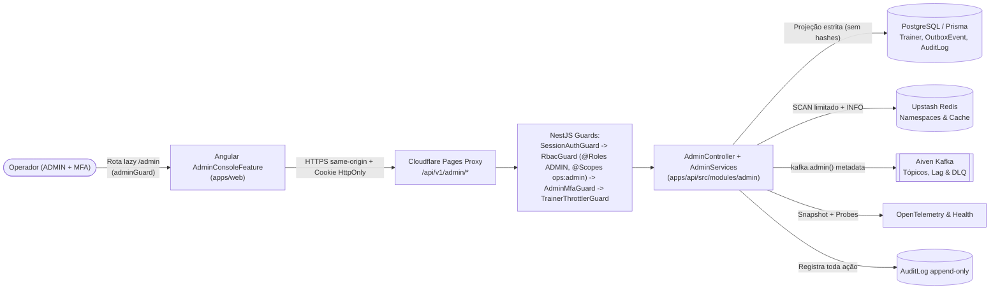

# 22 — Observabilidade em Produção, Guia de Uso Operacional e Painel Admin (`/admin`)

> **Por que este documento existe:** no [doc 19](19-observabilidade-telemetria-e-monitoramento.md), estruturamos a stack local de observabilidade (OpenTelemetry, Grafana, Prometheus, Loki, Tempo, Sentry e Datadog). Porém, **em produção hoje**, o criador do projeto ainda não tem uma tela única nem um roteiro direto para responder perguntas simples do dia a dia: *quantas pessoas acessaram o site, quantas contas foram criadas, quais Pokémon estão sendo salvos, o que há no Redis/Kafka e se algum job falhou*.
> Este documento resolve isso em **três partes**: (1) **como consultar tudo hoje** nos provedores em nuvem já conectados, (2) **o que falta ativar de métricas de negócio (`MEL-08`)**, e (3) **a especificação completa da tela `/admin` (`MEL-09`)** para inspecionar usuários, banco de dados, Redis, Kafka e telemetria dentro da própria plataforma.

---

## Sumário

1. [Diagnóstico: O que Já Existe vs. O que Falta](#1-diagnóstico-o-que-já-existe-vs-o-que-falta)
2. [Parte 1 — Guia Prático: Como Ver Seus Usuários e Infra em Produção Hoje](#2-parte-1--guia-prático-como-ver-seus-usuários-e-infra-em-produção-hoje)
3. [Parte 2 — Ativação Contínua e Métricas de Negócio Faltantes (`MEL-08`)](#3-parte-2--ativação-contínua-e-métricas-de-negócio-faltantes-mel-08)
4. [Parte 3 — Especificação Técnica do Painel Admin / Ops Console (`/admin` — `MEL-09`)](#4-parte-3--especificação-técnica-do-painel-admin--ops-console-admin--mel-09)
5. [Roteiro de Implementação Recomendado](#5-roteiro-de-implementação-recomendado)

---

## 1. Diagnóstico: O que Já Existe vs. O que Falta

| Camada | O que já funciona no código / infra | O que está faltando para o operador |
| :--- | :--- | :--- |
| **Back-end NestJS** | [`OpenTelemetryService`](../apps/api/src/common/telemetry/opentelemetry.service.ts), [`TelemetryController`](../apps/api/src/modules/system/telemetry.controller.ts) (`GET /api/v1/system/telemetry`), [`SentryErrorReporterService`](../apps/api/src/common/telemetry/sentry-error-reporter.service.ts) e [`StructuredLoggerService`](../apps/api/src/common/telemetry/structured-logger.service.ts). | Faltam contadores de negócio (cadastros, logins, buscas, slots salvos), `SENTRY_DSN`/OTLP configurados na Azure e endpoints administrativos (`/api/v1/admin/*`). |
| **Front-end Angular** | [`WebTelemetryService`](../apps/web/src/app/core/telemetry/web-telemetry.service.ts) (`LCP`/`CLS`/`LONG_TASK`), [`GlobalErrorHandler`](../apps/web/src/app/core/telemetry/global-error-handler.ts) (sob opt-in LGPD) e [`telemetryTraceInterceptor`](../apps/web/src/app/core/interceptors/telemetry-trace.interceptor.ts). | Falta analytics agregado de visitantes (Cloudflare Web Analytics) e a interface web **`/admin`** para leitura operacional sem depender de vários painéis externos. |
| **PostgreSQL (Neon)** | 14 modelos no [`schema.prisma`](../apps/api/prisma/schema.prisma) incluindo `Trainer`, `PokedexSlot`, `OutboxEvent` e `AuditLog` append-only. | Falta painel resumido e queries rápidas de acompanhamento de cadastros, retenção, Outbox e auditoria. |
| **Redis (Upstash)** | Cache PokéAPI (`24h` + `7d` stale), sessões opacas BFF, OTP e Throttler em TLS (`rediss://`). | Falta visão consolidada de chaves por namespace, memória e invalidação segura de cache. |
| **Kafka (Aiven)** | 3 tópicos ativos em mTLS (`pokeverse.world.events.v1`, `pokeverse.notifications.email.v1`, `pokeverse.dlq.v1`) + `OutboxRelayService`. | Falta visualização de lag de consumidores, offsets e inspeção/reprocessamento seguro de mensagens na DLQ pelo app. |

---

## 2. Parte 1 — Guia Prático: Como Ver Seus Usuários e Infra em Produção Hoje

Mesmo antes de implementar a tela `/admin`, **você já consegue ver todos os dados reais** acessando diretamente cada provedor provisionado na Fase 3 ([doc 10](10-infraestrutura-docker-ci-cd-e-deploy.md#5-estado-atual--checklist-da-migração-oficial-github-pages---produção)).

### 2.1. Visitantes e Tráfego do Site (Cloudflare Pages)

1. Acesse o **Cloudflare Dashboard** → **Workers & Pages** → projeto **`pokeverse`** (`https://pokeverse.pages.dev`).
2. Na aba **Analytics & Logs** → **Web Analytics**, clique em **Enable Web Analytics** (gratuito, *privacy-first*, sem cookies e compatível com a LGPD).
   - *Atenção ao CSP:* o projeto possui `Content-Security-Policy` estrito em [`apps/web/public/_headers`](../apps/web/public/_headers). Caso o Cloudflare injete script externo (`static.cloudflareinsights.com`), valide no Console do navegador se há bloqueio de CSP; se houver, adicione `https://static.cloudflareinsights.com` em `script-src` e `https://cloudflareinsights.com` em `connect-src` de `_headers` (ou use medição *first-party* no back-end).
3. Na aba **Functions**, acompanhe quantas chamadas passaram pelo proxy `/api/*`, `/health/*` e `/socket.io/*` e se houve erros `5xx`/`502`.

### 2.2. Contas Criadas, Slots, Outbox e Auditoria (Neon PostgreSQL)

1. Acesse o console do **Neon** → projeto **`pokeverse`** (`weathered-tooth-28070740`) → branch **`production`** → **SQL Editor**.
2. Execute os blocos **somente leitura** abaixo (nunca leia `passwordHash` ou `totpSecretEncrypted`):

```sql
-- 1) Resumo geral de usuarios, verificacao, MFA e OAuth
SELECT
  COUNT(*) AS total_trainers,
  COUNT(*) FILTER (WHERE "emailVerifiedAt" IS NOT NULL) AS verified_emails,
  COUNT(*) FILTER (WHERE "mfaEnabled" = true) AS mfa_enabled_count,
  COUNT(*) FILTER (WHERE role <> 'TRAINER') AS privileged_accounts,
  MAX("createdAt") AS latest_signup_at
FROM "Trainer";

-- 2) Novos cadastros por dia (ultimos 30 dias)
SELECT
  DATE_TRUNC('day', "createdAt")::date AS day,
  COUNT(*) AS new_trainers
FROM "Trainer"
WHERE "createdAt" >= NOW() - INTERVAL '30 days'
GROUP BY 1
ORDER BY 1 DESC;

-- 3) Ultimos 20 treinadores cadastrados (projeção segura sem segredos)
SELECT
  id,
  username,
  role,
  ("emailVerifiedAt" IS NOT NULL) AS email_verified,
  "mfaEnabled",
  "createdAt"
FROM "Trainer"
ORDER BY "createdAt" DESC
LIMIT 20;

-- 4) Top 15 Pokemon mais salvos nos slots da Pokedex
SELECT
  "pokemonId",
  "pokemonName",
  COUNT(*) AS saved_count
FROM "PokedexSlot"
GROUP BY "pokemonId", "pokemonName"
ORDER BY saved_count DESC
LIMIT 15;

-- 5) Saude da fila Transactional Outbox (Kafka relay)
SELECT
  status,
  COUNT(*) AS total,
  MAX("createdAt") AS newest_event_at
FROM "OutboxEvent"
GROUP BY status;

-- 6) Eventos Outbox com falha ou pendentes antigos (se houver)
SELECT id, "aggregateType", "eventType", status, "retryCount", "lastError", "createdAt", "processedAt"
FROM "OutboxEvent"
WHERE status <> 'PUBLISHED' OR "retryCount" > 0
ORDER BY "createdAt" DESC
LIMIT 25;

-- 7) Ultimos 30 registros de auditoria (RBAC, login, LGPD, tokens)
SELECT id, "actorTrainerId", "actorRole", action, resource, outcome, "traceId", "createdAt"
FROM "AuditLog"
ORDER BY "createdAt" DESC
LIMIT 30;
```

### 2.3. Sessões Ativas e Cache PokéAPI (Upstash Redis)

1. Acesse o **Upstash Console** → banco **`pokeverse-redis`** (`saved-ewe-133250.upstash.io`).
2. Na aba **Metrics**, confira comandos/dia, taxa de *hit/miss* e uso de memória (atenção à cota gratuita de `500k` comandos/mês).
3. Na aba **Data Browser** ou **CLI** do Upstash, use apenas `SCAN` (nunca `KEYS *` em produção, pois bloqueia o event loop do Redis):

```redis
DBSIZE
INFO memory
SCAN 0 MATCH session:* COUNT 100
SCAN 0 MATCH pokeapi:* COUNT 100
TTL pokeapi:catalog:enriched
```

> **Regra de segurança:** nunca leia nem copie valores inteiros de `session:*` ou `otp:*` para logs ou prints; apenas valide existência/contagem via `SCAN` e `TTL`.

### 2.4. Tópicos, Lag e DLQ (Aiven for Apache Kafka)

1. Acesse o **Aiven Console** → serviço **`pokeverse-kafka`** (`free-0`).
2. Abra a aba **Topics** e verifique os 3 tópicos provisionados em produção:
   - `pokeverse.world.events.v1` (cadastros e slots salvos/limpos)
   - `pokeverse.notifications.email.v1` (envios de OTP e boas-vindas — payload cifrado com AES-256-GCM)
   - `pokeverse.dlq.v1` (**Dead Letter Queue:** idealmente sempre com `0` mensagens; se houver mensagens, indica falha após retries no consumidor).
3. Na aba **Consumer groups**, verifique se o lag está em `0` (todos os eventos processados pelos consumidores NestJS).

### 2.5. Logs, Erros 5xx e Snapshot de Telemetria (Azure Container Apps)

1. No **Portal Azure**, abra o Container App **`pokeverse-api`** (Resource Group **`rg-pokeverse-prod`**) → **Monitoring** → **Log stream** para acompanhar os logs JSON do `StructuredLoggerService` ao vivo (filtrando por `"level":"error"`).
2. Pelo terminal local autenticado no Azure CLI:

```bash
az containerapp logs show \
  --name pokeverse-api \
  --resource-group rg-pokeverse-prod \
  --follow
```

3. **Endpoint protegido já existente (`GET /api/v1/system/telemetry`):**
   - Já implementado em [`TelemetryController`](../apps/api/src/modules/system/telemetry.controller.ts), exigindo `@Roles('MODERATOR', 'ADMIN')` e `@Scopes('ops:audit')`.
   - Para consultar com sua própria conta em produção:
     1. Crie sua conta normalmente em `https://pokeverse.pages.dev/`, verifique o e-mail e ative o **MFA (TOTP ou Passkey)**.
     2. Promova apenas a **sua** conta no SQL Editor do Neon (bootstrap administrativo seguro, sem rota HTTP pública):
        ```sql
        UPDATE "Trainer" SET role = 'ADMIN' WHERE username = 'seu_username';
        ```
     3. Faça **logout e login novamente** (para emitir nova sessão Redis com `role = 'ADMIN'`) e acesse `https://pokeverse.pages.dev/api/v1/system/telemetry` autenticado no navegador.

### 2.6. Entregabilidade de E-mails (Resend)

1. Acesse o painel **Resend** → **Emails** para confirmar se os OTPs de verificação, boas-vindas e reset de senha estão sendo entregues (`Delivered`) ou bloqueados (`Bounced` / restrição de destinatário enquanto o remetente usar `onboarding@resend.dev` antes do domínio próprio).

---

## 3. Parte 2 — Ativação Contínua e Métricas de Negócio Faltantes (`MEL-08`)

Hoje o `GET /api/v1/system/telemetry` retorna contadores **em memória da réplica** desde o último restart (HTTP, cache PokéAPI, Prisma, Kafka, WS, RUM e erros). Se o container reiniciar no Azure ou houver múltiplas réplicas, os contadores zeram.

### 3.1. Ativações de Infraestrutura Recomendadas (Custo Zero)

1. **Ativar Sentry em Produção:** criar projeto gratuito no Sentry (`Node.js`), pegar o `SENTRY_DSN` e salvar como segredo no Azure Container Apps (`pokeverse-api`). Tanto exceções `5xx` da API quanto crashes do Angular (via `/api/v1/telemetry/errors`, com opt-in LGPD) passarão a gerar alerta imediato no seu e-mail/Discord.
2. **Conectar OTLP ao Grafana Cloud Free:** apontar `OTEL_EXPORTER_OTLP_ENDPOINT` (e cabeçalho de autenticação quando adicionado ao `env.schema.ts` / `otel-sdk.bootstrap.ts`) para o **Grafana Cloud Free Tier**, mantendo histórico persistente de métricas, logs e traces na nuvem fora do container efêmero.
3. **Monitor de Uptime Externo:** configurar check gratuito (Better Stack / UptimeRobot) em `https://pokeverse.pages.dev/health/ready` a cada `5 minutos` com alerta em caso de falha de Postgres, Redis ou Kafka.

### 3.2. Novas Métricas de Negócio para Instrumentar no Código (`MEL-08`)

Estender [`TelemetryMetricsPort`](../apps/api/src/common/telemetry/telemetry.port.ts), [`OpenTelemetryService`](../apps/api/src/common/telemetry/opentelemetry.service.ts) e [`TelemetrySnapshotSchema`](../packages/shared/src/schemas/health.schemas.ts) com contadores de baixa cardinalidade (zero PII nos labels):

| Métrica | Tipo OTel | Labels permitidos | Onde registrar |
| :--- | :--- | :--- | :--- |
| `business_trainer_registrations_total` | Counter | `method=password\|google` | `CredentialsAuthService` e `GoogleAccountLinkerService` |
| `business_trainer_logins_total` | Counter | `method=password\|google\|passkey`, `mfa=true\|false` | `TrainerSessionIssuerService` |
| `business_pokedex_slots_saved_total` | Counter | `action=save\|swap\|clear` | `PokedexSlotsService` |
| `business_pokedex_searches_total` | Counter | `surface=catalog\|enriched\|encyclopedia` | `PokedexController` / `PokedexEncyclopediaController` |
| `business_visor_mode_opened_total` | Counter | `mode=ficha\|holocron\|comparar\|calculadora\|enciclopedia` | Eventos opt-in via `/api/v1/telemetry/rum` (`WebTelemetryService`) |

---

## 4. Parte 3 — Especificação Técnica do Painel Admin / Ops Console (`/admin` — `MEL-09`)

Para que o operador consiga inspecionar **usuários, PostgreSQL, Redis, Kafka e telemetria** em uma única tela protegida dentro do próprio PokéVerse OS, especificamos abaixo a arquitetura completa seguindo estritamente [`AGENTS.md`](../AGENTS.md) e [`REQ-SEC-01..35`](16-cookies-lgpd-e-requisitos.md#43-catálogo-normativo-de-requisitos-de-segurança-req-sec-01-a-req-sec-35).

### 4.1. Arquitetura de Fluxo e Segurança



### 4.2. Regras Inegociáveis de Blindagem (`REQ-SEC`)

1. **Novo escopo `ops:admin` em `@pokeverse/shared`:**
   - Estender `PermissionScopeSchema` e `ROLE_DEFAULT_SCOPES` em [`rbac.schemas.ts`](../packages/shared/src/schemas/rbac.schemas.ts) adicionando `'ops:admin'` exclusivamente ao perfil `ADMIN` (mantendo `'ops:audit'` para `MODERATOR` e `ADMIN`).
2. **Dupla barreira de acesso (`@Roles('ADMIN')` + `@Scopes('ops:admin')` + `AdminMfaGuard`):**
   - Mesmo um usuário com `role = 'ADMIN'` só pode acessar `/api/v1/admin/*` se a conta estiver com `mfaEnabled === true` (ou em ambiente local `NODE_ENV=development` quando explicitamente permitido).
   - Rate limit dedicado via `TrainerThrottlerGuard` (ex.: `30 req/min` por `trainerId`) para impedir abuso e estouro da cota do Upstash Redis.
3. **Proibição Absoluta de Exposição de Segredos ou SQL Arbitrário:**
   - **Nunca** criar terminal SQL livre no `/admin` nem comando arbitrário `EVAL`/`FLUSHALL` no Redis.
   - **Projeção estrita no Prisma (`select`):** jamais retornar `passwordHash`, `totpSecretEncrypted`, `tokenHash`, `codeHash`, `publicKey` ou `ipHash` bruto.
   - **Redis seguro:** `GET /admin/redis/summary` lê apenas `INFO`, `DBSIZE`, contagem aproximada por prefixo via `SCAN` com teto máximo de iterações e cache curto de `30s`; valores de chaves `session:*`, `otp:*` e `throttle:*` **nunca** podem ser lidos pelo endpoint (apenas contagem/TTL). Somente chaves públicas `pokeapi:*` podem ser listadas com TTL e invalidadas.
   - **Kafka seguro:** exibir apenas tópicos, partições, offsets, *consumer group lag* e metadados não sensíveis da DLQ (`eventId`, `eventType`, `topic`, `error`, `occurredAt`); **nunca** decifrar nem exibir payloads de `pokeverse.notifications.email.v1` na UI (pois contêm e-mail e código OTP).
4. **Auditoria Imutável (`AuditLog`):**
   - Toda consulta a listas sensíveis (`admin.users.listed`, `admin.audit.viewed`, `admin.kafka.viewed`) e toda ação mutante (`admin.outbox.retried`, `admin.redis.pokeapi_cache.purged`) grava um registro append-only em `AuditLog` com `actorTrainerId`, `traceId` e metadados.
5. **Bootstrap de Admin fora da API:**
   - Não deve existir nenhum endpoint HTTP público para promover usuário a `ADMIN`. A promoção inicial ocorre exclusivamente via SQL direto no Neon ou script CLI autenticado.

### 4.3. Contratos de API Planejados (`apps/api/src/modules/admin/`)

Todos os DTOs de query e resposta devem residir em `@pokeverse/shared` (`packages/shared/src/schemas/admin.schemas.ts`) validados por `ZodValidationPipe` e com **paginação obrigatória** (`limit`/`offset` com teto máximo `50`):

| Método & Rota | Descrição | Guardas & Observações |
| :--- | :--- | :--- |
| `GET /api/v1/admin/overview` | KPIs consolidados: total de treinadores, novos nas últimas 24h/7d/30d, verificados, MFA ativo, total de slots salvos, status do Outbox, memória Redis, lag Kafka e uptime da API. | `ADMIN` + `ops:admin` + `AdminMfaGuard` |
| `GET /api/v1/admin/users?limit=20&offset=0&q=&role=&verified=` | Lista paginada de contas (`id`, `username`, `email` mascarado opcional ou visível só com ação auditada, `role`, `emailVerified`, `mfaEnabled`, contagem de `passkeys`/`oauthAccounts`/`pokedexSlots`, `createdAt`). | Sem colunas de hash/segredo; grava `AuditLog`. |
| `GET /api/v1/admin/database/summary?outboxStatus=&limit=20&offset=0` | Contagem exata das `14` tabelas do schema, lista paginada de `OutboxEvent` (filtrável por `PENDING`/`PUBLISHED`/`FAILED`) e lista paginada de `AuditLog`. | Consultas tipadas via `AdminRepository` (zero `$queryRawUnsafe`). |
| `POST /api/v1/admin/database/outbox/:id/retry` | Reenfileira um `OutboxEvent` com status `FAILED` resetando `status = 'PENDING'` e `processedAt = null` para o `OutboxRelayService` reprocessar. | Ação auditada + confirmação explícita na UI. |
| `GET /api/v1/admin/redis/summary?prefix=pokeapi:&cursor=0&limit=25` | `DBSIZE`, uso de memória (`used_memory_human`), taxa hit/miss do Redis, contagem por prefixo (`session:*`, `pokeapi:*`, `otp:*`, `idemp:*`, `throttle:*`) e paginação por cursor apenas de chaves `pokeapi:*` com `TTL`. | Cache curto (`30s`) em memória ou chave dedicada para proteger cota Upstash. |
| `DELETE /api/v1/admin/redis/pokeapi-cache` | Invalida chaves `pokeapi:*` em lote controlado (`SCAN` + `UNLINK`, nunca `KEYS`/`DEL` bloqueante) para forçar reaquecimento contra a PokéAPI. | Exige confirmação na UI e grava `AuditLog`. |
| `GET /api/v1/admin/kafka/summary` | Lista tópicos (`KAFKA_TOPICS`), partições, *watermarks* (low/high offset), *consumer groups* e lag por partição via `kafka.admin()`, além de contagem/amostra sanitizada da `pokeverse.dlq.v1`. | Timeout curto (`3000ms`) para não travar a tela se o broker oscilar. |
| `GET /api/v1/admin/telemetry` | Agrega `TelemetrySnapshot` atual, resultado de `/health/ready`, estado dos *Circuit Breakers* (`pokeapi.co`, `graphql.pokeapi.co`) e conexões WebSocket ativas. | Reutiliza `TelemetryMetricsPort` + `InfraProbesService`. |

### 4.4. Arquitetura Front-end Planejada (`apps/web/src/app/features/admin-console/`)

Para não impactar o orçamento de bundle inicial (`<= 501 kB`) dos visitantes comuns:

1. **Rota Lazy + Guard Dedicado:**
   - Adicionar rota `{ path: 'admin', canActivate: [authGuard, adminGuard], loadComponent: ... }` em [`app.routes.ts`](../apps/web/src/app/app.routes.ts).
   - `adminGuard` verifica `AuthStore.trainer()?.role === 'ADMIN'` (redirecionando silenciosamente para `/inicio` para não vazar estrutura administrativa a visitantes).
   - No [`HudUserMenuComponent`](../apps/web/src/app/shared/hud/hud-user-menu.component.ts), exibir o botão **"Painel Admin"** apenas quando `trainer()?.role === 'ADMIN'`.
   - Incluir `<meta name="robots" content="noindex, nofollow">` via `SeoMetaService` ao entrar em `/admin`.
2. **Decomposição SOLID (máx. ~150–200 linhas por componente UI / ~300 linhas no store):**
   - `admin-console.store.ts` + `admin-api.client.ts` (estado por Signal com *Discriminated Unions* e `AbortController` / `takeUntilDestroyed`).
   - `admin-console-page.component.ts` (shell com 6 abas segmentadas usando tokens `--pv-*` e primitivos `.pv-glass-card`, `.pv-btn`, `.pv-badge` de [`_primitives.scss`](../apps/web/src/styles/_primitives.scss)):
     1. **Visão Geral:** cards de métricas (Treinadores, Verificados, MFA, Slots, Outbox, Redis, Kafka, Erros 5xx) + gráfico/série temporal simples dos últimos 30 dias.
     2. **Usuários & Contas:** busca, filtros (`role`, `emailVerified`, `mfaEnabled`), tabela paginada e resumo de adoção (Google OAuth, Passkeys, TOTP).
     3. **Banco de Dados & Auditoria:** saúde das 14 tabelas, fila `OutboxEvent` com botão **Reprocessar** em eventos `FAILED` e trilha `AuditLog` filtrável.
     4. **Redis & Cache:** consumo de memória, hit ratio, volume por namespace e inspetor/expurgo seguro de chaves `pokeapi:*`.
     5. **Kafka & Mensageria:** tabela de tópicos, partições, *consumer lag* e inspetor sanitizado da DLQ (`pokeverse.dlq.v1`).
     6. **Telemetria & Saúde:** leitura viva de `/api/v1/admin/telemetry`, probes (`Postgres`, `Redis`, `Kafka`, `S3`), *Circuit Breakers* e links rápidos para Grafana/Sentry/Neon/Upstash/Aiven.
3. **Estados Completos e Acessibilidade (WCAG 2.2 AA):**
   - Todas as 6 abas devem implementar os **5 estados obrigatórios** (*Loading* com skeleton, *Empty*, *Error* com botão *Tentar novamente*, *Success* e *Mutating* bloqueando duplo clique em ações como *Retry Outbox* / *Limpar Cache*) e confirmação explícita em duas etapas para ações destrutivas/mutantes.

---

## 5. Roteiro de Implementação Recomendado

Alinhado com a regra de entregas atômicas do repositório e a [Fila Prioritária](00-fila-prioritaria-melhorias.md):

1. **Etapa 1 — Visibilidade Imediata sem Código (`MEL-08` parte 1):**
   - Ativar **Cloudflare Web Analytics**, configurar **`SENTRY_DSN`** no Azure, criar monitor externo em `/health/ready` e salvar as queries SQL do Neon desta documentação.
2. **Etapa 2 — Métricas de Negócio + Contratos Shared (`MEL-08` parte 2 + base `MEL-09`):**
   - Adicionar contadores de negócio no `OpenTelemetryService`, adicionar `'ops:admin'` em `rbac.schemas.ts` e criar `admin.schemas.ts` em `@pokeverse/shared` com testes unitários.
3. **Etapa 3 — Back-end `AdminModule` (`MEL-09` API):**
   - Implementar `AdminController`, `AdminMfaGuard`, `AdminDatabaseService` + `AdminRepository`, `AdminRedisService`, `AdminKafkaService` e `AdminOverviewService`, com testes unitários e E2E HTTP garantindo que `VISITOR`, `TRAINER` e `MODERATOR` recebam `403 Forbidden` e `ADMIN` sem MFA seja bloqueado em produção.
4. **Etapa 4 — Front-end `/admin` (`MEL-09` Web):**
   - Implementar `admin-console/` com chunk lazy, as 6 abas em conformidade com ESLint/SonarQube/Prettier, testes Vitest, conferência visual real em `1440×900` e `375×812` (`npm run audit:ui` + Playwright) e sincronização de [`README.md`](../README.md) e [`docs/14`](14-status-e-changelog-implementacao.md).
