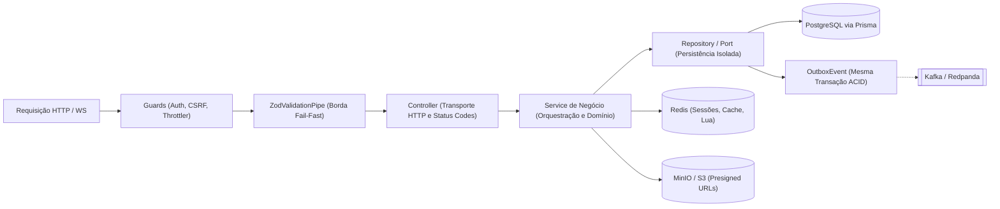

# Contrato de Qualidade — Diretrizes de Arquitetura e Padrões de Código (PokéVerse OS)

> **Documento normativo do repositório.** Complementa o [`AGENTS.md`](../AGENTS.md) e estabelece o **Contrato de Qualidade** obrigatório para qualquer código novo ou refatorado na stack do PokéVerse OS (`@pokeverse/shared`, `apps/api` e `apps/web`), impedindo a entrada de dívida técnica, acoplamento estrutural e **AI slop** (código gerativo genérico, prolixo, não otimizado ou cheio de boilerplate).

---

## Sumário

1. [Princípio Shift-Left e Design Ativo](#1-princípio-shift-left-e-design-ativo)
2. [Tratamento de Estado e Infraestrutura](#2-tratamento-de-estado-e-infraestrutura)
3. [Segurança e Validação (Fail-Fast)](#3-segurança-e-validação-fail-fast)
4. [Performance e Otimização (Banco de Dados)](#4-performance-e-otimização-banco-de-dados)
5. [Clean Code e Semântica (Anti-AI Slop)](#5-clean-code-e-semântica-anti-ai-slop)
6. [Diretrizes de Atuação para IA e Fluxo de Trabalho (Sessões Curtas)](#6-diretrizes-de-atuação-para-ia-e-fluxo-de-trabalho-sessões-curtas)

---

## 1. Princípio Shift-Left e Design Ativo

O **Shift-Left** exige que erros arquiteturais, violações de contrato e falhas de segurança sejam barrados o mais cedo possível — no design, nos tipos em tempo de compilação (`@pokeverse/shared`) e na borda HTTP/WS — antes de alcançarem a regra de negócio ou o banco de dados.

### 1.1. A Infraestrutura Obedece ao Domínio (DIP)

- O núcleo de regras de negócio (`packages/shared/src/domain/` e services de domínio/aplicação em `apps/api` e `apps/web`) **não depende** de detalhes concretos de banco de dados, cache, HTTP, DOM ou broker de mensageria.
- Contratos, enums, constantes e schemas **Zod v4** residem exclusivamente em `@pokeverse/shared` como fonte única da verdade (*Single Source of Truth*). Front-end e back-end importam esses contratos — duplicação entre `apps/web` e `apps/api` é proibida.
- No Angular, stores e services de estado jamais acessam o DOM diretamente (`document.querySelector` / `querySelectorAll`); a interação com elementos de tela ocorre via diretivas declarativas e `viewChild`.

### 1.2. Separação Rigorosa de Responsabilidades (SoC)



- **Controllers são adaptadores finos de transporte:** recebem parâmetros já validados pelo `ZodValidationPipe`, delegam ao Service específico do caso de uso, definem cookies BFF ou status HTTP adequados e retornam a resposta serializada. **Nenhuma regra de negócio, cálculo, loop de domínio ou acesso direto ao Prisma/Redis pode existir dentro de um Controller.**
- **Services de negócio orquestram regras e invariantes:** mantêm coesão estrita (limite alvo de **~300 linhas** por service/store; **~150–200 linhas** por componente de UI), aplicando os 5 princípios **SOLID** e delegando persistência aos Repositórios.
- **Repositórios e Adaptadores Isolados:** consultas diretas via `PrismaService` não devem poluir Services de negócio. Toda query SQL/Prisma, projeção (`select`), join (`include`) e transação ACID pertence a um **Repository** (ou porta de persistência dedicada). *(Nota de evolução: qualquer módulo inicial que ainda chame `PrismaService` diretamente no service deve ser migrado para Repository dedicado sempre que sofrer alteração estrutural; código novo já nasce 100% isolado.)*

### 1.3. Exemplo Comparativo: Controller Puro + Repository Isolado

#### Proibido / AI Slop (Regra no Controller + Prisma vazando no Service)

```typescript
@Controller('pokedex')
export class PokedexController {
  constructor(private readonly prisma: PrismaService) {}

  @Put('slots/:slotIndex')
  async saveSlot(@Param('slotIndex') rawIndex: string, @Body() body: any, @Req() req: any) {
    const slotIndex = Number(rawIndex);
    if (slotIndex < 1 || slotIndex > 10) {
      throw new BadRequestException('Slot inválido');
    }

    const existing = await this.prisma.pokedexSlot.findFirst({
      where: { trainerId: req.user.id, pokemonId: body.pokemonId },
    });
    if (existing && existing.slotIndex !== slotIndex) {
      throw new ConflictException('Duplicado');
    }

    return this.prisma.pokedexSlot.upsert({
      where: { trainerId_slotIndex: { trainerId: req.user.id, slotIndex } },
      update: { pokemonId: body.pokemonId, nickname: body.nickname },
      create: { trainerId: req.user.id, slotIndex, pokemonId: body.pokemonId, nickname: body.nickname },
    });
  }
}
```

#### Padrão PokéVerse (Borda Zod + Controller Fino + Service de Domínio + Repository Isolado)

```typescript
@Controller('pokedex/slots')
export class PokedexSlotsController {
  constructor(private readonly slotsService: PokedexSlotsService) {}

  @Put(':slotIndex')
  @HttpCode(HttpStatus.OK)
  upsertSlot(
    @CurrentTrainer() trainer: AuthenticatedTrainer,
    @Param('slotIndex', new ZodValidationPipe(PokedexSlotIndexSchema)) slotIndex: number,
    @Body(new ZodValidationPipe(SavePokedexSlotSchema)) payload: SavePokedexSlotInput,
  ): Promise<PokedexSlotRecord> {
    return this.slotsService.assignPokemonToSlot(trainer.id, slotIndex, payload);
  }
}

@Injectable()
export class PokedexSlotsService {
  constructor(private readonly slotRepository: PokedexSlotRepository) {}

  async assignPokemonToSlot(
    trainerId: string,
    slotIndex: number,
    payload: SavePokedexSlotInput,
  ): Promise<PokedexSlotRecord> {
    const duplicateSlot = await this.slotRepository.findSlotByPokemon(trainerId, payload.pokemonId);
    if (duplicateSlot && duplicateSlot.slotIndex !== slotIndex) {
      throw new ConflictException('Este Pokémon já está salvo em outro slot da sua Pokédex.');
    }

    return this.slotRepository.saveSlotWithOutbox(trainerId, slotIndex, payload);
  }
}
```

---

## 2. Tratamento de Estado e Infraestrutura

### 2.1. Backend Estritamente Stateless

- Instâncias NestJS **não guardam estado mutável em memória** (proibido `Map`/`Set` em RAM para sessões, bloqueios de login, contagem de tentativas ou presença de usuários; apenas cache efêmero de processo estritamente não-crítico ou *singleflight* de leitura idempotente sem estado de sessão).
- **Redis é a fonte única para estado transitório distribuído:**
  - Sessões **BFF opacas** (`sess:*`, `trainer_sessions:*`) vinculadas a cookies `HttpOnly` (`__Host-` / `__Secure-`); zero JWT trafegando em `localStorage` ou JS do navegador.
  - Códigos OTP (`otp:*`) e desafios temporários (WebAuthn, OAuth PKCE `state`).
  - Contadores de segurança e *rate limiting* (`rl:*`) executados **atomicamente via script Lua (`INCR` + `EXPIRE`)** — leitura (`GET`) seguida de gravação (`SET`) é proibida por criar janela de corrida (*TOCTOU*).
  - **Zero efeito externo pré-constraint:** nunca grave, sobrescreva ou apague chaves de OTP/sessão no Redis antes de uma operação SQL com constraint `UNIQUE` confirmar sucesso no PostgreSQL; erros `P2002` jamais podem apagar estado pertencente à conta já existente.

### 2.2. Gestão de Arquivos Isolada (MinIO / S3)

- Imagens de usuário, sprites pesados, ROMs do Arcade (`pokeverse-roms`) e *cloud save states* (`pokeverse-saves`) **nunca são armazenados no PostgreSQL** (proibido colunas `BYTEA` ou payloads Base64 pesados em `TEXT`/`JSONB`).
- Todo upload ou download de arquivo pesado opera exclusivamente contra **MinIO / S3** utilizando **URLs pré-assinadas (*Presigned URLs*)** de curta duração ou streaming autenticado após verificação de posse (`trainerId`) e validação de tamanho/MIME/SHA-256.
- O PostgreSQL armazena **somente metadados estruturados** (`storageKey` controlada por UUID/slug do servidor, `sha256`, `fileSizeBytes`, `createdAt`). Nunca confie em caminhos ou chaves de objeto enviadas pelo cliente (prevenção contra *Path Traversal* em buckets).

### 2.3. Idempotência em Eventos e Consistência (Kafka / Redpanda)

- **Transactional Outbox com Atomic Lease:** o back-end nunca publica no Kafka no meio de uma transação HTTP. A mutação de domínio e o registro em `OutboxEvent` acontecem na mesma transação curta do PostgreSQL; o `OutboxRelayService` reivindica lotes usando CTE atômica (`WITH claimed AS (... FOR UPDATE SKIP LOCKED) UPDATE "OutboxEvent" SET "processedAt" = NOW() ... RETURNING ...`), liberando o lease (`processedAt: null`) apenas em falhas retentáveis.
- **Consumidores Idempotentes com Rollback de Trava:** como a entrega do Kafka/Redpanda é *at-least-once*, todo consumidor checa o `eventId` via `SET idemp:{group}:{eventId} 1 NX EX 86400` no Redis (ou chave única no PostgreSQL) antes de aplicar efeitos colaterais. **Se o efeito colateral (envio SMTP, persistência ou broadcast) falhar de forma transiente, o `catch` DEVE liberar a trava de idempotência (`releaseIdempotencyLock`) antes de relançar o erro** para permitir *retry* legítimo e eventual encaminhamento à Dead Letter Queue (`pokeverse.dlq.v1`).

---

## 3. Segurança e Validação (Fail-Fast)

### 3.1. Validação na Borda com DTOs e Schemas Rígidos

- Toda fronteira externa (`@Body`, `@Query`, `@Param`, eventos Socket.IO e mensagens consumidas do Kafka) **deve** passar por validação rigorosa via **schemas Zod v4** (`@pokeverse/shared`) e `ZodValidationPipe` antes de alcançar qualquer Service.
- Schemas de entrada devem rejeitar propriedades desconhecidas (`.strict()`) e validar limites explícitos (tamanhos de string, faixas inteiras, UUIDs, formatos de e-mail e paginação).
- Toda rota do NestJS nasce protegida pelo guard global de sessão; exceções públicas recebem explicitamente `@Public()`, e mutações autenticadas validam posse do recurso (`resource.trainerId === trainer.id` contra **IDOR/BOLA**) além de origem via `CsrfOriginGuard`.

### 3.2. Zero Hardcoding e Boot Fail-Fast

- Credenciais de banco, `REDIS_URL`, `APP_ENCRYPTION_KEY`, chaves de API (`RESEND_API_KEY`, `S3_*`, `GOOGLE_*`) e segredos de sessão vêm **obrigatoriamente** de variáveis de ambiente.
- A API executa validação **fail-fast** na inicialização em `apps/api/src/config/env.schema.ts`: se qualquer variável obrigatória estiver ausente ou malformada, o processo aborta imediatamente **sem imprimir valores sensíveis** em log.

### 3.3. Sanitização Total contra Injeção de SQL e XSS

- **SQL Injection:** use exclusivamente o Prisma ORM tipado e parametrizado. Em consultas SQL nativas excepcionais (como CTEs de *atomic lease*), utilize apenas `prisma.$queryRaw` com *tagged template literals* parametrizadas — `$queryRawUnsafe` ou concatenação/interpolação manual de strings SQL são terminantemente proibidos.
- **XSS e Segurança HTTP/Front-end:** proibido `innerHTML`, `dangerouslySetInnerHTML`, `bypassSecurityTrustHtml` sem sanitização estrita ou inserção direta de HTML de usuário. URLs dinâmicas devem ser validadas contra esquemas `javascript:` e `data:`. A borda HTTP aplica `helmet()` e CSP estrito sem `'unsafe-inline'`.
- **Logs e Erros Seguros:** o `GlobalExceptionFilter` nunca expõe stack traces, queries SQL, chaves ou PII ao cliente, emitindo logs estruturados em JSON com `correlationId`/`traceparent` sanitizados.

---

## 4. Performance e Otimização (Banco de Dados)

### 4.1. Tolerância Zero para o Problema N+1

- Todas as buscas relacionais devem carregar associações necessárias em **uma única ida ao banco**, utilizando `include` ou `select` aninhado nativo do Prisma.
- É **terminantemente proibido** executar consultas Prisma/SQL dentro de laços (`for`, `for...of`, `while`, `.map()`, `.forEach()`).
- **Projeção Estrita (Zero `SELECT *`):** toda consulta deve declarar `select: { ... }` explícito retornando somente os campos exigidos pelo contrato de saída — nunca exponha `passwordHash`, `totpSecretEncrypted` ou payloads JSONB volumosos em listagens.
- **Transações Ultracurtas:** jamais execute chamadas HTTP externas (PokéAPI), uploads S3/MinIO ou publicações Kafka dentro de `prisma.$transaction()`.

### 4.2. Paginação Obrigatória desde a v1

- Todo endpoint REST que retorna coleções/listas **deve exigir paginação desde a primeira versão**:
  - **Paginação padrão (`limit` / `offset`):** validada na borda via schema Zod compartilhado (ex.: `limit` inteiro entre `1` e `MAX_PAGE_LIMIT = 50`, `offset >= 0`) e traduzida no Repositório para `take` e `skip`, retornando metadados (`items`, `total`, `limit`, `offset`).
  - **Paginação por Cursor (*Keyset Pagination*):** obrigatória para listas potencialmente gigantescas ou feeds ordenados (rankings, histórico de batalhas, logs de auditoria), usando cursor composto determinístico (`(createdAt, id)` ou `(score, id)`) para evitar degradação de `OFFSET` profundo.
- Consultas `.findMany()` sem `take` explícito são proibidas em endpoints da API.

### 4.3. Índices Bem Definidos no PostgreSQL

- Toda coluna usada em cláusulas `WHERE`, filtros de busca frequentes, chaves estrangeiras consultadas e colunas de ordenação (`ORDER BY`) deve possuir índice declarado em `apps/api/prisma/schema.prisma` ou migration SQL.
- Respeite a **Regra do Prefixo** em índices compostos (`@@index([trainerId, status, createdAt(sort: Desc)])`): colunas de igualdade vêm primeiro; colunas de faixa ou ordenação vêm por último.
- Use **índices parciais** (`WHERE "status" = 'PENDING'`) em tabelas de fila/evento para manter os índices residentes em memória mesmo sob alto volume histórico.

### 4.4. Exemplo Comparativo: Zero N+1 + Paginação no Repositório

#### Proibido / AI Slop (Sem paginação, `SELECT *` e Query N+1 em Loop)

```typescript
async listTrainerTeams(trainerId: string) {
  const teams = await this.prisma.pokemonTeam.findMany({ where: { trainerId } });
  const result = [];
  for (const team of teams) {
    const members = await this.prisma.pokemonTeamMember.findMany({
      where: { teamId: team.id },
    });
    result.push({ ...team, members });
  }
  return result;
}
```

#### Padrão PokéVerse (Join Único no Repositório + Projeção Estrita + Paginação `limit`/`offset`)

```typescript
const DEFAULT_TEAMS_LIMIT = 20;
const MAX_TEAMS_LIMIT = 50;

@Injectable()
export class PokemonTeamRepository {
  constructor(private readonly prisma: PrismaService) {}

  async findPaginatedByTrainer(
    trainerId: string,
    pagination: { limit?: number; offset?: number },
  ): Promise<PaginatedTeamsResult> {
    const limit = Math.min(pagination.limit ?? DEFAULT_TEAMS_LIMIT, MAX_TEAMS_LIMIT);
    const offset = Math.max(pagination.offset ?? 0, 0);

    const [items, total] = await this.prisma.$transaction([
      this.prisma.pokemonTeam.findMany({
        where: { trainerId },
        take: limit,
        skip: offset,
        orderBy: [{ updatedAt: 'desc' }, { id: 'asc' }],
        select: {
          id: true,
          name: true,
          formatRule: true,
          synergyScore: true,
          updatedAt: true,
          members: {
            orderBy: { position: 'asc' },
            select: {
              position: true,
              pokemonId: true,
              speciesName: true,
              level: true,
            },
          },
        },
      }),
      this.prisma.pokemonTeam.count({ where: { trainerId } }),
    ]);

    return { items, total, limit, offset };
  }
}
```

---

## 5. Clean Code e Semântica (Anti-AI Slop)

Código gerado às pressas costuma introduzir abstrações genéricas, desvios condicionais em pirâmide e strings soltas. No PokéVerse OS, clareza de domínio e previsibilidade de leitura são requisitos obrigatórios de aprovação.

### 5.1. Nomenclatura Ubíqua

- Identificadores de arquivos, classes, funções e variáveis devem refletir com precisão o vocabulário de negócio do **PokéVerse OS** (`claimPendingOutboxBatch`, `verifyTrainerTotpCode`, `PokedexSlotRepository`, `issuePresignedRomUrl`, `TrainerGdprService`).
- **Termos genéricos de *AI slop* são proibidos:** `dataHandler`, `processor`, `manager`, `helperUtil`, `handleData`, `processItem`, `temp`, `obj`, `res`, `info`, `doSomething`.

### 5.2. Fim das Strings e Números Mágicos

- Proibido espalhar literais soltos na lógica (`if (slot > 10)`, `status === 'PENDING'`, `ttl = 86400`).
- Use **Enums**, objetos **`as const`** ou **constantes semânticas estritamente tipadas** (`MAX_POKEDEX_SLOTS`, `KAFKA_TOPICS.WORLD_EVENTS`, `OutboxStatus.PENDING`, `OUTBOX_LEASE_SECONDS`, `HttpStatus.CONFLICT`).

### 5.3. Early Returns (Retorno Antecipado — Zero Código "Flecha")

- **Proibido `if/else` aninhados profundos (*arrow code*).**
- Valide todas as condições de erro, ausência de registro, permissão negada e estados inválidos **no topo da função** usando *Guard Clauses* que retornam ou lançam a exceção específica imediatamente.
- O **"caminho feliz" deve fluir em linha reta vertical no final da função** (aninhamento máximo de 2 níveis; funções curtas <= 40–50 linhas; TypeScript estrito com **zero `any`**).

### 5.4. Exemplo Comparativo: Anti-AI Slop vs. Early Returns

#### Proibido / AI Slop (Arrow Code + Nomes Genéricos + Números/Strings Mágicos)

```typescript
async processData(data: any, user: any) {
  if (data) {
    if (user && user.active) {
      const info = await this.repo.get(data.id);
      if (info) {
        if (info.status === 'READY') {
          if (data.amount <= 10) {
            return await this.doWork(info, data);
          } else {
            throw new BadRequestException('Limit exceeded');
          }
        } else {
          throw new ConflictException('Not ready');
        }
      } else {
        throw new NotFoundException('Missing');
      }
    } else {
      throw new ForbiddenException('Denied');
    }
  }
  throw new BadRequestException('Invalid');
}
```

#### Padrão PokéVerse (Linguagem Ubíqua + Constantes Tipadas + Guard Clauses / Early Return)

```typescript
const MAX_SLOT_BATCH_LIMIT = 10;

async assignTrainerTeamRoster(
  trainer: AuthenticatedTrainer,
  command: AssignTeamRosterCommand,
): Promise<PokemonTeamDetail> {
  if (!trainer.isActive) {
    throw new ForbiddenException('Conta de treinador inativa para alteração de equipe.');
  }
  if (command.members.length > MAX_SLOT_BATCH_LIMIT) {
    throw new BadRequestException(`Máximo de ${MAX_SLOT_BATCH_LIMIT} integrantes por solicitação.`);
  }

  const team = await this.teamRepository.findByIdAndTrainer(command.teamId, trainer.id);
  if (!team) {
    throw new NotFoundException('Equipe não encontrada para este treinador.');
  }
  if (team.status !== TeamStatus.READY) {
    throw new ConflictException('Equipe bloqueada enquanto uma partida estiver em andamento.');
  }

  return this.teamRepository.replaceRosterMembers(team.id, command.members);
}
```

---

## 6. Diretrizes de Atuação para IA e Fluxo de Trabalho (Sessões Curtas)

Todo agente de IA ou contribuidor atuando neste repositório deve seguir um ritmo disciplinado, rastreável e econômico:

1. **Mudanças Atômicas para Ciclos de 5 Prompts:**
   - Trabalhe em entregas pequenas, coesas e isoladas dentro do cluster de arquivos diretamente afetados (*Contratos `@pokeverse/shared` ↔ Implementação API/Web ↔ Testes ↔ Documentação*).
   - Estruture cada demanda para ser concluída, validada e consolidada em **`git commit` a cada ciclo de até 5 prompts** — evitando alterações gigantescas sem checkpoint ou contaminação de escopo.
2. **Zero Boilerplate Desnecessário (Pragmatismo Declarativo):**
   - Não gere interfaces espelho sem polimorfismo real, getters/setters triviais, comentários óbvios descrevendo *o quê* o código faz, `// TODO` ou placeholders.
   - Prefira composição simples, funções puras, tabelas declarativas (`Record<Key, Handler>`) e validação explícita por schema Zod.
3. **Preservação Integral da Fase 0 e Regra Zero de UI:**
   - Nunca altere `index.html`, `css/style.css`, `js/app.js` ou `assets/` da raiz sem solicitação explícita, e nunca simplifique componentes 3D/visuais de `apps/web`.
4. **Portão Obrigatório Pré-Commit & Documentação Sincronizada:**
   - Antes de declarar uma entrega pronta para `git commit`, execute na raiz:
     ```bash
     npm run typecheck && npm run lint && npm run test && npm run build
     ```
   - Para qualquer mudança de UI, rode também `npm run audit:ui` e realize conferência visual real em Desktop (`1440×900`) e Mobile (`375×812`).
   - Toda criação, alteração estrutural ou remoção exige atualização simultânea do [`README.md`](../README.md) e dos guias impactados em `docs/` (especialmente [`14 — Status Real`](14-status-e-changelog-implementacao.md)).
