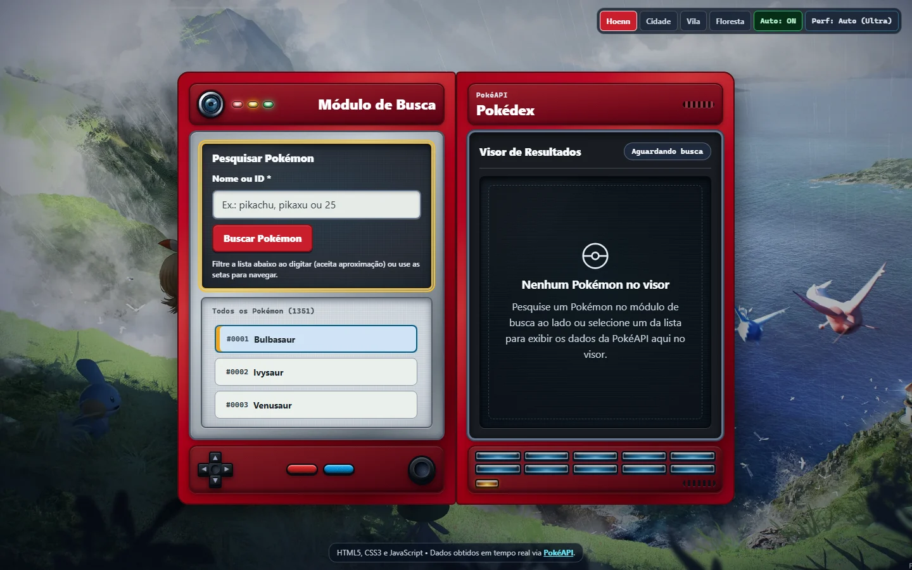
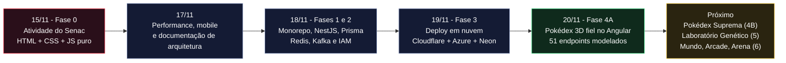
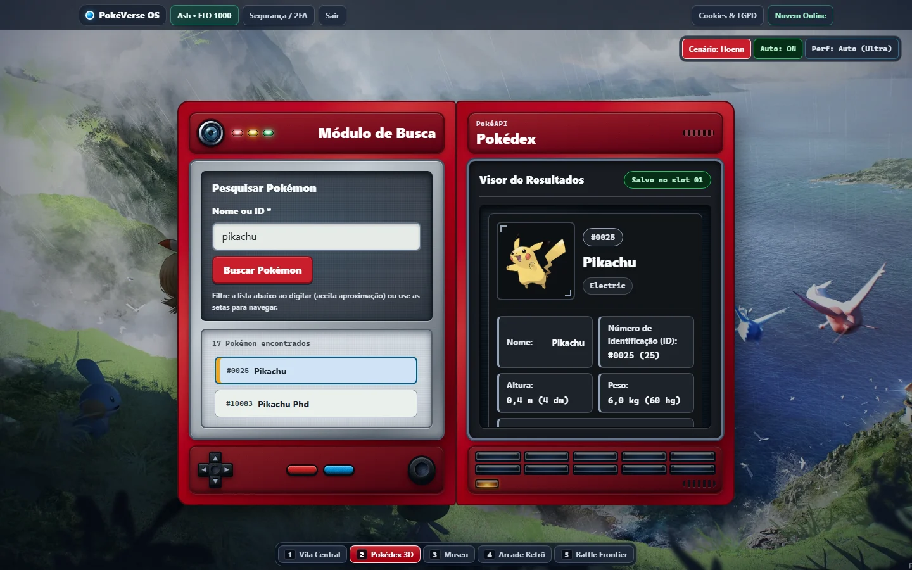

# Capítulo Zero — Como Tudo Começou

<p align="center">
  
</p>

> **Nota de arquivo.** Este documento conta como o projeto começou e guarda, como recordação, o último `README.md` da fase estática da **Pokédex** (commit `f61712d`, 17/11/2026), imediatamente antes da migração para o monorepo **PokéVerse OS** (`92fe70e` / `a96dd49`). O README atual do repositório, que cobre o estado real e o futuro da plataforma, está em [`../README.md`](../README.md).

---

## 1. A origem: uma atividade da faculdade

Este projeto nasceu como a **atividade final da matéria de Front-end no Senac**.

O enunciado era enxuto: construir uma página que consumisse uma API pública com `fetch`, mostrasse o resultado em uma lista HTML e tratasse as situações de erro. Eu escolhi a **PokéAPI** e a **Pokédex** como tema.

A atividade foi **concluída e entregue** dentro do escopo pedido. Foi essa versão que o README abaixo documenta.

### O que a atividade pedia

| Requisito da matéria | Como foi atendido na Fase 0 |
| :--- | :--- |
| HTML semântico com `<h1>` | Título **Pokédex**, `<search>`, `<form>` e áreas bem delimitadas |
| Formulário com campo de texto e botão | `<input type="text">` e `<button type="submit">` dentro de `<search>` |
| Consumo de API pública com `fetch` | PokéAPI v2, com `async/await` e `AbortController` |
| Lista `<ul>` com dados do recurso | Nome, ID, altura, peso e habilidades do Pokémon |
| Estilização com CSS | `background-color`, `padding`, `margin` e `display: flex`, além de bem mais do que o exigido |
| Tratamento de situações | Campo vazio, Pokémon não encontrado (`404`) e falha de rede com botão **Tentar novamente** |

---

## 2. Por que não parei por ali

Eu cumpri o que a matéria pedia. Mesmo assim, durante o desenvolvimento, passei a **gostar muito do tema e da pegada Pokémon**. O aparelho com tampa 3D, os LEDs e os botões físicos tinham virado algo que eu queria aprofundar.

Então tomei uma decisão **por conta própria**: tratar a atividade como ponto de partida e continuar o projeto fora da sala de aula, sem nota e sem prazo, só por interesse.

A Fase 0 continua intacta na raiz do repositório e funciona como **referência visual canônica**:

- [`index.html`](../index.html)
- [`css/style.css`](../css/style.css)
- [`js/app.js`](../js/app.js)
- [`assets/`](../assets/)
- [`capitulo-00-guia-de-estudos-pokedex.md`](capitulo-00-guia-de-estudos-pokedex.md), o manual técnico e "colinha" dessa versão feito para a apresentação no Senac (movido para `docs/` e continuado pelo [Capítulo 1](capitulo-01-guia-de-estudos-pokedex.md))

> A regra do repositório é não alterar esses arquivos sem pedido explícito. Eles são a memória do projeto.

---

## 3. Do trabalho final ao produto

O diagrama mostra de onde saí e onde estou, com base no histórico real do Git (35 commits em 7 dias, de 15/11 a 21/11/2026).



### Antes e depois

| Fase 0 — a atividade (HTML, CSS e JS puro) | Hoje — PokéVerse OS (Angular + NestJS) |
| :---: | :---: |
|  |  |

### O que cada ideia da Fase 0 virou

| Ideia da Fase 0 | Onde ela vive hoje |
| :--- | :--- |
| `fetch` direto na PokéAPI | `HttpClient` do Angular, passando por um proxy NestJS com cache Redis e fallback direto |
| Filtro fonético e Damerau-Levenshtein em `app.js` | Portado para [`@pokeverse/shared`](../packages/shared/src/domain/pokedex-search.ts), com testes |
| Mensagens de erro e botão **Tentar novamente** | Estados finitos tipados (`AsyncState`) e fallback degradado para visitantes |
| 10 slots azuis em `localStorage` | Visitante: `localStorage`. Treinador autenticado: PostgreSQL, com 1 Pokémon por botão (`409 Conflict`) |
| Tampa 3D com `preserve-3d` | [`_pokedex-classic.scss`](../apps/web/src/styles/_pokedex-classic.scss), porte fiel com giro reversível em voo |
| 4 cenários em JPG de 2500 a 4096 px | 4 cenários em WebP, nas versões `-desktop` e `-mobile` |
| Nenhum teste e nenhum build | CI com tipos, lint, testes, E2E, build e auditoria visual de contraste |

---

## 4. O que esta fase me ensinou

- **Limites do JavaScript puro.** O [Capítulo Zero do guia de estudos](capitulo-00-guia-de-estudos-pokedex.md) (a "colinha" da apresentação) documenta como levei HTML, CSS e JS sem frameworks até onde deu: máquina de estados por teclado, busca fuzzy, cinemática 3D e acessibilidade — trilha que agora segue no [Capítulo 1 (Full-Stack)](capitulo-01-guia-de-estudos-pokedex.md).
- **Quando um framework passa a valer a pena.** O projeto cresceu até exigir contas, sessões, cache, mensageria e testes. Aí a migração para um monorepo com contratos compartilhados deixou de ser capricho e virou necessidade.
- **Fidelidade visual é requisito.** Por isso o repositório tem a **Regra Zero de UI** (veja [`AGENTS.md`](../AGENTS.md)): nada do visual original é simplificado sem validação.

---

## 5. O último README da Pokédex (preservado sem alterações)

O texto abaixo é a cópia fiel do último `README.md` do projeto ainda como **Pokédex** estática em HTML5, CSS3 e JavaScript puro (commit `f61712d`, 17/11/2026), logo antes da inicialização do monorepo e da mudança para **PokéVerse OS**. Ele reflete o estado do projeto naquele momento, então **está desatualizado de propósito**. A única adaptação foi nos destinos dos links relativos, que ganharam o prefixo `../` para continuarem funcionando a partir da pasta `docs/`. Para o estado atual do projeto, leia o [README principal](../README.md).

<!-- INÍCIO DO README ORIGINAL DA POKÉDEX (commit f61712d) -->

# Pokédex

> **Site publicado (hospedagem estática no GitHub Pages):** [https://digooow.github.io/pokedex-frontend/](https://digooow.github.io/pokedex-frontend/)

Aplicação web desenvolvida com **HTML5**, **CSS3** e **JavaScript puro** no formato de **Pokédex 3D interativa** sobre 4 cenários Pokémon em alta resolução, consumindo em tempo real a API pública [PokéAPI](https://pokeapi.co/).

## Requisitos e Funcionalidades

- **Estrutura HTML semântica**:
  - Título principal (`<h1>`) com o nome do sistema (**Pokédex**).
  - Formulário (`<form>`) dentro de `<search>` com campo de texto (`<input type="text">`) e botão de pesquisa (`<button type="submit">`).
  - Área dedicada para exibição dos resultados (`#resultado-area`).
  - Lista HTML (`<ul>`) apresentando nome, número de identificação (ID), altura, peso e habilidades (*abilities*) obtidos da API.
- **Consumo de API pública (`fetch`)**:
  - Consulta dinâmica ao endpoint `https://pokeapi.co/api/v2/pokemon/NOME_DO_POKEMON` utilizando `fetch()`, `async/await` e `AbortController` (para cancelamento de buscas concorrentes e timeout).
  - Carregamento completo dos nomes disponíveis na PokéAPI via `https://pokeapi.co/api/v2/pokemon?limit=100000&offset=0`, exibidos em uma lista selecionável dentro do módulo de busca com filtragem tolerante a erros de digitação (fonética e distância Damerau-Levenshtein).
  - Câmera ótica principal (frente na capa e verso na ala esquerda) com flashes vermelho/amarelo/verde reativos (`.is-scanning`) durante a busca na API.
  - Nenhum dado de Pokémon é cadastrado manualmente no código.
- **Controles Interativos da Pokédex**:
  - **Direcional (D-Pad) à esquerda e botão circular de seleção à direita**: navegam no estilo menu RPG pelas telas (`busca`, `lista`, `visor` e `slots`), itens do catálogo da PokéAPI (`.is-cursor`), botões de slot e campos de edição, confirmando pelo botão redondo ou pela tecla `Enter`.
  - **Botões centrais (vermelho e azul)**: no modo RPG, o botão azul entra na tela/submenu destacado e limpa o visor de resultados quando já está em uma tela sem submenu; o botão vermelho recua um nível do menu e limpa o formulário de busca quando está na raiz.
  - **10 botões de gravação rápida à direita + botão amarelo compacto**: sinalizam por cor se o slot está livre (azul) ou utilizado (verde), permitindo gravar/carregar com um clique ou abrir o editor no visor pelo botão amarelo para alterar nome/apelido ou remover registros salvos em `localStorage`.
- **Estilização CSS e Experiência Pokédex 3D**:
  - Uso explícito de `background-color`, `padding`, `margin` e `display: flex`.
  - **Acabamento realista em metal, plástico, vidro e telas eletrônicas (`oklch` + microtexturas WebP pré-assadas)**: carcaça externa em metal vermelho granulado semi-opaco com reflexo sutil ao ponteiro (`@property --luz-x/--luz-y` via `requestAnimationFrame`, incluindo a dobradiça lateral quando fechada e respeitando `prefers-reduced-motion`), moldura esquerda em cinza metálico (`#painel-busca`), relevos em plástico ABS fosco texturizado (`assets/textures/*.webp`), câmera com lente de safira/vidro e LEDs luminosos, botões de slot inferiores com tampa de plástico transparente iluminado por baixo e visores internos com moldura rebaixada e textura LCD sutil que preserva a legibilidade.
  - **Cards giratórios em 3D (`preserve-3d`) sem reflow por quadro no mobile**: a capa fechada e a ala esquerda ocupam as duas faces do mesmo card giratório (`rotateY(-180deg)` com `translateX` no desktop / `rotateX(180deg)` com reserva estática de espaço e rolagem natural da página no mobile), eliminando animações de `padding-top` e comportando integralmente busca, lista, controles, visor e slots em celulares.
  - **Detecção Automática de Hardware & Modo Lite (`Perf: Auto`)**: identifica automaticamente RAM, núcleos de CPU, rede (`saveData`) e tela touch para escolher entre os perfis **Ultra**, **Equilibrado** ou **Lite**, além de monitorar quadros (`requestAnimationFrame`) durante transições para rebaixar efeitos pesados automaticamente em celulares e PCs modestos (com alternância manual pelo botão no topo).
  - **Proteção de scroll e fechamento intuitivo**: clicar e rolar dentro do visor de resultados (incluindo arraste pela barra de rolagem) não fecha o aparelho; clicar em partes externas às telas e controles ou pressionar `Escape` gira a tampa de volta.
  - **4 cenários responsivos em WebP sob demanda** (`assets/backgrounds/*-desktop.webp` `1920px` e `*-mobile.webp` `820px`) carregando apenas o cenário ativo na GPU e descartando inativos fora do modo Ultra, substituindo `9,34 MB` de JPEGs 4K simultâneos para rodar liso em celulares.
- **Tratamento de situações**:
  - Validação para campo vazio ou somente espaços.
  - Mensagem dedicada quando o Pokémon não é encontrado (HTTP `404`), com sugestões clicáveis *"Você quis dizer"* baseadas na lista da API.
  - Mensagem amigável com botão **Tentar novamente** quando ocorre falha de comunicação ou tempo limite excedido.

## Estrutura de Arquivos

```text
pokedex-frontend/
├── assets/
│   ├── backgrounds/               # 4 cenários otimizados (-desktop.webp / -mobile.webp)
│   ├── textures/                  # Microtexturas granuladas pré-assadas (metal-floco / plastico-grao)
│   └── favicon.svg
├── css/
│   └── style.css
├── docs/                          # Documentação arquitetural Full-Stack + Performance Gates
├── js/
│   └── app.js
├── GUIA-DE-ESTUDOS-POKEDEX.md
├── index.html
└── README.md
```

### Decisão arquitetural: por que manter 3 arquivos principais?

O projeto foi estruturado intencionalmente com apenas **`index.html`**, **`css/style.css`** e **`js/app.js`** (sem dividir o código em dezenas de módulos ou pastas de componentes) pelos seguintes motivos técnicos:

- **Compatibilidade universal (`file://` e servidor HTTP):** diferentemente de *ES Modules* nativos (`<script type="module">`), que são bloqueados por política de segurança **CORS** nos navegadores quando abertos diretamente via protocolo `file://`, o carregamento clássico (`<link>` + `<script defer>`) garante que o projeto funcione tanto por duplo clique no `index.html` quanto em servidores HTTP (*Live Server*, GitHub Pages, Vercel) sem etapa de *build* nem *bundler*.
- **Encapsulamento sem vazar escopo global:** dividir JavaScript sem *ES Modules* e sem empacotador obrigaria usar múltiplos `<script>` compartilhando estado em escopo global (`globalThis`). Manter um único `js/app.js` com `"use strict"` preserva o isolamento interno com funções pequenas e coesas por domínio (cenários, giro 3D, catálogo/busca *fuzzy*, slots, PokéAPI, renderização do visor, controles RPG e iluminação dinâmica).
- **CSS em cascata única previsível:** `css/style.css` centraliza design tokens (`:root`), texturas inline e componentes ordenados por `@layer reset, base, components, utilities;`, evitando carregamentos em cascata de `@import` e reduzindo o número de requisições de rede na carga inicial.

## Como Executar

Não há dependências externas nem etapa de build:

1. Abra o arquivo `index.html` diretamente no navegador (ou utilize a extensão **Live Server** no VS Code).
2. Clique na **capa fechada da Pokédex** (ou pressione `Enter`) para abri-la no movimento 3D.
3. Digite o nome ou número de um Pokémon, use o direcional para navegar pela lista e pressione o botão circular à direita ou **Buscar Pokémon**; salve seus favoritos nas teclas azuis e gerencie-os pelo botão amarelo.
4. Para fechar e voltar a visualizar o cenário inteiro, clique em qualquer área da carcaça fora das telas e controles (ou fora da Pokédex) ou pressione `Escape`.

## Arquitetura da Plataforma Full-Stack (`docs/`)

Documentação técnica das decisões planejadas para expandir este projeto em uma plataforma Full-Stack (Angular + Phaser 3/PixiJS + Three.js + NestJS + PostgreSQL/Prisma + Redis + Apache Kafka/Redpanda + MinIO/S3), preservando a Pokédex 3D atual como primeiro módulo integrado:

- [00 — Visão Geral, Regras de Acesso e Roadmap](../docs/00-visao-geral-e-roadmap.md)
- [01 — Arquitetura do Monorepo e Padrões de Engenharia](../docs/01-arquitetura-monorepo-e-padroes.md)
- [02 — Front-end Angular, HUD de Jogo e Gerenciamento de Estado](../docs/02-frontend-angular-hud-e-estado.md)
- [03 — Motores Gráficos: Phaser 3 e Three.js (WebGL2/GLSL)](../docs/03-motores-graficos-phaser-e-threejs.md)
- [04 — Back-end NestJS, Autenticação e Segurança](../docs/04-backend-nestjs-auth-e-seguranca.md)
- [05 — Banco de Dados PostgreSQL e Prisma ORM](../docs/05-banco-de-dados-postgresql-e-prisma.md)
- [06 — Cache com Redis e Mensageria com Apache Kafka / Redpanda](../docs/06-cache-redis-e-eventos-kafka.md)
- [07 — Arcade Retrô 3D (WebAssembly) e Cloud Save States](../docs/07-arcade-retro-wasm-e-cloud-saves.md)
- [08 — Museu das Regiões, Lore e Pokédex Holocron 3D](../docs/08-museu-lore-e-holocron-pokedex.md)
- [09 — Arena de Batalha (PvE/PvP), Team Builder e Mini-Games](../docs/09-arena-batalha-teambuilder-e-minigames.md)
- [10 — Infraestrutura Docker, Observabilidade e CI/CD](../docs/10-infraestrutura-docker-ci-cd-e-deploy.md)
- [11 — Desempenho Ponta a Ponta, Detecção de Hardware, Mobile e Release Gates](../docs/11-performance-hardware-gates-e-mobile.md)
- [12 — Pokédex 2.0: Catálogo Completo da PokéAPI v2 e Controles sem Novos Botões](../docs/12-pokedex-2-0-pokeapi-e-controles.md)

<!-- FIM DO README ORIGINAL DA POKÉDEX -->

---

<p align="center">
  <a href="../README.md">Ir para o README atual</a>
  &nbsp;·&nbsp;
  <a href="capitulo-00-guia-de-estudos-pokedex.md">Capítulo Zero: guia de estudos</a>
  &nbsp;·&nbsp;
  <a href="capitulo-01-guia-de-estudos-pokedex.md">Capítulo 1: guia de estudos (Full-Stack)</a>
  &nbsp;·&nbsp;
  <a href="00-visao-geral-e-roadmap.md">Visão geral e roadmap</a>
  &nbsp;·&nbsp;
  <a href="14-status-e-changelog-implementacao.md">Status e changelog</a>
</p>
