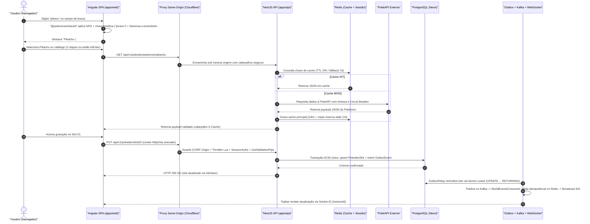

  <a href="../README.md">README atual</a>
  &nbsp;·&nbsp;
  <a href="capitulo-00-como-tudo-comecou.md">Capítulo 00: como tudo começou</a>
  &nbsp;·&nbsp;
  <a href="capitulo-00-guia-de-estudos-pokedex.md">Capítulo 00: guia de estudos (Fase 0)</a>
  &nbsp;·&nbsp;
  <a href="capitulo-01-guia-de-estudos/01-anatomia-do-repositorio-pastas-e-arquivos.md">Vol. 01: Pastas &amp; Arquivos</a>
  &nbsp;·&nbsp;
  <a href="capitulo-01-guia-de-estudos/02-linguagens-estruturas-de-dados-e-pacote-shared.md">Vol. 02: Linguagens &amp; Shared</a>
  &nbsp;·&nbsp;
  <a href="capitulo-01-guia-de-estudos/03-dicionario-completo-de-jargoes-e-glossario.md">Vol. 03: Glossário Técnico</a>

# Capítulo 01 — Manual Técnico e Guia de Estudos Full-Stack (PokéVerse OS)

> **Propósito deste guia:** documentar a arquitetura completa do **PokéVerse OS** em continuidade direta ao **[Capítulo 00 — Guia de Estudos da Pokédex (Fase 0)](capitulo-00-guia-de-estudos-pokedex.md)**. O conteúdo detalha cada linguagem, framework, estrutura de dados, padrão arquitetural (**SOLID**, **Clean Architecture**), controle de segurança (**AppSec**, **IAM**, **LGPD**), persistência, mensageria e pipeline de entrega contínua do repositório.

---

## 1. Evolução Arquitetural: da Aplicação Estática (Fase 0) à Plataforma Full-Stack

Na **Fase 0** (preservada na raiz em [`index.html`](../index.html), [`css/style.css`](../css/style.css) e [`js/app.js`](../js/app.js)), a Pokédex foi construída sem frameworks nem etapa de compilação, executando inteiramente no navegador sobre APIs nativas da plataforma Web. Embora atendesse ao escopo estático, essa arquitetura impunha limites estruturais claros:

- **Persistência restrita ao dispositivo:** os 10 slots gravados em `localStorage` ficavam limitados ao navegador local, sem sincronização entre aparelhos ou contas de usuário.
- **Ausência de identidade e controle de acesso:** não havia autenticação, proteção contra abuso automatizado (*rate limiting*) nem comunicação em tempo real entre usuários.
- **Dependência direta da API externa:** cada pesquisa no cliente consultava diretamente a **PokéAPI** pública, sem camada intermediária de cache distribuído ou contingência em caso de indisponibilidade externa.
- **Ausência de portões automatizados de qualidade:** não existiam verificação estática de tipos, lint unificado, testes automatizados ou auditoria visual em navegador *headless*.

Para superar essas limitações preservando a interface 3D original (**Regra Zero de UI** em [`AGENTS.md`](../AGENTS.md)), o projeto evoluiu para o monorepo **PokéVerse OS**, organizado nas camadas descritas abaixo:

| Camada | O que é e o que faz | Tecnologia & Localização no Repositório | Problema Técnico que Resolve |
| :--- | :--- | :--- | :--- |
| **Front-end (SPA)** | Aplicação Web executada no navegador (*Single-Page Application*) que renderiza a Pokédex 3D skeuomórfica, o HUD superior/inferior, o Museu das Regiões e os formulários de autenticação/privacidade. | **Angular 22** (Standalone, Signals, Zoneless) + **SCSS** (`oklch`) — [`apps/web/`](../apps/web/) | Reatividade granular sem recarregar páginas, separação de estado em stores, acessibilidade WCAG 2.2 AA e adaptação automática a perfis de hardware (`ULTRA` / `BALANCED` / `LITE`). |
| **Proxy Same-Origin na Borda** | Camada intermediária executada na rede de distribuição (**Cloudflare Pages Functions**) que encaminha chamadas de `/api`, `/health` e `/socket.io` para o servidor na nuvem sob o mesmo domínio do front-end. | **Cloudflare Pages Functions** — [`apps/web/functions/`](../apps/web/functions/) e [`apps/web/cloudflare/`](../apps/web/cloudflare/) | Faz front-end e API compartilharem a mesma origem (`pokeverse.pages.dev`), permitindo cookies de sessão `HttpOnly` estritos e política **CSP** sem exceções inseguras. |
| **Back-end (API REST & BFF)** | Servidor Node.js que centraliza regras de negócio, autenticação (**IAM**), proteção de entrada, proxy de cache para a PokéAPI e emissão de eventos assíncronos. | **NestJS 11** + **TypeScript 6** — [`apps/api/`](../apps/api/) | Aplica validação estrita na entrada (`ZodValidationPipe`), controle de acesso por sessão e origens CSRF, impedindo que regras críticas dependam de validação no navegador. |
| **Pacote Compartilhado (`@pokeverse/shared`)** | Biblioteca interna compilada para ESM e CommonJS contendo constantes globais, tipos de estado finito, contratos de validação e algoritmos puros de domínio. | **TypeScript 6** + **Zod v4** + **tsup** — [`packages/shared/`](../packages/shared/) | Mantém fonte única da verdade (*Single Source of Truth*): alterações em schemas de API ou fórmulas de busca afetam front-end e back-end no mesmo commit. |
| **Banco de Dados Relacional** | Armazenamento persistente estruturado em tabelas com integridade referencial, chaves estrangeiras e transações **ACID**. | **PostgreSQL 16** + **Prisma ORM 6.19** (nuvem: **Neon**) — [`apps/api/prisma/`](../apps/api/prisma/) | Garante consistência transacional para contas, credenciais MFA/Passkeys, slots gravados, histórico de partidas e tabela de eventos `OutboxEvent`. |
| **Cache & Estado Transitório em Memória** | Banco de dados em memória RAM com latência na casa de milissegundos e execução atômica de scripts **Lua**. | **Redis 7** (nuvem: **Upstash TLS**) — [`redis.service.ts`](../apps/api/src/infra/redis.service.ts) | Armazena sessões opacas, códigos OTP com contagem atômica anti-TOCTOU, rate limiting compartilhado e cache da PokéAPI (`24h` + cópia reserva `stale` de `7` dias). |
| **Outbox & Mensageria Assíncrona** | Mecanismo que grava o dado de negócio e o registro de evento na mesma transação SQL e publica posteriormente em um barramento distribuído (*Broker*). | **Transactional Outbox** + **Kafka / Redpanda** (`kafkajs`, nuvem: **Aiven mTLS**) — [`apps/api/src/modules/events/`](../apps/api/src/modules/events/) | Evita o problema de escrita dupla (*Dual-Write*) entre banco e broker, garante reentrega tolerante a falhas com idempotência e isola falhas irreversíveis em Dead Letter Queue (**DLQ**). |
| **Comunicação em Tempo Real** | Conexão bidirecional persistente sobre HTTP/WebSocket para envio imediato de eventos do servidor ao cliente conectado. | **Socket.IO** (`/ws/world`) — [`world.gateway.ts`](../apps/api/src/modules/world/world.gateway.ts) | Atualiza o painel de atividades na Topbar em tempo real para os usuários conectados, com limite de conexões por IP e validação estrita de origem em produção. |
| **Armazenamento de Objetos (S3)** | Serviço compatível com protocolo S3 voltado a arquivos binários grandes, acessados via URLs temporárias assinadas (*Presigned URLs*). | **S3 (`pgsty/silo`)** — [`infra/docker/docker-compose.yml`](../infra/docker/docker-compose.yml) | Prepara a infraestrutura para ROMs e *save states* do futuro Arcade Retrô sem armazenar blobs pesados no PostgreSQL. |
| **Infraestrutura, CI/CD & Quality Gate** | Conteinerização local e de produção, pipeline automatizado de verificação/deploy e inspeção visual automatizada em navegador real. | **Docker**, **GitHub Actions**, **Chrome Headless (CDP)** — [`infra/docker/`](../infra/docker/), [`.github/workflows/`](../.github/workflows/), [`scripts/`](../scripts/) | Garante reprodutibilidade de ambiente e bloqueia vazamento de segredos, vulnerabilidades, erros de tipo/lint, falhas de integração e regressões de contraste/layout antes do deploy. |

---

## 2. Fluxo Ponta a Ponta de uma Operação na Plataforma

O diagrama abaixo detalha o fluxo completo desde uma consulta textual aproximada no cliente Angular até a persistência transacional em banco relacional e propagação assíncrona via Kafka e WebSocket:

Pontos arquiteturais observáveis nesse fluxo:

1. **Filtragem local com zero latência de rede:** a normalização Unicode `NFD`, a chave fonética bilíngue e o cálculo de distância de Damerau-Levenshtein em `@pokeverse/shared` executam diretamente na memória do cliente sobre a lista previamente carregada.
2. **Resiliência em camadas na consulta externa:** o back-end serve respostas em cache (`HIT`), renova dados expirados quando a PokéAPI responde (`MISS`), aciona o registro reserva de até 7 dias em falhas externas (`STALE` / *Circuit Breaker*) e, caso a própria API esteja inacessível, o cliente Angular aplica fallback direto à PokéAPI pública para navegação de visitante.
3. **Proteção de escrita e atomicidade transacional:** mutações HTTP passam em sequência por validação de origem (`CsrfOriginGuard`), controle de taxa atômico em Lua (`ThrottlerGuard` + `RedisThrottlerStorage`), verificação de sessão opaca no Redis (`SessionAuthGuard`) e validação estrita de payload (`ZodValidationPipe`). No repositório, a gravação do slot e do evento de notificação ocorre dentro da mesma transação `$transaction` no PostgreSQL, impedindo inconsistências entre estado persistido e eventos publicados.

---

## 3. Organização Modular do Capítulo 01 (`docs/capitulo-01-guia-de-estudos/`)

Para manter o detalhamento técnico legível e organizado por domínio, o **Capítulo 01** está estruturado em volumes modulares dentro de [`capitulo-01-guia-de-estudos/`](capitulo-01-guia-de-estudos/), indexados por este documento central:

```mermaid
flowchart TD
  hub["capitulo-01-guia-de-estudos-pokedex.md<br/>Índice Mestre e Visão Geral"]

  v01["Vol. 01 · Anatomia do Repositório<br/>Diretórios, Arquivos + Docs 00, 01, ARCHITECTURE"]:::done
  v02["Vol. 02 · Linguagens, Frameworks, Estruturas & Shared<br/>TS 6, Zod v4, Angular, NestJS, Prisma, Int32Array, Map, Set"]:::done
  v03["Vol. 03 · Glossário Técnico Completo<br/>Conceitos, Siglas, Padrões e Segurança"]:::done

  v04["Vol. 04 · Front-end Angular 22 & Stores<br/>Signals, Zoneless, Guards, Interceptores + Doc 02"]:::plan
  v05["Vol. 05 · Visual 3D, Hardware & A11y<br/>SCSS Tokens oklch, Giro 3D, RPG Nav + Docs 03, 11"]:::plan
  v06["Vol. 06 · Back-end NestJS & Pipeline HTTP<br/>DI, Pipes, Filters, Telemetria + Doc 04"]:::plan
  v07["Vol. 07 · PostgreSQL, Prisma & Redis<br/>13 modelos, Neon, Cache 7d, Lua Atômico + Docs 05, 06"]:::plan
  v08["Vol. 08 · Kafka Outbox, WebSockets & S3<br/>Atomic Lease, Idempotência, DLQ, Futuros + Docs 06, 07, 08, 09"]:::plan
  v09["Vol. 09 · Segurança Enterprise (AppSec) & LGPD<br/>BFF, Argon2id, TOTP, Passkeys, PKCE, AES + Docs 13, 16"]:::plan
  v10["Vol. 10 · Testes, CDP Gate, Docker, Cloud & Defesa<br/>Vitest, Jest, CDP, CI/CD, Nuvem + Docs 10, 11, 14, 18"]:::plan

  hub --> v01
  hub --> v02
  hub --> v03
  hub -.-> v04
  hub -.-> v05
  hub -.-> v06
  hub -.-> v07
  hub -.-> v08
  hub -.-> v09
  hub -.-> v10

  classDef done fill:#10301f,stroke:#3ddc84,color:#fff
  classDef plan fill:#141b34,stroke:#6aa7ff,color:#fff
```

### Painel dos Volumes

| Volume | Título & Arquivo | Docs Associados | Escopo Técnico | Status |
| :---: | :--- | :---: | :--- | :---: |
| **01** | **[Anatomia do Repositório: Pastas, Arquivos e Regras Arquiteturais](capitulo-01-guia-de-estudos/01-anatomia-do-repositorio-pastas-e-arquivos.md)** | `00`, `01`, `ARCHITECTURE` | Inventário de diretórios e arquivos da raiz, `packages/shared`, `apps/api`, `apps/web`, `infra/`, `scripts/`, `.github/`, `assets/` e `docs/`, além da matriz de clusters acoplados. | **Concluído** |
| **02** | **[Linguagens, Frameworks, Estruturas de Dados e Pacote `@pokeverse/shared`](capitulo-01-guia-de-estudos/02-linguagens-estruturas-de-dados-e-pacote-shared.md)** | `01`, `12`, `15`, `17` | Explicação completa das linguagens e frameworks (TypeScript 6, Zod v4, Angular 22, NestJS 11, Prisma, SQL, Lua), estruturas de dados (`Array`, `Map`, `Set`, `Int32Array`, `Record`) com exemplos reais no código e análise do pacote compartilhado. | **Concluído** |
| **03** | **[Glossário Técnico Completo: Linguagens, Frameworks, Arquitetura, Dados e Segurança](capitulo-01-guia-de-estudos/03-dicionario-completo-de-jargoes-e-glossario.md)** | `00` a `18` + `ARCH` | Dicionário técnico padronizado definindo cada sigla, padrão arquitetural, biblioteca, protocolo e controle de segurança do repositório com indicação de uso concreto. | **Concluído** |
| **04** | **Front-end Angular 22: Standalone, Signals, Zoneless e Stores** *(planejado)* | `02`, `16`, `17`, `18` | `app.config.ts`, `app.routes.ts`, `auth.guard.ts`, `auth.interceptor.ts`, `AuthStore`, `SecurityIamStore`, `PrivacyConsentStore`, `PokedexStore` e diretivas. | Planejado |
| **05** | **Engenharia Visual 3D, Perfis de Hardware e Acessibilidade (WCAG 2.2 AA)** *(planejado)* | `03`, `08`, `11`, `12` | `_tokens.scss`, `_pokedex-classic.scss`, parciais `styles/pokedex/`, `PokedexLidPhysicsService`, `PokedexRpgNavService`, `[pvRpgFocusable]`, `QualityStore` e `ScenarioStore`. | Planejado |
| **06** | **Back-end NestJS 11, Pipeline de Requisição e Observabilidade** *(planejado)* | `04`, `10`, `17`, `18` | Ciclo da requisição (`main.ts` -> `CorrelationMiddleware` -> Guards -> `ZodValidationPipe` -> Controller -> Service -> Repository -> `GlobalExceptionFilter`), `env.schema.ts` e probes. | Planejado |
| **07** | **Banco Relacional (PostgreSQL + Prisma 6) e Cache Atômico (Redis 7)** *(planejado)* | `05`, `06`, `11`, `17` | Os 13 modelos e 4 enums de `schema.prisma`, migrations, índice parcial, Neon pooled vs. unpooled, cache `HIT`/`MISS`/`STALE` 7d e scripts Lua anti-TOCTOU. | Planejado |
| **08** | **Mensageria Kafka/Outbox, WebSockets e Módulos Futuros (4B–6)** *(planejado)* | `06`, `07`, `08`, `09`, `15` | Transactional Outbox com `UPDATE ... RETURNING` (*Atomic Lease*), idempotência com rollback no `catch`, DLQ, `WorldGateway` e especificações de Arcade WASM, Museu e Battle Frontier. | Planejado |
| **09** | **Segurança AppSec, IAM Enterprise BFF, Criptografia e LGPD** *(planejado)* | `04`, `13`, `16`, `17` | `AuthModule`, sessão opaca `HttpOnly`, Argon2id + dummy hash, TOTP + backup codes, WebAuthn Passkeys, Google PKCE, AES-256-GCM e conformidade LGPD. | Planejado |
| **10** | **Testes, CDP Quality Gate, Docker, CI/CD Cloud e Arquitetura** *(planejado)* | `10`, `11`, `14`, `18` | Pirâmide de testes (unitários, E2E HTTP, integração real), `ui-quality-gate.mjs`, `docker-compose.yml`, `api.Dockerfile`, `ci.yml`, `deploy.yml` e topologia cloud. | Planejado |

---

## 4. Mapa de Correspondência dos Documentos Técnicos em `docs/`

| Documento | Título | Conteúdo Principal | Volume Relacionado |
| :--- | :--- | :--- | :---: |
| [`ARCHITECTURE.md`](ARCHITECTURE.md) | Contrato de Qualidade | Diretrizes obrigatórias de engenharia (**Shift-Left**, separação Controller/Service/Repository, performance SQL e combate a *AI slop*). | **Vol. 01** & **Vol. 02** |
| [`00`](00-visao-geral-e-roadmap.md) | Visão Geral e Roadmap | Escopo dos 5 módulos da plataforma, matriz de acesso (Visitante vs. Treinador) e sequenciamento das Fases 0 a 6. | **Vol. 01** |
| [`01`](01-arquitetura-monorepo-e-padroes.md) | Arquitetura do Monorepo | Estrutura em workspaces (`apps/`, `packages/`, `infra/`), fonte única em `@pokeverse/shared` e padrões estruturais. | **Vol. 01** & **Vol. 02** |
| [`02`](02-frontend-angular-hud-e-estado.md) | Front-end Angular e HUD | Arquitetura da SPA Angular 22, Topbar, Quick Dock e gerenciamento de estado reativo com Signals. | **Vol. 04** |
| [`03`](03-motores-graficos-phaser-e-threejs.md) | Motores Gráficos (Phaser / Three.js) | Especificação da integração dos futuros mundos 2D (Vila Central) e 3D (Holocron e Arcade). | **Vol. 05** & **Vol. 08** |
| [`04`](04-backend-nestjs-auth-e-seguranca.md) | Back-end NestJS e Auth | Estrutura da API NestJS, fluxo de autenticação BFF, controle de origens e blindagem HTTP. | **Vol. 06** & **Vol. 09** |
| [`05`](05-banco-de-dados-postgresql-e-prisma.md) | PostgreSQL e Prisma ORM | Modelagem relacional (13 tabelas), chaves estrangeiras, índices planejados e prevenção de consultas N+1. | **Vol. 07** |
| [`06`](06-cache-redis-e-eventos-kafka.md) | Redis e Mensageria Kafka | Estratégia de cache, scripts Lua atômicos, Transactional Outbox e publicação assíncrona de eventos. | **Vol. 07** & **Vol. 08** |
| [`07`](07-arcade-retro-wasm-e-cloud-saves.md) | Arcade Retrô WASM | Especificação de emulação em WebAssembly no navegador com persistência de saves em armazenamento S3. | **Vol. 08** |
| [`08`](08-museu-lore-e-holocron-pokedex.md) | Museu das Regiões & Holocron | Atlas público das regiões (Kanto a Paldea) e especificação do projetor holográfico 3D. | **Vol. 05** & **Vol. 08** |
| [`09`](09-arena-batalha-teambuilder-e-minigames.md) | Arena de Batalha & Mini-Games | Projeto de Team Builder competitivo (IVs/EVs), placares em Redis e partidas PvE/PvP. | **Vol. 08** |
| [`10`](10-infraestrutura-docker-ci-cd-e-deploy.md) | Infraestrutura, Docker e CI/CD | Ambiente local com Docker Compose, container de produção não-root e pipelines de CI/CD no GitHub Actions. | **Vol. 10** |
| [`11`](11-performance-hardware-gates-e-mobile.md) | Desempenho e Hardware Gates | Detecção de capacidade de hardware (`ULTRA`/`BALANCED`/`LITE`), watchdog de quadros e auditoria CDP. | **Vol. 05** & **Vol. 10** |
| [`12`](12-pokedex-2-0-pokeapi-e-controles.md) | Pokédex 2.0 e Controles | Expansão funcional dos recursos da PokéAPI sem acréscimo de botões fora da carcaça original. | **Vol. 02** & **Vol. 05** |
| [`13`](13-dossie-de-seguranca-e-blindagem.md) | Dossiê de Segurança (AppSec) | Análise de vulnerabilidades mitigadas, arquitetura BFF/IAM e matriz de requisitos `REQ-SEC-01..35`. | **Vol. 09** |
| [`14`](14-status-e-changelog-implementacao.md) | Status Real & Changelog | Registro contínuo do estado entregue, divergências em relação aos planos iniciais e métricas medidas. | **Vol. 10** |
| [`15`](15-pokedex-suprema-51-endpoints-e-laboratorio-genetico.md) | Pokédex Suprema & Lab Genético | Catálogo dos 51 endpoints da PokéAPI, otimização de bundle e modelagem matemática do Laboratório Genético. | **Vol. 02** & **Vol. 08** |
| [`16`](16-cookies-lgpd-e-requisitos.md) | Cookies, LGPD e Requisitos | Requisitos funcionais/não-funcionais, consentimento versionado, portabilidade e exclusão definitiva de dados. | **Vol. 04** & **Vol. 09** |
| [`17`](17-plano-solid-clean-code-e-engenharia-big-tech.md) | Plano SOLID & Post-Mortem | Análise de condições de corrida identificadas em auditoria e decomposição estrutural SOLID aplicada ao monorepo. | **Vol. 02**, **Vol. 06**, **Vol. 09** |
| [`18`](18-auditoria-e-plano-divida-tecnica-arquitetura.md) | Auditoria de Dívida Técnica | Consolidação das 4 ondas de refatoração estrutural conforme o Contrato de Qualidade (`ARCHITECTURE.md`). | **Vol. 01**, **Vol. 04**, **Vol. 10** |

---

  <a href="../README.md">Ir para o README atual</a>
  &nbsp;·&nbsp;
  <a href="capitulo-00-como-tudo-comecou.md">Capítulo 00: como tudo começou</a>
  &nbsp;·&nbsp;
  <a href="capitulo-00-guia-de-estudos-pokedex.md">Capítulo 00: guia de estudos (Fase 0)</a>
  &nbsp;·&nbsp;
  <a href="capitulo-01-guia-de-estudos/01-anatomia-do-repositorio-pastas-e-arquivos.md">Começar pelo Vol. 01</a>

