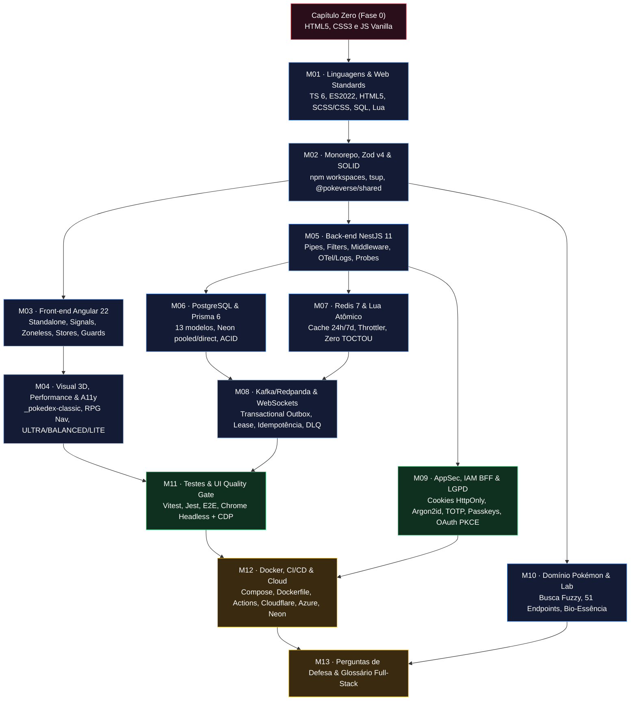

  <a href="../README.md">README atual</a>
  &nbsp;·&nbsp;
  <a href="capitulo-zero-guia-de-estudos-pokedex.md">Capítulo Zero: guia de estudos (Fase 0)</a>
  &nbsp;·&nbsp;
  <a href="capitulo-zero-como-tudo-comecou.md">Capítulo Zero: como tudo começou</a>

# Capítulo 1 — Guia de Estudos Full-Stack (PokéVerse OS)

> **Status do documento:** **Escopo e idealização concluídos — conteúdo em aberto para preenchimento progressivo.**
> Este documento continua a jornada iniciada no **[Capítulo Zero — Guia de Estudos da Pokédex (Fase 0)](capitulo-zero-guia-de-estudos-pokedex.md)**. Enquanto o Capítulo Zero foi a "colinha" técnica da versão estática apresentada no Senac, este **Capítulo 1** mapeia **100% das tecnologias, linguagens, padrões arquiteturais, travas de segurança, testes e infraestrutura** presentes no estado atual do **PokéVerse OS** (pós-Fase 4A).

---

## 1. Propósito e Evolução da Ideia

O Capítulo Zero cumpriu o papel de explicar linha por linha uma aplicação em 3 arquivos (`index.html`, `css/style.css`, `js/app.js`). Ao continuar o projeto por conta própria, o escopo cresceu para um monorepo full-stack em produção na nuvem.

Este **Capítulo 1** foi idealizado para ter a mesma utilidade prática de consulta rápida e aprofundamento técnico — agora voltado para:

1. **Dominar o porquê de cada escolha tecnológica** (por que Angular Zoneless + Signals, por que BFF com Redis em vez de JWT no `localStorage`, por que Transactional Outbox com *Atomic Lease*, por que Zod v4 compartilhado).
2. **Preparar defesas técnicas e entrevistas** (nível Pleno/Sênior/Staff) usando um sistema real que você mesmo construiu como estudo de caso.
3. **Permitir preenchimento modular sem sobrecarga de contexto:** os 13 módulos abaixo são autônomos e podem ser desenvolvidos individualmente ou em pares nas próximas sessões.

---

## 2. Mapa de Conhecimento do Projeto Atual

---

## 3. Formato Padrão dos Módulos (Template de Preenchimento)

Quando cada módulo for preenchido nas próximas sessões, ele seguirá sempre esta estrutura didática em 5 blocos:

1. **O que é e por que existe:** explicação direta do conceito/ferramenta e do problema real que ela resolve.
2. **Onde e como aparece no PokéVerse OS:** mapeamento exato dos arquivos, classes, funções e configurações no repositório.
3. **Anatomia do código e trade-offs:** leitura comentada das decisões técnicas e o que foi descartado (ex.: por que npm workspaces em vez de Turborepo; por que Prisma 6 em vez de 7/8).
4. **Pegadinhas, casos de borda e antipadrões evitados:** o que quebraria em produção sem os cuidados aplicados (race conditions, TOCTOU, vazamento de PII, falhas de CSP, layout overflow).
5. **Colinha de apresentação e entrevista:** perguntas diretas que um avaliador ou Tech Lead faria sobre aquele módulo, com respostas objetivas.

---

## 4. Painel de Progresso dos Módulos

| Módulo | Trilha Temática | Tecnologias / Conceitos-Chave | Status |
| :---: | :--- | :--- | :---: |
| **01** | Linguagens & Web Standards | TypeScript 6 strict, ES2022+, HTML5, SCSS (`oklch`, `@layer`, `@container`, `preserve-3d`), SQL, Lua | Escopo mapeado |
| **02** | Monorepo, Contratos & SOLID | npm workspaces, `tsup`, Zod v4 (tree-shaking), DRY, SRP/OCP/LSP/ISP/DIP | Escopo mapeado |
| **03** | Front-end Angular 22 | Standalone, Signals, Zoneless, `@defer`, Stores, Interceptors, Guards, Diretivas | Escopo mapeado |
| **04** | Visual 3D, Hardware & A11y | Chassi 3D skeuomórfico, giro reversível, `ULTRA/BALANCED/LITE`, `FpsWatchdog`, WCAG 2.2 AA | Escopo mapeado |
| **05** | Back-end NestJS 11 & Telemetria | Módulos, DI, `env.schema.ts`, `ZodValidationPipe`, `GlobalExceptionFilter`, `traceparent`, Probes | Escopo mapeado |
| **06** | PostgreSQL & Prisma ORM 6 | 13 modelos, 4 enums, migrações, índice parcial, `409 Conflict`, Neon (pooled vs. direct) | Escopo mapeado |
| **07** | Redis 7 & Concorrência Atômica | Cache 24h + `stale-fallback` 7d, `RedisThrottlerStorage`, Lua atômico (zero TOCTOU), `P2002` | Escopo mapeado |
| **08** | Kafka / Redpanda, Outbox & WS | Transactional Outbox, *Atomic Lease*, idempotência com rollback no `catch`, DLQ, Socket.IO | Escopo mapeado |
| **09** | Segurança Enterprise, IAM BFF & LGPD | Sessão opaca `HttpOnly`, `MFA_PENDING`, Argon2id, TOTP, Passkeys, Google PKCE, AES-256-GCM, CSRF, CSP, LGPD | Escopo mapeado |
| **10** | Domínio Pokémon & Laboratório | Busca fonética + Damerau-Levenshtein, 51 endpoints da PokéAPI, IV/EV/XP e Bio-Essência (`APEX`) | Escopo mapeado |
| **11** | Testes & UI Quality Gate (CDP) | Vitest 5, Jest 30 + Supertest, Chrome headless via CDP, luminância/contraste, viewport `375px`/`1440px` | Escopo mapeado |
| **12** | Docker, CI/CD & Cloud em Produção | Compose local, Dockerfile multi-stage não-root, GitHub Actions, Cloudflare Pages Functions, Azure/Neon/Upstash/Aiven | Escopo mapeado |
| **13** | Perguntas de Banca & Glossário Full-Stack | Simulado de perguntas estilo Staff Engineer + glossário unificado de termos e siglas | Escopo mapeado |

---

## 5. Escopo Detalhado por Módulo (Em Aberto)

### Módulo 01 — Linguagens, Tipagem Estrita e Web Standards Modernos
- **Objetivo de estudo:** consolidar os recursos avançados das linguagens usadas em todas as camadas do projeto.
- **Tópicos a cobrir:**
  - **TypeScript 6 (`strict`):** inferência via `z.infer` e `z.input`, proibição de `any`, *type narrowing* com `unknown`, e modelagem de estados finitos via **Discriminated Unions** (`AsyncState<T>`).
  - **HTML5 & DOM moderno:** `<dialog>`, atributo `inert`, landmarks semânticos e prevenção de XSS sem `[innerHTML]`/`dangerouslySetInnerHTML`.
  - **SCSS & CSS moderno:** espaço de cor `oklch`, custom properties tipadas `@property --luz-x` / `--luz-y`, `@layer`, `@container`, `preserve-3d` e animações em GPU.
  - **SQL (PostgreSQL) & Lua (Redis):** CTEs atômicas (`WITH ... FOR UPDATE SKIP LOCKED ... RETURNING`) e scripts Lua executados atomicamente no servidor Redis.
- **Arquivos-chave no repositório:** [`tsconfig.base.json`](../tsconfig.base.json), [`packages/shared/src/types/async-state.ts`](../packages/shared/src/types/async-state.ts), [`apps/web/src/styles/_tokens.scss`](../apps/web/src/styles/_tokens.scss), [`apps/web/src/styles/_pokedex-classic.scss`](../apps/web/src/styles/_pokedex-classic.scss).
- **Status:** `Aguardando preenchimento`

---

### Módulo 02 — Arquitetura de Monorepo, Contratos Compartilhados (`@pokeverse/shared`) e Princípios SOLID
- **Objetivo de estudo:** entender como o código compartilha verdade única entre front-end e back-end e como o SOLID evita degradação conforme o sistema cresce.
- **Tópicos a cobrir:**
  - **Monorepo com npm workspaces:** organização `apps/*` + `packages/*` e por que o projeto optou por workspaces nativos em vez de Turborepo.
  - **Build dual com `tsup` + Zod v4:** exportação simultânea ESM (`.mjs`), CJS (`.js`) e tipagens (`.d.ts`/`.d.mts`), além de `"sideEffects": false` para habilitar *tree-shaking* no Angular.
  - **Princípios SOLID na prática:** SRP (limite ~300 linhas em services/stores e ~150–200 em UI), OCP, LSP, ISP e DIP (domínio sem acoplamento ao DOM ou framework), aplicados integralmente na refatoração do [doc 17](17-plano-solid-clean-code-e-engenharia-big-tech.md).
- **Arquivos-chave no repositório:** [`package.json`](../package.json), [`packages/shared/tsup.config.ts`](../packages/shared/tsup.config.ts), [`AGENTS.md`](../AGENTS.md), [`17 — Plano SOLID e Engenharia Big Tech`](17-plano-solid-clean-code-e-engenharia-big-tech.md).
- **Status:** `Aguardando preenchimento`

---

### Módulo 03 — Front-end Angular 22 (Standalone, Signals, Zoneless e Arquitetura de Componentes)
- **Objetivo de estudo:** dominar a arquitetura reativa moderna do Angular 22 sem `Zone.js`.
- **Tópicos a cobrir:**
  - **Zoneless & Signals:** `provideZonelessChangeDetection()`, `signal()`, `computed()`, `input()`/`output()` e `ChangeDetectionStrategy.OnPush`.
  - **Stores de domínio:** separação entre estado de autenticação, segurança/IAM, privacidade, hardware, cenários, status do sistema, ticker em tempo real, catálogo Pokédex e slots.
  - **Roteamento, Lazy Loading e Segurança de Front:** `loadComponent`, imports dinâmicos (`socket.io-client`, `@simplewebauthn/browser`), `authGuard`, `authInterceptor` e diretiva declarativa `[pvRequiresTrainer]`.
- **Arquivos-chave no repositório:** [`apps/web/src/app/app.config.ts`](../apps/web/src/app/app.config.ts), [`apps/web/src/app/app.routes.ts`](../apps/web/src/app/app.routes.ts), [`apps/web/src/app/core/stores/auth.store.ts`](../apps/web/src/app/core/stores/auth.store.ts), [`apps/web/src/app/core/stores/auth-cross-tab-sync.service.ts`](../apps/web/src/app/core/stores/auth-cross-tab-sync.service.ts), [`apps/web/src/app/core/stores/auth-recovery.service.ts`](../apps/web/src/app/core/stores/auth-recovery.service.ts), [`apps/web/src/app/core/http/api-error.util.ts`](../apps/web/src/app/core/http/api-error.util.ts), [`apps/web/src/app/core/guards/auth.guard.ts`](../apps/web/src/app/core/guards/auth.guard.ts), [`apps/web/src/app/core/interceptors/auth.interceptor.ts`](../apps/web/src/app/core/interceptors/auth.interceptor.ts), [`apps/web/src/app/shared/directives/requires-trainer.directive.ts`](../apps/web/src/app/shared/directives/requires-trainer.directive.ts), [`apps/web/src/app/features/pokedex-device/services/pokedex.store.ts`](../apps/web/src/app/features/pokedex-device/services/pokedex.store.ts), [`apps/web/src/app/features/pokedex-device/services/pokedex-slots.store.ts`](../apps/web/src/app/features/pokedex-device/services/pokedex-slots.store.ts).
- **Status:** `Aguardando preenchimento`

---

### Módulo 04 — Engenharia Visual 3D, Performance Adaptativa e Acessibilidade (WCAG 2.2 AA)
- **Objetivo de estudo:** explicar como preservar fidelidade visual skeuomórfica da Fase 0 com alto FPS em desktop e mobile, sem quebrar acessibilidade.
- **Tópicos a cobrir:**
  - **Porte fiel do chassi 3D:** giro bidirecional reversível em pleno voo (`rotateY(-180deg)` no desktop / `rotateX(180deg)` no mobile), microtexturas WebP e iluminação reativa ao ponteiro.
  - **Navegação estilo RPG e botão vermelho:** histórico progressivo em 3 passos, seleção em 2 cliques, física de tampa em `PokedexLidPhysicsService` e registro declarativo de foco por `[pvRpgFocusable]` (DIP sem `document.querySelector`).
  - **Perfis de hardware e Web Vitals:** detecção de RAM/CPU/WebGL2/`saveData`/`prefers-reduced-motion` para escolher `ULTRA`, `BALANCED` ou `LITE`, `FpsWatchdog`, animações apenas em `opacity`/`transform` e `aspect-ratio`/skeletons contra CLS.
  - **WCAG 2.2 AA:** contraste mínimo, foco visível, navegação por teclado, `aria-live`, `<dialog>` e alvos de toque em mobile.
- **Arquivos-chave no repositório:** [`apps/web/src/styles/_pokedex-classic.scss`](../apps/web/src/styles/_pokedex-classic.scss), [`apps/web/src/styles/pokedex/`](../apps/web/src/styles/pokedex), [`apps/web/src/app/features/pokedex-device/services/pokedex-rpg-nav.service.ts`](../apps/web/src/app/features/pokedex-device/services/pokedex-rpg-nav.service.ts), [`apps/web/src/app/features/pokedex-device/services/pokedex-lid-physics.service.ts`](../apps/web/src/app/features/pokedex-device/services/pokedex-lid-physics.service.ts), [`apps/web/src/app/features/pokedex-device/directives/rpg-focusable.directive.ts`](../apps/web/src/app/features/pokedex-device/directives/rpg-focusable.directive.ts), [`apps/web/src/app/core/stores/quality.store.ts`](../apps/web/src/app/core/stores/quality.store.ts), [`apps/web/src/app/core/stores/scenario.store.ts`](../apps/web/src/app/core/stores/scenario.store.ts).
- **Status:** `Aguardando preenchimento`

---

### Módulo 05 — Back-end NestJS 11, Pipeline de Requisição e Observabilidade
- **Objetivo de estudo:** mapear o ciclo completo de uma requisição HTTP na API NestJS, do bootstrap à resposta ou exceção.
- **Tópicos a cobrir:**
  - **Arquitetura modular e DI:** `AppModule`, `app.setup.ts`, `helmet()`, `cookieParser()`, CORS por allowlist e prefixo global `/api/v1`.
  - **Validação fail-fast e tratamento de erros:** `env.schema.ts` com Zod sem vazar valores no boot, `ZodValidationPipe` e `GlobalExceptionFilter` (sem vazamento de stack traces).
  - **Observabilidade (3 pilares):** `CorrelationMiddleware` (`x-correlation-id` e header W3C `traceparent`), `StructuredLoggerService` (JSON estruturado) e probes separados `/health/live` vs. `/health/ready` (`InfraProbesService`).
- **Arquivos-chave no repositório:** [`apps/api/src/app.module.ts`](../apps/api/src/app.module.ts), [`apps/api/src/app.setup.ts`](../apps/api/src/app.setup.ts), [`apps/api/src/config/env.schema.ts`](../apps/api/src/config/env.schema.ts), [`apps/api/src/common/pipes/zod-validation.pipe.ts`](../apps/api/src/common/pipes/zod-validation.pipe.ts), [`apps/api/src/common/filters/global-exception.filter.ts`](../apps/api/src/common/filters/global-exception.filter.ts), [`apps/api/src/common/middleware/correlation.middleware.ts`](../apps/api/src/common/middleware/correlation.middleware.ts), [`apps/api/src/common/telemetry/structured-logger.service.ts`](../apps/api/src/common/telemetry/structured-logger.service.ts), [`apps/api/src/infra/infra-probes.service.ts`](../apps/api/src/infra/infra-probes.service.ts).
- **Status:** `Aguardando preenchimento`

---

### Módulo 06 — Persistência Relacional com PostgreSQL e Prisma ORM 6
- **Objetivo de estudo:** compreender a modelagem de dados atual e futura, integridade ACID, índices e operação no Neon Postgres.
- **Tópicos a cobrir:**
  - **Schema Prisma:** os 13 modelos (`Trainer`, `RefreshToken`, `MfaBackupCode`, `TrainerOAuthAccount`, `TrainerPasskey`, `PokedexSlot`, `PokemonTeam`, `PokemonTeamMember`, `ArcadeRom`, `ArcadeSaveState`, `MinigameScore`, `BattleMatch`, `OutboxEvent`) e 4 enums.
  - **Constraints e integridade:** unicidade `[trainerId, slotIndex]`, regra de 1 Pokémon por botão (`409 Conflict`), exclusão atômica dos slots e migrações versionadas.
  - **Performance e Neon Serverless:** índice parcial `idx_outbox_pending`, transações curtas sem chamadas externas no meio e separação `DATABASE_URL` (pooled) vs. `DATABASE_URL_UNPOOLED` (migrações).
- **Arquivos-chave no repositório:** [`apps/api/prisma/schema.prisma`](../apps/api/prisma/schema.prisma), [`apps/api/src/modules/pokedex/pokedex-slots.service.ts`](../apps/api/src/modules/pokedex/pokedex-slots.service.ts).
- **Status:** `Aguardando preenchimento`

---

### Módulo 07 — Cache Distribuído, Sessões e Concorrência Atômica com Redis 7 (Upstash)
- **Objetivo de estudo:** entender como o Redis sustenta performance, tolerância a falhas e segurança contra condições de corrida.
- **Tópicos a cobrir:**
  - **Cache PokéAPI e resiliência:** TTL de 24 h + cópia `:stale` de 7 dias (`stale-fallback`), cabeçalho `X-Cache` (`HIT`/`MISS`/`STALE`) e fallback direto no front-end se a API cair.
  - **Rate Limiting distribuído:** `RedisThrottlerStorage` compartilhado entre instâncias.
  - **Zero TOCTOU (Time-of-Check to Time-of-Use):** por que `GET` + `SET` quebra sob requisições paralelas e como `incrementCounterWithTtl` usa script Lua atômico (`INCR` + `EXPIRE`).
  - **Zero efeito externo pré-constraint:** criação de rascunho de OTP em memória antes da transação SQL para evitar que erro `P2002` apague OTPs de contas existentes.
- **Arquivos-chave no repositório:** [`apps/api/src/infra/redis.service.ts`](../apps/api/src/infra/redis.service.ts), [`apps/api/src/modules/pokedex/pokeapi-cache.service.ts`](../apps/api/src/modules/pokedex/pokeapi-cache.service.ts), [`apps/api/src/common/guards/redis-throttler.storage.ts`](../apps/api/src/common/guards/redis-throttler.storage.ts), [`apps/api/src/modules/auth/otp.service.ts`](../apps/api/src/modules/auth/otp.service.ts).
- **Status:** `Aguardando preenchimento`

---

### Módulo 08 — Mensageria Event-Driven com Apache Kafka / Redpanda, Transactional Outbox e WebSockets
- **Objetivo de estudo:** explicar comunicação assíncrona confiável, garantias de entrega *at-least-once* e tempo real.
- **Tópicos a cobrir:**
  - **Transactional Outbox Pattern:** por que nunca publicar no Kafka dentro da transação HTTP antes do commit no Postgres.
  - **Atomic Lease:** por que `SELECT ... FOR UPDATE SKIP LOCKED` em transação curta falha com múltiplas réplicas e como a CTE `UPDATE "OutboxEvent" SET "processedAt" = NOW() ... RETURNING` garante exclusividade de 60 s.
  - **Consumidores Idempotentes e DLQ:** deduplicação com `SET NX` no Redis, rollback da trava no `catch` em falhas transitórias para permitir retry legítimo e roteamento para `pokeverse.dlq.v1`.
  - **WebSockets (`/ws/world`):** `WorldGateway` com Socket.IO para ticker ao vivo e evolução futura com `WsAuthGuard`.
- **Arquivos-chave no repositório:** [`apps/api/src/modules/events/outbox-relay.service.ts`](../apps/api/src/modules/events/outbox-relay.service.ts), [`apps/api/src/modules/events/world-events.consumer.ts`](../apps/api/src/modules/events/world-events.consumer.ts), [`apps/api/src/modules/events/email-notifications.consumer.ts`](../apps/api/src/modules/events/email-notifications.consumer.ts), [`apps/api/src/modules/world/world.gateway.ts`](../apps/api/src/modules/world/world.gateway.ts), [`packages/shared/src/schemas/events.schemas.ts`](../packages/shared/src/schemas/events.schemas.ts).
- **Status:** `Aguardando preenchimento`

---

### Módulo 09 — Segurança Enterprise (AppSec), IAM BFF, MFA, Criptografia e LGPD
- **Objetivo de estudo:** detalhar cada camada de defesa aplicada contra OWASP Top 10, roubo de sessão e vazamento de dados pessoais.
- **Tópicos a cobrir:**
  - **Arquitetura IAM BFF:** sessões opacas no Redis com cookies `HttpOnly` + `SameSite` + `Secure` (zero JWT no JS do navegador), máquina `MFA_PENDING -> AUTHENTICATED`, rotação de `RefreshToken` por família e detecção de reuso.
  - **Autenticação multifator e sem senha:** **Argon2id** (com dummy hash contra enumeração por tempo), **TOTP 2FA** (QR Code + 8 backup codes), **Passkeys WebAuthn** (`@simplewebauthn`) e **Google OAuth 2.0 com PKCE** + proteção contra *Account Takeover*.
  - **Criptografia e borda:** **AES-256-GCM** para PII de e-mail em trânsito no Outbox (`CryptoService`), `CsrfOriginGuard` (`Origin` + `Sec-Fetch-Site`) e **CSP** estrita (`apps/web/public/_headers` + `inlineCritical: false`).
  - **Privacidade & LGPD:** cookie versionado `pokeverse_consent`, sincronização entre abas via `BroadcastChannel`, limpeza de chaves não essenciais, portabilidade em `/auth/me/export` e eliminação definitiva em cascata em `DELETE /api/v1/auth/me` (`TrainerGdprService`).
- **Arquivos-chave no repositório:** [`apps/api/src/modules/auth/auth.service.ts`](../apps/api/src/modules/auth/auth.service.ts), [`apps/api/src/modules/auth/credentials-auth.service.ts`](../apps/api/src/modules/auth/credentials-auth.service.ts), [`apps/api/src/modules/auth/token-refresh.service.ts`](../apps/api/src/modules/auth/token-refresh.service.ts), [`apps/api/src/modules/auth/trainer-gdpr.service.ts`](../apps/api/src/modules/auth/trainer-gdpr.service.ts), [`apps/api/src/modules/auth/trainer-session-issuer.service.ts`](../apps/api/src/modules/auth/trainer-session-issuer.service.ts), [`apps/api/src/modules/auth/session.service.ts`](../apps/api/src/modules/auth/session.service.ts), [`apps/api/src/modules/auth/session-cookies.util.ts`](../apps/api/src/modules/auth/session-cookies.util.ts), [`apps/api/src/modules/auth/mfa-totp.service.ts`](../apps/api/src/modules/auth/mfa-totp.service.ts), [`apps/api/src/modules/auth/passkey.service.ts`](../apps/api/src/modules/auth/passkey.service.ts), [`apps/api/src/modules/auth/google-oauth.service.ts`](../apps/api/src/modules/auth/google-oauth.service.ts), [`apps/api/src/common/security/crypto.service.ts`](../apps/api/src/common/security/crypto.service.ts), [`apps/api/src/common/guards/csrf-origin.guard.ts`](../apps/api/src/common/guards/csrf-origin.guard.ts), [`apps/web/public/_headers`](../apps/web/public/_headers), [`apps/web/src/app/core/stores/privacy-consent.store.ts`](../apps/web/src/app/core/stores/privacy-consent.store.ts).
- **Status:** `Aguardando preenchimento`

---

### Módulo 10 — Engenharia de Domínio Pokémon: Busca Fuzzy, 51 Endpoints da PokéAPI e Laboratório Genético
- **Objetivo de estudo:** entender as regras de negócio puras e determinísticas que alimentam a Pokédex atual e a futura Fase 4B/5.
- **Tópicos a cobrir:**
  - **Busca fuzzy:** evolução do algoritmo da Fase 0 para TypeScript tipado com normalização Unicode `NFD`, chave fonética bilíngue e distância Damerau-Levenshtein.
  - **Catálogo dos 51 endpoints:** mapeamento completo da PokéAPI v2 e contratos de filtragem avançada.
  - **Laboratório Genético:** fórmulas puras de XP por curva de crescimento, atributos por nível (`IV`, `EV`, `Nature`), avaliação de prontidão de evolução, clonagem/replicação e reciclagem em Bio-Essência (`Rank E` até `APEX`).
- **Arquivos-chave no repositório:** [`packages/shared/src/domain/pokedex-search.ts`](../packages/shared/src/domain/pokedex-search.ts), [`packages/shared/src/domain/pokeapi-endpoints.ts`](../packages/shared/src/domain/pokeapi-endpoints.ts), [`packages/shared/src/domain/pokemon-lab.ts`](../packages/shared/src/domain/pokemon-lab.ts).
- **Status:** `Aguardando preenchimento`

---

### Módulo 11 — Qualidade Automatizada: Testes Unitários, E2E e UI Quality Gate via Chrome DevTools Protocol (CDP)
- **Objetivo de estudo:** explicar como garantir qualidade de código e qualidade visual de forma automatizada antes de cada merge/deploy.
- **Tópicos a cobrir:**
  - **Pirâmide de testes atual:** `65` testes unitários (`@pokeverse/shared`: `15` Vitest; `pokeverse-api`: `32` Jest; `pokeverse-web`: `18` Vitest + TestBed) + `8` testes E2E (`pokeverse-api` Supertest) e limitações conhecidas de mocks sequenciais em memória (que não expõem corridas de I/O).
  - **Anatomia do UI Quality Gate:** servidor HTTP local sobre `dist/`, protocolo **CDP** via WebSocket direto com Chrome headless, cálculo de composição alfa (`effectiveSurfaceAlpha >= 0.55`) e luminância relativa **WCAG AA**, checagem de `scrollWidth > innerWidth`, clipping e tipografia em `1440×900` e `375×812`.
  - **Análise estática:** `npm run lint` com ESLint 9 unificado nos 3 workspaces (`@pokeverse/shared`, `apps/api`, `apps/web`), `tsc --noEmit` e SonarCloud (`.sonarcloud.properties`).
- **Arquivos-chave no repositório:** [`scripts/ui-quality-gate.mjs`](../scripts/ui-quality-gate.mjs), [`apps/web/src/app/app.spec.ts`](../apps/web/src/app/app.spec.ts), [`.sonarcloud.properties`](../.sonarcloud.properties).
- **Status:** `Aguardando preenchimento`

---

### Módulo 12 — Infraestrutura Local, Containers Docker, CI/CD e Arquitetura Cloud em Produção
- **Objetivo de estudo:** documentar toda a esteira de execução local até o deploy real em nuvem.
- **Tópicos a cobrir:**
  - **Ambiente Docker local:** PostgreSQL 16, Redis 7 AOF, Redpanda + Console, `pgsty/silo` (compatível S3/MinIO) e Mailpit para capturar OTPs sem SMTP real.
  - **Container de produção (`api.Dockerfile`):** multi-stage build, geração de Prisma Client, imagem enxuta sem devDependencies e execução com usuário sem privilégios (não-root).
  - **CI/CD no GitHub Actions:** estágios de verificação (`ci.yml`) e deploy (`deploy.yml`: Azure Container Registry → Azure Container Apps → probe `/health/live` → build web → UI Quality Gate → Cloudflare Pages).
  - **Proxy Same-Origin na borda:** como as Cloudflare Pages Functions encaminham `/api`, `/health` e `/socket.io` mantendo cookies `HttpOnly` no mesmo domínio do front-end, e a integração com Neon, Upstash, Aiven Kafka (`mTLS`) e Resend.
- **Arquivos-chave no repositório:** [`infra/docker/docker-compose.yml`](../infra/docker/docker-compose.yml), [`infra/docker/api.Dockerfile`](../infra/docker/api.Dockerfile), [`.github/workflows/ci.yml`](../.github/workflows/ci.yml), [`.github/workflows/deploy.yml`](../.github/workflows/deploy.yml), [`apps/web/functions/api/[[path]].ts`](../apps/web/functions/api/%5B%5Bpath%5D%5D.ts).
- **Status:** `Aguardando preenchimento`

---

### Módulo 13 — Perguntas de Apresentação / Entrevista Técnica & Glossário Full-Stack
- **Objetivo de estudo:** ser a "colinha definitiva" do PokéVerse OS para apresentações técnicas, code reviews e entrevistas — repetindo a fórmula da Seção 10 e Seção 11 do Capítulo Zero, agora em escala Full-Stack.
- **Tópicos a cobrir:**
  - **25+ Perguntas de Defesa Arquitetural:** desde *"Por que trocar JWT no navegador por sessão opaca BFF no Redis?"* até *"Como você evitou TOCTOU e perda de eventos entre Outbox e Kafka?"*.
  - **Glossário Unificado:** BFF, PKCE, WebAuthn, Argon2id, AES-256-GCM, CSP, CSRF, CORS, TOCTOU, ACID, `SKIP LOCKED`, Atomic Lease, DLQ, CDP, WCAG, Zoneless, Tree-Shaking, Same-Origin Proxy e mTLS.
- **Status:** `Aguardando preenchimento`

---

## 6. Como Preencher Este Guia nas Próximas Sessões

Para construir o conteúdo completo sem estourar o limite de contexto em uma única conversa, preencha **1 ou 2 módulos por sessão** usando este roteiro:

1. **Inicie um novo chat** apontando para este arquivo e indique quais módulos quer detalhar (por exemplo: *"Preencha os Módulos 01 e 02 de `docs/capitulo-um-guia-de-estudos-pokedex.md` lendo os arquivos reais citados neles"*).
2. Ao concluir um módulo, atualize o status dele no **Painel de Progresso (Seção 4)** e na respectiva seção para `Preenchido`.
3. Se quiser ampliar algum módulo com trechos extras de código ou novos diagramas depois da **Fase 4B** (Pokédex Suprema) ou **Fase 5**, basta abrir uma nova subseção mantendo o padrão dos 5 blocos.

---

  <a href="../README.md">Ir para o README atual</a>
  &nbsp;·&nbsp;
  <a href="capitulo-zero-guia-de-estudos-pokedex.md">Voltar ao Capítulo Zero (Guia da Fase 0)</a>
  &nbsp;·&nbsp;
  <a href="14-status-e-changelog-implementacao.md">Status real da implementação</a>

