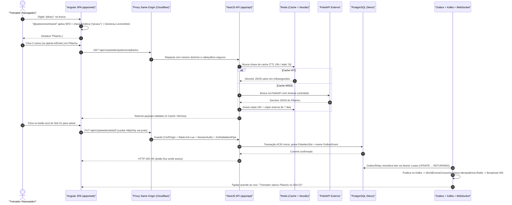

  <a href="../README.md">README atual</a>
  &nbsp;·&nbsp;
  <a href="capitulo-00-como-tudo-comecou.md">Capítulo 00: como tudo começou</a>
  &nbsp;·&nbsp;
  <a href="capitulo-00-guia-de-estudos-pokedex.md">Capítulo 00: guia de estudos (Fase 0)</a>
  &nbsp;·&nbsp;
  <a href="capitulo-01-guia-de-estudos/01-anatomia-do-repositorio-pastas-e-arquivos.md">Vol. 01: Pastas &amp; Arquivos</a>
  &nbsp;·&nbsp;
  <a href="capitulo-01-guia-de-estudos/02-linguagens-estruturas-de-dados-e-pacote-shared.md">Vol. 02: Shared &amp; Estruturas</a>
  &nbsp;·&nbsp;
  <a href="capitulo-01-guia-de-estudos/03-dicionario-completo-de-jargoes-e-glossario.md">Vol. 03: Dicionário de Jargões</a>

# Capítulo 01 — Enciclopédia e Guia de Estudos Full-Stack (PokéVerse OS)

> **Propósito deste guia:** ser para o **PokéVerse OS** inteiro (Fases 1 a 4A, Hardening SOLID/AppSec/CI e modelagem futura das Fases 4B a 6) exatamente o que o **[Capítulo 00](capitulo-00-guia-de-estudos-pokedex.md)** foi para a versão estática do Senac — um manual completo, didático e sem atalhos, escrito para que **tanto quem nunca programou na vida** consiga se localizar e entender como tudo funciona, quanto quem vai defender decisões em nível **Pleno / Sênior / Staff** domine cada linha, estrutura de dados, padrão arquitetural e trava de segurança do repositório.

---

## 1. Começando do Absoluto Zero: o que é este projeto?

Imagine uma **Pokédex física de plástico e metal** que abre com tampa articulada, tem botões de acrílico que acendem quando salvam um Pokémon, uma tela LCD de resultados e quatro papéis de parede animados ao fundo.

Na **Fase 0** (documentada no [Capítulo 00](capitulo-00-como-tudo-comecou.md)), essa Pokédex cabia inteira em **3 arquivos** (`index.html`, `css/style.css` e `js/app.js`). Ela funcionava muito bem sozinha no navegador, mas tinha limites naturais:

- Se você salvasse seus 10 Pokémon favoritos, eles ficavam presos só no navegador daquele aparelho (`localStorage`). Se abrisse no celular, sumiam.
- Não havia login, conta de treinador, segurança contra invasões, nem jeito de saber o que outros treinadores estavam salvando ao vivo.
- Toda vez que alguém pesquisava um Pokémon, o navegador batia direto no site externo da **PokéAPI** (e se a PokéAPI ficasse lenta ou caísse, todo mundo ficava esperando).
- Não existia verificação automática (testes, auditoria de contraste, escaneamento de segredos) garantindo que uma alteração de código hoje não quebraria o projeto amanhã.

Ao decidir continuar o projeto fora da faculdade por puro interesse técnico, essa ideia simples cresceu e virou o **PokéVerse OS**: uma plataforma **Full-Stack** completa (ou seja, feita tanto da parte visual que aparece na sua tela quanto dos servidores, bancos de dados e filas invisíveis que rodam na nuvem).

### A analogia da Central Pokémon para entender todas as peças

Se você nunca trabalhou com desenvolvimento de software, pense no **PokéVerse OS** como uma **Central Pokémon moderna**:

| Peça do Projeto | O que ela é na analogia | Nome Técnico & Pasta no Repositório | Por que existe? |
| :--- | :--- | :--- | :--- |
| **O aparelho na sua mão** | A própria Pokédex 3D com tampa que gira, botões, cores, sons e menus. É tudo o que você vê e clica. | **Front-end (Angular 22)** — `apps/web/` | Desenhar a interface fiel, responder rápido no mouse/toque/teclado e adaptar efeitos gráficos para PCs fortes ou celulares modestos. |
| **O balcão único de entrada** | Uma recepção no mesmo prédio da Pokédex que recebe seus pedidos e os repassa para a sala certa nos fundos, sem você precisar atravessar a rua. | **Proxy Same-Origin (Cloudflare Pages Functions)** — `apps/web/functions/` e `apps/web/cloudflare/` | Fazer o navegador achar que front-end e servidor moram no mesmo endereço (`pokeverse.pages.dev`), permitindo cookies de login blindados (`HttpOnly`). |
| **O gerente e as regras da Central** | Quem confere sua identidade, aplica as regras ("não pode repetir o mesmo Pokémon em dois slots"), busca informações e organiza tudo. | **Back-end / API (NestJS 11)** — `apps/api/` | Nunca confiar no que vem da tela do usuário: validar permissões, senhas, limites de cliques e proteger os dados. |
| **O livro de regras compartilhado** | Um manual oficial impresso em duas cópias idênticas: uma fica no aparelho, a outra com o gerente. Ambos falam exatamente a mesma língua. | **Pacote Compartilhado (`@pokeverse/shared`)** — `packages/shared/` | Evitar ter que escrever as mesmas validações e cálculos matemáticos (como a busca *fuzzy* ou status de erro) duas vezes. |
| **O cofre permanente** | O arquivo oficial de aço onde ficam gravadas as contas dos treinadores, seus 10 slots salvos, passkeys e histórico. Se faltar luz, nada se perde. | **Banco Relacional (PostgreSQL + Prisma ORM)** — `apps/api/prisma/` (nuvem: **Neon**) | Garantir consistência matemática (**ACID**): ou salva tudo certinho, ou não salva nada pela metade. |
| **O bloco de notas ultrarrápido** | Um quadro branco na mesa do atendente com os Pokémon que todo mundo pediu hoje e os crachás de quem está logado agora. | **Cache & Sessão em Memória (Redis 7)** — nuvem: **Upstash** | Responder em poucos milissegundos sem precisar perguntar à PokéAPI ou ao cofre toda hora, além de contar tentativas de senha com segurança. |
| **O malote com protocolo de entrega** | Um serviço de correios interno: quando você salva um Pokémon, o gerente anota no cofre *e* no protocolo de envio. Mesmo se o caminhão quebrar, a carta é reenviada depois. | **Transactional Outbox + Kafka / Redpanda** — `apps/api/src/modules/events/` (nuvem: **Aiven**) | Mandar e-mails de verificação e avisar todo mundo ao vivo no placar sem travar o seu clique nem perder mensagens em falhas de rede. |
| **O telão ao vivo** | O painel luminoso no topo da tela mostrando em tempo real quando outro treinador entrou ou capturou/salvou algo. | **WebSockets (Socket.IO)** — `apps/api/src/modules/world/` | Enviar atualizações instantâneas do servidor para o navegador sem você precisar apertar F5. |
| **O almoxarifado de cartuchos** | Um galpão preparado para guardar arquivos pesados (ROMs de console retrô e saves na nuvem) sem entupir o cofre principal. | **Object Storage S3 (MinIO / `pgsty/silo`)** — `infra/docker/` | Guardar arquivos binários grandes de forma barata e segura via links temporários. |
| **A caixa de ferramentas e o inspetor** | Scripts e robôs que montam a fábrica no seu computador, testam tudo e usam um Chrome invisível para conferir se nenhum texto ficou ilegível. | **Docker, GitHub Actions & UI Quality Gate** — `infra/docker/`, `.github/workflows/`, `scripts/` | Impedir que código quebrado, senhas vazadas ou telas com erro visual cheguem ao site no ar. |

---

## 2. A Viagem Completa de um Clique (Do Seu Dedo ao Banco e de Volta)

Para sentir como todas essas pastas conversam juntas na vida real, acompanhe o que acontece em menos de meio segundo quando um treinador abre a Pokédex, digita **`pikaxu`** (escrito errado de propósito!) e salva o Pikachu no **Slot 01**:

Perceba a elegância disso:
1. **Para digitar errado e achar o Pikachu**, o navegador nem precisou gastar internet na busca — a matemática pura em `@pokeverse/shared` resolveu na hora.
2. **Para abrir a ficha do Pikachu**, se outra pessoa já buscou hoje, o **Redis** responde antes mesmo da PokéAPI ser incomodada; se a PokéAPI estiver fora do ar, uma cópia reserva de até **7 dias (`stale-fallback`)** salva o dia; e se até a nossa API estiver offline, o front-end entra em **modo degradado** e consulta a PokéAPI direto!
3. **Para gravar no Slot 01**, um trio de porteiros (`CsrfOriginGuard`, `ThrottlerGuard` com script Lua no Redis e `SessionAuthGuard`) checa se você realmente está logado e se o pedido veio do próprio site; o `ZodValidationPipe` confere cada campo; e o **PostgreSQL** grava o slot e o aviso de evento **na mesma transação** para nunca haver slot salvo sem aviso ou aviso fantasma sem slot salvo.

---

## 3. Como o Capítulo 01 Está Organizado (`docs/capitulo-01-guia-de-estudos/`)

O projeto cresceu para mais de 130 arquivos de código e 19 documentos técnicos (`docs/00` a `docs/18` + `docs/ARCHITECTURE.md`). Colocar uma explicação linha por linha de tudo isso em um único arquivo gigante tornaria a leitura cansativa e difícil de manter.

Por isso, o **Capítulo 01** adota uma estrutura modular de **Enciclopédia em 10 Volumes** dentro da pasta [`capitulo-01-guia-de-estudos/`](capitulo-01-guia-de-estudos/), onde **este arquivo** funciona como o índice mestre e porta de entrada:

```mermaid
flowchart TD
  hub["capitulo-01-guia-de-estudos-pokedex.md<br/>Arquivo-Mestre & Mapa Geral (Você está aqui)"]

  v01["Vol. 01 · Anatomia do Repositório<br/>Todas as pastas, todos os arquivos + Docs 00, 01, ARCHITECTURE"]:::done
  v02["Vol. 02 · Linguagens, Estruturas & Shared<br/>TS 6, Zod v4, Int32Array, Map, Lab + Docs 12, 15, 17"]:::done
  v03["Vol. 03 · Dicionário Completo de Jargões<br/>90+ termos explicados do Zero ao Staff"]:::done

  v04["Vol. 04 · Front-end Angular 22 & Stores<br/>Signals, Zoneless, Guards, Interceptores + Doc 02"]:::plan
  v05["Vol. 05 · Visual 3D, Hardware & A11y<br/>SCSS Tokens oklch, Giro 3D, RPG Nav + Docs 03, 11"]:::plan
  v06["Vol. 06 · Back-end NestJS & Pipeline HTTP<br/>DI, Pipes, Filters, Telemetria + Doc 04"]:::plan
  v07["Vol. 07 · Banco PostgreSQL, Prisma & Redis<br/>13 modelos, Neon, Cache 7d, Lua Atômico + Docs 05, 06"]:::plan
  v08["Vol. 08 · Kafka Outbox, WebSockets & S3<br/>Atomic Lease, Idempotência, DLQ, Futuros + Docs 06, 07, 08, 09"]:::plan
  v09["Vol. 09 · Segurança Enterprise (AppSec) & LGPD<br/>BFF, Argon2id, TOTP, Passkeys, PKCE, AES + Docs 13, 16"]:::plan
  v10["Vol. 10 · Testes, CDP Gate, Docker, Cloud & Banca<br/>Vitest, Jest, CDP, CI/CD, Nuvem, Defesa + Docs 10, 11, 14, 18"]:::plan

  hub --> v01
  hub --> v02
  hub --> v03
  hub -.-> v04
  hub -.-> v05
  hub -.-> v06
  hub -.-> v07
  hub -.-> v08
  hub -.-> v09
  hub -.-> v10

  classDef done fill:#10301f,stroke:#3ddc84,color:#fff
  classDef plan fill:#141b34,stroke:#6aa7ff,color:#fff
```

### Painel de Progresso dos 10 Volumes

| Volume | Título & Arquivo | Docs Destrinchados | Conteúdo Principal | Status |
| :---: | :--- | :---: | :--- | :---: |
| **01** | **[Anatomia do Repositório: Todas as Pastas e Arquivos](capitulo-01-guia-de-estudos/01-anatomia-do-repositorio-pastas-e-arquivos.md)** | `00`, `01`, `ARCHITECTURE` | Inventário completo de **cada pasta e cada arquivo** da raiz, `shared`, `api`, `web`, `infra`, `scripts`, `.github`, `assets` e `docs`, mais clusters `1 ↔ 2 ↔ 3`. | **Concluído** |
| **02** | **[Linguagens, Estruturas de Dados e Pacote `@pokeverse/shared`](capitulo-01-guia-de-estudos/02-linguagens-estruturas-de-dados-e-pacote-shared.md)** | `01`, `12`, `15`, `17` | Análise linha por linha de `tsconfig.base.json`, `tsup`, `AsyncState<T>`, `Int32Array` com `stride` (Damerau-Levenshtein), `Map` $O(1)$, tabela tabular com `/* @__PURE__ */`, Laboratório Genético e Schemas Zod v4. | **Concluído** |
| **03** | **[Dicionário Completo de Jargões, Siglas e Conceitos](capitulo-01-guia-de-estudos/03-dicionario-completo-de-jargoes-e-glossario.md)** | `00` a `18` + `ARCH` | Mais de 90 termos técnicos (de *API REST* e *Monorepo* até *TOCTOU*, *Atomic Lease*, *PKCE* e *mTLS*), sempre explicados com analogia para leigos + visão técnica + por que foi escolhido. | **Concluído** |
| **04** | **Front-end Angular 22: Standalone, Signals, Zoneless e Stores** *(a criar)* | `02`, `16`, `17`, `18` | Linha por linha de `app.config.ts`, `app.routes.ts`, `auth.guard.ts`, `auth.interceptor.ts`, `AuthStore`, `SecurityIamStore`, `PrivacyConsentStore`, `PokedexStore` e diretivas. | Pendente (Etapa 2) |
| **05** | **Engenharia Visual 3D, Perfis de Hardware e Acessibilidade (WCAG 2.2 AA)** *(a criar)* | `03`, `08`, `11`, `12` | Linha por linha de `_tokens.scss`, `_pokedex-classic.scss`, parciais `styles/pokedex/`, `PokedexLidPhysicsService`, `PokedexRpgNavService`, `[pvRpgFocusable]`, `QualityStore` e `ScenarioStore`. | Pendente (Etapa 2) |
| **06** | **Back-end NestJS 11, Pipeline de Requisição e Observabilidade** *(a criar)* | `04`, `10`, `17`, `18` | Ciclo completo da requisição (`main.ts` -> `CorrelationMiddleware` -> Guards -> `ZodValidationPipe` -> Controller -> Service -> Repository -> `GlobalExceptionFilter`), `env.schema.ts` e probes. | Pendente (Etapa 3) |
| **07** | **Banco Relacional (PostgreSQL + Prisma 6) e Cache Atômico (Redis 7)** *(a criar)* | `05`, `06`, `11`, `17` | Os 13 modelos e 4 enums do `schema.prisma`, migrations, índice parcial, Neon pooled vs. unpooled, cache `HIT`/`MISS`/`STALE` 7d e scripts Lua anti-TOCTOU no `RedisService`. | Pendente (Etapa 3) |
| **08** | **Mensageria Kafka/Outbox, WebSockets e Módulos Futuros (4B–6)** *(a criar)* | `06`, `07`, `08`, `09`, `15` | Transactional Outbox com `UPDATE ... RETURNING` (*Atomic Lease*), idempotência com rollback no `catch`, DLQ, `WorldGateway`, além do desenho de Arcade WASM, Museu e Battle Frontier. | Pendente (Etapa 4) |
| **09** | **Dossiê AppSec, IAM Enterprise BFF, Criptografia e LGPD** *(a criar)* | `04`, `13`, `16`, `17` | Análise linha por linha do `AuthModule` (5 services + 5 repositórios), sessão opaca `HttpOnly`, Argon2id + dummy hash, TOTP + backup codes, WebAuthn Passkeys, Google PKCE, AES-256-GCM e LGPD. | Pendente (Etapa 4) |
| **10** | **Pirâmide de Testes, CDP Quality Gate, Docker, CI/CD Cloud e Banca Técnica** *(a criar)* | `10`, `11`, `14`, `18` | Anatomia dos 118 testes automatizados, `ui-quality-gate.mjs` via Chrome CDP, `docker-compose.yml`, `api.Dockerfile`, `ci.yml`, `deploy.yml`, Cloudflare/Azure/Neon/Upstash/Aiven e perguntas de defesa. | Pendente (Etapa 5) |

---

## 4. Mapa de Correspondência: O que Cada Documento em `docs/` Explica

Antes de abrir qualquer documento técnico da pasta `docs/`, use esta tabela para saber **o que tem dentro de cada um**, em português claro, e qual Volume do Capítulo 01 o destrincha:

| Documento | Título Original | O que ele explica em termos simples | Volume do Cap. 01 |
| :--- | :--- | :--- | :---: |
| [`ARCHITECTURE.md`](ARCHITECTURE.md) | Contrato de Qualidade | As "leis da casa" para escrever código limpo: validar na entrada, não misturar banco com regra de negócio, evitar consultas lentas e manter arquivos pequenos. | **Vol. 01** & **Vol. 02** |
| [`00`](00-visao-geral-e-roadmap.md) | Visão Geral e Roadmap | O mapa completo do PokéVerse OS: quem entra sem login vs. quem precisa de conta, os 5 módulos e a ordem das fases (0 a 6). | **Vol. 01** |
| [`01`](01-arquitetura-monorepo-e-padroes.md) | Arquitetura do Monorepo | Por que juntamos front-end, back-end e pacote compartilhado num único repositório e quais regras garantem que não virem uma bagunça. | **Vol. 01** & **Vol. 02** |
| [`02`](02-frontend-angular-hud-e-estado.md) | Front-end Angular e HUD | Como funciona a interface moderna em Angular 22, a barra superior, o dock inferior e as caixas de memória reativas (*Stores*). | **Vol. 04** |
| [`03`](03-motores-graficos-phaser-e-threejs.md) | Motores Gráficos (Phaser / Three.js) | O planejamento de como os mundos 2D (Vila Central) e 3D (Holocron e Console Arcade) funcionarão sem disputar o mesmo espaço na tela. | **Vol. 05** & **Vol. 08** |
| [`04`](04-backend-nestjs-auth-e-seguranca.md) | Back-end NestJS e Auth | Como o servidor central recebe requisições HTTP, protege rotas e valida a identidade dos treinadores. | **Vol. 06** & **Vol. 09** |
| [`05`](05-banco-de-dados-postgresql-e-prisma.md) | PostgreSQL e Prisma ORM | O desenho das tabelas do banco de dados (treinadores, slots, equipes, partidas, eventos) e como falar com ele sem perder performance. | **Vol. 07** |
| [`06`](06-cache-redis-e-eventos-kafka.md) | Redis e Mensageria Kafka | Como o sistema usa memória ultrarrápida para cache/limites e filas de mensagens garantidas para nunca perder notificações. | **Vol. 07** & **Vol. 08** |
| [`07`](07-arcade-retro-wasm-e-cloud-saves.md) | Arcade Retrô WASM | O projeto futuro de rodar jogos clássicos direto no navegador via WebAssembly com saves salvos na nuvem. | **Vol. 08** |
| [`08`](08-museu-lore-e-holocron-pokedex.md) | Museu das Regiões & Holocron | A vitrine pública de Kanto a Paldea (já com base entregue) e a futura projeção holográfica 3D dos Pokémon. | **Vol. 05** & **Vol. 08** |
| [`09`](09-arena-batalha-teambuilder-e-minigames.md) | Arena de Batalha & Mini-Games | O projeto futuro do montador de times competitivos (IVs/EVs), placares ao vivo e batalhas PvE/PvP em tempo real. | **Vol. 08** |
| [`10`](10-infraestrutura-docker-ci-cd-e-deploy.md) | Infraestrutura, Docker e CI/CD | Como subir toda a fábrica no seu computador com um comando e como os robôs do GitHub testam e publicam na nuvem automaticamente. | **Vol. 10** |
| [`11`](11-performance-hardware-gates-e-mobile.md) | Desempenho e Hardware Gates | Como o app descobre se o seu celular é fraco ou seu PC é forte para adaptar os efeitos (`ULTRA`/`BALANCED`/`LITE`) e não travar. | **Vol. 05** & **Vol. 10** |
| [`12`](12-pokedex-2-0-pokeapi-e-controles.md) | Pokédex 2.0 e Controles | O plano de como acessar todos os dados da PokéAPI sem inventar botões extras na carcaça física da Pokédex. | **Vol. 02** & **Vol. 05** |
| [`13`](13-dossie-de-seguranca-e-blindagem.md) | Dossiê de Segurança (AppSec) | O relatório detalhado das proteções contra ataques reais (roubo de sessão, CSRF, XSS, força bruta, vazamento de dados pessoais). | **Vol. 09** |
| [`14`](14-status-e-changelog-implementacao.md) | Status Real & Changelog | O diário oficial de bordo: exatamente o que já funciona hoje, o que mudou em relação aos planos antigos e as métricas medidas. | **Vol. 10** |
| [`15`](15-pokedex-suprema-51-endpoints-e-laboratorio-genetico.md) | Pokédex Suprema & Lab Genético | Os 51 endpoints da PokéAPI mapeados e as fórmulas matemáticas de XP, atributos, evolução, clonagem e Bio-Essência. | **Vol. 02** & **Vol. 08** |
| [`16`](16-cookies-lgpd-e-requisitos.md) | Cookies, LGPD e Requisitos | A lista de requisitos funcionais/não-funcionais e como cumprimos a lei brasileira de privacidade (consentimento, exportação e exclusão de conta). | **Vol. 04** & **Vol. 09** |
| [`17`](17-plano-solid-clean-code-e-engenharia-big-tech.md) | Plano SOLID & Post-Mortem | A história de bugs difíceis de concorrência que encontramos na auditoria e como aplicamos princípios SOLID para resolvê-los na raiz. | **Vol. 02**, **Vol. 06**, **Vol. 09** |
| [`18`](18-auditoria-e-plano-divida-tecnica-arquitetura.md) | Auditoria de Dívida Técnica | O boletim de notas do repositório em 4 ondas de refatoração, mostrando como cada workspace chegou à nota 10/10 no Contrato de Qualidade. | **Vol. 01**, **Vol. 04**, **Vol. 10** |

---

## 5. Plano Passo a Passo para Concluir Todos os Volumes (Sem Economizar Detalhes)

Para manter cada volume com o nível de profundidade de um livro técnico (lendo o código-fonte real e explicando linha por linha, sem resumir ou pular arquivos), a escrita completa da enciclopédia foi dividida em **5 etapas curtas** (1 etapa por conversa, seguida de `git commit` conforme a regra de economia de contexto do repositório):

### Etapa 1 — Concluída Nesta Sessão
- Padronização dos nomes (`capitulo-00-*` sempre antes de `capitulo-01-*`).
- Criação deste Arquivo-Mestre (`docs/capitulo-01-guia-de-estudos-pokedex.md`).
- **Volume 01:** Anatomia completa de todas as pastas e todos os arquivos + `docs/00`, `01`, `ARCHITECTURE`.
- **Volume 02:** Linguagens, estruturas de dados, algoritmos e análise linha por linha de `packages/shared` + `docs/12`, `15`, `17`.
- **Volume 03:** Dicionário completo com 90+ jargões explicados para iniciantes e especialistas.

### Etapa 2 — Front-end Angular, Física 3D, Hardware & Acessibilidade (Volumes 04 e 05)
- **O que será lido e destrinchado:** todos os arquivos em `apps/web/src/app/`, `apps/web/src/styles/` e `docs/02`, `03`, `08`, `11`, `12`, `16`.
- **Prompt pronto para usar no próximo chat:**
  > *"Continue o Capítulo 01 preenchendo os Volumes 04 e 05 dentro de `docs/capitulo-01-guia-de-estudos/` (`04-frontend-angular-22-e-stores.md` e `05-visual-3d-hardware-e-acessibilidade.md`), lendo os arquivos reais de `apps/web/src/` e os docs `02`, `03`, `08`, `11`, `12` e `16`. Mantenha o padrão didático (leigo + técnico + linha por linha + por que foi escolhido) e atualize a tabela de progresso em `docs/capitulo-01-guia-de-estudos-pokedex.md` e `README.md`."*

### Etapa 3 — Back-end NestJS, PostgreSQL/Prisma e Redis Atômico (Volumes 06 e 07)
- **O que será lido e destrinchado:** `apps/api/src/main.ts`, `app.setup.ts`, `app.module.ts`, `config/`, `common/`, `infra/`, `prisma/schema.prisma`, `migrations/`, `modules/pokedex/`, `modules/health/`, `modules/system/` e `docs/04`, `05`, `06`.
- **Prompt pronto para usar em um novo chat:**
  > *"Continue o Capítulo 01 preenchendo os Volumes 06 e 07 dentro de `docs/capitulo-01-guia-de-estudos/` (`06-backend-nestjs-pipeline-e-observabilidade.md` e `07-postgresql-prisma-e-redis-atomico.md`), lendo os arquivos reais em `apps/api/` e os docs `04`, `05` e `06`. Atualize o painel de progresso no Capítulo 01 e no `README.md`."*

### Etapa 4 — Mensageria Kafka/Outbox, Segurança AppSec/IAM BFF e Módulos Futuros (Volumes 08 e 09)
- **O que será lido e destrinchado:** `apps/api/src/modules/events/`, `notifications/`, `world/`, todos os 25 arquivos de `modules/auth/`, `apps/web/functions/`, `apps/web/cloudflare/`, `apps/web/public/_headers` e `docs/06`, `07`, `08`, `09`, `13`, `16`, `17`.
- **Prompt pronto para usar em um novo chat:**
  > *"Continue o Capítulo 01 preenchendo os Volumes 08 e 09 dentro de `docs/capitulo-01-guia-de-estudos/` (`08-kafka-outbox-websockets-e-modulos-futuros.md` e `09-seguranca-appsec-iam-bff-e-lgpd.md`), lendo os arquivos reais de `events`, `world`, `notifications`, `auth` e `cloudflare` mais os docs `06`, `07`, `08`, `09`, `13`, `16` e `17`. Atualize o painel de progresso no Capítulo 01 e no `README.md`."*

### Etapa 5 — Testes, UI Quality Gate (CDP), Docker, Cloud e Banca Técnica (Volume 10)
- **O que será lido e destrinchado:** `scripts/ui-quality-gate.mjs`, `infra/docker/*`, `.github/workflows/*`, todos os `*.spec.ts`, `*.e2e-spec.ts`, `*.integration-spec.ts` e `docs/10`, `11`, `14`, `18`.
- **Prompt pronto para usar em um novo chat:**
  > *"Finalize o Capítulo 01 criando o Volume 10 (`docs/capitulo-01-guia-de-estudos/10-testes-cdp-docker-cloud-e-banca-tecnica.md`), lendo os testes reais, `scripts/ui-quality-gate.mjs`, `infra/docker/`, `.github/workflows/` e os docs `10`, `11`, `14` e `18`, incluindo 30+ perguntas e respostas de defesa técnica estilo Staff Engineer. Marque todos os 10 volumes como concluídos no Capítulo 01 e no `README.md`."*

---

  <a href="../README.md">Ir para o README atual</a>
  &nbsp;·&nbsp;
  <a href="capitulo-00-como-tudo-comecou.md">Capítulo 00: como tudo começou</a>
  &nbsp;·&nbsp;
  <a href="capitulo-00-guia-de-estudos-pokedex.md">Capítulo 00: guia de estudos (Fase 0)</a>
  &nbsp;·&nbsp;
  <a href="capitulo-01-guia-de-estudos/01-anatomia-do-repositorio-pastas-e-arquivos.md">Começar pelo Vol. 01</a>

