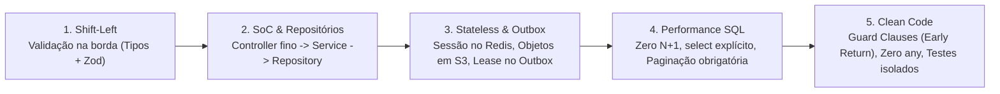

  <a href="../capitulo-01-guia-de-estudos-pokedex.md">Voltar ao Índice do Capítulo 01</a>
  &nbsp;·&nbsp;
  <a href="../../README.md">README atual</a>
  &nbsp;·&nbsp;
  <a href="02-linguagens-estruturas-de-dados-e-pacote-shared.md">Próximo: Vol. 02 (Linguagens, Estruturas &amp; Shared)</a>

# Volume 01 — Anatomia do Repositório: Pastas, Arquivos e Regras Arquiteturais

> **Documentos originais consolidados:** [`00 — Visão Geral e Roadmap`](../00-visao-geral-e-roadmap.md), [`01 — Arquitetura do Monorepo e Padrões`](../01-arquitetura-monorepo-e-padroes.md) e [`ARCHITECTURE.md — Contrato de Qualidade`](../ARCHITECTURE.md).
> **Objetivo deste volume:** mapear integralmente a estrutura de diretórios e arquivos do repositório `pokedex-frontend`, explicando o papel técnico de cada componente, biblioteca e ferramenta de automação e os critérios arquiteturais que governam a organização do código.

---

## 1. Arquitetura Monorepo e Organização Modular do Repositório

Na **Fase 0**, toda a aplicação cabia em três arquivos estáticos (`index.html`, `css/style.css` e `js/app.js` — já portados e **removidos da raiz por não serem mais utilizados**). Ao incorporar autenticação segura, persistência em banco relacional, cache distribuído, mensageria assíncrona, build otimizado e testes automatizados, o código foi estruturado em domínios isolados (`apps/`, `packages/`, `infra/` e `scripts/`) para impedir acoplamento destrutivo entre interface visual, regras de negócio, infraestrutura e scripts de qualidade.

### Conceitos Estruturais do Repositório

| Conceito | O que é e o que faz | Implementação no PokéVerse OS |
| :--- | :--- | :--- |
| **Monorepo** | Estratégia de controle de versão que reúne o front-end (`apps/web`), o back-end (`apps/api`), bibliotecas internas (`packages/shared`) e a definição de infraestrutura (`infra/`) em um único repositório Git. | Permite atualizar um contrato de validação em `@pokeverse/shared` e adaptar simultaneamente a API NestJS e a SPA Angular no mesmo commit, evitando incompatibilidade de versões entre cliente e servidor. |
| **`npm workspaces`** | Mecanismo nativo do gerenciador de pacotes `npm` (configurado no [`package.json`](../../package.json#L5-L8) raiz) que vincula pacotes locais como dependências internas resolvidas automaticamente. | Embora o planejamento inicial (`doc 01`) citasse o Turborepo como opção futura, a adoção exclusiva de `npm workspaces` elimina ferramentas externas extras de orquestração mantendo comandos unificados (`build`, `typecheck`, `lint`, `format:check`, `test`, `audit:ui`). |
| **Coesão SOLID (SRP)** | O **Princípio da Responsabilidade Única** determina que cada módulo, serviço ou componente tenha apenas um eixo de alteração. | Os arquivos de configuração do **ESLint** impõem limites rígidos no CI: até **`300` linhas úteis** para serviços/stores em geral e até **`200` linhas úteis** para componentes visuais Angular (`*.component.ts`), com complexidade ciclomática máxima de **`15`**. |

---

## 2. Síntese dos Documentos Arquiteturais Fundamentais (`00`, `01` e `ARCHITECTURE.md`)

### 2.1. [`00 — Visão Geral e Roadmap`](../00-visao-geral-e-roadmap.md)

1. **Priorização "Pokédex First":** após consolidar a infraestrutura em nuvem (Fase 3), o desenvolvimento concentra-se em tornar a **Pokédex 3D** uma enciclopédia completa e de alta fluidez (Fase 4A entregue; Fase 4B dedicada aos 51 endpoints da PokéAPI, abas no visor LCD, Web Audio e projeção Holocron 3D) antes de ativar o Laboratório Genético em back-end (Fase 5) e os módulos expansíveis (Fase 6: Vila Central Phaser 3, Arcade WASM e Battle Frontier).
2. **Os 5 Módulos da Plataforma (atalhos `1` a `5` no Dock):**
   - `1` **Vila Central** (`/mundo`) — Acesso autenticado (`18%` de preparação modelada).
   - `2` **Pokédex 3D** (`/` e `/pokedex`) — Acesso público (**em produção**, Fase 4A concluída).
   - `3` **Museu das Regiões** (`/museu`) — Acesso público (base com 6 gerações entregue).
   - `4` **Arcade Retrô** (`/arcade`) — Acesso autenticado (`14%` de preparação modelada).
   - `5` **Battle Frontier** (`/arena`) — Acesso autenticado (`28%` de preparação modelada).
3. **Política de Acesso (Visitante vs. Treinador):** visitantes não autenticados operam a Pokédex (leitura e gravação local via `localStorage` condicionada ao consentimento de privacidade) e o Museu das Regiões. Persistência em PostgreSQL, presença no Overworld, emulação com saves em S3 e batalhas na Arena exigem conta autenticada.

### 2.2. [`01 — Arquitetura do Monorepo e Padrões`](../01-arquitetura-monorepo-e-padroes.md)

Define a separação física entre aplicações executáveis (`apps/`), pacotes compartilhados (`packages/`), contêineres (`infra/`) e o registro documental da Fase 0 (cujo código estático foi removido da raiz após migração completa para `apps/web` e `@pokeverse/shared`). Estabelece o princípio **Single Source of Truth** (fonte única da verdade): schemas **Zod**, constantes numéricas, tipos de estado e regras puras de domínio residem exclusivamente em `@pokeverse/shared`, sendo proibida a duplicação de contratos entre front-end e back-end.

### 2.3. [`ARCHITECTURE.md — Contrato de Qualidade`](../ARCHITECTURE.md)

Define as diretrizes normativas de arquitetura e combate a **AI slop** (código genérico, redundante, com nomes vagos ou sem isolamento de responsabilidades) em cinco pilares:

1. **Shift-Left:** antecipar a detecção de defeitos para os estágios iniciais — primeiro via sistema estático de tipos do TypeScript, depois via validação de borda em runtime (`ZodValidationPipe`) antes que dados não confiáveis alcancem serviços ou o banco de dados.
2. **Separação de Responsabilidades (SoC) e Repositórios Isolados:** Controllers apenas recebem requisições validadas, invocam o Service correspondente e retornam códigos HTTP; Services implementam regras de negócio sem acoplamento direto a queries Prisma; Repositórios concentram todas as operações SQL/Prisma e transações ACID.
3. **Back-end Stateless, S3 e Transactional Outbox:** nenhuma instância da API mantém sessões ou contadores de segurança apenas em memória local do processo, permitindo escalabilidade horizontal. Sessões, OTPs e contadores residem no **Redis**; arquivos binários pesados vão para armazenamento **S3** (nunca no PostgreSQL); eventos assíncronos são gravados na tabela `OutboxEvent` dentro da mesma transação ACID da operação de domínio.
4. **Performance SQL (Zero N+1 e Paginação):** é vedado executar consultas relacionais dentro de laços iterativos (`N+1 queries`). Consultas usam seleção estrita de campos (`select`), índices planejados e paginação obrigatória (`take`/`skip` ou keyset/cursor).
5. **Clean Code e Guard Clauses (*Early Return*):** nomes de domínio precisos (vetados identificadores genéricos como `dataHandler` ou `temp`), constantes tipadas no lugar de valores mágicos e verificação de condições inválidas no início das funções com retorno ou exceção imediata, mantendo o fluxo principal sem aninhamento profundo.

---

## 3. Inventário Completo de Diretórios e Arquivos

### Bloco A — Raiz do Repositório e Base da Fase 0

| Arquivo / Pasta | O que é e o que faz | Papel no Sistema |
| :--- | :--- | :--- |
| [`.gitignore`](../../.gitignore) | Define caminhos ignorados pelo controle de versão Git (`node_modules/`, `.env`, `.env.cloud`, `dist/`, `.angular/`). | Impede o versionamento de dependências compiladas e impede vazamento de credenciais locais para o repositório remoto. |
| [`.dockerignore`](../../.dockerignore) | Lista arquivos excluídos do contexto de construção da imagem Docker. | Acelera o build de contêineres e evita empacotar `.env`, `docs/` ou o código do front-end dentro da imagem da API. |
| [`.env.example`](../../.env.example) | Modelo documentado de todas as variáveis de ambiente exigidas (`DATABASE_URL`, `REDIS_URL`, `APP_ENCRYPTION_KEY`, etc.) com valores fictícios seguros. | Fornece referência completa de configuração para ambientes locais e pipelines sem expor segredos reais. |
| [`.gitleaks.toml`](../../.gitleaks.toml) | Configuração do **Gitleaks** (ferramenta de análise estática que escaneia commits e arquivos em busca de chaves privadas, tokens e senhas), declarando exceções explícitas para os valores fictícios de `.env.example`. | Permite que o estágio inicial do CI bloqueie automaticamente commits contendo credenciais reais antes mesmo da instalação de dependências. |
| [`.sonarcloud.properties`](../../.sonarcloud.properties) | Arquivo de configuração do **SonarQube Cloud** (plataforma de inspeção contínua de qualidade e segurança estática), mapeando diretórios de código-fonte, testes e exclusões de migrações SQL na análise de duplicação (CPD). | Automatiza a detecção de *code smells*, vulnerabilidades estáticas e trechos duplicados. |
| [`package.json`](../../package.json) | Manifesto raiz Node.js do monorepo: declara `workspaces: ["packages/*", "apps/*"]` e os scripts globais (`build`, `typecheck`, `lint`, `format:check`, `test`, `audit:ui`, `infra:up`). | Centraliza a orquestração de compilação, análise estática e testes nos três workspaces a partir da raiz. |
| [`package-lock.json`](../../package-lock.json) | Arquivo de trava determinística gerado pelo `npm` com as versões exatas e hashes de integridade de toda a árvore de dependências. | Garante builds reproduzíveis entre estações locais, contêineres Docker e executores de CI. |
| [`tsconfig.base.json`](../../tsconfig.base.json) | Configuração base compartilhada do compilador **TypeScript 6** (`strict`, `noImplicitAny`, `strictNullChecks`, `noUncheckedIndexedAccess`, etc.). | Impõe verificação rigorosa de tipos e nulidade herdada por `shared`, `api` e `web`. |
| [`eslint.base.mjs`](../../eslint.base.mjs) | Fábrica compartilhada de configuração **ESLint v9** (`createWorkspaceEslintConfig`, `maxLinesRule`) usada pelos 3 workspaces (`shared`, `api` e `web`). | Evita duplicação CPD e aplica uniformemente Prettier, `no-explicit-any`, `complexity <= 15`, `max-depth <= 3` e `max-lines`. |
| [`neon.ts`](../../neon.ts) | Política de ciclo de vida de branches da plataforma serverless **Neon Postgres** (`@neon/config`), definindo expiração (TTL) de 7 dias para branches temporárias. | Evita acúmulo de bancos efêmeros ociosos em nuvem após testes ou revisões. |
| [`AGENTS.md`](../../AGENTS.md) | Conjunto de regras operacionais do repositório (Regra Zero de UI, princípios SOLID, travas contra condições de corrida e sincronização obrigatória de documentação). | Padroniza critérios de engenharia e revisão para qualquer alteração aplicada ao código ou à documentação. |
| [`README.md`](../../README.md) | Documentação principal na raiz do repositório com visão geral, diagramas arquiteturais, comandos de execução e índice da documentação. | Consolida em um único ponto de entrada o estado funcional, a arquitetura e as instruções de uso do projeto. |
| `index.html`, `css/style.css`, `js/app.js` *(removidos por desuso)* | Antiga aplicação estática da **Fase 0** em HTML5, CSS3 e JavaScript puro (*Vanilla JS*). | Portada integralmente para `apps/web` e `@pokeverse/shared` e **apagada da raiz por não ser mais utilizada** (histórico preservado no Git e no [Capítulo 00](../capitulo-00-guia-de-estudos-pokedex.md)). |
| `assets/` | Recursos estáticos da Fase 0: [`assets/favicon.svg`](../../assets/favicon.svg), `assets/textures/` (`metal-floco.webp`, `plastico-grao.webp`) e `assets/backgrounds/` (4 cenários nas variantes `-desktop.webp` e `-mobile.webp`). | Entrega microtexturas pré-assadas e imagens responsivas otimizadas em WebP para manter desempenho estável em dispositivos móveis. |

---

### Bloco B — `packages/shared/` (Biblioteca Interna `@pokeverse/shared`)

Pacote TypeScript compilado previamente para fornecer tipos, constantes, contratos **Zod v4** e lógica pura compartilhada entre front-end e back-end (analisado em profundidade no [Volume 02](02-linguagens-estruturas-de-dados-e-pacote-shared.md)).

| Caminho em `packages/shared/` | O que contém e o que faz |
| :--- | :--- |
| [`package.json`](../../packages/shared/package.json), [`tsup.config.ts`](../../packages/shared/tsup.config.ts), [`tsconfig.json`](../../packages/shared/tsconfig.json), [`vitest.config.mts`](../../packages/shared/vitest.config.mts), [`eslint.config.mjs`](../../packages/shared/eslint.config.mjs), [`.prettierrc`](../../packages/shared/.prettierrc) | Configuram compilação dual (**ESM** `.mjs` para o Angular e **CommonJS** `.js` para o NestJS + declarações `.d.ts`) com o empacotador **tsup**, sinalizam `"sideEffects": false` para *tree-shaking* (remoção de código não importado), aplicam lint estrito via [`eslint.base.mjs`](../../eslint.base.mjs) (`complexity <= 15`, `max-lines <= 300`) e executam testes unitários via **Vitest**. |
| [`src/index.ts`](../../packages/shared/src/index.ts) | Ponto único de reexportação (*barrel file*) que expõe tipos, constantes, schemas e funções de domínio como API pública de `@pokeverse/shared`. |
| [`src/types/async-state.ts`](../../packages/shared/src/types/async-state.ts) | Define a união discriminada `AsyncState<T, E>` (5 estados: `idle`, `loading`, `empty`, `error`, `success`), `AppError`, `HardwareTier`, `PerfPreference`, `AccessMode` e a função de verificação exaustiva `assertNever`. |
| [`src/constants/platform.constants.ts`](../../packages/shared/src/constants/platform.constants.ts) | Centraliza constantes numéricas (`TOTAL_POKEDEX_SLOTS = 10`, `MAX_EV_TOTAL = 510`, timeouts de probes), a tupla `POKEMON_TYPES` (`as const`) e a tabela `PLATFORM_MODULES` dos 5 módulos da plataforma. |
| [`src/domain/pokedex-search.ts`](../../packages/shared/src/domain/pokedex-search.ts) + [`.spec.ts`](../../packages/shared/src/domain/pokedex-search.spec.ts) | Motor puro de busca aproximada: decomposição Unicode `NFD`, chave fonética PT/EN, matriz linearizada `Int32Array` para distância de Damerau-Levenshtein e ranking determinístico por pontuação. |
| [`src/domain/pokeapi-endpoints.ts`](../../packages/shared/src/domain/pokeapi-endpoints.ts) | Registro compacto dos **51 endpoints da PokéAPI v2** (`POKEAPI_V2_ENDPOINTS` anotado com `/* @__PURE__ */` e validado por Zod) e motor de filtragem multi-critério (`filterCatalogWithAdvancedQuery`) usando `Map<number, T>`. |
| [`src/domain/pokemon-lab.ts`](../../packages/shared/src/domain/pokemon-lab.ts) + [`.spec.ts`](../../packages/shared/src/domain/pokemon-lab.spec.ts) | Funções puras determinísticas para o futuro Laboratório Genético: 6 curvas de experiência (`calculateXpForLevel`), atributos por nível (`calculateStatsAtLevel`), prontidão evolutiva, replicação/clonagem e progressão de Bio-Essência (`E..APEX`). |
| [`src/schemas/pokedex.schemas.ts`](../../packages/shared/src/schemas/pokedex.schemas.ts) | Contratos Zod v4 para validação de parâmetros (`PokedexSlotIndexParamSchema`, `PokemonIdentifierParamSchema`), payloads da PokéAPI, gravação estrita de slots (`.strict()`), perfis de hardware e cenários. |
| [`src/schemas/auth.schemas.ts`](../../packages/shared/src/schemas/auth.schemas.ts) | Contratos Zod v4 de identidade e privacidade: cadastro, login, verificação/recuperação OTP, perfil, desafio MFA (`totp`/`backup_code`), WebAuthn Passkeys, callback OAuth Google, sessões ativas, portabilidade LGPD e consentimento de cookies (`PRIVACY_CONSENT_VERSION`). |
| [`src/schemas/events.schemas.ts`](../../packages/shared/src/schemas/events.schemas.ts) | Constante `KAFKA_TOPICS` (6 tópicos incluindo `pokeverse.dlq.v1`) e contratos dos eventos de ticker em tempo real (`WorldTickerEventSchema`), notificações por e-mail (`EmailNotificationEventSchema`) e envelope cifrado do Outbox (`EncryptedOutboxPayloadSchema`). |
| [`src/schemas/health.schemas.ts`](../../packages/shared/src/schemas/health.schemas.ts) + [`schemas.spec.ts`](../../packages/shared/src/schemas/schemas.spec.ts) | Contratos de resposta para `/health/live`, `/health/ready` e `/api/v1/system/bootstrap`, acompanhados da suíte Vitest que valida todos os schemas de borda. |

---

### Bloco C — `apps/api/` (Back-end NestJS 11)

#### C.1. Configuração, Banco de Dados e Inicialização

| Pasta / Arquivo | O que é e o que faz |
| :--- | :--- |
| [`apps/api/package.json`](../../apps/api/package.json), [`nest-cli.json`](../../apps/api/nest-cli.json), [`tsconfig.json`](../../apps/api/tsconfig.json), [`tsconfig.build.json`](../../apps/api/tsconfig.build.json), [`eslint.config.mjs`](../../apps/api/eslint.config.mjs), [`.prettierrc`](../../apps/api/.prettierrc), [`README.md`](../../apps/api/README.md) | Declaram dependências de servidor (**NestJS 11**, **Prisma 6.19.3**, **`ioredis`**, **`kafkajs`**, **`argon2`**, **`@simplewebauthn/server`**, **Helmet**, **`nodemailer`**, **`socket.io`**, **Zod**), regras ESLint via [`eslint.base.mjs`](../../eslint.base.mjs) com análise de tipos (`recommendedTypeChecked`, `max-lines: 300`, `complexity <= 15`) e execução de testes com **Jest**. |
| [`apps/api/prisma/schema.prisma`](../../apps/api/prisma/schema.prisma) | Esquema relacional único do PostgreSQL: define **5 enums** (`ArcadeConsole`, `OutboxStatus`, `BattleMode`, `BattleStatus`, `TrainerRole`) e **14 modelos** (`Trainer`, `RefreshToken`, `MfaBackupCode`, `TrainerOAuthAccount`, `TrainerPasskey`, `PokedexSlot`, `PokemonTeam`, `PokemonTeamMember`, `ArcadeRom`, `ArcadeSaveState`, `MinigameScore`, `BattleMatch`, `OutboxEvent`, `AuditLog`). |
| `apps/api/prisma/migrations/` | Histórico versionado em SQL puro aplicado em produção: `migration_lock.toml` (fixa o provedor `postgresql`), [`20261118073124_init_pokeverse_schema/migration.sql`](../../apps/api/prisma/migrations/20261118073124_init_pokeverse_schema/migration.sql) (tabelas iniciais e índice parcial `idx_outbox_pending`), [`20261118082535_iam_enterprise_foundation/migration.sql`](../../apps/api/prisma/migrations/20261118082535_iam_enterprise_foundation/migration.sql) (estruturas de MFA, OAuth e Passkeys) e [`20261123080000_onda4_rbac_and_audit_log/migration.sql`](../../apps/api/prisma/migrations/20261123080000_onda4_rbac_and_audit_log/migration.sql) (`TrainerRole`, `AuditLog` e triggers SQL *append-only*). |
| [`src/main.ts`](../../apps/api/src/main.ts) | Ponto de entrada do processo Node.js: instancia o contêiner NestJS com `bodyParser: false` (permitindo configurar parsers limitados depois) e `bufferLogs: true`, conecta o logger JSON estruturado e inicia o servidor HTTP. |
| [`src/app.setup.ts`](../../apps/api/src/app.setup.ts) | Configura a camada HTTP global: `trust proxy`, cabeçalhos de segurança via **Helmet** (CSP restritiva, proteção de enquadramento) e `Permissions-Policy`, parsers explícitos JSON (`64kb`) e URL-encoded (`16kb`), `cookieParser()`, **CORS** por lista de origens permitidas, prefixo `/api/v1` (mantendo `/health/live` e `/health/ready` na raiz), filtro global de exceções e *shutdown hooks*. |
| [`src/app.module.ts`](../../apps/api/src/app.module.ts) | Módulo raiz: carrega variáveis de ambiente com validação *fail-fast* (`validateApiEnv`), registra `ThrottlerModule` apoiado no Redis (`120` requisições/minuto padrão), importa os módulos de domínio e ativa `CorrelationMiddleware` e os quatro **Guards** globais (`CsrfOriginGuard`, `SessionAuthGuard`, `RbacGuard`, `TrainerThrottlerGuard`). |
| [`src/config/env.schema.ts`](../../apps/api/src/config/env.schema.ts) + [`.spec.ts`](../../apps/api/src/config/env.schema.spec.ts) | Valida todas as variáveis de ambiente na inicialização via Zod. Caso falte chave criptográfica, URL de banco/Redis ou credencial S3 quando habilitado, interrompe o processo imediatamente sem imprimir valores sensíveis nos logs. |

#### C.2. `apps/api/src/common/` (Segurança Transversal, Pipes, Filtros e Telemetria)

| Subpasta / Arquivo | O que faz |
| :--- | :--- |
| `decorators/` (`public.decorator.ts`, `allow-mfa-pending.decorator.ts`, `current-trainer.decorator.ts`) | Metadados declarativos (`@Public()`, `@AllowMfaPending()`, `@CurrentTrainer()`) que sinalizam aos Guards políticas de acesso por rota e extraem o treinador autenticado para o Controller. |
| `guards/csrf-origin.guard.ts` | Protege rotas mutáveis (`POST`, `PUT`, `PATCH`, `DELETE`) contra **CSRF** verificando `Content-Type`, `Sec-Fetch-Site`, `Origin`, `Referer` e presença de cookies de sessão. |
| `guards/redis-throttler.storage.ts` | Adaptador de armazenamento distribuído para o `@nestjs/throttler`: delega o controle de requisições por janela ao **Redis** via script Lua atômico, compartilhando contadores entre todas as réplicas da API. |
| `guards/session-auth.guard.ts` | Verifica o cookie opaco da requisição no Redis e exige sessão no estado `AUTHENTICATED` em rotas privadas, bloqueando sessões `MFA_PENDING` fora das rotas específicas de verificação de segundo fator. |
| `pipes/zod-validation.pipe.ts` | Executa `.safeParse()` sobre parâmetros, queries ou corpos HTTP usando schemas de `@pokeverse/shared` antes de invocar o Controller, rejeitando entradas inválidas com `400 Bad Request`. |
| `filters/global-exception.filter.ts` | Centraliza o tratamento de exceções HTTP e internas (convertendo estouros de limite de corpo para `413` e JSON malformado para `400`), registra eventos estruturados com `traceId` e omite stack traces ou queries SQL na resposta ao cliente. |
| `middleware/correlation.middleware.ts` | Propaga ou cria identificadores de rastreio distribuído (`x-correlation-id` e cabeçalho W3C `traceparent`) em todas as requisições HTTP e os devolve nos cabeçalhos de resposta. |
| `security/crypto.service.ts` | Módulo criptográfico baseado em **AES-256-GCM** autenticado para cifrar e decifrar segredos TOTP e payloads de notificação com dados pessoais armazenados no Outbox. |
| `telemetry/structured-logger.service.ts` + [`.spec.ts`](../../apps/api/src/common/telemetry/structured-logger.service.spec.ts) | Emite logs estruturados em JSON com mascaramento recursivo automático de campos sensíveis (`password`, `token`, `secret`, `authorization`, `cookie`). |

#### C.3. `apps/api/src/infra/` (Adaptadores de Infraestrutura)

| Arquivo | O que faz |
| :--- | :--- |
| [`infra.module.ts`](../../apps/api/src/infra/infra.module.ts) | Módulo global (`@Global()`) que exporta `PrismaService`, `RedisService`, `KafkaService` e `InfraProbesService` para toda a aplicação. |
| [`prisma.service.ts`](../../apps/api/src/infra/prisma.service.ts) | Estende o `PrismaClient`, estabelece conexão com o PostgreSQL no boot da API e encerra conexões de forma limpa no evento `OnModuleDestroy`. |
| [`redis.service.ts`](../../apps/api/src/infra/redis.service.ts) | Encapsula o cliente `ioredis` (com suporte a TLS `rediss://`), operações atômicas `GETDEL` (`consumeString`) e `SET NX EX`, além dos scripts Lua `THROTTLE_LUA_SCRIPT` e `INCR_WITH_TTL_LUA_SCRIPT`. |
| [`kafka.service.ts`](../../apps/api/src/infra/kafka.service.ts) | Gerencia produtor e consumidores **KafkaJS**, com suporte a autenticação **mTLS** por certificados digitais para o cluster Aiven Kafka em nuvem e comunicação direta com o Redpanda local em desenvolvimento. |
| [`infra-probes.service.ts`](../../apps/api/src/infra/infra-probes.service.ts) | Executa checagens reais com timeout controlado contra PostgreSQL, Redis, Kafka e S3 (quando ativo) para compor o diagnóstico do endpoint `/health/ready`. |

#### C.4. `apps/api/src/modules/` (Módulos de Domínio)

- **`modules/auth/` (Identidade, Sessões BFF, MFA, Passkeys, Google PKCE e LGPD — 35 arquivos incluindo testes):**
  - *Controllers (camada de transporte HTTP):* [`auth.controller.ts`](../../apps/api/src/modules/auth/auth.controller.ts) (cadastro, login, OTP, refresh, logout, `/me`, exportação e exclusão LGPD), [`mfa.controller.ts`](../../apps/api/src/modules/auth/mfa.controller.ts) (configuração/ativação TOTP, verificação de desafio MFA, registro/autenticação/remoção de Passkeys) e [`google-oauth.controller.ts`](../../apps/api/src/modules/auth/google-oauth.controller.ts) (início e callback OAuth PKCE).
  - *Fachada e emissão de sessão/eventos:* [`auth.service.ts`](../../apps/api/src/modules/auth/auth.service.ts) (+ `auth.service.spec.ts`) atua como fachada delegando aos serviços especializados; [`trainer-session-issuer.service.ts`](../../apps/api/src/modules/auth/trainer-session-issuer.service.ts) cria sessão no Redis e família de refresh tokens; [`auth-outbox-publisher.service.ts`](../../apps/api/src/modules/auth/auth-outbox-publisher.service.ts) publica eventos de boas-vindas, OTP e alertas cifrados no Outbox; [`session-cookies.util.ts`](../../apps/api/src/modules/auth/session-cookies.util.ts) gerencia gravação e limpeza de cookies `HttpOnly`.
  - *Serviços especializados (SRP):* [`credentials-auth.service.ts`](../../apps/api/src/modules/auth/credentials-auth.service.ts) (registro e login com **Argon2id** e *dummy hash* contra enumeração de contas), [`token-refresh.service.ts`](../../apps/api/src/modules/auth/token-refresh.service.ts) (rotação de refresh tokens por família com revogação completa em caso de reuso), [`account-recovery.service.ts`](../../apps/api/src/modules/auth/account-recovery.service.ts) (confirmação de e-mail e redefinição de senha por OTP), [`session-management.service.ts`](../../apps/api/src/modules/auth/session-management.service.ts) (listagem/revogação de sessões e limpeza periódica a cada 6 horas de tokens/eventos expirados) e [`trainer-gdpr.service.ts`](../../apps/api/src/modules/auth/trainer-gdpr.service.ts) (exportação JSON de portabilidade e exclusão definitiva LGPD).
  - *Módulos criptográficos e protocolos de identidade:* [`session.service.ts`](../../apps/api/src/modules/auth/session.service.ts) (sessões opacas no Redis e transição `MFA_PENDING -> AUTHENTICATED`), [`otp.service.ts`](../../apps/api/src/modules/auth/otp.service.ts) (geração, incremento atômico via Lua e consumo `DEL`), [`mfa-totp.service.ts`](../../apps/api/src/modules/auth/mfa-totp.service.ts) (+ `.spec.ts`) e [`totp-crypto.util.ts`](../../apps/api/src/modules/auth/totp-crypto.util.ts) (+ `.spec.ts`, algoritmo RFC 6238, geração de QR Code e 8 códigos de backup), [`passkey.service.ts`](../../apps/api/src/modules/auth/passkey.service.ts) (+ `.spec.ts`, WebAuthn FIDO2 com consumo `GETDEL`), e os componentes OAuth Google ([`google-oauth.service.ts`](../../apps/api/src/modules/auth/google-oauth.service.ts) + `.spec.ts`, [`google-oauth-http.client.ts`](../../apps/api/src/modules/auth/google-oauth-http.client.ts), [`google-oidc.verifier.ts`](../../apps/api/src/modules/auth/google-oidc.verifier.ts) e [`google-account-linker.service.ts`](../../apps/api/src/modules/auth/google-account-linker.service.ts)).
  - *Repositórios isolados (ISP — único ponto de acesso Prisma no domínio Auth):* [`trainer-account.repository.ts`](../../apps/api/src/modules/auth/trainer-account.repository.ts) (+ `.spec.ts`), [`auth-token.repository.ts`](../../apps/api/src/modules/auth/auth-token.repository.ts) (+ `.spec.ts`), [`mfa-totp.repository.ts`](../../apps/api/src/modules/auth/mfa-totp.repository.ts), [`passkey.repository.ts`](../../apps/api/src/modules/auth/passkey.repository.ts) (+ `.spec.ts`) e [`trainer-oauth.repository.ts`](../../apps/api/src/modules/auth/trainer-oauth.repository.ts), integrados por [`auth.module.ts`](../../apps/api/src/modules/auth/auth.module.ts).
- **`modules/pokedex/`:** [`pokedex.controller.ts`](../../apps/api/src/modules/pokedex/pokedex.controller.ts) (rotas públicas `/catalog`, `/pokemon/:idOrName` e rotas autenticadas `/slots`), [`pokeapi-cache.service.ts`](../../apps/api/src/modules/pokedex/pokeapi-cache.service.ts) (+ `.spec.ts`, cache Redis `24h`, reserva `stale-fallback` `7d`, coalescência de requisições simultâneas e *Circuit Breaker*), [`pokedex-slots.service.ts`](../../apps/api/src/modules/pokedex/pokedex-slots.service.ts) (+ `.spec.ts`, regra de unicidade por slot com HTTP `409 Conflict`), [`pokedex-slot.repository.ts`](../../apps/api/src/modules/pokedex/pokedex-slot.repository.ts) (+ `.spec.ts`, persistência e evento Outbox na mesma transação) e [`pokedex.module.ts`](../../apps/api/src/modules/pokedex/pokedex.module.ts).
- **`modules/events/`:** [`outbox-event.repository.ts`](../../apps/api/src/modules/events/outbox-event.repository.ts) (+ `.spec.ts`, CTE atômica `FOR UPDATE SKIP LOCKED` + `UPDATE ... RETURNING`), [`outbox-relay.service.ts`](../../apps/api/src/modules/events/outbox-relay.service.ts) (+ `.spec.ts`, publicador periódico ao Kafka com envio à DLQ após limite de falhas), [`base-idempotent-kafka.consumer.ts`](../../apps/api/src/modules/events/base-idempotent-kafka.consumer.ts) (+ `.spec.ts`, classe base para ciclo KafkaJS, validação Zod, DLQ, spans `kafka.consume`, trava de idempotência Redis e rollback no `catch`), [`world-events.consumer.ts`](../../apps/api/src/modules/events/world-events.consumer.ts) (+ `.spec.ts`, consumo idempotente com retransmissão ao gateway WebSocket), [`email-notifications.consumer.ts`](../../apps/api/src/modules/events/email-notifications.consumer.ts) (+ `.spec.ts`, decifragem AES-256-GCM e disparo via `MailService`) e [`events.module.ts`](../../apps/api/src/modules/events/events.module.ts).
- **`modules/notifications/`:** [`mail.service.ts`](../../apps/api/src/modules/notifications/mail.service.ts) (renderiza os 4 templates de e-mail via tabela `EMAIL_TEMPLATE_RENDERERS` e envia por SMTP/Mailpit em desenvolvimento ou API Resend em produção) e [`notifications.module.ts`](../../apps/api/src/modules/notifications/notifications.module.ts).
- **`modules/world/`:** [`world.gateway.ts`](../../apps/api/src/modules/world/world.gateway.ts) (+ `.spec.ts`, gateway Socket.IO `/ws/world` com validação de origem em produção, limites de `10` conexões por IP e `1000` globais em `Map`, enviando eventos recentes na conexão) e [`world.module.ts`](../../apps/api/src/modules/world/world.module.ts).
- **`modules/health/` e `modules/system/`:** [`health.controller.ts`](../../apps/api/src/modules/health/health.controller.ts) (+ `.spec.ts`, endpoints `/health/live` e `/health/ready`) e [`system.controller.ts`](../../apps/api/src/modules/system/system.controller.ts) (+ `.spec.ts`, `/api/v1/system/bootstrap` com resolução dinâmica de `POKEVERSE_PHASE`).

#### C.5. `apps/api/test/` (Suítes E2E HTTP e Integração Real)

| Arquivo | Escopo de Verificação |
| :--- | :--- |
| [`app.e2e-spec.ts`](../../apps/api/test/app.e2e-spec.ts) + [`jest-e2e.json`](../../apps/api/test/jest-e2e.json) | Instancia a aplicação NestJS completa com infraestrutura em memória via **Supertest**, validando cabeçalhos Helmet CSP, `CsrfOriginGuard`, corte de payload acima de `64kb` (`413`), JSON malformado (`400`), restrição de `MFA_PENDING` e `ZodValidationPipe`. |
| [`app.integration-spec.ts`](../../apps/api/test/app.integration-spec.ts) + [`jest-integration.json`](../../apps/api/test/jest-integration.json) | Executada no CI contra instâncias reais de **PostgreSQL 16, Redis 7 e Apache Kafka 3.9**, validando migrations, atomicidade de scripts Lua, *atomic lease* do Outbox e consumo Kafka sem mocks. |

---

### Bloco D — `apps/web/` (Front-end Angular 22 e Borda Cloudflare)

#### D.1. Configuração do Workspace Web e Proxy Same-Origin

| Caminho em `apps/web/` | O que faz |
| :--- | :--- |
| [`angular.json`](../../apps/web/angular.json), [`package.json`](../../apps/web/package.json), [`tsconfig*.json`](../../apps/web/tsconfig.json), [`eslint.config.mjs`](../../apps/web/eslint.config.mjs), [`.prettierrc`](../../apps/web/.prettierrc), [`.editorconfig`](../../apps/web/.editorconfig), [`.gitignore`](../../apps/web/.gitignore), [`README.md`](../../apps/web/README.md) | Configuram o builder `@angular/build:application` do Angular 22 com prefixo `pv`, `"inlineCritical": false` para compatibilidade total com CSP sem `script-src 'unsafe-inline'` (mantendo `style-src 'unsafe-inline'` até adoção futura de `ngCspNonce`), orçamentos de tamanho de bundle e regras ESLint via [`eslint.base.mjs`](../../eslint.base.mjs) (`max-lines: 200` em `*.component.ts`, `300` nos demais arquivos). |
| [`proxy.conf.json`](../../apps/web/proxy.conf.json) | Em desenvolvimento (`ng serve`), encaminha requisições de `/api`, `/health` e `/socket.io` (`ws: true`) da porta `4200` para a API NestJS na porta `3000`. |
| [`cloudflare/api-proxy.ts`](../../apps/web/cloudflare/api-proxy.ts) e `functions/` (`api/[[path]].ts`, `health/[[path]].ts`, `socket.io/[[path]].ts`) | Em produção no **Cloudflare Pages**, encaminham chamadas para o container da API (`API_ORIGIN`) mantendo a mesma origem do front-end, removem o atributo `Domain=` dos cabeçalhos `Set-Cookie` para vincular o cookie estritamente ao domínio do site e aplicam timeout de `15s` com fallback seguro `502`. |
| [`public/_headers`](../../apps/web/public/_headers) e [`public/_routes.json`](../../apps/web/public/_routes.json) | `_headers` aplica cabeçalhos de segurança na borda CDN (**CSP** estrita sem wildcard `ws: wss:`, **HSTS**, `X-Frame-Options: DENY` e `Permissions-Policy`); `_routes.json` restringe a invocação de Pages Functions exclusivamente às rotas `/api/*`, `/health/*` e `/socket.io/*`. |
| `public/assets/` e `public/favicon.ico` | Assets estáticos empacotados no build de produção da SPA (cenários WebP, microtexturas e ícone). |

#### D.2. Bootstrap, Roteamento e Núcleo (`src/app/core/`)

| Caminho em `apps/web/src/` | O que faz |
| :--- | :--- |
| [`index.html`](../../apps/web/src/index.html), [`main.ts`](../../apps/web/src/main.ts), [`styles.scss`](../../apps/web/src/styles.scss) | Documento HTML base da SPA, inicialização via `bootstrapApplication(App, appConfig)` e ponto de entrada global dos estilos SCSS. |
| [`app/app.ts`](../../apps/web/src/app/app.ts), [`app.html`](../../apps/web/src/app/app.html), [`app.scss`](../../apps/web/src/app/app.scss), [`app.config.ts`](../../apps/web/src/app/app.config.ts), [`app.routes.ts`](../../apps/web/src/app/app.routes.ts), [`app-shell.spec.ts`](../../apps/web/src/app/app-shell.spec.ts) | Componente raiz (`<pv-root>`): no ciclo `ngOnInit`, atualiza status da plataforma, restaura sessão autenticada e conecta o ticker WebSocket; `app.config.ts` configura tratamento global de erros no navegador, roteamento com binding de inputs e `HttpClient` com `authInterceptor`; `app.routes.ts` define carregamento sob demanda (*lazy loading* com `loadComponent`) das telas. |
| [`app/testing/test-fixtures.spec-helper.ts`](../../apps/web/src/app/testing/test-fixtures.spec-helper.ts) e [`pokemon-bundle-fixture.spec-helper.ts`](../../apps/web/src/app/testing/pokemon-bundle-fixture.spec-helper.ts) | Builders e fixtures compartilhados entre as suítes Vitest e E2E Playwright da camada web (sem duplicação). |
| [`core/guards/auth.guard.ts`](../../apps/web/src/app/core/guards/auth.guard.ts) | Guarda funcional de rotas (`CanActivateFn`) que bloqueia navegação direta às rotas autenticadas (`/mundo`, `/arcade`, `/arena`) quando não há sessão ativa, abrindo o diálogo de acesso. |
| [`core/http/api-error.util.ts`](../../apps/web/src/app/core/http/api-error.util.ts) | Converte respostas de erro HTTP em mensagens padronizadas e seguras sem expor payloads brutos de infraestrutura. |
| [`core/interceptors/auth.interceptor.ts`](../../apps/web/src/app/core/interceptors/auth.interceptor.ts) | Interceptor funcional (`HttpInterceptorFn`) que anexa `withCredentials: true` às chamadas `/api/` e tenta renovação automática de sessão (`refreshSession`) ao receber `401`. |
| `core/stores/auth.store.ts`, `auth-cross-tab-sync.service.ts`, `auth-recovery.service.ts` + `auth-iam.spec.ts` | Gerenciam estado reativo da sessão (`visitor` vs `trainer`), fluxos de login/cadastro, recuperação de conta por OTP, sincronização entre abas via `BroadcastChannel` e tratamento uniforme de respostas de autenticação. |
| [`core/stores/security-iam.store.ts`](../../apps/web/src/app/core/stores/security-iam.store.ts) | Gerencia configurações de segurança da conta: ativação/desativação de TOTP, registro e remoção de Passkeys, revogação de sessões ativas, vínculo com conta Google, portabilidade JSON e eliminação de conta LGPD. |
| [`core/stores/privacy-consent.store.ts`](../../apps/web/src/app/core/stores/privacy-consent.store.ts) + [`.spec.ts`](../../apps/web/src/app/core/stores/privacy-consent.store.spec.ts) | Controla o cookie versionado `pokeverse_consent` e o `Set` de chaves não essenciais no `localStorage`, removendo preferências armazenadas quando o consentimento funcional é negado. |
| [`core/stores/quality.store.ts`](../../apps/web/src/app/core/stores/quality.store.ts) | Avalia métricas de hardware (memória, núcleos de CPU, WebGL2, ponteiro tátil, `saveData`, `prefers-reduced-motion`), seleciona o perfil `ULTRA`, `BALANCED` ou `LITE` e monitora taxa de quadros com `FpsWatchdog`. |
| [`core/stores/scenario.store.ts`](../../apps/web/src/app/core/stores/scenario.store.ts) | Controla a seleção dos 4 cenários (`hoenn`, `cidade`, `vila`, `floresta`) e a alternância temporizada automática, respeitando visibilidade da aba e perfil de hardware. |
| [`core/stores/system-status.store.ts`](../../apps/web/src/app/core/stores/system-status.store.ts) e [`world-ticker.store.ts`](../../apps/web/src/app/core/stores/world-ticker.store.ts) | Monitoram a fase/conectividade do sistema e carregam `socket.io-client` dinamicamente (`import()`) sob demanda para exibir eventos em tempo real na Topbar. |

#### D.3. Funcionalidades (`src/app/features/`), Compartilhados (`src/app/shared/`) e Estilos (`src/styles/`)

| Pasta / Arquivos | O que fazem |
| :--- | :--- |
| `features/pokedex-device/` (`pokedex-device.component.ts/.html/.spec.ts`) | Módulo principal da Pokédex 3D integrada à arquitetura reativa Angular. |
| `features/pokedex-device/components/` (`pokedex-cover`, `pokedex-search-panel`, `pokedex-physical-controls`, `pokedex-visor`, `pokedex-slots-config`, `pokedex-slots-grid`, `slot-confirm-dialog`) | Decomposição SRP dos elementos físicos e telas do dispositivo: tampa frontal fechada, painel de busca e catálogo de 1351 entradas, D-Pad e botões de ação, visor LCD de resultados, editor de slots, grade dos 10 botões inferiores e diálogo nativo `<dialog>` para confirmações. |
| `features/pokedex-device/directives/rpg-focusable.directive.ts` | Diretivas declarativas (`[pvRpgFocusable]`, `[pvRpgContainer]`, `[pvRpgEditForm]`) que registram controles interativos na navegação estilo RPG em conformidade com DIP (eliminando queries imperativas ao DOM nos serviços). |
| `features/pokedex-device/services/` (`pokedex.store.ts`, `pokedex-api.client.ts`, `pokedex-view-mapper.util.ts`, `pokedex-slots.store.ts`, `pokedex-local-slots.storage.ts`, `pokedex-rpg-nav.service.ts`, `pokedex-rpg-nav.util.ts`, `pokedex-input-shortcuts.service.ts`, `pokedex-lid-physics.service.ts` + `.spec.ts`) | Gerenciam estado reativo da busca com fallback direto à PokéAPI em indisponibilidade da API, persistência dual de slots (`localStorage` vs. PostgreSQL indexados em `Map`), máquina de estados da navegação RPG, atalhos de teclado e cinemática reversível 3D da tampa + iluminação reativa. |
| `features/regions-museum/museum-page.component.ts` | Página pública do Museu das Regiões apresentando 6 gerações com seleção direta para inspeção na Pokédex. |
| `features/title-screen/` (`title-screen.component.ts/.html/.scss`) | Tela inicial de entrada com opções entre acesso autenticado e navegação pública. |
| `features/under-construction/` (`under-construction.component.*` + `under-construction.data.ts`) | Tela informativa para módulos em preparação (`/mundo`, `/arcade`, `/arena`), exibindo especificações técnicas e percentual de modelagem. |
| `shared/data/regions-atlas.data.ts` | Repositório estático único com metadados das regiões, compartilhado entre o Museu e as telas de módulos em preparação. |
| `shared/directives/` (`main-heading.directive.ts`, `requires-trainer.directive.ts`, `dialog-light-dismiss.directive.ts`) | Gerenciam foco acessível no cabeçalho principal após transições de rota, sinalizam restrições de acesso em ações exclusivas de conta autenticada e fornecem fallback de light-dismiss para diálogos nativos. |
| `shared/hud/` (`hud-topbar.*`, `hud-quick-dock.*`, `cenarios-backdrop.component.ts`, `cenarios-bar.component.ts`, `privacy-notice-banner.component.ts`, `privacy-consent-dialog.*`, `visitor-lock-dialog.*`, `auth-dialog-validator.util.ts` + `.spec.ts`, `security-settings-dialog.*`) | Componentes transversais de interface: barra superior (status, ticker ao vivo, seletor de perfil de hardware e conta), dock inferior de atalhos (`1..5`), cenários de fundo em WebP sob demanda, controles de privacidade LGPD e diálogos de autenticação/MFA/Passkeys. |
| `src/styles/` (`_tokens.scss`, `_pokedex-classic.scss`, `pokedex/_chassis-3d.scss`, `_search-scanner.scss`, `_controls-dpad.scss`, `_slots-grid.scss`, `_visor-lcd.scss`) | Tokens visuais (`oklch` e `--pv-hud-*`) e porte modular fiel da carcaça 3D, dobradiça, visores LCD e botões translúcidos da Fase 0. |

---

### Bloco E — Infraestrutura, Qualidade Visual, Automação e Documentação

| Pasta / Arquivo | O que faz |
| :--- | :--- |
| [`infra/docker/docker-compose.yml`](../../infra/docker/docker-compose.yml) | Orquestra localmente 7 contêineres com `healthcheck`: **PostgreSQL 16** (`5433`), **Redis 7** (`6379` com persistência AOF), **Redpanda** (`19092`) + **Redpanda Console** (`8085`), **S3 (`pgsty/silo`)** (`9000`/`9001`) + inicializador `minio-init` (criação dos buckets privados `pokeverse-roms` e `pokeverse-saves`) e **Mailpit** (`1025`/`8025` para captura de e-mails de desenvolvimento). |
| [`infra/docker/api.Dockerfile`](../../infra/docker/api.Dockerfile) | Definição *multi-stage* da imagem de produção da API: compila `shared` e `api`, isola apenas dependências de produção e executa sobre `node:22-slim` sob o usuário sem privilégios `node`, com `HEALTHCHECK` consultando `/health/live`. |
| [`scripts/ui-quality-gate.mjs`](../../scripts/ui-quality-gate.mjs) | Inicia servidor HTTP local sobre o build compilado do Angular (aplicando os cabeçalhos reais de `public/_headers`), controla um navegador Chrome/Chromium/Edge *headless* via protocolo **CDP** (*Chrome DevTools Protocol*) e audita composição alfa, contraste WCAG 2.2 AA, overflow horizontal, recorte e tipografia em `1440×900` e `375×812`. |
| [`scripts/sonar-quality-gate.mjs`](../../scripts/sonar-quality-gate.mjs) | Executa o portão local de zero duplicação (`jscpd` respeitando `.sonarcloud.properties`, `--threshold 0`) e verifica via API do SonarQube Cloud (localmente pré-push ou com `--wait` no CI) que o Quality Gate está `OK` com `0` issues em aberto, `0` Security Hotspots pendentes e `0` linhas/blocos duplicados. |
| [`.github/workflows/ci.yml`](../../.github/workflows/ci.yml) | Pipeline de Integração Contínua (CI): **Gitleaks** pré-instalação -> `npm ci` -> `npm audit` crítico -> `prisma generate` + `build:shared` -> `typecheck` -> `lint` (`eslint-plugin-sonarjs` + `no-await-in-loop`) -> `format:check` -> `audit:duplication` -> testes unitários -> E2E HTTP -> `build` -> `audit:ui` -> Playwright E2E Web -> build Docker -> **Trivy** `CRITICAL` + SBOM CycloneDX -> job bloqueante `sonarqube` (`0` issues/`0` duplicação) + job `sast` (CodeQL) + job paralelo `integration-e2e` com PostgreSQL, Redis, Kafka e S3 (`pgsty/silo`) reais. |
| [`.github/workflows/deploy.yml`](../../.github/workflows/deploy.yml) | Pipeline de Entrega Contínua (CD): publica imagem da API no Azure Container Registry, executa `prisma migrate deploy` em etapa pré-deploy única via `DATABASE_URL_UNPOOLED`, atualiza o **Azure Container Apps**, valida `/health/live`, compila o Angular, executa `audit:ui` e publica no **Cloudflare Pages**. |
| `docs/` | Reúne [`ARCHITECTURE.md`](../ARCHITECTURE.md), a série temática [`00`](../00-visao-geral-e-roadmap.md) a [`18`](../18-auditoria-e-plano-divida-tecnica-arquitetura.md), ativos visuais ([`assets/README.md`](../assets/README.md), `banner.svg`, 10 capturas WebP), o **Capítulo 00** ([`capitulo-00-como-tudo-comecou.md`](../capitulo-00-como-tudo-comecou.md) e [`capitulo-00-guia-de-estudos-pokedex.md`](../capitulo-00-guia-de-estudos-pokedex.md)) e o **Capítulo 01** (índice mestre + esta pasta `capitulo-01-guia-de-estudos/`). |

---

## 4. Matriz de Acoplamento e Clusters (`1 ↔ 2 ↔ 3`)

Para manter consistência entre contratos compartilhados, servidor, interface e testes durante evoluções no código, os arquivos agrupam-se nos clusters funcionais abaixo:

| Fluxo / Domínio | 1. Contrato (`@pokeverse/shared`) | 2. Back-end (`apps/api`) | 3. Front-end (`apps/web`) | 4. Testes & Documentação |
| :--- | :--- | :--- | :--- | :--- |
| **Busca e Ficha da Pokédex** | `pokedex-search.ts`, `pokedex.schemas.ts` | `pokedex.controller.ts`, `pokeapi-cache.service.ts` | `pokedex.store.ts`, `pokedex-api.client.ts`, `pokedex-view-mapper.util.ts`, `pokedex-search-panel.*`, `pokedex-visor.*` | `pokedex-search.spec.ts`, `pokeapi-cache.service.spec.ts`, `pokedex-view-mapper.util.spec.ts`, `pokedex-device.spec.ts` |
| **10 Slots (Local vs. Nuvem)** | `platform.constants.ts`, `pokedex.schemas.ts`, `events.schemas.ts` | `pokedex.controller.ts`, `pokedex-slots.service.ts`, `pokedex-slot.repository.ts`, `outbox-*` | `pokedex-slots.store.ts`, `pokedex-local-slots.storage.ts`, `pokedex-slots-grid.*`, `pokedex-slots-config.*`, `slot-confirm-dialog.*` | `pokedex-slot.repository.spec.ts`, `pokedex-slots.service.spec.ts`, `pokedex-local-slots.storage.spec.ts` |
| **Autenticação, MFA, Passkeys & LGPD** | `auth.schemas.ts` | `auth.controller.ts`, `mfa.controller.ts`, `google-oauth.controller.ts`, `auth.service.ts`, 5 services + 5 repos + `session.service.ts` | `auth.store.ts`, `auth-recovery.service.ts`, `auth-cross-tab-sync.service.ts`, `security-iam.store.ts`, `visitor-lock-dialog.*`, `security-settings-dialog.*`, `auth.interceptor.ts` | `auth.service.spec.ts`, `mfa-totp.service.spec.ts`, `passkey.service.spec.ts`, `google-oauth.service.spec.ts`, `auth-iam.spec.ts`, `app.e2e-spec.ts` |
| **Ticker Ao Vivo & Outbox** | `events.schemas.ts` | `outbox-event.repository.ts`, `outbox-relay.service.ts`, `world-events.consumer.ts`, `world.gateway.ts` | `world-ticker.store.ts`, `hud-topbar.*` | `outbox-event.repository.spec.ts`, `outbox-relay.service.spec.ts`, `world-events.consumer.spec.ts`, `world.gateway.spec.ts`, `app.integration-spec.ts` |
| **Privacidade & Cookies (LGPD)** | `auth.schemas.ts` (`PrivacyConsentSchema`) | `trainer-gdpr.service.ts` | `privacy-consent.store.ts`, `privacy-notice-banner.component.ts`, `privacy-consent-dialog.*` | `privacy-consent.store.spec.ts`, `docs/16` |
| **Hardware, Cenários & Fidelidade 3D** | `pokedex.schemas.ts`, `async-state.ts` | *(cliente web + ativos WebP)* | `quality.store.ts`, `scenario.store.ts`, `pokedex-lid-physics.service.ts`, `pokedex-rpg-nav.*`, `rpg-focusable.directive.ts`, `styles/pokedex/*` | `scripts/ui-quality-gate.mjs`, `docs/11` |

---

  <a href="../capitulo-01-guia-de-estudos-pokedex.md">Voltar ao Índice do Capítulo 01</a>
  &nbsp;·&nbsp;
  <a href="02-linguagens-estruturas-de-dados-e-pacote-shared.md">Avançar para o Vol. 02: Linguagens, Estruturas &amp; Shared</a>

