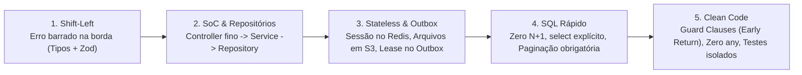

  <a href="../capitulo-01-guia-de-estudos-pokedex.md">Voltar ao Índice do Capítulo 01</a>
  &nbsp;·&nbsp;
  <a href="../../README.md">README atual</a>
  &nbsp;·&nbsp;
  <a href="02-linguagens-estruturas-de-dados-e-pacote-shared.md">Próximo: Vol. 02 (Linguagens, Estruturas &amp; Shared)</a>

# Volume 01 — Anatomia do Repositório: Todas as Pastas, Todos os Arquivos e Regras Arquiteturais

> **Documentos originais destrinchados aqui:** [`00 — Visão Geral e Roadmap`](../00-visao-geral-e-roadmap.md), [`01 — Arquitetura do Monorepo e Padrões`](../01-arquitetura-monorepo-e-padroes.md) e [`ARCHITECTURE.md — Contrato de Qualidade`](../ARCHITECTURE.md).
> **Objetivo deste volume:** transformar a árvore de pastas de `pokedex-frontend` em um mapa totalmente legível. Mesmo que você nunca tenha aberto um projeto grande antes, ao terminar esta leitura você saberá **o que existe dentro de cada pasta**, **o que cada arquivo faz** e **por que o código foi organizado dessa forma**.

---

## 1. Para Quem Nunca Viu um Monorepo: por que tantas pastas?

Na **Fase 0**, o projeto inteiro tinha **1 HTML, 1 CSS e 1 JS**. Por que agora existem dezenas de arquivos separados em `apps/`, `packages/`, `infra/` e `scripts/`?

Pense na diferença entre uma **barraca de limonada** e uma **lanchonete completa com entrega**:
- Na barraca (Fase 0), uma única pessoa faz o suco, cobra, limpa o balcão e entrega no copo. Cabe tudo em uma mesa.
- Na lanchonete (PokéVerse OS), há cozinha (Back-end), salão onde o cliente faz o pedido (Front-end), cardápio oficial impresso dos dois lados (`packages/shared`), estoque refrigerado (`PostgreSQL` + `Redis`), motoboy com protocolo (`Kafka` + `Outbox`) e vigilância sanitária automatizada (`CI/CD` + `UI Quality Gate`).

Se colocássemos tudo em um único arquivo de 15.000 linhas, qualquer mudança na tela de login poderia quebrar acidentalmente o salvamento de Pokémon ou a criptografia de senhas.

### Por que Monorepo com `npm workspaces` (e não vários repositórios ou Turborepo)?

| Conceito | Explicação Simples | Por que foi escolhido no PokéVerse OS |
| :--- | :--- | :--- |
| **Monorepo** | Guardar o Front-end, o Back-end, o pacote compartilhado e a infraestrutura Docker **dentro da mesma pasta/repositório Git**. | Quando adicionamos um campo novo no formulário de Pokédex, alteramos `packages/shared`, `apps/api` e `apps/web` **no mesmo commit**, garantindo que nunca fiquem dessincronizados. |
| **npm workspaces** | Recurso nativo do próprio `npm` (listado em [`package.json`](../../package.json)) que conecta pastas internas como se fossem pacotes publicados (`@pokeverse/shared`). | O doc `01` mencionava Turborepo como opção futura, mas usar **workspaces nativos** eliminou dependências extras e complexidade desnecessária no estágio atual do projeto. |
| **Separação SOLID (SRP)** | Regra de ouro do repositório: arquivos de serviço/memória têm no máximo ~**300 linhas** e componentes visuais ~**150–200 linhas** (travado automaticamente pelo ESLint!). | Arquivos pequenos têm uma única responsabilidade clara, são fáceis de ler, fáceis de testar isoladamente e fáceis de explicar em entrevista. |

---

## 2. Destrinchando os Documentos Fundamentais (`00`, `01` e `ARCHITECTURE.md`)

### 2.1. O que diz [`00 — Visão Geral e Roadmap`](../00-visao-geral-e-roadmap.md)

1. **Estratégia "Pokédex First":** depois de subir a infraestrutura na nuvem (Fase 3), a prioridade absoluta é tornar a **Pokédex 3D** a enciclopédia Pokémon mais completa e fluida possível (Fase 4A já entregue; Fase 4B trará os 51 endpoints, abas LCD, áudio Web Audio e Holocron 3D). Só sobre essa base sólida entram o back-end de jogo do Laboratório Genético (Fase 5) e os mundos exploráveis (Fase 6: Vila Central Phaser 3, Arcade WASM, Battle Frontier).
2. **Os 5 Módulos da Plataforma (atalhos `1` a `5` no Dock):**
   - `1` **Vila Central** (`/mundo`) — Treinador (`18%` modelado em tela de status).
   - `2` **Pokédex 3D** (`/` e `/pokedex`) — Público (**em produção**, Fase 4A concluída).
   - `3` **Museu das Regiões** (`/museu`) — Público (base com 6 gerações entregue).
   - `4` **Arcade Retrô** (`/arcade`) — Treinador (`14%` modelado).
   - `5` **Battle Frontier** (`/arena`) — Treinador (`28%` modelado).
3. **Matriz de Acesso (Visitante vs. Treinador):** qualquer visitante sem login explora a Pokédex (leitura + slots locais no `localStorage`) e o Museu. Já gravar slots na nuvem (PostgreSQL), entrar no Overworld multiplayer, rodar ROMs do Arcade ou jogar na Arena exigem conta autenticada.

### 2.2. O que diz [`01 — Arquitetura do Monorepo e Padrões`](../01-arquitetura-monorepo-e-padroes.md)

Define a organização física em `apps/` (aplicações executáveis), `packages/` (bibliotecas internas reutilizáveis), `infra/` (containers), `docs/` e a preservação da raiz estática. Estabelece a regra **Single Source of Truth**: contratos Zod, constantes e regras de domínio vivem **apenas** em `@pokeverse/shared`, proibindo copiar schemas entre front-end e back-end.

### 2.3. O que diz [`ARCHITECTURE.md — Contrato de Qualidade`](../ARCHITECTURE.md)

É a "Constituição Técnica" contra código improvisado (**AI slop**). Seus **5 mandamentos práticos** são:

1. **Shift-Left (Deslocamento à Esquerda):** quanto mais cedo um bug for barrado, mais barato ele é. Primeiro pelos tipos do TypeScript; depois pelos schemas Zod na entrada da API (`ZodValidationPipe`); só então chega à lógica de negócio.
2. **Controllers Finos + Repositórios Isolados:** o Controller só recebe a requisição HTTP, confere a validação e devolve o status HTTP. Ele nunca calcula regra nem chama o banco. O Service orquestra a regra de negócio, e quem sabe falar a língua do Prisma/SQL é exclusivamente a pasta/classe **Repository**.
3. **Back-end Stateless + S3 + Outbox:** o servidor NestJS não guarda sessões ou contadores na própria memória RAM (para poder escalar para várias máquinas ao mesmo tempo). Sessões/OTPs/limites vivem no **Redis**; arquivos pesados (ROMs e saves futuros) vão para **MinIO/S3** (nunca dentro do PostgreSQL); eventos assíncronos usam **Transactional Outbox**.
4. **Performance SQL (Zero N+1 & Paginação):** proibido fazer uma busca no banco dentro de um laço `for`/`.map()` (N+1 queries). Toda listagem usa projeção `select` explícita, índices planejados e paginação obrigatória (`take`/`skip` ou cursor).
5. **Anti-AI Slop & Early Returns:** proibido nomes vagos (`dataHandler`, `temp`, `processItem`), números/strings mágicos soltos e `if/else` gigantes em formato de pirâmide ("código flecha"). Valida-se erros logo no topo com retorno/exceção imediata (*Guard Clauses*), deixando o caminho de sucesso em linha reta no final da função.

---

## 3. Inventário Completo: Pasta por Pasta, Arquivo por Arquivo

Abaixo está o mapa **100% real** do repositório atual, organizado em **5 grandes blocos**.

---

### Bloco A — Raiz do Repositório e Memória da Fase 0

| Arquivo / Pasta | O que é / Faz na Prática | Por que existe |
| :--- | :--- | :--- |
| [`.gitignore`](../../.gitignore) | Lista o que o Git **não** deve salvar (`node_modules/`, `.env`, `.env.cloud`, `dist/`, `.angular/`). | Impede subir bibliotecas pesadas (gigabytes) e, principalmente, senhas reais para o GitHub. |
| [`.dockerignore`](../../.dockerignore) | Lista o que o Docker ignora ao empacotar a API. | Acelera o build do container e evita copiar `.env`, `docs/` ou código do front-end para dentro da imagem do back-end. |
| [`.env.example`](../../.env.example) | Modelo de todas as variáveis de ambiente (`DATABASE_URL`, `REDIS_URL`, `APP_ENCRYPTION_KEY`, etc.) com valores fictícios seguros. | Mostra para qualquer pessoa (ou CI) quais configurações são necessárias sem expor nenhum segredo real. |
| [`.gitleaks.toml`](../../.gitleaks.toml) | Configuração do scanner **Gitleaks**, com lista restrita de falsos positivos conhecidos (como chaves dummy do `.env.example`). | Garante que o robô de segurança no CI bloqueie qualquer vazamento acidental de chaves reais de API ou senhas. |
| [`.sonarcloud.properties`](../../.sonarcloud.properties) | Configuração do **SonarQube Cloud**: define onde estão fontes, testes e o que ignorar na análise de duplicação (CPD) e migrações SQL. | Automatiza a caça a *code smells*, bugs sutis e trechos copiados/colados. |
| [`package.json`](../../package.json) | Manifesto raiz do monorepo: declara `workspaces: ["packages/*", "apps/*"]` e os scripts globais (`build`, `typecheck`, `lint`, `format:check`, `test`, `audit:ui`, `infra:up`). | Permite controlar os 3 projetos juntos a partir de um único terminal na raiz. |
| [`package-lock.json`](../../package-lock.json) | Trava exata das versões instaladas de todas as dependências. | Garante que o código rode exatamente com as mesmas bibliotecas no seu PC, no PC de outro dev e no servidor de CI. |
| [`tsconfig.base.json`](../../tsconfig.base.json) | Regras globais de rigor máximo do **TypeScript 6** (`strict`, `noImplicitAny`, `noUncheckedIndexedAccess`, etc.). | Herdado pelos workspaces para impedir erros de tipo, `null` esquecido ou acesso inseguro a posições de array. |
| [`neon.ts`](../../neon.ts) | Política de branches da plataforma **Neon Postgres** (`@neon/config`): define TTL de 7 dias para branches temporárias não-padrão. | Permite criar bancos isolados efêmeros para testes sem esquecê-los abertos indefinidamente na nuvem. |
| [`AGENTS.md`](../../AGENTS.md) | Regras inegociáveis para humanos e agentes de IA atuando no projeto (Regra Zero de UI, SOLID, travas anti-corrida, sincronização de docs). | Funciona como um manual de governança automático lido antes de qualquer alteração. |
| [`README.md`](../../README.md) | Vitrine principal do projeto no GitHub com visão geral, diagramas Mermaid, comandos e índice da documentação. | Ponto de entrada para recrutadores, avaliadores e novos contribuidores. |
| [`index.html`](../../index.html), [`css/style.css`](../../css/style.css), [`js/app.js`](../../js/app.js) | **Fase 0 preservada:** a Pokédex original da atividade do Senac em HTML5, CSS3 e JS Vanilla puros. | Mantida intacta como referência visual canônica e site estático independente (documentada linha por linha no [Capítulo 00](capitulo-00-guia-de-estudos-pokedex.md)). |
| `assets/` | Imagens da Fase 0: [`assets/favicon.svg`](../../assets/favicon.svg), `assets/textures/` (`metal-floco.webp`, `plastico-grao.webp`) e `assets/backgrounds/` (4 cenários em `-desktop.webp` e `-mobile.webp`). | Materiais visuais otimizados em WebP para manter 60 FPS sem imagens 4K pesadas. |

---

### Bloco B — `packages/shared/` (O Livro de Regras Único — `@pokeverse/shared`)

Este pacote é compilado antes do Front-end e do Back-end e fornece **uma única fonte da verdade**. *(Cada linha de código dele é destrinchada no [Volume 02](02-linguagens-estruturas-de-dados-e-pacote-shared.md)).*

| Caminho em `packages/shared/` | O que contém e faz |
| :--- | :--- |
| [`package.json`](../../packages/shared/package.json), [`tsup.config.ts`](../../packages/shared/tsup.config.ts), [`tsconfig.json`](../../packages/shared/tsconfig.json), [`vitest.config.mts`](../../packages/shared/vitest.config.mts), [`eslint.config.mjs`](../../packages/shared/eslint.config.mjs), [`.prettierrc`](../../packages/shared/.prettierrc) | Configuram compilação dual (ESM `.mjs` para o Angular + CommonJS `.js` para o NestJS + tipos `.d.ts`) via `tsup`, `"sideEffects": false` para *tree-shaking*, linter estrito e testes unitários em Vitest. |
| [`src/index.ts`](../../packages/shared/src/index.ts) | Ponto único de exportação (*barrel file*) que reexporta tipos, constantes, schemas e regras de domínio para `apps/api` e `apps/web`. |
| [`src/types/async-state.ts`](../../packages/shared/src/types/async-state.ts) | Define `AsyncState<T, E>` (união discriminada de 5 estados: `idle`, `loading`, `empty`, `error`, `success`), `AppError`, `HardwareTier`, `PerfPreference`, `AccessMode` e `assertNever`. |
| [`src/constants/platform.constants.ts`](../../packages/shared/src/constants/platform.constants.ts) | Constantes globais (`TOTAL_POKEDEX_SLOTS = 10`, `MAX_EV_TOTAL = 510`, timeouts de probe), os 18 `POKEMON_TYPES` e metadados dos 5 módulos (`PLATFORM_MODULES`). |
| [`src/domain/pokedex-search.ts`](../../packages/shared/src/domain/pokedex-search.ts) + [`.spec.ts`](../../packages/shared/src/domain/pokedex-search.spec.ts) | Motor de busca tolerante a erros: normalização Unicode `NFD`, chave fonética bilíngue PT/EN, matriz linearizada `Int32Array` de Damerau-Levenshtein e ranking de resultados. |
| [`src/domain/pokeapi-endpoints.ts`](../../packages/shared/src/domain/pokeapi-endpoints.ts) | Catálogo compacto dos **51 endpoints da PokéAPI v2** (`POKEAPI_V2_ENDPOINTS` com `/* @__PURE__ */`) e filtro combinado multi-critério (`filterCatalogWithAdvancedQuery`). |
| [`src/domain/pokemon-lab.ts`](../../packages/shared/src/domain/pokemon-lab.ts) + [`.spec.ts`](../../packages/shared/src/domain/pokemon-lab.spec.ts) | Fórmulas puras do futuro **Laboratório Genético**: curvas de XP (6 taxas), cálculo de stats por nível (`IV`/`EV`/`Nature`), prontidão de evolução, clonagem e Bio-Essência (`E..APEX`). |
| [`src/schemas/pokedex.schemas.ts`](../../packages/shared/src/schemas/pokedex.schemas.ts) | Contratos Zod v4 para parâmetros (`PokedexSlotIndexParamSchema`, `PokemonIdentifierParamSchema`), payloads da PokéAPI, slots graváveis (`.strict()`), perfis de hardware e cenários. |
| [`src/schemas/auth.schemas.ts`](../../packages/shared/src/schemas/auth.schemas.ts) | Contratos Zod v4 de todo o sistema de contas: cadastro, login, OTP, perfil do treinador, TOTP, Passkeys, OAuth Google callback, sessões ativas, exportação LGPD e consentimento de cookies. |
| [`src/schemas/events.schemas.ts`](../../packages/shared/src/schemas/events.schemas.ts) | Constante `KAFKA_TOPICS` (os 6 tópicos incluindo DLQ) e schemas dos eventos do ticker ao vivo (`WorldTickerEventSchema`), e-mails (`EmailNotificationEventSchema`) e envelope cifrado (`EncryptedOutboxPayloadSchema`). |
| [`src/schemas/health.schemas.ts`](../../packages/shared/src/schemas/health.schemas.ts) + [`schemas.spec.ts`](../../packages/shared/src/schemas/schemas.spec.ts) | Contratos dos probes `/health/live`, `/health/ready` e `/api/v1/system/bootstrap`, além da suíte Vitest que valida todos os schemas de borda. |

---

### Bloco C — `apps/api/` (O Back-end NestJS 11)

#### C.1. Configuração, Banco de Dados e Bootstrap

| Pasta / Arquivo | O que faz |
| :--- | :--- |
| [`apps/api/package.json`](../../apps/api/package.json), [`nest-cli.json`](../../apps/api/nest-cli.json), [`tsconfig.json`](../../apps/api/tsconfig.json), [`tsconfig.build.json`](../../apps/api/tsconfig.build.json), [`eslint.config.mjs`](../../apps/api/eslint.config.mjs), [`.prettierrc`](../../apps/api/.prettierrc), [`README.md`](../../apps/api/README.md) | Dependências do servidor (NestJS 11, Prisma 6.19, `ioredis`, `kafkajs`, `argon2`, `@simplewebauthn/server`, `helmet`, `nodemailer`, `socket.io`), regras ESLint com teto de `300` linhas e complexidade `<= 15`, e runner Jest. |
| [`apps/api/prisma/schema.prisma`](../../apps/api/prisma/schema.prisma) | **Fonte do banco relacional:** define os **4 enums** (`ArcadeConsole`, `OutboxStatus`, `BattleMode`, `BattleStatus`) e os **13 modelos** (`Trainer`, `RefreshToken`, `MfaBackupCode`, `TrainerOAuthAccount`, `TrainerPasskey`, `PokedexSlot`, `PokemonTeam`, `PokemonTeamMember`, `ArcadeRom`, `ArcadeSaveState`, `MinigameScore`, `BattleMatch`, `OutboxEvent`). |
| `apps/api/prisma/migrations/` | Histórico versionado do banco SQL em produção: `migration_lock.toml` (trava o dialeto `postgresql`), [`20261118073124_init_pokeverse_schema/migration.sql`](../../apps/api/prisma/migrations/20261118073124_init_pokeverse_schema/migration.sql) (tabelas iniciais + índice parcial `idx_outbox_pending`) e [`20261118082535_iam_enterprise_foundation/migration.sql`](../../apps/api/prisma/migrations/20261118082535_iam_enterprise_foundation/migration.sql) (tabelas MFA/OAuth/Passkeys). |
| [`src/main.ts`](../../apps/api/src/main.ts) | Ponto de partida do processo Node.js: cria a aplicação NestJS com `bodyParser: false` (para controlar o limite de tamanho manualmente depois) e `bufferLogs: true`, pluga o logger JSON e sobe a porta HTTP. |
| [`src/app.setup.ts`](../../apps/api/src/app.setup.ts) | Configura a segurança HTTP da aplicação inteira: `trust proxy`, **Helmet** (CSP e headers de segurança), `Permissions-Policy`, parsers JSON (`64kb`) e URL-encoded (`16kb`), `cookieParser()`, **CORS** por allowlist, prefixo `/api/v1` (poupando `/health/live` e `/health/ready`), filtro global de erros e *shutdown hooks*. |
| [`src/app.module.ts`](../../apps/api/src/app.module.ts) | Módulo raiz que conecta tudo: carrega `.env`, aplica validação fail-fast `validateApiEnv`, configura o `ThrottlerModule` apoiado no Redis (`120` req/min padrão), importa todos os módulos e ativa os 3 **Guards globais** (`CsrfOriginGuard`, `ThrottlerGuard`, `SessionAuthGuard`) + `CorrelationMiddleware`. |
| [`src/config/env.schema.ts`](../../apps/api/src/config/env.schema.ts) + [`.spec.ts`](../../apps/api/src/config/env.schema.spec.ts) | Valida **todas** as variáveis de ambiente na partida via Zod. Se faltar chave de criptografia, URL do banco ou credencial S3 quando habilitado, aborta imediatamente **sem imprimir nenhum segredo no log**. |

#### C.2. `apps/api/src/common/` (Segurança Transversal, Pipes, Filtros e Telemetria)

| Subpasta / Arquivo | O que faz |
| :--- | :--- |
| `decorators/` (`public.decorator.ts`, `allow-mfa-pending.decorator.ts`, `current-trainer.decorator.ts`) | Etiquetas (`@Public()`, `@AllowMfaPending()`, `@CurrentTrainer()`) que dizem aos Guards se uma rota aceita visitantes, sessões aguardando 2FA ou injeta o treinador logado no Controller. |
| `guards/csrf-origin.guard.ts` | Bloqueia mutações (`POST`/`PUT`/`PATCH`/`DELETE`) vindas de sites estranhos checando cabeçalhos `Origin`, `Referer` e `Sec-Fetch-Site`. |
| `guards/redis-throttler.storage.ts` | Conecta o rate limiter do NestJS ao **Redis** com script Lua atômico (se houver 5 servidores da API rodando, todos compartilham a mesma contagem de cliques por IP). |
| `guards/session-auth.guard.ts` | Guarda padrão de todas as rotas privadas: lê o cookie de sessão opaca, consulta o Redis e exige estado `AUTHENTICATED` (bloqueando quem ainda está em `MFA_PENDING`, exceto nas rotas de desafio MFA). |
| `pipes/zod-validation.pipe.ts` | "Alfândega" executada antes do Controller: valida `@Body`, `@Param` ou `@Query` com schemas do `@pokeverse/shared` e rejeita payloads ruins com `400 Bad Request`. |
| `filters/global-exception.filter.ts` | Captura qualquer erro da API (inclusive payload > `64kb` como `413` e JSON malformado como `400`), registra nos logs internos com `traceId` e devolve uma mensagem segura ao usuário **sem vazar stack traces nem SQL**. |
| `middleware/correlation.middleware.ts` | Lê ou cria `x-correlation-id` e `traceparent` (padrão W3C de rastreamento distribuído) em cada requisição e devolve o ID no cabeçalho de resposta. |
| `security/crypto.service.ts` | Utilitário criptográfico central: cifra e decifra dados sensíveis (como e-mails dentro do Outbox e segredos TOTP) usando **AES-256-GCM** autenticado. |
| `telemetry/structured-logger.service.ts` + [`.spec.ts`](../../apps/api/src/common/telemetry/structured-logger.service.spec.ts) | Emite logs em JSON estruturado com redação recursiva automática (mascara tokens, senhas e chaves se algum objeto sensível passar perto do log). |

#### C.3. `apps/api/src/infra/` (Conexões com o Mundo Externo)

| Arquivo | O que faz |
| :--- | :--- |
| [`infra.module.ts`](../../apps/api/src/infra/infra.module.ts) | Módulo global (`@Global()`) que disponibiliza Postgres, Redis, Kafka e Probes para toda a API sem precisar importar em cada módulo. |
| [`prisma.service.ts`](../../apps/api/src/infra/prisma.service.ts) | Envolve o `PrismaClient`, conecta ao PostgreSQL na inicialização e fecha conexões graciosamente no desligamento (`OnModuleDestroy`). |
| [`redis.service.ts`](../../apps/api/src/infra/redis.service.ts) | Cliente `ioredis` (com suporte a TLS `rediss://` no Upstash), operações atômicas `GETDEL` (`consumeString`), `SET NX EX`, e **scripts Lua atômicos** (`THROTTLE_LUA_SCRIPT` e `INCR_WITH_TTL_LUA_SCRIPT`) que zeram vulnerabilidades TOCTOU. |
| [`kafka.service.ts`](../../apps/api/src/infra/kafka.service.ts) | Configura cliente `kafkajs` (com suporte a **mTLS** / certificados para o Aiven Kafka em nuvem ou PLAINTEXT local no Redpanda), gerencia produtores e criação de consumidores. |
| [`infra-probes.service.ts`](../../apps/api/src/infra/infra-probes.service.ts) | Executa checagens reais de saúde com timeout curto contra PostgreSQL, Redis, Kafka e S3 (quando habilitado) para alimentar `/health/ready`. |

#### C.4. `apps/api/src/modules/` (Domínios de Negócio)

- **`modules/auth/` (Identidade, Sessões BFF, MFA, Passkeys, Google PKCE e LGPD — 35 arquivos incluindo testes):**
  - *Controllers (borda HTTP):* [`auth.controller.ts`](../../apps/api/src/modules/auth/auth.controller.ts) (cadastro, login, OTP, refresh, logout, `/me`, exportação e exclusão LGPD), [`mfa.controller.ts`](../../apps/api/src/modules/auth/mfa.controller.ts) (setup/ativação TOTP, verificação de desafio MFA, registro/login/remoção de Passkeys) e [`google-oauth.controller.ts`](../../apps/api/src/modules/auth/google-oauth.controller.ts) (início e callback PKCE).
  - *Fachada e Emissão:* [`auth.service.ts`](../../apps/api/src/modules/auth/auth.service.ts) (+ `auth.service.spec.ts`) orquestra como fachada fina os casos de uso; [`trainer-session-issuer.service.ts`](../../apps/api/src/modules/auth/trainer-session-issuer.service.ts) emite sessão Redis + refresh token; [`auth-outbox-publisher.service.ts`](../../apps/api/src/modules/auth/auth-outbox-publisher.service.ts) grava eventos de boas-vindas, OTP e alerta de segurança cifrados no Outbox; [`session-cookies.util.ts`](../../apps/api/src/modules/auth/session-cookies.util.ts) escreve e limpa cookies `HttpOnly`.
  - *Services Especializados (SRP):* [`credentials-auth.service.ts`](../../apps/api/src/modules/auth/credentials-auth.service.ts) (registro e login com **Argon2id** + *dummy hash* anti-enumeração), [`token-refresh.service.ts`](../../apps/api/src/modules/auth/token-refresh.service.ts) (rotação de refresh tokens por família e revogação em caso de reuso suspeito), [`account-recovery.service.ts`](../../apps/api/src/modules/auth/account-recovery.service.ts) (verificação de e-mail e reset de senha via OTP), [`session-management.service.ts`](../../apps/api/src/modules/auth/session-management.service.ts) (listagem/revogação de sessões e expurgo automático a cada 6h de tokens/eventos expirados) e [`trainer-gdpr.service.ts`](../../apps/api/src/modules/auth/trainer-gdpr.service.ts) (portabilidade JSON e exclusão definitiva LGPD).
  - *Submódulos de Segurança:* [`session.service.ts`](../../apps/api/src/modules/auth/session.service.ts) (sessões opacas no Redis e máquina `MFA_PENDING -> AUTHENTICATED`), [`otp.service.ts`](../../apps/api/src/modules/auth/otp.service.ts) (geração, contagem Lua atômica e consumo `DEL`), [`mfa-totp.service.ts`](../../apps/api/src/modules/auth/mfa-totp.service.ts) (+ `.spec.ts`) e [`totp-crypto.util.ts`](../../apps/api/src/modules/auth/totp-crypto.util.ts) (+ `.spec.ts`, RFC 6238 + QR Code + 8 backup codes), [`passkey.service.ts`](../../apps/api/src/modules/auth/passkey.service.ts) (+ `.spec.ts`, WebAuthn FIDO2 com consumo `GETDEL`), e o trio OAuth Google ([`google-oauth.service.ts`](../../apps/api/src/modules/auth/google-oauth.service.ts) + `.spec.ts`, [`google-oauth-http.client.ts`](../../apps/api/src/modules/auth/google-oauth-http.client.ts), [`google-oidc.verifier.ts`](../../apps/api/src/modules/auth/google-oidc.verifier.ts) e [`google-account-linker.service.ts`](../../apps/api/src/modules/auth/google-account-linker.service.ts)).
  - *Repositórios Isolados (ISP — únicos a tocar Prisma no Auth):* [`trainer-account.repository.ts`](../../apps/api/src/modules/auth/trainer-account.repository.ts) (+ `.spec.ts`), [`auth-token.repository.ts`](../../apps/api/src/modules/auth/auth-token.repository.ts) (+ `.spec.ts`), [`mfa-totp.repository.ts`](../../apps/api/src/modules/auth/mfa-totp.repository.ts), [`passkey.repository.ts`](../../apps/api/src/modules/auth/passkey.repository.ts) (+ `.spec.ts`) e [`trainer-oauth.repository.ts`](../../apps/api/src/modules/auth/trainer-oauth.repository.ts), todos ligados pelo [`auth.module.ts`](../../apps/api/src/modules/auth/auth.module.ts).
- **`modules/pokedex/`:** [`pokedex.controller.ts`](../../apps/api/src/modules/pokedex/pokedex.controller.ts) (rotas públicas `/catalog`, `/pokemon/:idOrName` e rotas protegidas `/slots`), [`pokeapi-cache.service.ts`](../../apps/api/src/modules/pokedex/pokeapi-cache.service.ts) (+ `.spec.ts`, cache Redis 24h + `stale-fallback` 7d), [`pokedex-slots.service.ts`](../../apps/api/src/modules/pokedex/pokedex-slots.service.ts) (+ `.spec.ts`, regra de 1 Pokémon por botão com `409 Conflict`), [`pokedex-slot.repository.ts`](../../apps/api/src/modules/pokedex/pokedex-slot.repository.ts) (+ `.spec.ts`, persistência + Outbox em transação única) e [`pokedex.module.ts`](../../apps/api/src/modules/pokedex/pokedex.module.ts).
- **`modules/events/`:** [`outbox-event.repository.ts`](../../apps/api/src/modules/events/outbox-event.repository.ts) (+ `.spec.ts`, CTE atômica `FOR UPDATE SKIP LOCKED` + `UPDATE ... RETURNING`), [`outbox-relay.service.ts`](../../apps/api/src/modules/events/outbox-relay.service.ts) (+ `.spec.ts`, poller que envia o lote ao Kafka e move falhas esgotadas para DLQ), [`world-events.consumer.ts`](../../apps/api/src/modules/events/world-events.consumer.ts) (+ `.spec.ts`, lê eventos de mundo com trava idempotente e envia ao WebSocket), [`email-notifications.consumer.ts`](../../apps/api/src/modules/events/email-notifications.consumer.ts) (+ `.spec.ts`, decifra AES-256-GCM, dispara e-mail e faz rollback da trava de idempotência no `catch`) e [`events.module.ts`](../../apps/api/src/modules/events/events.module.ts).
- **`modules/notifications/`:** [`mail.service.ts`](../../apps/api/src/modules/notifications/mail.service.ts) (renderiza os 4 templates de e-mail por tabela OCP e envia via SMTP/Mailpit em dev ou API Resend em produção) e [`notifications.module.ts`](../../apps/api/src/modules/notifications/notifications.module.ts).
- **`modules/world/`:** [`world.gateway.ts`](../../apps/api/src/modules/world/world.gateway.ts) (+ `.spec.ts`, gateway Socket.IO `/ws/world` com validação de origem em produção, cota de `10` conexões por IP e `1000` globais, enviando os últimos eventos do ticker ao conectar) e [`world.module.ts`](../../apps/api/src/modules/world/world.module.ts).
- **`modules/health/` e `modules/system/`:** [`health.controller.ts`](../../apps/api/src/modules/health/health.controller.ts) (+ `.spec.ts`, `/health/live` e `/health/ready`) e [`system.controller.ts`](../../apps/api/src/modules/system/system.controller.ts) (+ `.spec.ts`, `/api/v1/system/bootstrap` com `POKEVERSE_PHASE` dinâmico).

#### C.5. `apps/api/test/` (Testes de Borda HTTP e Integração Real)

| Arquivo | O que testa |
| :--- | :--- |
| [`app.e2e-spec.ts`](../../apps/api/test/app.e2e-spec.ts) + [`jest-e2e.json`](../../apps/api/test/jest-e2e.json) | Sobe o pipeline HTTP real da aplicação com Supertest (infra mockada) para validar Helmet CSP, `CsrfOriginGuard`, limite `64kb` (`413`), JSON inválido (`400`), bloqueio de `MFA_PENDING` e `ZodValidationPipe`. |
| [`app.integration-spec.ts`](../../apps/api/test/app.integration-spec.ts) + [`jest-integration.json`](../../apps/api/test/jest-integration.json) | Roda no CI contra **PostgreSQL 16, Redis 7 e Apache Kafka 3.9 reais** sem mocks de banco/cache/broker, provando que migrations, scripts Lua, atomic lease e consumidores Kafka funcionam de verdade. |

---

### Bloco D — `apps/web/` (O Front-end Angular 22 + Borda Cloudflare)

#### D.1. Configuração do Workspace Web e Proxy Same-Origin (Cloudflare)

| Caminho em `apps/web/` | O que faz |
| :--- | :--- |
| [`angular.json`](../../apps/web/angular.json), [`package.json`](../../apps/web/package.json), [`tsconfig*.json`](../../apps/web/tsconfig.json), [`eslint.config.mjs`](../../apps/web/eslint.config.mjs), [`.prettierrc`](../../apps/web/.prettierrc), [`.editorconfig`](../../apps/web/.editorconfig), [`.gitignore`](../../apps/web/.gitignore), [`README.md`](../../apps/web/README.md) | Configura o Angular 22 (`@angular/build:application`), prefixo `pv`, `inlineCritical: false` para compatibilidade total com CSP sem `'unsafe-inline'`, budgets de bundle e ESLint (`max-lines: 200` para componentes). |
| [`proxy.conf.json`](../../apps/web/proxy.conf.json) | Em desenvolvimento local (`ng serve`), redireciona `/api`, `/health` e `/socket.io` (`ws: true`) da porta `4200` para a API NestJS na `3000`. |
| [`cloudflare/api-proxy.ts`](../../apps/web/cloudflare/api-proxy.ts) e `functions/` (`api/[[path]].ts`, `health/[[path]].ts`, `socket.io/[[path]].ts`) | Em produção no **Cloudflare Pages**, age como proxy *same-origin* para o container na Azure (`API_ORIGIN`), remove atributo `Domain=` do `Set-Cookie` para o cookie ficar preso ao domínio da página e aplica timeout de `15s` com `502` seguro. |
| [`public/_headers`](../../apps/web/public/_headers) e [`public/_routes.json`](../../apps/web/public/_routes.json) | `_headers` aplica CSP estrito (sem `ws: wss:` wildcard), HSTS, `X-Frame-Options: DENY` e `Permissions-Policy`; `_routes.json` instrui o Cloudflare a só invocar Functions nessas 3 rotas. |
| `public/assets/` e `public/favicon.ico` | Cópia dos cenários WebP, microtexturas e ícone empacotados junto ao build estático servido no CDN. |

#### D.2. Bootstrap, Shell e Núcleo (`src/app/core/`)

| Caminho em `apps/web/src/` | O que faz |
| :--- | :--- |
| [`index.html`](../../apps/web/src/index.html), [`main.ts`](../../apps/web/src/main.ts), [`styles.scss`](../../apps/web/src/styles.scss) | HTML raiz da SPA, inicialização `bootstrapApplication(App, appConfig)` e ponto de entrada SCSS. |
| [`app/app.ts`](../../apps/web/src/app/app.ts), [`app.html`](../../apps/web/src/app/app.html), [`app.scss`](../../apps/web/src/app/app.scss), [`app.config.ts`](../../apps/web/src/app/app.config.ts), [`app.routes.ts`](../../apps/web/src/app/app.routes.ts), [`app-shell.spec.ts`](../../apps/web/src/app/app-shell.spec.ts) | Componente raiz (`<pv-root>`): no boot atualiza status do sistema, restaura sessão e conecta o ticker WebSocket; configura roteamento *lazy* (`loadComponent`) e `authInterceptor`. |
| [`app/testing/test-fixtures.spec-helper.ts`](../../apps/web/src/app/testing/test-fixtures.spec-helper.ts) | Fixtures e builders reutilizados pelas suítes Vitest da interface. |
| [`core/guards/auth.guard.ts`](../../apps/web/src/app/core/guards/auth.guard.ts) | Impede acesso direto pela URL a rotas de Treinador (`/mundo`, `/arcade`, `/arena`) quando o usuário é Visitante, abrindo o diálogo de login. |
| [`core/http/api-error.util.ts`](../../apps/web/src/app/core/http/api-error.util.ts) | Extrai mensagens humanas uniformes de falhas HTTP sem expor códigos internos crus. |
| [`core/interceptors/auth.interceptor.ts`](../../apps/web/src/app/core/interceptors/auth.interceptor.ts) | Anexa `withCredentials: true` (para enviar cookies `HttpOnly`), tenta renovar a sessão automaticamente se receber `401` e atualiza o estado de autenticação em caso de sessão expirada. |
| `core/stores/auth.store.ts`, `auth-cross-tab-sync.service.ts`, `auth-recovery.service.ts` + `auth-iam.spec.ts` | Gerenciam estado reativo de sessão (`visitor` vs `trainer`), login, registro, recuperação OTP, sincronização instantânea entre abas via `BroadcastChannel` e resolução uniforme de erros de auth. |
| [`core/stores/security-iam.store.ts`](../../apps/web/src/app/core/stores/security-iam.store.ts) | Controla painel de segurança do treinador: setup/desativação TOTP, registro/remoção de Passkeys, sessões ativas, vinculação Google, exportação JSON e exclusão de conta LGPD. |
| [`core/stores/privacy-consent.store.ts`](../../apps/web/src/app/core/stores/privacy-consent.store.ts) + [`.spec.ts`](../../apps/web/src/app/core/stores/privacy-consent.store.spec.ts) | Gerencia o cookie versionado `pokeverse_consent` e o registro declarativo de chaves não essenciais no `localStorage` (limpando-as se o usuário recusar preferências). |
| [`core/stores/quality.store.ts`](../../apps/web/src/app/core/stores/quality.store.ts) | Executa o probe de hardware (RAM, CPU, WebGL2, toque, `saveData`, `reduced-motion`), define `ULTRA` / `BALANCED` / `LITE` e roda o `FpsWatchdog` para rebaixar efeitos se o FPS cair. |
| [`core/stores/scenario.store.ts`](../../apps/web/src/app/core/stores/scenario.store.ts) | Controla o cenário ativo (`hoenn`, `cidade`, `vila`, `floresta`) e a alternância automática (respeitando visibilidade da aba e perfil de hardware). |
| [`core/stores/system-status.store.ts`](../../apps/web/src/app/core/stores/system-status.store.ts) e [`world-ticker.store.ts`](../../apps/web/src/app/core/stores/world-ticker.store.ts) | O primeiro monitora fase/conectividade da API; o segundo carrega `socket.io-client` sob demanda (`import()`) para exibir eventos globais ao vivo na Topbar. |

#### D.3. Funcionalidades (`src/app/features/`), Compartilhados (`src/app/shared/`) e Estilos (`src/styles/`)

| Pasta / Arquivos | O que fazem |
| :--- | :--- |
| `features/pokedex-device/` (`pokedex-device.component.ts/.html/.spec.ts`) | **O coração atual da plataforma:** orquestra a carcaça 3D da Pokédex fiel à Fase 0. |
| `features/pokedex-device/components/` (7 componentes: `pokedex-cover`, `pokedex-search-panel`, `pokedex-physical-controls`, `pokedex-visor`, `pokedex-slots-config`, `pokedex-slots-grid`, `slot-confirm-dialog`) | Fatiamento SRP da interface: tampa frontal fechada, painel de busca + catálogo de 1351 itens, D-Pad + botões vermelho/azul/A, visor LCD de resultados, editor do botão amarelo, grade dos 10 botões azuis/verdes e modal nativo `<dialog>` de confirmação de substituição/remoção. |
| `features/pokedex-device/directives/rpg-focusable.directive.ts` | Diretivas declarativas (`[pvRpgFocusable]`, `[pvRpgContainer]`, `[pvRpgEditForm]`) que registram os elementos interativos para o controle estilo RPG sem usar `document.querySelector` (DIP). |
| `features/pokedex-device/services/` (9 arquivos + 2 `.spec.ts`: `pokedex.store.ts`, `pokedex-api.client.ts`, `pokedex-view-mapper.util.ts`, `pokedex-slots.store.ts`, `pokedex-local-slots.storage.ts`, `pokedex-rpg-nav.service.ts`, `pokedex-rpg-nav.util.ts`, `pokedex-input-shortcuts.service.ts`, `pokedex-lid-physics.service.ts`) | Estado reativo da busca com fallback direto na PokéAPI se a API cair; adaptação visitante (`localStorage`) vs. treinador (PostgreSQL); máquina de estados RPG 2D/1D; atalhos de teclado; e física de giro 3D reversível em voo + iluminação reativa no ponteiro. |
| `features/regions-museum/museum-page.component.ts` | Página pública do Museu das Regiões (6 gerações com iniciais clicáveis que abrem direto na Pokédex). |
| `features/title-screen/` (`title-screen.component.ts/.html/.scss`) | Tela de recepção/cartão de boas-vindas com escolha entre Login de Treinador e Exploração Pública. |
| `features/under-construction/` (`under-construction.component.*` + `under-construction.data.ts`) | Tela padronizada para os módulos futuros (`/mundo`, `/arcade`, `/arena`), exibindo especificação arquitetural e progresso de preparação. |
| `shared/data/regions-atlas.data.ts` | Fonte única compartilhada dos dados das regiões (eliminou duplicação entre Museu e telas em construção). |
| `shared/directives/` (`main-heading.directive.ts`, `requires-trainer.directive.ts`) | Gerencia foco acessível no título principal ao trocar de rota e aplica cadeado visual/bloqueio de clique para visitantes em ações exclusivas de treinador. |
| `shared/hud/` (`hud-topbar.*`, `hud-quick-dock.*`, `cenarios-backdrop.component.ts`, `cenarios-bar.component.ts`, `privacy-notice-banner.component.ts`, `privacy-consent-dialog.*`, `visitor-lock-dialog.*`, `auth-dialog-validator.util.ts` + `.spec.ts`, `security-settings-dialog.*`) | Toda a camada HUD sobreposta: barra superior (status, ticker ao vivo, perfis de hardware, botão de conta), dock inferior de viagem rápida (`1..5`), cenários de fundo WebP sob demanda, banner/modal de cookies LGPD e modais de login/MFA/Passkeys/LGPD. |
| `src/styles/` (`_tokens.scss`, `_pokedex-classic.scss`, `pokedex/_chassis-3d.scss`, `_search-scanner.scss`, `_controls-dpad.scss`, `_slots-grid.scss`, `_visor-lcd.scss`) | Design tokens `oklch` e `--pv-hud-*`, além do porte modular fiel de toda a carcaça 3D, dobradiça, visores LCD e botões translúcidos da Fase 0. |

---

### Bloco E — Infraestrutura, Qualidade Visual, Automação e Documentação

| Pasta / Arquivo | O que faz |
| :--- | :--- |
| [`infra/docker/docker-compose.yml`](../../infra/docker/docker-compose.yml) | Sobe localmente 7 containers com `healthcheck`: **PostgreSQL 16** (`5433`), **Redis 7** (`6379`, AOF), **Redpanda** (`19092`) + **Redpanda Console** (`8085`), **S3 (`pgsty/silo`)** (`9000`/`9001`) + container `minio-init` (criando buckets privados `pokeverse-roms` e `pokeverse-saves`) e **Mailpit** (`1025`/`8025`, captura e-mails de OTP em dev). |
| [`infra/docker/api.Dockerfile`](../../infra/docker/api.Dockerfile) | Receita multi-stage da API em produção: compila `shared` e `api`, isola só dependências de produção e roda em `node:22-slim` como usuário sem privilégios (`USER node`), com `HEALTHCHECK` batendo em `/health/live`. |
| [`scripts/ui-quality-gate.mjs`](../../scripts/ui-quality-gate.mjs) | Sobe um servidor local sobre o build do Angular, abre um Chrome/Chromium/Edge *headless* via protocolo **CDP** (`Page.captureScreenshot`, avaliação DOM) e valida contraste WCAG AA por composição alfa, ausência de overflow horizontal, recorte e tipografia em `1440×900` e `375×812`. |
| [`.github/workflows/ci.yml`](../../.github/workflows/ci.yml) | Esteira de verificação automática: **Gitleaks** pré-instalação -> `npm ci` -> `npm audit` crítico -> `prisma generate` + `build:shared` -> `typecheck` -> `lint` -> `format:check` -> testes unitários -> E2E HTTP -> `build` + `node --check js/app.js` -> `audit:ui` -> build Docker -> **Trivy** `CRITICAL` -> job paralelo `integration-e2e` com Postgres, Redis e Kafka reais. |
| [`.github/workflows/deploy.yml`](../../.github/workflows/deploy.yml) | Esteira de publicação contínua: envia imagem da API para o Azure Container Registry, roda `prisma migrate deploy` uma única vez pré-deploy usando `DATABASE_URL_UNPOOLED`, atualiza o **Azure Container Apps**, testa `/health/live`, compila o Angular, roda `audit:ui` e publica no **Cloudflare Pages**. |
| `docs/` | Contém o [`ARCHITECTURE.md`](../ARCHITECTURE.md), a série de arquitetura [`00`](../00-visao-geral-e-roadmap.md) a [`18`](../18-auditoria-e-plano-divida-tecnica-arquitetura.md), os assets visuais ([`assets/README.md`](../assets/README.md), `banner.svg`, 10 screenshots WebP), o **Capítulo 00** ([`capitulo-00-como-tudo-comecou.md`](../capitulo-00-como-tudo-comecou.md) e [`capitulo-00-guia-de-estudos-pokedex.md`](../capitulo-00-guia-de-estudos-pokedex.md)) e o **Capítulo 01** (arquivo-mestre + esta pasta `capitulo-01-guia-de-estudos/`). |

---

## 4. Mapa de Clusters de Aproximação (`Arquivo 1 ↔ Arquivo 2 ↔ Arquivo 3`)

Quando você precisar alterar uma funcionalidade no futuro, nunca abra arquivos aleatórios. Siga os **clusters correlacionados** abaixo:

| Fluxo / Feature | 1. Contrato (`@pokeverse/shared`) | 2. Back-end (`apps/api`) | 3. Front-end (`apps/web`) | 4. Testes & Docs |
| :--- | :--- | :--- | :--- | :--- |
| **Busca e Ficha da Pokédex** | `pokedex-search.ts`, `pokedex.schemas.ts` | `pokedex.controller.ts`, `pokeapi-cache.service.ts` | `pokedex.store.ts`, `pokedex-api.client.ts`, `pokedex-view-mapper.util.ts`, `pokedex-search-panel.*`, `pokedex-visor.*` | `pokedex-search.spec.ts`, `pokeapi-cache.service.spec.ts`, `pokedex-view-mapper.util.spec.ts`, `pokedex-device.spec.ts` |
| **10 Slots (Visitante vs. Nuvem)** | `platform.constants.ts`, `pokedex.schemas.ts`, `events.schemas.ts` | `pokedex.controller.ts`, `pokedex-slots.service.ts`, `pokedex-slot.repository.ts`, `outbox-*` | `pokedex-slots.store.ts`, `pokedex-local-slots.storage.ts`, `pokedex-slots-grid.*`, `pokedex-slots-config.*`, `slot-confirm-dialog.*` | `pokedex-slot.repository.spec.ts`, `pokedex-slots.service.spec.ts`, `pokedex-local-slots.storage.spec.ts` |
| **Autenticação, MFA, Passkeys & LGPD** | `auth.schemas.ts` | `auth.controller.ts`, `mfa.controller.ts`, `google-oauth.controller.ts`, `auth.service.ts`, 5 services + 5 repos + `session.service.ts` | `auth.store.ts`, `auth-recovery.service.ts`, `auth-cross-tab-sync.service.ts`, `security-iam.store.ts`, `visitor-lock-dialog.*`, `security-settings-dialog.*`, `auth.interceptor.ts` | `auth.service.spec.ts`, `mfa-totp.service.spec.ts`, `passkey.service.spec.ts`, `google-oauth.service.spec.ts`, `auth-iam.spec.ts`, `app.e2e-spec.ts` |
| **Ticker Ao Vivo & Outbox** | `events.schemas.ts` | `outbox-event.repository.ts`, `outbox-relay.service.ts`, `world-events.consumer.ts`, `world.gateway.ts` | `world-ticker.store.ts`, `hud-topbar.*` | `outbox-event.repository.spec.ts`, `outbox-relay.service.spec.ts`, `world-events.consumer.spec.ts`, `world.gateway.spec.ts`, `app.integration-spec.ts` |
| **Privacidade & Cookies (LGPD)** | `auth.schemas.ts` (`PrivacyConsentSchema`) | `trainer-gdpr.service.ts` | `privacy-consent.store.ts`, `privacy-notice-banner.component.ts`, `privacy-consent-dialog.*` | `privacy-consent.store.spec.ts`, `docs/16` |
| **Hardware, Cenários & Fidelidade 3D** | `pokedex.schemas.ts`, `async-state.ts` | *(cliente puro + assets WebP)* | `quality.store.ts`, `scenario.store.ts`, `pokedex-lid-physics.service.ts`, `pokedex-rpg-nav.*`, `rpg-focusable.directive.ts`, `styles/pokedex/*` | `scripts/ui-quality-gate.mjs`, `docs/11` |

---

  <a href="../capitulo-01-guia-de-estudos-pokedex.md">Voltar ao Índice do Capítulo 01</a>
  &nbsp;·&nbsp;
  <a href="02-linguagens-estruturas-de-dados-e-pacote-shared.md">Avançar para o Vol. 02: Linguagens, Estruturas &amp; Shared</a>

