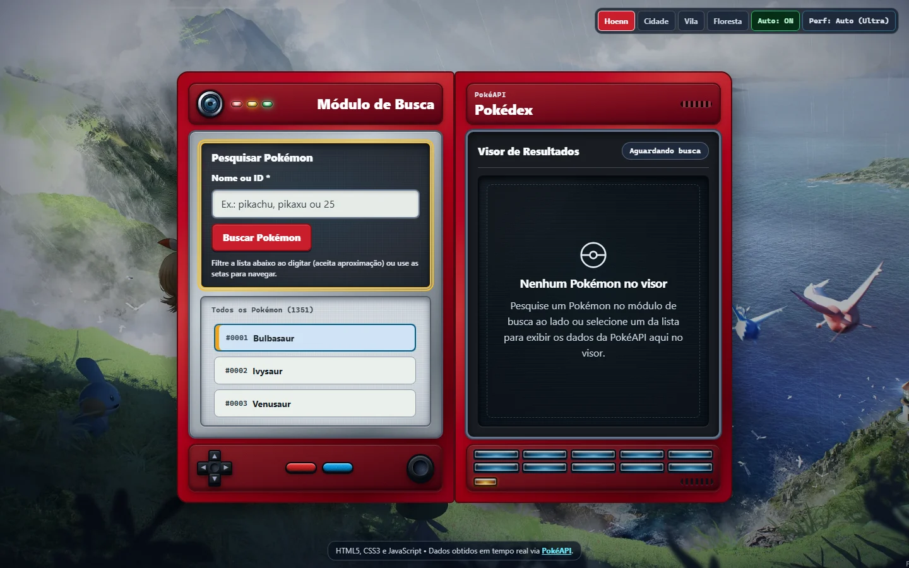
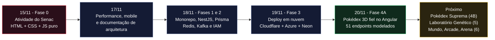
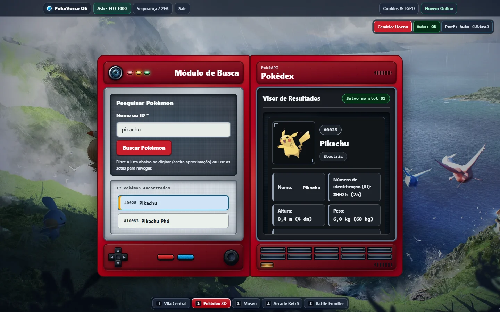

# Capítulo Zero — Como Tudo Começou

<p align="center">
  
</p>

> **Nota de arquivo.** Este documento conta como o projeto começou e guarda, como recordação, o `README.md` exatamente como ele era antes da reescrita (commit `e79bcde`, 20/11/2026). Esse texto descreve o estado da plataforma ao fim da **Fase 4A**, já em monorepo Angular + NestJS. O README atual do repositório, que cobre o estado real e o futuro do projeto, está em [`../README.md`](../README.md).

---

## 1. A origem: uma atividade da faculdade

Este projeto nasceu como a **atividade final da matéria de Front-end no Senac**.

O enunciado era enxuto: construir uma página que consumisse uma API pública com `fetch`, mostrasse o resultado em uma lista HTML e tratasse as situações de erro. Eu escolhi a **PokéAPI** e a **Pokédex** como tema.

A atividade foi **concluída e entregue** dentro do escopo pedido. Foi essa versão que o README abaixo documenta.

### O que a atividade pedia

| Requisito da matéria | Como foi atendido na Fase 0 |
| :--- | :--- |
| HTML semântico com `<h1>` | Título **Pokédex**, `<search>`, `<form>` e áreas bem delimitadas |
| Formulário com campo de texto e botão | `<input type="text">` e `<button type="submit">` dentro de `<search>` |
| Consumo de API pública com `fetch` | PokéAPI v2, com `async/await` e `AbortController` |
| Lista `<ul>` com dados do recurso | Nome, ID, altura, peso e habilidades do Pokémon |
| Estilização com CSS | `background-color`, `padding`, `margin` e `display: flex`, além de bem mais do que o exigido |
| Tratamento de situações | Campo vazio, Pokémon não encontrado (`404`) e falha de rede com botão **Tentar novamente** |

---

## 2. Por que não parei por ali

Eu cumpri o que a matéria pedia. Mesmo assim, durante o desenvolvimento, passei a **gostar muito do tema e da pegada Pokémon**. O aparelho com tampa 3D, os LEDs e os botões físicos tinham virado algo que eu queria aprofundar.

Então tomei uma decisão **por conta própria**: tratar a atividade como ponto de partida e continuar o projeto fora da sala de aula, sem nota e sem prazo, só por interesse.

A Fase 0 continua intacta na raiz do repositório e funciona como **referência visual canônica**:

- [`index.html`](../index.html)
- [`css/style.css`](../css/style.css)
- [`js/app.js`](../js/app.js)
- [`assets/`](../assets/)
- [`capitulo-zero-guia-de-estudos-pokedex.md`](capitulo-zero-guia-de-estudos-pokedex.md), o manual técnico e "colinha" dessa versão feito para a apresentação no Senac (movido para `docs/` e continuado pelo [Capítulo 1](capitulo-um-guia-de-estudos-pokedex.md))

> A regra do repositório é não alterar esses arquivos sem pedido explícito. Eles são a memória do projeto.

---

## 3. Do trabalho final ao produto

O diagrama mostra de onde saí e onde estou, com base no histórico real do Git (35 commits em 7 dias, de 15/11 a 21/11/2026).



### Antes e depois

| Fase 0 — a atividade (HTML, CSS e JS puro) | Hoje — PokéVerse OS (Angular + NestJS) |
| :---: | :---: |
|  |  |

### O que cada ideia da Fase 0 virou

| Ideia da Fase 0 | Onde ela vive hoje |
| :--- | :--- |
| `fetch` direto na PokéAPI | `HttpClient` do Angular, passando por um proxy NestJS com cache Redis e fallback direto |
| Filtro fonético e Damerau-Levenshtein em `app.js` | Portado para [`@pokeverse/shared`](../packages/shared/src/domain/pokedex-search.ts), com testes |
| Mensagens de erro e botão **Tentar novamente** | Estados finitos tipados (`AsyncState`) e fallback degradado para visitantes |
| 10 slots azuis em `localStorage` | Visitante: `localStorage`. Treinador autenticado: PostgreSQL, com 1 Pokémon por botão (`409 Conflict`) |
| Tampa 3D com `preserve-3d` | [`_pokedex-classic.scss`](../apps/web/src/styles/_pokedex-classic.scss), porte fiel com giro reversível em voo |
| 4 cenários em JPG de 2500 a 4096 px | 4 cenários em WebP, nas versões `-desktop` e `-mobile` |
| Nenhum teste e nenhum build | CI com tipos, lint, testes, E2E, build e auditoria visual de contraste |

---

## 4. O que esta fase me ensinou

- **Limites do JavaScript puro.** O [Capítulo Zero do guia de estudos](capitulo-zero-guia-de-estudos-pokedex.md) (a "colinha" da apresentação) documenta como levei HTML, CSS e JS sem frameworks até onde deu: máquina de estados por teclado, busca fuzzy, cinemática 3D e acessibilidade — trilha que agora segue no [Capítulo 1 (Full-Stack)](capitulo-um-guia-de-estudos-pokedex.md).
- **Quando um framework passa a valer a pena.** O projeto cresceu até exigir contas, sessões, cache, mensageria e testes. Aí a migração para um monorepo com contratos compartilhados deixou de ser capricho e virou necessidade.
- **Fidelidade visual é requisito.** Por isso o repositório tem a **Regra Zero de UI** (veja [`AGENTS.md`](../AGENTS.md)): nada do visual original é simplificado sem validação.

---

## 5. O README anterior (preservado sem alterações)

O texto abaixo é a cópia fiel do `README.md` como ele estava antes da reescrita. Ele reflete o estado do projeto naquele momento, então **está desatualizado de propósito**. A única adaptação foi nos destinos dos links relativos, que ganharam o prefixo `../` para continuarem funcionando a partir da pasta `docs/`. Para o estado atual do projeto, leia o [README principal](../README.md).

<!-- INÍCIO DO README ANTERIOR (commit e79bcde) -->

# PokéVerse OS — Pokédex 3D Interativa & Plataforma Full-Stack

> **Plataforma em produção (Cloudflare Pages + Azure Container Apps):** [https://pokeverse.pages.dev/](https://pokeverse.pages.dev/)
> A versão estática original da Fase 0 ([index.html](../index.html), [css/style.css](../css/style.css), [js/app.js](../js/app.js) e [assets/](../assets/)) permanece preservada intacta na raiz como referência visual canônica da Pokédex.

Aplicação web full-stack em monorepo (**Angular 22 Standalone/Zoneless**, **NestJS 11**, **Prisma/PostgreSQL**, **Redis**, **Redpanda/Kafka** e contratos compartilhados **Zod v4** em `@pokeverse/shared`) construída ao redor de uma **Pokédex 3D interativa** que consome a [PokéAPI v2](https://pokeapi.co/) com cache distribuído, autenticação BFF segura e validação automatizada de qualidade visual e contraste.

---

## O que Já Está Implementado

### 1. Pokédex 3D & Experiência Visual (`apps/web`)
- **Chassi 3D skeuomórfico fiel (`_pokedex-classic.scss`):**
  - Carcaça vermelha metálica com iluminação dinâmica por ponteiro (`--luz-x`/`--luz-y`), microtexturas WebP (`metal-floco.webp` e `plastico-grao.webp`), dobradiça lateral articulada, câmera com lente de safira e trio de LEDs reativos ao carregamento.
  - **Abertura e fechamento 3D reversíveis em voo:** clicar para abrir ou fechar reverte a animação `rotateY(-180deg)` / `rotateX(180deg)` suavemente sem esperar o fim do ciclo.
- **Busca inteligente e navegação progressiva em 1 clique:**
  - Catálogo completo da PokéAPI com filtro instantâneo por ID/nome, chave fonética PT/EN e aproximação Damerau-Levenshtein (via `@pokeverse/shared`).
  - **Seleção em 2 passos na lista:** 1º clique destaca o item (`.is-cursor`) e 2º clique (ou botão circular `A` / `Enter`) carrega os detalhes no visor.
  - **Botão vermelho com histórico progressivo:** se um Pokémon específico foi escolhido a partir de uma busca ampla (ex.: `"pikachu"` -> `"pikachu-original-cap"`), o primeiro clique volta 1 passo para a busca `"pikachu"` mantendo o item destacado/centralizado; o clique seguinte volta para `"Todos os Pokémon"` na posição do Pokémon selecionado; mais um clique retorna ao topo da lista (`#0001`).
- **10 Slots Azuis de Gravação Rápida & Edição:**
  - Luz azul (slot livre), verde (slot ocupado) e contorno amarelo no Pokémon atualmente exibido; regra estrita de 1 Pokémon por botão (front-end + `409 Conflict` na API).
  - Clicar em qualquer botão azul ocupado abre diretamente o Pokémon salvo no visor sem pop-ups intermediários.
  - Clicar em um slot vazio grava o Pokémon exibido (em `localStorage` no modo visitante ou persistido em PostgreSQL quando autenticado); substituição por slot, apelidos e exclusões contam com confirmação explícita no editor (`Config`) e sincronização atômica via `DELETE /api/v1/pokedex/slots`.
- **HUD Compacta, Cenários e Rotas da Plataforma:**
  - Barra superior com estado da sessão, verificação de e-mail por OTP (com fechamento automático e redirecionamento pós-confirmação), segurança/2FA e ticker global em tempo real (`/ws/world`).
  - Seletor compacto de cenários de fundo (**Hoenn**, **Cidade**, **Vila**, **Floresta**) em botão único cíclico + alternância **Auto** + detector automático de hardware (`Perf: Auto — Ultra / Equil. / Lite`).
  - Dock inferior compacto em vidro translúcido ligando os 5 módulos: `1 Vila Central` (`/mundo`), `2 Pokédex 3D` (`/pokedex`), `3 Museu` (`/museu`, com cards das gerações sobre cabeçalho frosted de alto contraste), `4 Arcade Retrô` (`/arcade`) e `5 Battle Frontier` (`/arena`). Rotas ainda em desenvolvimento exibem telas dedicadas de status em construção.

### 2. Back-end NestJS, Cache, IAM BFF & Mensageria (`apps/api`)
- **Proxy e Cache PokéAPI (`/api/v1/pokedex/*`):** cache em Redis com `stale-fallback` de 7 dias e fallback automático para a PokéAPI direta no cliente em caso de indisponibilidade local.
- **Autenticação & IAM Enterprise BFF:** sessões opacas armazenadas em Redis com cookies `HttpOnly`, sem exposição de JWT no JavaScript do navegador, máquina de estados `MFA_PENDING -> AUTHENTICATED`, proteção `CsrfOriginGuard`, hash `Argon2id`, 2FA TOTP com QR Code + códigos de backup, Google OAuth PKCE, Passkeys WebAuthn e fluxos OTP de verificação de e-mail / redefinição de senha via Redpanda + SMTP/Resend.
- **Persistência & Eventos (`PostgreSQL` + `Prisma` + `Redpanda`):** 10 modelos no schema Prisma, Transactional Outbox com `SKIP LOCKED`, consumidor idempotente em Redis e Gateway WebSocket `/ws/world`.

### 3. Domínio Futuro Modelado em `@pokeverse/shared`
- Catálogo estruturado dos **51 endpoints da PokéAPI v2** e modelo de filtros avançados ([pokeapi-endpoints.ts](../packages/shared/src/domain/pokeapi-endpoints.ts)).
- Regras puras do **Laboratório Genético e Evolução** — cálculo de atributos por nível, chances de evolução, clonagem, replicação e conversão em Bio-Essência ([pokemon-lab.ts](../packages/shared/src/domain/pokemon-lab.ts)).

---

## Qualidade Automatizada & UI Quality Gate

O repositório bloqueia commits e deploys caso qualquer regressão visual ou técnica ocorra:

- **UI Quality Gate (`npm run audit:ui` via [scripts/ui-quality-gate.mjs](../scripts/ui-quality-gate.mjs)):** executa Chrome/Chromium headless com CDP em Desktop (`1440×900`) e Mobile (`375×812`) sobre o bundle compilado (`/`, `/pokedex?q=pikachu`, `/museu`, `/mundo`), reprovando:
  - Textos sobre cenário sem fundo escuro/translúcido adequado (`effectiveSurfaceAlpha < 0.55`);
  - Contraste WCAG AA insuficiente (`< 4.5:1` texto normal / `< 3.0:1` texto grande), simulado inclusive sobre fundo diurno claro;
  - Overflow horizontal de viewport (`> innerWidth`), clipping lateral ou texto vazando fora de botões/caixas;
  - Tamanho de fonte abaixo do mínimo legível (`< 10.5px`) ou erros de console.
- **CI/CD ([ci.yml](../.github/workflows/ci.yml) & [deploy.yml](../.github/workflows/deploy.yml)):** `build:shared`, `prisma generate`, `typecheck`, `lint:api`, `test` (Vitest + Jest), `test:e2e`, `build`, `audit:ui`, imagem Docker multi-stage não-root para Azure Container Apps e deploy no Cloudflare Pages (`apps/web/functions/` proxy same-origin + CSP estrita com `inlineCritical: false`).

---

## Estrutura do Monorepo

```text
pokedex-frontend/
├── apps/
│   ├── api/                       # NestJS 11 + Prisma 6 + Redis + Redpanda + Socket.IO
│   └── web/                       # Angular 22 Standalone/Zoneless + Proxy Cloudflare Pages
├── packages/
│   └── shared/                    # Schemas Zod v4, busca fuzzy, 51 endpoints e Laboratório Genético
├── infra/
│   └── docker/                    # api.Dockerfile e docker-compose.yml (Postgres, Redis, Redpanda, S3/MinIO)
├── scripts/
│   └── ui-quality-gate.mjs        # Auditoria automatizada de contraste, overflow e tipografia no browser
├── .github/workflows/             # CI e Deploy contínuo (Azure Container Apps + Cloudflare Pages)
├── assets/                        # Cenários WebP (-desktop / -mobile), texturas WebP e favicon
├── css/ & js/ & index.html        # Versão estática original da Fase 0 preservada intacta
├── docs/                          # Documentação arquitetural (00 ao 15)
└── AGENTS.md                      # Regras inegociáveis de fidelidade visual e engenharia do projeto
```

---

## Como Executar Localmente

### Pré-requisitos
- **Node.js 22+** e **npm 11+**
- **Docker** (opcional para rodar PostgreSQL, Redis, Redpanda e Object Storage S3 localmente)

### Passos
1. **Instalar dependências e gerar artefatos base:**
   ```bash
   npm install
   npm run build:shared
   ```
2. **Subir infraestrutura local e migrações (opcional para modo completo com API):**
   ```bash
   cp .env.example .env
   npm run infra:up
   npx --workspace=pokeverse-api prisma generate
   npx --workspace=pokeverse-api prisma migrate deploy
   ```
3. **Iniciar desenvolvimento:**
   ```bash
   npm run dev:api
   npm run dev:web
   ```
   A interface Angular inicia em `http://localhost:4200` com proxy automático para `/api`, `/health` e `/socket.io` (ou funciona em modo degradado/visitante direto contra a PokéAPI se a API não estiver ativa).
4. **Rodar verificações completas e auditoria visual:**
   ```bash
   npm run typecheck
   npm run lint:api
   npm run test
   npm run build
   npm run audit:ui
   ```

> Para executar apenas a **versão estática clássica (Fase 0)** sem build nem dependências, abra [index.html](../index.html) via Live Server ou servidor HTTP estático.

---

## Documentação Arquitetural (`docs/`)

- [00 — Visão Geral, Regras de Acesso e Roadmap](../docs/00-visao-geral-e-roadmap.md)
- [01 — Arquitetura do Monorepo e Padrões de Engenharia](../docs/01-arquitetura-monorepo-e-padroes.md)
- [02 — Front-end Angular, HUD de Jogo e Gerenciamento de Estado](../docs/02-frontend-angular-hud-e-estado.md)
- [03 — Motores Gráficos: Phaser 3 e Three.js (WebGL2/GLSL)](../docs/03-motores-graficos-phaser-e-threejs.md)
- [04 — Back-end NestJS, Autenticação e Segurança](../docs/04-backend-nestjs-auth-e-seguranca.md)
- [05 — Banco de Dados PostgreSQL e Prisma ORM](../docs/05-banco-de-dados-postgresql-e-prisma.md)
- [06 — Cache com Redis e Mensageria com Apache Kafka / Redpanda](../docs/06-cache-redis-e-eventos-kafka.md)
- [07 — Arcade Retrô 3D (WebAssembly) e Cloud Save States](../docs/07-arcade-retro-wasm-e-cloud-saves.md)
- [08 — Museu das Regiões, Lore e Pokédex Holocron 3D](../docs/08-museu-lore-e-holocron-pokedex.md)
- [09 — Arena de Batalha (PvE/PvP), Team Builder e Mini-Games](../docs/09-arena-batalha-teambuilder-e-minigames.md)
- [10 — Infraestrutura Docker, Observabilidade e CI/CD](../docs/10-infraestrutura-docker-ci-cd-e-deploy.md)
- [11 — Desempenho Ponta a Ponta, Detecção de Hardware, Mobile e Release Gates](../docs/11-performance-hardware-gates-e-mobile.md)
- [12 — Pokédex 2.0: Catálogo Completo da PokéAPI v2 e Controles sem Novos Botões](../docs/12-pokedex-2-0-pokeapi-e-controles.md)
- [13 — Dossiê Completo de Segurança e Blindagem (AppSec, Auth & Infra)](../docs/13-dossie-de-seguranca-e-blindagem.md)
- [14 — Status Real da Implementação, Mudanças vs. Plano Original e Backlog](../docs/14-status-e-changelog-implementacao.md)
- [15 — Pokédex Suprema: Auditoria, 51 Endpoints e Laboratório Genético](../docs/15-pokedex-suprema-51-endpoints-e-laboratorio-genetico.md)

<!-- FIM DO README ANTERIOR -->

---

<p align="center">
  <a href="../README.md">Ir para o README atual</a>
  &nbsp;·&nbsp;
  <a href="capitulo-zero-guia-de-estudos-pokedex.md">Capítulo Zero: guia de estudos</a>
  &nbsp;·&nbsp;
  <a href="capitulo-um-guia-de-estudos-pokedex.md">Capítulo 1: guia de estudos (Full-Stack)</a>
  &nbsp;·&nbsp;
  <a href="00-visao-geral-e-roadmap.md">Visão geral e roadmap</a>
  &nbsp;·&nbsp;
  <a href="14-status-e-changelog-implementacao.md">Status e changelog</a>
</p>
