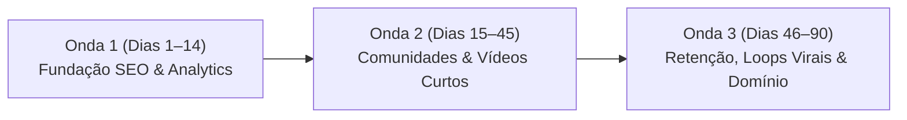

# Núcleo de Growth, SEO, Divulgação e Métricas — PokéVerse OS

> **Objetivo deste diretório:** transformar o **PokéVerse OS** (`https://pokeverse.pages.dev/`) de um produto tecnicamente pronto em uma plataforma descoberta organicamente no Google, compartilhada em comunidades Pokémon e dev, e medida com métricas reais respeitando a LGPD e o CSP estrito do projeto.

---

## 1. Índice dos Guias

| Documento | Foco | O que você encontra |
| :--- | :--- | :--- |
| **[01 — SEO Técnico e Presença no Google](01-seo-tecnico-e-google.md)** | Descoberta orgânica | Diagnóstico de `index.html` e `apps/web/public/`, domínio próprio, `robots.txt`, `sitemap.xml`, Open Graph/JSON-LD, indexação de SPA Angular no Cloudflare Pages, Google Search Console e palavras-chave alvo. |
| **[02 — Divulgação, Comunidades e Aquisição](02-divulgacao-comunidades-e-aquisicao.md)** | Distribuição e tráfego | Posicionamento e ganchos visuais, roteiros de vídeos curtos (TikTok/Reels/Shorts), estratégia em comunidades Pokémon e Tech (TabNews, Product Hunt, Hacker News, Reddit, LinkedIn) e loops virais dentro do app. |
| **[03 — Métricas de Produto e Analytics](03-metricas-de-produto-e-analytics.md)** | Retenção e funil | Funil AARRR, KPIs semanais, stack *privacy-first* compatível com `PrivacyConsentStore` e `_headers` (Cloudflare Web Analytics + telemetria *first-party* NestJS) e rotina semanal de 15 minutos. |

> **Relação com a engenharia:** os itens técnicos derivados destes guias estão priorizados em [`00 — Fila Prioritária`](../00-fila-prioritaria-melhorias.md) (`MEL-07`, `MEL-08` e `MEL-09`), e o acompanhamento operacional em produção está documentado em [`22 — Observabilidade em Produção, Guia de Uso e Painel Admin`](../22-observabilidade-em-producao-uso-e-painel-admin.md).

---

## 2. Roadmap de Aquisição em 3 Ondas (90 Dias)

### Onda 1 — Dias 1 a 14: Fundação Mensurável e Indexável (`MEL-07` + `MEL-08`)

1. Ativar **Cloudflare Web Analytics** (sem cookies) no projeto `pokeverse` para começar a enxergar visitantes e origens de tráfego imediatamente.
2. Configurar **Google Search Console** e **Bing Webmaster Tools** após adicionar `robots.txt`, `sitemap.xml`, meta tags e Open Graph em `apps/web`.
3. Garantir que o fluxo de **Cadastro + Verificação de E-mail + Login Google OAuth** funcione sem atrito em desktop e mobile.
4. Ativar `SENTRY_DSN` e monitor de disponibilidade (`/health/ready`) para saber antes do usuário se algo cair.

### Onda 2 — Dias 15 a 45: Lançamento em Comunidades e Conteúdo Curto

1. Publicar demonstrações visuais curtas (15–30s) mostrando a **Pokédex 3D abrindo**, o **Holocron 3D `.glb`**, a **Calculadora VGC/Showdown** e o **Comparador 1v1**.
2. Fazer lançamentos estruturados em comunidades de tecnologia (**TabNews**, **LinkedIn**, **Dev.to**, **Show HN**, **Product Hunt**, **Reddit**) contando a história do projeto (Senac até monorepo full-stack) para conquistar backlinks de autoridade e primeiros usuários recorrentes.
3. Engajar de forma genuína em comunidades Pokémon BR/Global (Discords de VGC/Smogon, subreddits respeitando regras de autopromoção) com utilidade direta (link de simulação de dano ou matchup).

### Onda 3 — Dias 46 a 90: Retenção, Loops Virais e Domínio Próprio

1. Conectar **domínio próprio** no Cloudflare DNS/Pages (`pokedex.<domínio>`) para consolidar autoridade de SEO e confiança de marca (atualizando `CORS_ORIGINS`, `WEBAUTHN_*`, `GOOGLE_REDIRECT_URI` e remetente no Resend).
2. Adicionar **URLs compartilháveis** e botões rápidos de cópia de link no **Holocron 3D**, **Comparador 1v1** e **Calculadora** com preview rico (`og:title`, `og:image`).
3. Evoluir o **Hub Inicial (`/inicio`)** (`MEL-02`) com ganchos de retorno diário (ex.: Pokémon em destaque, atalho para seus slots salvos e novidades da Enciclopédia) e revisar métricas no `/admin` (`MEL-09`).
